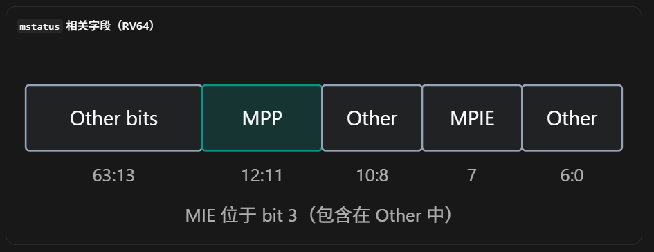
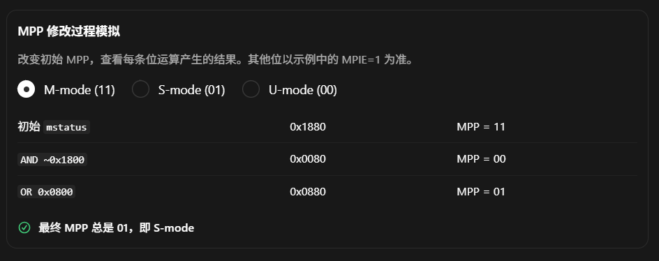
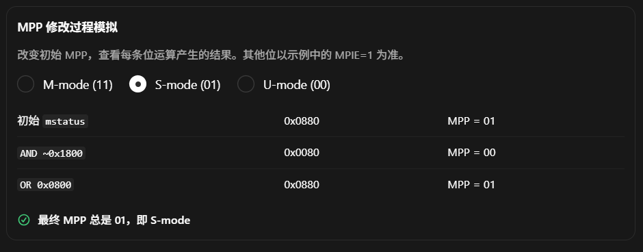
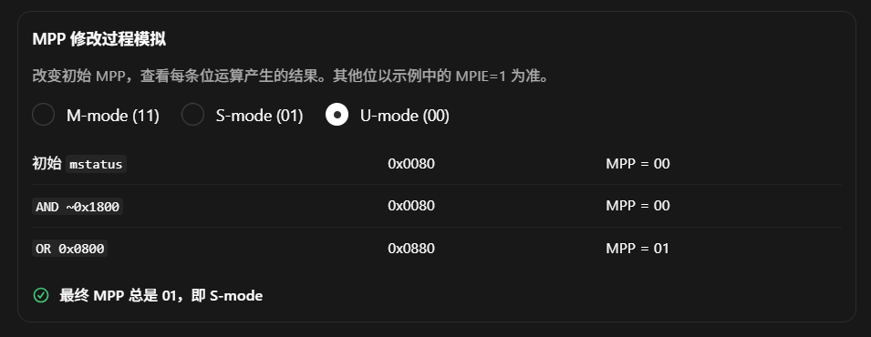

这段汇编代码非常重要，它展示了 RISC-V OpenSBI 中最核心的特权级切换机制之一：

CPU 当前运行在 M-mode，通过设置 `mepc` 和 `mstatus.MPP`，最后执行 `mret`，让 CPU 从 M-mode 进入 S-mode，开始执行 OP-TEE。

理解这段代码的关键，不是记住每条汇编指令，而是理解：

1. `mepc` 决定 跳转到哪里执行。
2. `mstatus.MPP` 决定 以什么特权级执行。
3. `mret` 真正执行 特权级切换和控制流跳转。

下面从寄存器、汇编指令、位运算和硬件行为四个层次展开。

## 一、先看完整代码

```bash

# 1. 设置目标入口地址
li    t0, OPTEE_ENTRY_PA
csrw  mepc, t0

# 2. 读取 mstatus 寄存器
csrr  t1, mstatus

# 3. 清除 mstatus.MPP 字段
li    t2, MSTATUS_MPP_MASK
not   t2, t2
and   t1, t1, t2

# 4. 将 MPP 设置为 S-mode
li    t2, MSTATUS_MPP_S
or    t1, t1, t2

# 5. 将修改后的值写回 mstatus
csrw  mstatus, t1

# 6. 从 M-mode 切换到 S-mode
mret

```

这段代码假设 CPU 当前位于 M-mode，而且已经具备进入 OP-TEE S-mode 的基本条件。

## 二、首先理解两个关键 CSR

### 2.1 `mepc`：Machine Exception Program Counter

`mepc` 是 M-mode 的一个 CSR。

它主要用于保存 M-mode Trap 返回时的目标地址。

例如：

```bash
mepc = 0x80200000
```

当 M-mode 执行：

```
mret
```

硬件就会：

```bash
PC ← mepc
```

即：

```bash
PC = 0x80200000
```

CPU 从这个地址继续取指执行。

这里有一个非常重要的细节：

虽然 `mepc` 名称中有 Exception，但 `mret` 并不要求软件真的刚刚发生过 Exception。

OpenSBI 可以主动设置 `mepc`，然后利用 `mret` 实现首次从 M-mode 进入 S-mode。

### 2.2 `mstatus`：Machine Status Register

`mstatus` 是控制当前 hart 特权状态及相关行为的重要 `CSR`。

本次重点关注三个字段。



`mstatus` 相关字段（RV64）

| 字段     | Bit       | 用途                    |
| ------ | --------- | --------------------- |
| `MPP`  | `[12:11]` | `mret` 返回时的目标特权级      |
| `MPIE` | `7`       | 保存此前的 M-mode 全局中断使能状态 |
| `MIE`  | `3`       | M-mode 全局中断使能         |

其中最重要的是 `MPP`（Machine Previous Privilege）。
> 那么`MPIE`就可以理解为`Machine Previous Interrupt Enable`

其编码如下：

| MPP  | 目标特权级  |
| ---- | ------ |
| `00` | U-mode |
| `01` | S-mode |
| `11` | M-mode |

`10` 不是普通 M/S/U 特权模式的有效 MPP 编码。

因此，我们只要把：

```bash
mstatus.MPP = 01
```

然后执行：

```
mret
```

CPU 就会按照相应的特权级返回规则进入 S-mode。

## 三、逐行解释汇编

### 第 1 行：设置 OP-TEE 入口地址

```bash
li t0, OPTEE_ENTRY_PA
```

`li` 是 Load Immediate 伪指令。

其含义是：

```bash
t0 = OPTEE_ENTRY_PA
```

假设：

```bash
OPTEE_ENTRY_PA = 0x80200000
```

执行完成：

```bash
t0 = 0x80200000
```

`t0` 是通用寄存器 `x5`，并非特殊的地址寄存器。

值得注意的是，`li` 是伪指令，汇编器可能根据立即数大小将其展开为一条或多条真实机器指令。

例如：

```bash
li t0, 0x800
```

可能使用：

```bash
lui t0, 0x1
addiw t0, t0, -2048
```

具体展开取决于目标值、架构位宽及工具链。

### 第 2 行：写入 `mepc`

```bash
csrw mepc, t0
```

`csrw` 是 CSR Write 伪指令。

其效果是：

```bash
mepc = t0
```

因此：

```bash
mepc = 0x80200000
```

这告诉 CPU：

下一次执行 `mret` 时，应当从 `0x80200000` 开始执行。

不过此时 CPU 仍然运行在 M-mode。

因为写入 `mepc` 本身不会改变当前 PC 或当前 Privilege。

你可以把它理解为提前配置下一次切换的目标。

从真实 ISA 看，它可以展开为：

```
csrrw x0, mepc, t0
```

由于 `rd=x0`，不会保留 CSR 的旧值。

### 第 3 行：读取 `mstatus`

```
csrr t1, mstatus
```

`csrr` 是 CSR Read 伪指令。

含义为：

```
t1 = mstatus
```

假设原来的 `mstatus` 中：

```
MPP = 11
```

也就是目标返回模式被设置为 M-mode。

我们的任务就是把它修改成：

```
MPP = 01
```

这里没有直接覆盖整个 `mstatus`，而是先读取当前值。

原因是 `mstatus` 包含许多其他控制字段。

如果直接写：

```
li   t1, 0x800
csrw mstatus, t1
```

就可能意外修改其他字段。

因此，正确的通用方法是：

Read → Modify → Write（RMW）。

### 第 4 行：加载 MPP Mask

```
li t2, MSTATUS_MPP_MASK
```

`MPP` 位于：

```
mstatus[12:11]
```

因此对应的掩码是：

```
MPP_MASK = 0b11 << 11
         = 0x1800
```

执行后：

```
t2 = 0x1800
```

其二进制局部表示：

```
Bit:  15 14 13 12 11 10 9 8
      -----------------------
Mask:  0  0  0  1  1  0 0 0
                  ^  ^
                 MPP
```

注意，Mask 中为 1 的位表示我们希望操作的字段位置。

但是，接下来的目的并不是把这两个位设置为 1，而是将这两个位清零。

### 第 5 行：按位取反

```
not t2, t2
```

`not` 表示 Bitwise NOT。

在 RV64 中：

```
t2 = ~t2
```

假设：

```
t2 = 0x0000000000001800
```

执行后：

```
t2 = 0xFFFFFFFFFFFFE7FF
```

为什么需要取反？

因为我们要使用：

```
and t1, t1, t2
```

清除 MPP 所在的两个 bit，同时保留其他 bit。

下面的3张图依次展示了MPP字段在 m-mode -> s-mode -> u-mode 3个mode之间转换时的字段值的变化: 





### 第 6 行：清除 MPP 字段

```
and t1, t1, t2
```

这是真正执行 MPP Clear 的指令。

其逻辑是：

```
t1 = t1 & ~MPP_MASK
```

假设初始：

```
mstatus.MPP = 11
```

那么执行：

```
11 & 00 = 00
```

结果就是：

```
t1.MPP = 00
```

这里应注意：

我们还没有把 MPP 设置成 S-mode，只是先把它清成 00。

并且这一变化目前只存在于通用寄存器 `t1` 中。

真正的 `mstatus` CSR 还没有被修改。

### 第 7 行：加载 S-mode 编码

```
li t2, MSTATUS_MPP_S
```

前面已经知道：

```
MPP = 01 → S-mode
```

字段位于 `[12:11]`，所以：

```
MPP_S = 01 << 11
      = 0x800
```

执行后：

```
t2 = 0x800
```

这里容易出现一个理解错误：

为什么 `MPP_S` 是 `0x800`，而不是 `1`？

因为 `1` 只是字段本身的编码值。

真正写入整个 `mstatus` 寄存器时，必须把字段值左移到对应位置。

即：

```
#define MSTATUS_MPP_S (1UL << 11)
```

### 第 8 行：设置 MPP 为 S-mode

```
or t1, t1, t2
```

操作：

```
t1 = t1 | 0x800
```

由于我们已经在前面清除了 MPP 两个位：

```
原 MPP = 00
```

现在：

```
00 | 01 = 01
```

因此：

```
t1.MPP = 01
```

这就完成了期望的字段修改。

可以把这一整段代码翻译成 C：

```
uint_xlen_t value = read_csr(mstatus);

value &= ~MSTATUS_MPP_MASK;
value |= MSTATUS_MPP_S;

write_csr(mstatus, value);
```

本质上就是修改一个 CSR 的 Bit Field。

### 第 9 行：写回 `mstatus`

```
csrw mstatus, t1
```

现在才真正更新 `mstatus`。

执行完成后：

```
mstatus.MPP = 01
```

但 CPU 此刻仍然处于 M-mode。

这个区别非常关键：

设置 MPP 并不会立即改变 CPU 的 Privilege Mode。

MPP 只是配置下一次 `mret` 的目标 Privilege。

### 第 10 行：执行 `mret`

```
mret
```

这是整段代码中真正完成特权级切换的指令。

根据 RISC-V Privileged Architecture，`mret` 会根据 `mstatus.MPP`（在支持 Hypervisor Extension 的情况下还涉及 `MPV`）确定目标模式，并进行规定的状态恢复。


对于这里不使用虚拟化模式的情形，其主要行为为：

```
New Privilege Mode = mstatus.MPP
PC                 = mepc

mstatus.MIE        = mstatus.MPIE
mstatus.MPIE       = 1
mstatus.MPP        = 00
```

由于之前设置：

```
MPP = 01
mepc = 0x80200000
```

最终：

```
Privilege = S-mode
PC        = 0x80200000
```

于是 CPU 开始在 S-mode 下执行 OP-TEE 的入口代码。

这里还有一个容易忽略的硬件细节：`mret` 在返回低于 M-mode 的特权级时，也会清除 `mstatus.MPRV`，避免 M-mode 临时内存访问权限设置泄露到后续执行环境。

## 四、把整个过程用寄存器变化串起来

假设初始状态为：

```
CPU Privilege = M-mode

OPTEE_ENTRY_PA = 0x80200000

mstatus.MPP = 11
mstatus.MPIE = 1
```

M-mode → S-mode 执行状态变化

| 阶段                 | Privilege | `mepc`     | `MPP` |
| ------------------ | --------- | ---------- | ----- |
| 初始状态               | M         | 未设置        | 11    |
| \`csrw mepc\` 后    | M         | 0x80200000 | 11    |
| \`csrw mstatus\` 后 | M         | 0x80200000 | 01    |
| \`mret\` 后         | S         | 0x80200000 | 00    |

`mret` 将 MPP 重置为最低受支持的特权级（典型 M/S/U 系统为 U-mode），不影响已经完成的 S-mode 进入操作。

注意到 `mret` 后的一个有趣现象：

```
当前 Privilege = S
mstatus.MPP = 00
```

为什么？

因为 `MPP` 不是当前执行模式寄存器，而是记录/配置 M-mode Trap Return 目标的字段。

执行完成之后，硬件会按照规范重置 MPP，降低后续错误使用状态字段造成意外特权提升的风险。

## 五、深入两个经常被忽略的问题

### 5.1 为什么 `mret` 可以完成 M → S 切换，而不使用 `sret`？

因为 `mret` 和 `sret` 分别对应不同特权层级的 Trap Return。

| 指令     | 执行环境              | 主要依据          | 返回 PC  |
| ------ | ----------------- | ------------- | ------ |
| `mret` | M-mode            | `mstatus.MPP` | `mepc` |
| `sret` | S-mode（或受支持的更高模式） | `sstatus.SPP` | `sepc` |

`mret` 并不总是返回 S-mode。

它可能返回 M、S 或 U，取决于已经配置的 MPP，以及平台支持的特权模式。

另外，如果 SoC 实现了 Hypervisor Extension，在准备进入普通 S-mode（HS-mode，V=0）时，还必须正确处理 `mstatus.MPV`。仅设置 `MPP=S` 不能在所有 H Extension 场景下保证进入的是非虚拟化的 S-mode。

[image](https://www.google.com/s2/favicons?domain=https://docs.riscv.org\&sz=32)

RISC-V 文档


### 5.2 为什么这段代码还不足以完成真实的 OP-TEE 启动？

这是从学习架构指令上升到真正做 OP-TEE Porting 时，必须认识到的问题。

这段汇编只完成了：

```
设置目标 PC
+
设置目标 Privilege
+
执行 MRET
```

它并没有自动完成以下工作：

- PMP/SoC Firewall：是否允许 OP-TEE 访问对应的物理内存？
- `satp`：进入 S-mode 后，是 Bare Mode 还是 Sv39/Sv48？如果使用分页，`mepc` 必须是目标地址空间中的有效可执行地址。
- `a0/a1`：有没有按照 Boot Protocol 传递 Hart ID 和 DTB？
- Delegation：`medeleg`、`mideleg` 是否正确配置？
- Trap：`mtvec`、`stvec` 和异常处理入口是否满足启动条件？
- Interrupt：是否正确设置中断使能和路由？
- Domain Isolation：Linux 与 OP-TEE 的安全边界是否已经由可信固件和硬件建立？

尤其需要注意，代码中的名字 `OPTEE_ENTRY_PA` 暗示物理入口地址。

但 `mret` 本身不负责决定新 PC 是否需要地址转换。若目标 S-mode 的 `satp` 已启用分页，`mepc` 给出的地址将按目标执行环境的地址转换规则解释。因此，使用物理入口数值通常需要确保 Bare Mode 或适当的 Identity Mapping。

这也是 OpenSBI 真实的下一特权级切换实现比这个教学示例更复杂的原因。

## 六、如何在 QEMU/GDB 中实际观察？

你可以在 OpenSBI 执行 `mret` 前设置断点，查看：

```
info registers mepc
info registers mstatus
info registers pc
```

在 `mret` 前：

```
Privilege = M
mepc.MPP target = S
mepc = OP-TEE entry
```

然后使用：

```
x/i $pc
stepi
```

执行 `mret`。

随后观察：

```
info registers pc
info registers mstatus
```

正确的预期是：

```
PC = OP-TEE entry
Current privilege = S-mode
MPP = 00
```

注意，GDB 是否直接显示当前 Privilege，取决于 QEMU/GDB Stub 的支持。可以借助 QEMU 调试日志或 Monitor 进一步确认，不能仅用 MPP 判断当前模式。

## 七、最终总结

你可以把整段汇编压缩成三个关键操作：

```

/* Conceptual pseudocode, not real CSR-access C */

mepc = OPTEE_ENTRY_PA;

mstatus.MPP = PRV_S;

mret();  /* PC = mepc, enter S-mode */

```

剩余的 `li`、`not`、`and`、`or` 都是在实现 CSR Bit Field 的读改写。

最值得牢牢记住的是：

`mepc` 指定目标地址，`mstatus.MPP` 指定目标特权级，`mret` 才是真正执行跳转和特权级转换的指令。

下一步值得继续深入的是 `mret` 与 OpenSBI `sbi_hart_switch_mode()` 的真实实现关系：它会把刚才这十几行教学汇编，连接到 OpenSBI 实际使用的 `mstatus`、`mepc`、`satp`、Hart Context 与 OP-TEE Domain Boot 流程。
