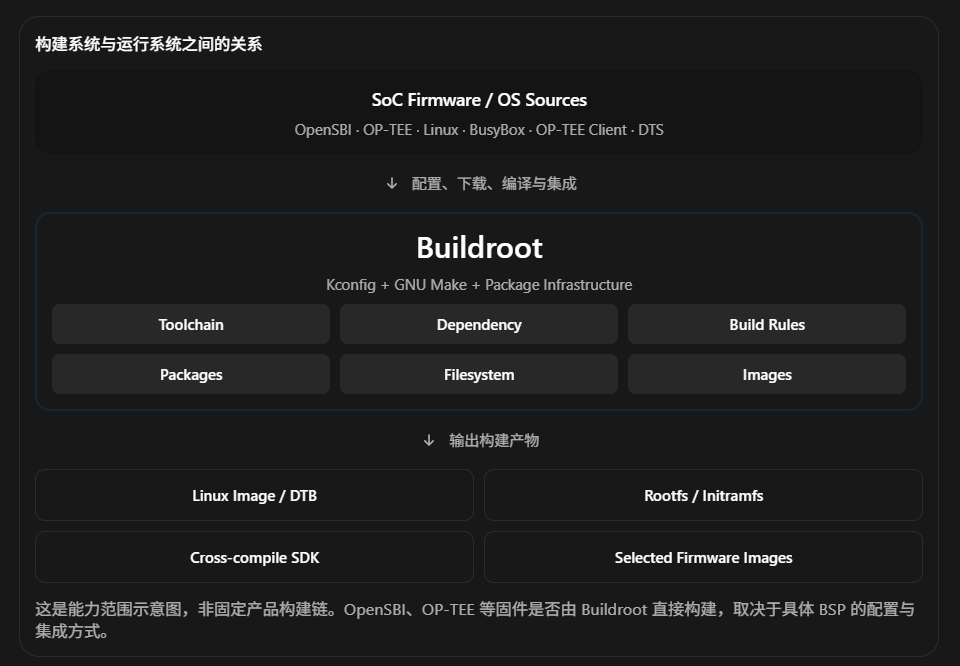

# Buildroot 系统教程：从架构原理到 RISC-V + OP-TEE 工程实践

面向 Embedded Linux / Firmware / TEE 工程师 · 理论、源码、工具链、FDT、增量编译、多仓库管理

这份教程会以真实 SoC 软件开发为背景，而不是简单介绍 `make menuconfig` 和 `make` 的使用方法。我们的目标是：让你能够理解 Buildroot 整个构建系统的工作机制，并逐步具备独立维护大型 RISC-V BSP 构建环境的能力。

先给出一个核心结论：

Buildroot 本质上是一个基于 GNU Make、Kconfig 和 Package Infrastructure 的嵌入式 Linux 系统构建框架。它不是操作系统，也不是单纯的 rootfs 生成工具，而是负责将工具链、内核、用户态组件、固件及文件系统按照统一配置和依赖关系构建成最终交付物的系统集成工具。

针对你的使用场景，我建议把学习重点分成四个层次：

- 架构理解： Buildroot 在整个 SoC 软件栈中处于什么位置，负责哪些内容，不负责哪些内容。
- 构建机制： Kconfig、Makefile、Package、依赖关系、Stamp、Sysroot 如何协同工作。
- 日常开发： Rootfs 定制、FDT/DTB 管理、快速重编译、调试、加速、源码联调。
- 大型项目： `br2-external`、多 Board、多 SoC、多配置、多 Git 仓库、CI 和版本一致性。

# Part I：建立 Buildroot 的完整架构认知

## 1. Why：为什么需要 Buildroot？

假设你现在有一颗 RISC-V 服务器 SoC，需要运行：

- OpenSBI
- OP-TEE OS
- Linux Kernel
- OP-TEE Client / `tee-supplicant`
- BusyBox、Shell、基础 Linux 工具
- SoC 专用的 Device Tree
- xtest 和一些平台验证程序

如果完全不使用 Buildroot，你需要分别完成：

1. 准备匹配 RISC-V ISA、ABI、libc 的交叉编译工具链。
2. 编译 Linux Kernel。
3. 编译 BusyBox、libc 和其他用户空间程序。
4. 管理所有应用的依赖库及其版本。
5. 将软件安装到目标 rootfs 目录。
6. 配置 `/etc`、`/dev`、init 和系统启动脚本。
7. 生成 ext4、cpio 或其他格式的 rootfs。
8. 集成 DTB、Kernel Image、Bootloader。
9. 确保整个系统能够重复构建。

其中，困难的地方并不只是编译某一个组件。

真正困难的是协调几十甚至几百个组件之间的编译依赖、配置与版本关系。

例如：

```
xtest
  |
  +-- libteec
  |     |
  |     +-- libc
  |
  +-- pthread
        |
        +-- libc

tee-supplicant
  |
  +-- libteec
  +-- libpthread / libc
  +-- Optional libraries
```

如果每个组件都通过手写 Shell 脚本来编译，随着项目规模扩大，很快就会遇到工具链不统一、依赖缺失、版本漂移，以及编译顺序难以维护等问题。

Buildroot 的价值，就是把这些工作纳入一套统一的构建机制中。

## 2. What：Buildroot 在整个 RISC-V SoC 当中的位置



这里有一个非常重要的设计理念：

Buildroot 是 Build-time 工具，而不是 Runtime 管理组件。

也就是说，Buildroot 本身不会运行在你的 RISC-V SoC 上。

它运行在开发机或者构建服务器上，生成最终运行于 SoC 的软件。

对于运行时系统，可以采用这样的模型：

```
RISC-V SoC Runtime
===================================
           Linux User Space
     xtest / tee-supplicant / BusyBox
-----------------------------------
           Linux Kernel
          /dev/tee*  Driver
-----------------------------------
     OpenSBI / OP-TEE Firmware
       (具体架构相关)
-----------------------------------
              Hardware
===================================
```

这里的 OpenSBI 与 OP-TEE 关系不能简单理解为永远上下层串联，它们的执行权限、安全域与切换机制取决于 SoC 的 TEE 架构。

Buildroot 并不负责定义这些安全域的执行语义，而是负责其所管理组件的构建与集成。

## 3. Buildroot、Yocto、CMake 和 Make 的本质区别

| 工具              | 主要职责                      | 层次       |
| --------------- | ------------------------- | -------- |
| GNU Make        | 根据规则和依赖执行构建任务             | 构建执行     |
| CMake           | 为单个软件项目生成构建配置             | 项目构建     |
| Buildroot       | 集成工具链、软件包、Kernel、Rootfs 等 | 系统构建     |
| Yocto / BitBake | 基于 Recipe 和 Layer 的发行版构建  | 系统与发行版工程 |

Buildroot 和 Yocto 的定位存在重叠，但工程侧重点不同。

Buildroot 追求相对简单、直接的嵌入式系统构建流程；Yocto 更强调发行版级别的元数据管理、包构建、可复用 Layer 以及复杂产品变体管理。

对于一个重点在 Firmware、Linux、TEE bring-up 和芯片验证的团队，Buildroot 往往具有很高的实用价值。

## 4. How：Buildroot 一次完整构建到底做了什么？

假设执行：

```
make my_riscv_defconfig
make
```

它背后的主要逻辑可以概括成：

1. 读取配置

   通过 Kconfig 生成 `.config`，确定架构、工具链、组件、Linux 配置与 rootfs 格式。
2. 解析依赖

   Makefile 加载 Package 规则，建立依赖关系图，确定各个构建目标的前置条件。
3. 获取源码

   下载或导入 Linux、BusyBox、库和各类软件包的源码与补丁。
4. 准备交叉编译工具链

   构建内部 Toolchain，或者验证并导入已有的 External Toolchain。
5. 编译并安装组件

   依赖就绪后，对每个包执行 Extract → Patch → Configure → Build → Install。
6. 构建 Kernel / Bootloader

   根据配置构建 Linux Image、DTB，以及启用的 Bootloader 等组件。
7. 生成最终镜像

   整合 Rootfs、执行定制脚本、处理权限，再生成 cpio、ext4、tar 等输出。

这是一条具有依赖关系的构建流程，而不是所有源码都按固定线性顺序依次编译。具体顺序由 Makefile 和包依赖共同决定。

官方 Buildroot 2026.08 手册对总体工作流程也采用了这一模型。

[image](https://www.google.com/s2/favicons?domain=https://buildroot.org\&sz=32)

Buildroot


# Part II：Buildroot 内部工作机制

## 5. Buildroot 的源码目录：每个目录负责什么？

先认识 Buildroot 的源码结构。

```
buildroot/
├── Makefile            # 顶层构建入口
├── Config.in           # 顶层 Kconfig
├── arch/               # CPU 架构与 ABI 选项
├── toolchain/          # Toolchain 构建与集成
├── package/            # 用户态软件包
│   ├── busybox/
│   ├── optee-client/
│   └── optee-test/
├── linux/              # Linux Kernel 构建规则
├── boot/               # Bootloader / Firmware
│   ├── opensbi/
│   └── optee-os/
├── fs/                 # rootfs 镜像生成
├── system/             # init、用户、rootfs skeleton
├── board/              # Board 相关文件
├── configs/            # 预定义 defconfig
├── support/            # 构建基础设施
└── output/             # 默认编译输出目录
```

需要注意 `boot/` 与 `package/` 的区别。

例如，在当前 Buildroot 中，OP-TEE OS 具有固件构建支持，而 OP-TEE Client / Test 主要是用户空间组件。Buildroot 已经包含相关 Package，不必全部从零实现。

[image](https://www.google.com/s2/favicons?domain=https://github.com\&sz=32)

GitHub+1


### 5.1 最重要的五个输出目录

假设编译完成后：

```
output/
├── .config
├── build/
│   ├── busybox-1.xx/
│   ├── linux-6.x/
│   └── optee-client-4.x/
├── host/
│   ├── bin/
│   └── <tuple>/sysroot/
├── staging -> host/.../sysroot
├── target/
│   ├── bin/
│   ├── etc/
│   ├── lib/
│   └── usr/
└── images/
    ├── Image
    ├── *.dtb
    └── rootfs.cpio
```

其中各目录的含义：

| 目录         | 作用                        | 工程中怎么用             |
| ---------- | ------------------------- | ------------------ |
| `build/`   | 各 Package 的编译工作目录         | 查代码、编译命令、错误日志      |
| `host/`    | 主机工具、交叉编译器、Target Sysroot | 工具链、GDB、编译用户程序     |
| `staging/` | 目标软件开发所用头文件与库             | 为其他 Package 提供构建依赖 |
| `target/`  | 最终 rootfs 的内容树            | 检查实际安装的文件          |
| `images/`  | 最终打包后的镜像                  | 提供给 QEMU、仿真平台、烧录流程 |

最容易混淆的是：

`staging/` 不等于 `target/`。

例如你编译了 libteec：

```
staging/usr/include/tee_client_api.h
staging/usr/lib/libteec.so

target/usr/lib/libteec.so
```

前者是编译程序时需要的开发文件；后者是 Linux 运行时需要的库。

而且 `target/` 本身并不等于已经完成权限、设备节点等最终处理的 rootfs 镜像。

在真实项目中，如果怀疑 `tee-supplicant` 缺失，建议首先检查：

```
find output/target -name 'tee-supplicant'
find output/target -name 'libteec.so*'
find output/images -maxdepth 1 -type f
```

如果 `target/` 中有文件但运行时找不到，就需要进一步调查镜像是否重新生成、运行的是否是同一份镜像。

## 6. Kconfig 与 Makefile：Buildroot 的双控制系统

你熟悉 Linux Kernel 的 Kconfig，因此可以直接从这里理解 Buildroot。

Buildroot 同样采用：

```
Kconfig → .config → Makefile
```

但两者的职责不同。

### 6.1 Kconfig 解决“构建什么”

例如：

```
config BR2_PACKAGE_HELLO_TEE
    bool "hello-tee"
    help
      Example application using OP-TEE Client API.
```

选中之后，`.config` 中出现：

```
BR2_PACKAGE_HELLO_TEE=y
```

这只表示需要构建这个 Package。

它并没有描述源码如何下载、使用哪个编译器、安装到哪里。

### 6.2 `.mk` 解决“怎么构建”

对应文件：

```
HELLO_TEE_VERSION = 1.0
HELLO_TEE_SITE = /path/to/hello-tee
HELLO_TEE_SITE_METHOD = local

HELLO_TEE_DEPENDENCIES = optee-client

define HELLO_TEE_BUILD_CMDS
	$(TARGET_MAKE_ENV) $(MAKE) -C $(@D) \
		CC="$(TARGET_CC)" \
		CFLAGS="$(TARGET_CFLAGS)"
endef

define HELLO_TEE_INSTALL_TARGET_CMDS
	$(INSTALL) -D -m 0755 $(@D)/hello-tee \
		$(TARGET_DIR)/usr/bin/hello-tee
endef

$(eval $(generic-package))
```

这是一个简化的自定义 Buildroot Package 配方。它要求 `hello-tee` 工程自身已有可调用的 Makefile；如果源码需要 `libteec` 头文件和链接库，还要在应用 Makefile 中设置正确的 include 与 link flags。

理解几个关键变量：

| 变量                       | 含义                          |
| ------------------------ | --------------------------- |
| `HELLO_TEE_SITE`         | 获取源码的位置                     |
| `HELLO_TEE_SITE_METHOD`  | 源码获取方式                      |
| `HELLO_TEE_DEPENDENCIES` | 构建依赖                        |
| `TARGET_CC`              | Buildroot 管理的目标交叉编译器        |
| `TARGET_CFLAGS`          | Buildroot 提供的目标编译选项         |
| `$(@D)`                  | 当前 Package 的构建目录            |
| `TARGET_DIR`             | rootfs 文件安装目录               |
| `generic-package`        | 使用通用 Package Infrastructure |

最重要的是最后一行：

```
$(eval $(generic-package))
```

这并不是普通的编译命令。

它会使用 Buildroot 提供的宏，将当前 Package 的变量和命令转化为实际构建目标及其依赖规则。

因此，Package `.mk` 文件本质上是声明构建元数据和生命周期回调，而不是为每个 Package 重新手写整套 Build System。

## 7. Package Lifecycle：Buildroot 构建的核心原理

你可以将一个 Package 的构建视作状态机。

Buildroot Package Lifecycle

这是核心阶段示意，实际还会有依赖准备、Staging、Target、Images 等安装与收尾阶段。

重点在于每个阶段完成后，Buildroot 会记录一个 Stamp 文件。

例如：

```
output/build/hello-tee-1.0/
├── .stamp_downloaded
├── .stamp_extracted
├── .stamp_patched
├── .stamp_configured
├── .stamp_built
└── .stamp_target_installed
```

实际 Stamp 的名称和数量会随 Package 类型和 Buildroot 版本有所不同。

它们的基本作用是：

```
.stamp_built exists
       |
       v
Buildroot considers the build stage complete
       |
       v
Normally skip the same stage
```

因此，当你修改某个 Package 的源码之后，为什么重新执行 `make` 有时候什么都不做？

因为 Buildroot 对很多 Package 并不会自动追踪你对源码的每一次修改。已经完成的生命周期阶段通常由 Stamp 标记。

它也不会像 Linux Kernel 的 Kbuild 那样，全面管理所有 Package 的源文件级依赖关系。

所以：

```
make hello-tee-rebuild
```

实际意义是让 Buildroot 重新执行这个 Package 的编译、安装阶段。

类似地：

```
make hello-tee-reconfigure
```

从 Configure 阶段重新执行。

```
make hello-tee-dirclean
```

则删除该 Package 的构建目录，为后续从头构建该包做准备。

这一机制是理解 Buildroot 增量编译的关键，也是后续大量高级技巧的理论基础。

[image](https://www.google.com/s2/favicons?domain=https://buildroot.org\&sz=32)

Buildroot


## 8. Buildroot 与 Linux Kernel 的配置层级

Buildroot 可以管理 Linux Kernel，但两者有独立的配置系统。

```
Buildroot .config
  |
  +-- Architecture: RISC-V
  +-- Toolchain
  +-- Packages
  +-- Linux enabled
  |      |
  |      +-- Linux version/source
  |      +-- Kernel defconfig
  |      +-- Kernel config fragments
  |      +-- Device Tree
  |
  +-- Filesystem image formats
```

例如：

```
# 修改 Buildroot 的系统配置
make menuconfig

# 修改 Linux Kernel 内部配置
make linux-menuconfig

# 保存 Linux Kernel 的精简配置
make linux-savedefconfig

# 保存 Buildroot 自身的配置
make savedefconfig
```

这里容易犯的错误是：

修改了 `linux-menuconfig`，却只执行：

```
make savedefconfig
```

结果只保存了 Buildroot 配置，并没有将 Linux Kernel 的修改正确持久化。

两者要分别保存。

对于 OP-TEE OS，如果它由 Buildroot 负责构建，还存在第三层配置：

```
Buildroot configuration
    |
    +-- Linux Kconfig
    |
    +-- OP-TEE OS CFG_* / platform configuration
```

OP-TEE 的 `CFG_*` 选项由其自身构建系统处理，不能直接等同于 `BR2_*` 选项。

# Part III：Buildroot 如何管理 RISC-V + OP-TEE + FDT

## 9. 首先纠正一个容易误解的地方：Buildroot 管理 FDT，并不意味着它负责所有 Device Tree

你提到 Buildroot 同时为 OP-TEE 管理 FDT。这个现象在一些 BSP 中确实存在，但有必要区分三个层次。

### 9.1 DTS、DTB 和 FDT 分别是什么？

```
DTS / DTSI
    |
    | dtc / Kernel Device Tree Build
    v
DTB (Device Tree Blob)
    |
    | Firmware/Bootloader loads into RAM
    v
FDT (Flattened Device Tree)
    |
    +-- OpenSBI
    +-- OP-TEE (architecture-dependent)
    +-- U-Boot / UEFI
    +-- Linux
```

简单来说：

- DTS 是供人类维护的设备树源代码。
- DTB 是经过编译的二进制设备树。
- FDT 通常强调内存中的 Flattened Device Tree 数据格式与实例。

DTB 与 FDT 不是两种完全不同的二进制格式。

例如：

```
dtc -I dtb -O dts -o running.dts board.dtb
```

可以将 DTB 反编译为 DTS，方便检查实际内容。

但需要注意，反编译的文件一般不能完美恢复原始 `.dts` / `.dtsi` 的拆分、标签等源码结构。

### 9.2 在 RISC-V 系统当中，Device Tree 可能经过哪些组件？

Device Tree 的构建与运行时传递

Buildroot / Linux Kbuild

DTS + DTSI → DTB

镜像打包或平台加载流程

Boot Firmware / Platform Loader

加载 DTB、传递地址，必要时修改内容

OpenSBI / TEE

读取硬件信息或进行资源描述处理

U-Boot / UEFI

选择、修订或向下游传递 DTB

Linux Kernel

解析实际收到的 FDT，建立设备模型

概念示意：并不表示每个项目都按此顺序运行，也不意味着 OP-TEE 一定接收与 Linux 相同的 FDT。

关键在于：

Device Tree 的构建者、传递者、修改者、消费者可以是不同组件。

Buildroot 负责构建 DTB，是 Build-time 的职责。

OpenSBI、UEFI、OP-TEE、Linux 读取甚至修改 FDT，是 Runtime 或 Boot-time 的职责。

OP-TEE 官方 Device Tree 文档明确介绍了 embedded DTB 与 external DTB 的不同使用方式，以及某些启动路径下 Bootloader 向 OP-TEE 传递设备树地址的机制。但具体到 RISC-V 移植，必须检查该移植的实际 Boot ABI，不能直接套用 Arm 的约定。

[image](https://www.google.com/s2/favicons?domain=https://optee.readthedocs.io\&sz=32)

OP-TEE documentation documentation


## 10. Buildroot 实际如何编译 Device Tree？

在 Buildroot 中，最值得了解的几个配置包括：

```
BR2_LINUX_KERNEL_DTS_SUPPORT=y

BR2_LINUX_KERNEL_INTREE_DTS_NAME="..."

BR2_LINUX_KERNEL_CUSTOM_DTS_DIR="..."
```

根据你所使用的 Buildroot 版本及所选配置，相关选项有所区别。

其中：

### 方案 A：使用 Linux Kernel 自带 DTS

假设内核源码中存在：

```
linux/
└── arch/riscv/boot/dts/
    └── acme/
        ├── acme-soc.dtsi
        └── acme-board.dts
```

可以配置：

```
BR2_LINUX_KERNEL_INTREE_DTS_NAME="acme/acme-board"
```

Buildroot 会通过 Linux Kbuild 构建对应 DTB。

### 方案 B：将私有 DTS 放到 Linux 源码之外

例如：

```
my-br2-external/
└── board/
    └── acme/
        └── dts/
            └── acme/
                ├── acme-soc.dtsi
                └── acme-board.dts
```

Buildroot 较新版本提供：

```
BR2_LINUX_KERNEL_CUSTOM_DTS_DIR="..."
```

它能够将指定目录的内容同步到内核 `arch/<arch>/boot/dts/` 结构中，并纳入 DTB 构建。

这是较新的 Linux Device Tree 集成方案。旧版本中经常看到：

```
BR2_LINUX_KERNEL_CUSTOM_DTS_PATH="..."
```

但这个旧选项在新内核中存在兼容性问题；当前上游已经将其标记为弃用，推荐使用目录方式管理外部 DTS。尤其在 Linux 6.12 及之后，DTS 的 Vendor 子目录组织方式很重要。

[image](https://www.google.com/s2/favicons?domain=https://github.com\&sz=32)

GitHub+1


### 方案 C：使用外部构建的 DTB

还有一种典型情况：

```
SoC Repository
    |
    +-- DTS build system
    |
    +-- acme.dtb
            |
            v
Firmware Packaging
```

这种情况下，Buildroot 可能根本不负责 DTB 编译，而只是通过脚本复制、打包这个 DTB，甚至完全不参与。

因此，不能只看到最终 DTB 位于 `output/images/`，就认定它一定是 Linux Kbuild 编译出来的。

应该追查其生产规则。

## 11. Linux 与 OP-TEE 的 Device Tree 有什么不同？

从 TEE Architecture 的角度，你需要特别关注安全资源的描述方式。

例如一颗 SoC 具有：

```
DRAM: 0x80000000 - 0xFFFFFFFF

Normal World:
    Linux Kernel
    Linux User Space

Protected Resources:
    TEE Secure Memory
    Secure MMIO
    TEE Shared Memory
```

Linux Device Tree 通常必须正确描述 CPU、RAM、设备及需要避免普通内核分配或访问的保留内存区域。

例如，下面仅演示 `reserved-memory` 语法，不代表它已经建立了硬件安全隔离：

```
/ {
    reserved-memory {
        #address-cells = <2>;
        #size-cells = <2>;
        ranges;

        tee_reserved: tee@be000000 {
            reg = <0x0 0xbe000000 0x0 0x02000000>;
            no-map;
        };
    };
};
```

这里表示保留起始地址 `0xBE000000`、大小 32 MiB 的一段物理地址空间，并要求 Linux 不将其建立为普通线性映射。

但是：

Device Tree 只是资源描述，不是 Security Enforcement。

仅添加一个 `no-map`，无法阻止恶意内核通过其他可用映射或 DMA 访问该区域。

真正的隔离还需要通过你的 SoC 支持的 PMP/ePMP、系统级内存保护、IOMMU、SMMPT 或其他机制实现，并保证配置不能被 Non-secure Software 绕过。

对于你正在集成的 RISC-V OP-TEE，这一点尤其重要。

另外，还要区分：

- Linux 使用的 DTB。
- OP-TEE 内嵌或接收的 DTB。
- OpenSBI 使用的 FDT。
- Platform Firmware 在启动时传递或修订的 FDT。

有些架构能够复用同一个 DTB；另一些架构会使用多份配置不同的 DTB，或者对同一份 FDT 进行动态修订。

不能假设 Buildroot 中一份 `board.dts` 的修改会自动同步到 OP-TEE 使用的所有设备树。

这需要检查构建链以及运行时 FDT 地址来源。

### 推荐的实际调试方法

首先检查构建系统：

```
grep -E \
  'BR2_LINUX_KERNEL.*DTS|BR2_LINUX_KERNEL.*DTB' \
  output/.config
```

然后检查实际生成的 DTB：

```
find output/images -name '*.dtb'

dtc -I dtb -O dts \
    -o /tmp/boot.dts \
    output/images/acme-board.dtb
```

进入 Linux 之后：

```
# Linux 实际收到的 Device Tree
ls /sys/firmware/devicetree/base/

# 支持该接口的内核可导出运行时 FDT
ls -l /sys/firmware/fdt
```

若 `/sys/firmware/fdt` 存在，可以导出并反编译：

```
cp /sys/firmware/fdt /tmp/runtime.dtb

dtc -I dtb -O dts \
    -o /tmp/runtime.dts \
    /tmp/runtime.dtb
```

对比：

```
diff -u /tmp/boot.dts /tmp/runtime.dts
```

这样能够发现启动过程对 Device Tree 的修改。

但要注意，编译期 DTB 与 Runtime FDT 的差异也可能来自 U-Boot、UEFI、OpenSBI、Platform Loader 或其他固件逻辑，而不仅仅是 OP-TEE。

# Part IV：实践——真正掌握 Buildroot 的开发技巧

下面开始工程实战。这部分比理论更重要，我会尽量将每种操作与实际工作中的问题关联起来。

## 12. 实战一：先建立一个可以独立构建的 RISC-V 环境

建议先用 QEMU 熟悉 Buildroot，再把方法迁移到 Palladium 或真实开发板。

有两条路线。

### 路线 A：标准 Buildroot RISC-V 系统

这是学习 Buildroot 基础机制的路线，不包含专门配置好的 OP-TEE 环境。

获取 Buildroot：

```
git clone https://gitlab.com/buildroot.org/buildroot.git
cd buildroot

make list-defconfigs | grep -i riscv
```

选择与你当前 Buildroot 版本匹配的 QEMU RISC-V 配置。

例如，部分版本提供：

```
make qemu_riscv64_virt_defconfig
make
```

完成后检查：

```
ls -lh output/images/
ls -lh output/host/bin/
ls -lh output/target/
```

通常可以看到 Linux Image、rootfs 和相关启动文件，具体取决于 defconfig。

### 路线 B：直接学习 RISC-V + OP-TEE 集成

这里有一个与你当前项目非常相关的真实参考项目。

[RISC-V Star Rises Among Chip Developers Worldwide - IEEE Spectrum](https://images.openai.com/static-rsc-4/o7nAsiHvua36-B2SzvpUBffEfeCqSjN4tuult8ajnH4irRQSEwfaKRWiCmLtt1aM05jgX6ylrUx0SCZ5Jw-BPqphHwPni4yzeljrU66SwVmvfokKjdrVIjrNJPGNVJFl8Wyj9Z2xKsY2ZhmuDuFlXBFCS-E_fOinkYWIlTCbSQI?purpose=inline)

[RISE Project RP016：RISC-V OP-TEE Build Instructions](https://riscv-optee-docs-c9fea0.gitlab.io/rp016/build/?utm_source=chatgpt.com)

这个项目把 OpenSBI、OP-TEE、U-Boot、Linux 和 QEMU 纳入 Buildroot 的构建流程，并提供可运行 `xtest` 的开发环境。

[image](https://www.google.com/s2/favicons?domain=https://riscv-optee-docs-c9fea0.gitlab.io\&sz=32)

RISC-V OP-TEE


其文档给出了：

```
git clone \
  https://gitlab.com/riseproject/riscv-optee/buildroot.git \
  -b rp016_m1

cd buildroot

make qemu_riscv64_virt_optee_defconfig
make
```

构建后，可以使用项目提供的 QEMU 启动脚本：

```
./output/images/start-qemu.sh
```

在目标 Linux 中运行：

```
xtest
```

该项目采用自己的 Buildroot 分支和配置，因此建议按照项目文档使用匹配的版本，不要直接假定这些配置存在于上游主线。

对你来说，它最值得研究的内容不是成功运行 QEMU 本身，而是追踪：

```
Buildroot defconfig
        |
        v
Package Configuration
        |
        +-- OpenSBI
        +-- OP-TEE OS
        +-- Linux Kernel
        +-- OP-TEE Client
        +-- OP-TEE Test
        |
        v
Images
        |
        v
QEMU Boot / xtest
```

一旦这条链理解清楚，再回到公司 BSP，会容易很多。

## 13. 实战二：Rootfs 定制——如何添加自己的配置和文件？

这是我建议优先掌握的功能。

假设需要给 Linux 系统添加：

```
/etc/init.d/S99tee-debug
/etc/tee.conf
/usr/bin/tee-test-helper
```

最不推荐的方法是直接修改：

```
output/target/
```

因为 `make clean` 后修改会消失，而且无法可靠地纳入版本管理。

### 13.1 推荐方案：Rootfs Overlay

创建：

```
board/acme/rootfs-overlay/
├── etc/
│   ├── tee.conf
│   └── init.d/
│       └── S99tee-debug
└── usr/
    └── bin/
        └── tee-test-helper
```

在 Buildroot 中配置：

```
BR2_ROOTFS_OVERLAY="board/acme/rootfs-overlay"
```

之后：

```
make
```

Buildroot 会在 rootfs 构建阶段，将 Overlay 的文件覆盖到对应的目标文件树。

例如：

```
board/acme/rootfs-overlay/etc/tee.conf
                   |
                   v
output/target/etc/tee.conf
                   |
                   v
output/images/rootfs.ext4
```

你不必每次都重新编译 Linux、BusyBox 或 libc。

这是修改纯配置文件、启动脚本、测试数据时最高频的提效技巧之一。

### 13.2 Rootfs Overlay 与 OverlayFS 完全不同

这两个术语很容易混淆。

|      | Rootfs Overlay | Linux OverlayFS  |
| ---- | -------------- | ---------------- |
| 发生阶段 | 构建阶段           | 运行阶段             |
| 主要功能 | 覆盖目标文件树        | 合并多个文件系统层        |
| 实现方  | Buildroot      | Linux Kernel     |
| 典型用途 | 预置配置文件         | 只读 rootfs 上提供可写层 |

Rootfs Overlay 实质上是一种 Build-time 文件复制和覆盖机制。

### 13.3 什么时候需要 Post-build Script？

假设你需要根据 SoC 型号动态生成配置：

```
SoC A → tee.conf 使用 UART0
SoC B → tee.conf 使用 UART2
```

如果你只有两个固定文件，Overlay 就够了。

但如果需要执行复杂逻辑，可以使用：

```
BR2_ROOTFS_POST_BUILD_SCRIPT="board/acme/post-build.sh"
```

例如：

```
#!/bin/sh
set -eu

TARGET_DIR="$1"

mkdir -p "${TARGET_DIR}/etc"

cat > "${TARGET_DIR}/etc/tee-platform.conf" <<EOF
TEE_LOG_LEVEL=3
TEE_PLATFORM=acme-riscv
EOF
```

其中：

```
TARGET_DIR="$1"
```

表示当前待生成 rootfs 的目标目录。

要注意，Post-build Script 应当尽量做到 Idempotent（幂等）。

也就是说，执行两次的结果应该与执行一次一致，避免不断向配置文件追加重复内容。

### 13.4 三种 Rootfs 定制机制的区别

| 机制                             | 使用时机          |
| ------------------------------ | ------------- |
| `BR2_ROOTFS_OVERLAY`           | 复制、替换静态文件     |
| `BR2_ROOTFS_POST_BUILD_SCRIPT` | 在生成镜像前修改目标文件树 |
| `BR2_ROOTFS_POST_IMAGE_SCRIPT` | 镜像生成后打包、整合、部署 |

如果你需要生成最终用于 Palladium 的启动文件集合：

```
fw_jump.bin
Image
board.dtb
rootfs.cpio
```

可以考虑通过 Post-image Script 将它们复制到统一交付目录。

但最好不要在 Post-image Script 中无条件重新编译所有固件，否则会削弱 Buildroot 自身的依赖与增量构建机制。

## 14. 实战三：掌握 Package 的快速增量编译

这部分能够直接提高你日常修改代码的效率。

### 14.1 不同改动应该采取不同构建操作

| 修改内容                | 推荐操作                          |
| ------------------- | ----------------------------- |
| 修改 rootfs Overlay   | `make`                        |
| 修改某个 Package 的 `.c` | `make <pkg>-rebuild all`      |
| 修改 Package 配置参数     | `make <pkg>-reconfigure all`  |
| Package 编译目录异常      | `make <pkg>-dirclean`，再构建     |
| 修改 Linux 源代码        | `make linux-rebuild all`      |
| 修改 Linux Kconfig    | `make linux-menuconfig`，保存后构建 |
| 切换 libc、工具链或 ABI    | 完整清理构建                        |
| 移除 Package 或影响依赖关系  | 通常需要完整重构建才能保证结果正确             |

这是 Buildroot 与某些更复杂的增量构建系统之间的重要区别：

Buildroot 不保证所有配置改变、包删除、依赖关系改变都能被自动完整追踪。&#x20;

[image](https://www.google.com/s2/favicons?domain=https://buildroot.org\&sz=32)

Buildroot


例如：

```
make optee-client-rebuild all
```

它会重编对应 Package，并让最终镜像更新，但不意味着所有依赖 `optee-client` 的 Package 都会自动重新编译。

如果你修改了 libteec 的公共 ABI，可能还需要显式重编相关的应用和测试程序。

### 14.2 为什么通常要写 `all`？

这是一个非常实用的细节。

```
make optee-client-rebuild
```

主要执行 Package 的重新编译和安装。

但 rootfs 镜像可能不会重新生成。

因此，实际开发中推荐：

```
make optee-client-rebuild all
```

类似地：

```
make busybox-rebuild all
make linux-rebuild all
```

可以避免“明明重新编译了，启动后却还是旧程序”的问题。

## 15. 实战四：`OVERRIDE_SRCDIR`——我最推荐掌握的高级技巧之一

考虑你目前可能同时开发：

```
~/workspace/
├── buildroot/
├── linux/
├── optee_os/
├── optee_client/
└── opensbi/
```

你希望保持这些源码仓库独立，使用 Git 正常管理，同时能够快速将修改交给 Buildroot 编译。

这就非常适合 `OVERRIDE_SRCDIR`。

### 15.1 为什么不建议直接修改 `output/build/`？

因为 Buildroot 默认会将源码解包到：

```
output/build/linux-6.x/
output/build/optee-client-4.x/
```

这些目录的生命周期由 Buildroot 管理。

当你清理或重新提取 Package 时，里面的手工修改可能丢失。

更规范的方法是让 Buildroot 使用你自己的 Git 工作目录。

### 15.2 创建 `local.mk`

如果采用 `O=` 输出目录，那么默认位置是：

```
output/my-board/local.mk
```

内容：

```
LINUX_OVERRIDE_SRCDIR = /home/dev/workspace/linux
OPTEE_CLIENT_OVERRIDE_SRCDIR = /home/dev/workspace/optee_client
```

如果你所使用的 Buildroot 版本支持相应的固件 Package，也可以对其他 Package 采用类似方式：

```
OPTEE_OS_OVERRIDE_SRCDIR = /home/dev/workspace/optee_os
OPENSBI_OVERRIDE_SRCDIR = /home/dev/workspace/opensbi
```

实际变量前缀需要依据 BSP 的 Package 名称及 `.mk` 配方确认。

### 15.3 这个机制究竟做了什么？

假设执行：

```
make linux-rebuild all
```

Buildroot 会使用 `rsync` 将你的 Linux 工作目录同步到受管理的构建目录。

```
~/workspace/linux/
      |
      | rsync
      v
output/build/linux-custom/
      |
      | Linux Kbuild
      v
output/images/Image
```

你的原始 Git 仓库不会因为 Buildroot 执行 `make clean` 而被删除。

相较于手动复制修改后的源文件，这是非常重要的提升。

### 15.4 两个容易忽略的限制

第一，Override 机制是同步源码到 Buildroot 构建工作目录，并不是直接在 Git 工作树中编译。

因此，检查编译产物时仍然要看 Buildroot 的 `output/build/`。

第二，Override 默认绕开正常的源码下载、解包和补丁应用流程。

如果你的 BSP 使用 `BR2_GLOBAL_PATCH_DIR` 管理大量补丁，需要区分：

```
Release Build:
    Upstream source + Patch set

Development Build:
    Local Git working tree
```

不能假设两条路径一定具有相同的源码内容。

建议将 `local.mk` 作为个人开发环境配置，不直接用于正式发布。

这一机制是 Buildroot 官方专门为开发阶段源码联调提供的功能。

[image](https://www.google.com/s2/favicons?domain=https://buildroot.org\&sz=32)

Buildroot


## 16. 实战五：Buildroot 编译加速技巧

### 16.1 使用外部交叉编译工具链

Buildroot 可以选择内部工具链，也可以选择已有的外部工具链。

对于工业 RISC-V 项目，如果公司已经有经过验证的 GCC/LLVM 工具链，通常应优先评估复用它。

但一定要确认：

```
ISA:       rv64gc / rv64imafdc / ...
ABI:       lp64 / lp64d / ...
libc:      glibc / musl / uClibc-ng
Headers:   Linux UAPI compatibility
Compiler:  Version and sysroot compatibility
```

尤其要区分：

```
riscv64-unknown-elf-
```

与：

```
riscv64-linux-gnu-
```

前者通常针对 Bare-metal / Firmware 开发，后者针对 Linux 用户空间。

即使二者都能生成 RV64 机器码，也不能认为它们可互换。

对于 OpenSBI、OP-TEE、Linux 和 Linux 用户态程序，可以采用不同工具链，但必须明确各自的目标 ABI 和执行环境。

### 16.2 开启 ccache

在 `make menuconfig` 的 Build options 中启用 Compiler Cache。

之后可通过：

```
make ccache-stats
```

查看命中率。

ccache 对频繁执行完整构建，或者在多个相似配置之间切换时比较有价值。

但它不是万能的：如果编译选项、工具链、源码内容大量改变，缓存命中率会下降。

### 16.3 共享源码下载缓存

假设同时管理多个平台：

```
out/
├── soc-a/
├── soc-b/
└── qemu/
```

建议共享一个下载缓存：

```
export BR2_DL_DIR="$HOME/.cache/buildroot/dl"
```

这样不同 Output Directory 不必重复下载相同版本的源码。

还可以提前执行：

```
make source
```

把当前配置的依赖源码提前下载好，适合构建服务器无法稳定访问外网的情况。

### 16.4 使用 Out-of-tree Build

这是多平台开发必须掌握的功能。

```
make O=/work/out/soc-a menuconfig
make O=/work/out/soc-a

make O=/work/out/soc-b menuconfig
make O=/work/out/soc-b
```

这样可以共用一套 Buildroot 源码，但使用不同构建目录。

对于多个项目，建议：

```
buildroot/
out/
├── soc-a-debug/
├── soc-a-release/
├── soc-b-debug/
└── qemu-riscv/
```

共享 Buildroot Source Tree，但不要共享同一个 Output Directory。

官方明确支持不同 `O=` 目录下的独立构建，并允许使用同一份源码树。

[image](https://www.google.com/s2/favicons?domain=https://buildroot.org\&sz=32)

Buildroot


### 16.5 谨慎使用顶层 `make -j`

Buildroot 与普通 CMake 项目的并行构建方式并不完全相同。

应区分：

- 单个 Package 内部的并行编译。
- 不同 Package 之间的顶层并行构建。

Buildroot 具有 `BR2_PER_PACKAGE_DIRECTORIES` 等用于支持 Package 间顶层并行构建的机制，启用之后才能依据对应版本文档使用更高层次的并行方案。

因此，不建议在任何项目中都直接执行：

```
make -j$(nproc)
```

并假设一定安全且更快。

特别是修改过的 Vendor Buildroot Fork，可能还有额外的依赖问题。

更稳妥的方案是先验证单 Package 的并行配置，再逐步启用顶层并行。

# Part V：多工程管理——大型 SoC BSP 应该怎样组织？

这部分是你特别提到的重点，也是 Buildroot 从“会用”到“能维护大型工程”的分水岭。

## 17. `br2-external`：Buildroot 最重要的扩展机制

对于企业 BSP 开发，我最推荐掌握的就是 `br2-external`。

首先理解它要解决什么问题。

假设你直接修改 Buildroot：

```
buildroot/
├── package/
│   └── acme-tee/
├── board/
│   └── acme/
└── configs/
    └── acme_defconfig
```

在项目初期这样做完全可行。

但如果公司有三个 SoC 平台：

```
SoC-A
SoC-B
SoC-C
```

每个项目都有独立的修改，就可能产生：

```
buildroot-soc-a/
buildroot-soc-b/
buildroot-soc-c/
```

随后将面临一系列维护问题：

- Buildroot 升级需要在三个分支中重复处理。
- 通用 Package 修复不能自动共享。
- 修改一个公共工具链配置，需要同步到多个项目。
- 新的 Linux Kernel 可能只兼容其中部分平台。
- Platform-specific 内容逐渐污染 Buildroot 本体。

`br2-external` 就是为了改善这种局面。

它允许你将公司定制内容放在 Buildroot 源码树之外，同时继续复用 Buildroot 的 Kconfig、Package 和 Makefile 机制。

[image](https://www.google.com/s2/favicons?domain=https://buildroot.buildroot.org\&sz=32)

Buildroot


## 18. 一套建议用于 RISC-V SoC 开发的目录结构

我建议设计成：

```
workspace/
|
├── buildroot/                 # Buildroot upstream/fork
|
├── br2-external-acme/         # 公司 Buildroot 扩展
│   ├── external.desc
│   ├── external.mk
│   ├── Config.in
│   │
│   ├── configs/
│   │   ├── soc_a_debug_defconfig
│   │   ├── soc_a_release_defconfig
│   │   ├── soc_b_debug_defconfig
│   │   └── qemu_riscv_defconfig
│   │
│   ├── package/
│   │   ├── tee-probe/
│   │   ├── soc-diag/
│   │   └── platform-utils/
│   │
│   └── board/
│       ├── common/
│       │   ├── rootfs-overlay/
│       │   └── scripts/
│       │
│       ├── soc-a/
│       │   ├── dts/
│       │   ├── linux.config
│       │   ├── rootfs-overlay/
│       │   └── post-image.sh
│       │
│       └── soc-b/
│           ├── dts/
│           ├── linux.config
│           └── rootfs-overlay/
│
├── sources/
│   ├── linux/
│   ├── opensbi/
│   ├── optee_os/
│   ├── optee_client/
│   ├── u-boot/
│   └── rss-firmware/
│
├── outputs/
│   ├── soc-a-debug/
│   ├── soc-a-release/
│   └── soc-b-debug/
│
├── scripts/
│   ├── build.sh
│   ├── package.sh
│   └── verify.sh
│
└── manifest/
    └── versions.lock
```

这个设计把工程拆成四个层次：

| 层次                  | 管理对象                     |
| ------------------- | ------------------------ |
| Buildroot Base      | 通用构建基础设施                 |
| br2-external        | 公司 Package、Board 配置、定制规则 |
| Source Repositories | Linux、OP-TEE、OpenSBI 等源码 |
| Output Directories  | 各个产品、平台和构建变体的产物          |

不一定要严格照搬所有目录，但保持这种职责分离非常重要。

### 18.1 创建 br2-external 最小工程

首先创建三个必需文件。

`external.desc`：

```
name: ACME
desc: ACME RISC-V Platform
```

`Config.in`：

```
menu "ACME Platform Packages"

source "$BR2_EXTERNAL_ACME_PATH/package/tee-probe/Config.in"

endmenu
```

`external.mk`：

```
include $(sort $(wildcard \
    $(BR2_EXTERNAL_ACME_PATH)/package/*/*.mk))
```

其中：

```
BR2_EXTERNAL_ACME_PATH
```

是 Buildroot 根据 `external.desc` 中的名称生成的路径变量。

接下来：

```
make -C buildroot \
    BR2_EXTERNAL="$PWD/br2-external-acme" \
    O="$PWD/outputs/soc-a-debug" \
    menuconfig
```

就能够在 Buildroot Kconfig 中看到新的外部配置内容。

### 18.2 保存多个 Board 配置

假设已经配置好 SoC-A：

```
make -C buildroot \
    BR2_EXTERNAL="$PWD/br2-external-acme" \
    O="$PWD/outputs/soc-a-debug" \
    savedefconfig \
    BR2_DEFCONFIG="$PWD/br2-external-acme/configs/soc_a_debug_defconfig"
```

之后就可以用它重新初始化构建目录：

```
make -C buildroot \
    BR2_EXTERNAL="$PWD/br2-external-acme" \
    O="$PWD/outputs/soc-a-debug" \
    soc_a_debug_defconfig
```

然后：

```
make -C buildroot \
    O="$PWD/outputs/soc-a-debug"
```

由于 `BR2_EXTERNAL` 的信息已经保存在对应 Output Directory，通常不需要每次都重新传入。

这意味着一个 Buildroot Source Tree 可以服务于多个 SoC，而不同 SoC 的配置和编译产物完全隔离。

## 19. 实战六：为 OP-TEE 编写自己的 Buildroot Package

下面我们写一个简单但真实的例子。

目标是在 Linux rootfs 中生成一个 `tee-probe` 可执行文件，调用 OP-TEE Client API，检查 TEE Driver 是否能被用户空间访问。

### 19.1 创建目录

```
br2-external-acme/
└── package/
    └── tee-probe/
        ├── Config.in
        ├── tee-probe.mk
        └── src/
            └── tee-probe.c
```

### 19.2 编写测试程序

`src/tee-probe.c`：

```

#include <stdio.h>
#include <tee_client_api.h>

int main(void)
{
    TEEC_Context ctx;

    TEEC_Result res =
        TEEC_InitializeContext(NULL, &ctx);

    if (res != TEEC_SUCCESS) {
        fprintf(stderr,
                "TEEC_InitializeContext failed: 0x%08x\n",
                (unsigned int)res);
        return 1;
    }

    printf("TEE Client API initialized successfully\n");

    TEEC_FinalizeContext(&ctx);
    return 0;
}

```

注意，这个程序只验证 Linux 用户空间到 TEE Client API/Driver 的初始化链路，并不代表已经成功调用 TA，更不能单凭它证明整个 TEE 安全机制正确。

### 19.3 编写 Kconfig

`package/tee-probe/Config.in`：

```

config BR2_PACKAGE_TEE_PROBE
    bool "tee-probe"
    depends on BR2_PACKAGE_OPTEE_CLIENT
    help
      Simple OP-TEE Client API initialization test.

```

这个例子要求先启用 `optee-client`。

Buildroot Kconfig 负责控制该选项是否可选，而 Package 的 `DEPENDENCIES` 负责构建顺序。

两者不能互相替代。

### 19.4 编写 Package Makefile

`package/tee-probe/tee-probe.mk`：

```

################################################################################
# tee-probe
################################################################################

TEE_PROBE_VERSION = 1.0

TEE_PROBE_SITE = $(BR2_EXTERNAL_ACME_PATH)/package/tee-probe/src
TEE_PROBE_SITE_METHOD = local

TEE_PROBE_DEPENDENCIES = optee-client

define TEE_PROBE_BUILD_CMDS
	$(TARGET_CC) $(TARGET_CFLAGS) \
		-o $(@D)/tee-probe \
		$(@D)/tee-probe.c \
		$(TARGET_LDFLAGS) -lteec
endef

define TEE_PROBE_INSTALL_TARGET_CMDS
	$(INSTALL) -D -m 0755 \
		$(@D)/tee-probe \
		$(TARGET_DIR)/usr/bin/tee-probe
endef

$(eval $(generic-package))

```

这里包含几个值得深入理解的机制。

第一，源码管理：

```
TEE_PROBE_SITE_METHOD = local
```

表示使用本地源码目录，而不是下载远程 Tarball。

第二，依赖管理：

```
TEE_PROBE_DEPENDENCIES = optee-client
```

确保构建 `tee-probe` 之前，`optee-client` 已完成所需的构建和安装阶段。

第三，工具链管理：

```
$(TARGET_CC)
```

使用 Buildroot 提供的交叉编译器及其目标 Sysroot，而不是直接调用宿主机的 `gcc`。

第四，Rootfs 安装：

```
$(TARGET_DIR)/usr/bin/tee-probe
```

把生成的目标程序安装到最终 rootfs 的文件树中。

### 19.5 编译和验证

在 `make menuconfig` 中启用 `optee-client` 和 `tee-probe`，然后：

```
make tee-probe
```

检查：

```
find output/target -name tee-probe
```

如果正常：

```
output/target/usr/bin/tee-probe
```

继续：

```
make all
```

生成包含该文件的最终 rootfs 镜像。

如果你的 RISC-V OP-TEE 驱动接口已经工作，可以在目标系统执行：

```
tee-probe
```

如果仍然失败，排查路径可以从：

```
tee-probe
    |
    v
libteec
    |
    v
/dev/tee*
    |
    v
Linux TEE Driver
    |
    v
RISC-V TEE Call Mechanism
    |
    v
OP-TEE
```

逐层分析。

这非常适合你现在的 OP-TEE Porting 工作。

## 20. 多工程管理：三个不同的构建协调方案

假设公司内有：

```
RSS Firmware
OpenSBI
UEFI
OP-TEE OS
Linux
Buildroot
```

这些都是独立的 Git 仓库。

存在三种常见的管理方式。

### 方案 A：Buildroot 统一构建

```
Buildroot
  |
  +-- RSS Firmware (custom package)
  +-- OpenSBI
  +-- UEFI
  +-- OP-TEE
  +-- Linux
  +-- rootfs
```

优点是统一配置、构建顺序和交付机制。

缺点是 RSS、TEE、UEFI 等独立固件可能有复杂的专属编译流程，强行全部纳入 Buildroot 会增加集成工作量。

适合所有组件的生命周期相对统一、团队愿意共同维护 Buildroot 配方的项目。

### 方案 B：独立 Top-level Build System 协调

```
Top-Level Makefile
      |
      +-- RSS Build
      +-- OpenSBI Build
      +-- UEFI Build
      +-- OP-TEE Build
      +-- Buildroot Build
      |
      v
Final Image Packaging
```

例如：

```
.PHONY: all rss opensbi optee rootfs package

all: package

rss:
	$(MAKE) -C sources/rss-firmware

opensbi:
	$(MAKE) -C sources/opensbi

optee:
	$(MAKE) -C sources/optee_os

rootfs:
	$(MAKE) -C buildroot O=$(CURDIR)/outputs/soc-a

package: rss opensbi optee rootfs
	./scripts/package.sh
```

这只是说明职责划分的骨架，并不是完整可用的 SoC 构建脚本；真实工程仍需加入交叉编译器、配置、输出路径和必要的构建先后关系。

例如，如果 `optee` 的构建确实依赖 `rss` 提供的文件，就应显式声明该依赖，而不是依靠配方碰巧按照某个顺序执行。

这种方案比较适合不同固件团队独立开发的芯片公司。

### 方案 C：混合架构

推荐考虑的多组件构建架构

SoC Build Orchestrator

统一配置 · 版本 Manifest · 构建顺序 · 镜像交付

RSS / RoT

Independent Build

TEE / SBI / UEFI

Independent Build

Buildroot

Independent Build

Artifacts Validation & Packaging

ABI · Memory Map · DTB · Signature · Version

Release / Emulator / FPGA / Silicon Images

Palladium · ZeBu · QEMU · Board

我更倾向于你当前的 RISC-V 服务器 SoC 项目采用第三种方式。

原因是 RSS、OpenSBI、UEFI 和 OP-TEE 都具有独立的固件职责与工程边界，而 Buildroot 更适合集中管理 Linux、用户空间软件以及适合纳入其依赖系统的固件。

特别是 RSS 涉及 Root of Trust、Secure Boot、镜像认证与密钥管理。

这类组件的构建、签名、发布审批流程通常需要独立控制。

当然，如果现有 BSP 已经将这些固件集成进 Buildroot，并且运行稳定，就没有必要仅为架构形式而立即重构。

## 21. 进阶：多个 SoC 如何共享构建配置？

假设：

```
SoC-A: 8 Harts
SoC-B: 16 Harts
```

两者有大量公共配置。

例如：

- 相同的 libc 和 BusyBox。
- 相同的 OP-TEE Client。
- 相同的基础 Linux 工具。
- 不同的 Kernel Config。
- 不同的 DTS。
- 不同的 Rootfs 启动脚本。
- 不同的物理内存地址布局。

不应该简单复制两份完整的 Buildroot 配置，然后长期独立维护。

### 21.1 推荐 Common + Board-specific 分层

```
Common Configuration
        |
        +-- SoC-A Configuration
        |
        +-- SoC-B Configuration
```

Buildroot 官方支持多个 Overlay、Patch Directory 和 Post-build Script 的分层组合方式。

[image](https://www.google.com/s2/favicons?domain=https://buildroot.buildroot.org\&sz=32)

Buildroot


例如：

```
BR2_ROOTFS_OVERLAY="\
$(BR2_EXTERNAL_ACME_PATH)/board/common/rootfs-overlay \
$(BR2_EXTERNAL_ACME_PATH)/board/soc-a/rootfs-overlay"
```

构建时先使用公共 Overlay，再应用 SoC-A 的 Overlay。

因此，SoC-A 可以通过后面的文件覆盖公共配置。

同样的思想可以用于：

```
BR2_GLOBAL_PATCH_DIR="..."
```

以及多个 Post-build Script。

### 21.2 什么时候不应该共享配置？

对于 TEE 项目，以下配置要格外谨慎：

```
TEE Reserved Memory
Secure MMIO Ranges
PMP / SMMPT Policy
Shared Memory Window
Secure Interrupt Routing
```

这些参数往往与具体 SoC 的硬件安全架构有关。

不应该仅因为两个平台都使用 RISC-V，就把它们放进同一个 Common Config。

更合理的方法是：

```
Common:
    Software policy / shared packages

SoC-specific:
    Physical memory map / isolation / boot ABI
```

如果安全隔离配置与 Device Tree 分别由不同团队维护，应通过自动化检查确认二者一致。

# Part VI：高级工程技巧与问题排查

## 22. 实战七：如何快速分析 Buildroot 的构建依赖？

假设突然发现：

```
为什么启用 optee-test 之后，
Buildroot 又开始编译很多其他 Package？
```

不建议第一时间去翻几百行 Makefile。

先查看依赖关系：

```
make optee-test-show-depends
make optee-test-show-recursive-depends
```

还可以查看反向依赖：

```
make optee-client-show-rdepends
```

这些命令非常适合分析软件包之间的依赖关系。

另外：

```
make graph-depends
```

会生成完整构建依赖图。

也可以针对单个 Package：

```
make optee-test-graph-depends
```

生成局部依赖图。

再结合：

```
make V=1 optee-test-rebuild
```

就可以追查到底执行了哪些编译命令。

这一组命令非常适合排查“为什么这个组件被构建”和“到底使用了什么编译参数”。

[image](https://www.google.com/s2/favicons?domain=https://buildroot.org\&sz=32)

Buildroot


## 23. 实战八：Buildroot 常用高级命令速查

| 命令                           | 主要用途               |
| ---------------------------- | ------------------ |
| `make help`                  | 查看当前可用的构建目标        |
| `make list-defconfigs`       | 列出预定义平台            |
| `make menuconfig`            | 配置 Buildroot       |
| `make savedefconfig`         | 保存精简 Buildroot 配置  |
| `make linux-menuconfig`      | 配置 Linux Kernel    |
| `make linux-savedefconfig`   | 保存精简 Kernel 配置     |
| `make <pkg>-rebuild all`     | 重编某个 Package 并更新镜像 |
| `make <pkg>-reconfigure all` | 重新配置并构建            |
| `make <pkg>-dirclean`        | 清理单个 Package 的构建目录 |
| `make V=1`                   | 输出详细命令             |
| `make source`                | 下载当前配置的源码          |
| `make graph-depends`         | 生成 Package 依赖图     |
| `make graph-build`           | 生成编译耗时图            |
| `make graph-size`            | 分析 rootfs 空间占用     |
| `make show-info`             | 导出 Package 元数据     |
| `make pkg-stats`             | 查看版本和安全相关统计        |
| `make sdk`                   | 导出交叉编译 SDK         |
| `make legal-info`            | 整理许可证及相关材料         |
| `make clean`                 | 清除构建产物、保留配置        |
| `make distclean`             | 清除构建产物及配置          |

不同 Buildroot 版本和 Package 类型支持的目标可能有所区别，特别是 Vendor Fork，应以该版本的 `make help` 和 Package 规则为准。

### 23.1 通过 `graph-build` 优化构建耗时

构建完成后：

```
make graph-build
```

可以分析哪些 Package 的编译耗时最长。

如果发现：

```
Linux         60%
Toolchain     25%
Other         15%
```

就应该优先优化 Linux Build 或复用工具链，而不是花大量精力优化一些本来只需要几秒的程序。

### 23.2 使用 `graph-size` 分析 rootfs

```
make graph-size
```

能够分析不同 Package 对 rootfs 大小的贡献。

但这类统计应在完整干净构建后使用，避免增量构建中的残留文件影响结果。

### 23.3 导出 SDK，供其他开发人员使用

```
make sdk
```

Buildroot 会将交叉编译工具链和选定的开发文件打包导出。

在另一台机器上解压后，通常需要：

```
./relocate-sdk.sh
```

修正工具链中的路径信息。

这对多个团队协作很有价值。

例如 OP-TEE CA 开发人员只需要兼容的 Linux 用户空间 SDK，就不必每个人都完整构建整个 BSP。

当然，TEE TA 的编译还涉及 OP-TEE TA Dev Kit，两者应分别管理，不能将 Buildroot SDK 当作 TA Dev Kit 的替代品。

## 24. 实战九：Palladium / ZeBu 环境下的 Buildroot 使用技巧

这部分与你的真实工作场景关系很密切。

假设你完成了一次完整构建：

```
outputs/soc-a/images/
├── Image
├── soc-a.dtb
├── rootfs.cpio
└── fw_jump.bin
```

之后需要把这些文件交给仿真平台。

这里最重要的不是“怎么复制文件”，而是如何保证源码、构建产物与仿真加载的文件始终一致。

### 24.1 建立固定的 Artifact Contract

建议明确：

| Artifact      | 生产者                         | 消费者                            |
| ------------- | --------------------------- | ------------------------------ |
| `Image`       | Linux Kbuild / Buildroot    | Bootloader / UEFI / 仿真加载器      |
| `soc-a.dtb`   | Linux DT Build 或独立 DT Build | OpenSBI / Bootloader / Linux   |
| `rootfs.cpio` | Buildroot                   | Linux Initramfs Boot           |
| `fw_jump.bin` | OpenSBI                     | Boot ROM / 前级固件 / Loader       |
| `tee.elf` 等   | OP-TEE Build                | TEE Loader / Platform Firmware |
| RSS Firmware  | RSS Build System            | RSS Boot Flow                  |

这些消费者只是示意，具体还取决于芯片实际加载路径。

尤其需要区分：

```
Generated Artifact
        !=
Loaded Artifact
```

例如：

```
make linux-rebuild all
```

可能已经生成了新 `Image`，但 Palladium 所加载的仍然是另一个目录中的旧文件。

### 24.2 建立镜像检查机制

使用：

```
sha256sum \
  output/images/Image \
  output/images/*.dtb \
  output/images/rootfs.cpio
```

生成构建产物的 Hash。

实际仿真启动前，对即将加载的文件重新计算 Hash。

这样就能有效识别“编译成功但仿真加载了旧文件”的问题。

对于正式发布，还应该记录构建时使用的每个仓库 commit、工具链版本、构建配置和签名状态。

### 24.3 建立 Build Manifest

例如：

```
BUILD_ID=20261111-soc-a-debug
BUILDROOT_COMMIT=<commit>
LINUX_COMMIT=<commit>
OPENSBI_COMMIT=<commit>
OPTEE_COMMIT=<commit>
RSS_COMMIT=<commit>
TOOLCHAIN_ID=<toolchain-version>
BOARD=soc-a
PROFILE=debug
```

Build Manifest 应当由构建系统实际采集信息自动生成，而不是人工填写。

如果 Linux Kernel、OP-TEE、OpenSBI 分别由不同 Git 仓库管理，Manifest 能够显著提升问题复现能力。

这也是多工程管理最值得投入的基础设施之一。

## 25. 一些经常发生的 Buildroot 问题及其根因

问题一：修改源码之后，`make` 显示 Nothing to be done

原因通常是该 Package 已经通过 Stamp 标记完成。

处理方式：确定源码同步机制后，使用 `make <pkg>-rebuild all`。

问题二：Linux 已经编译成功，但启动时还是旧版 Kernel

可能是构建生成的 Image 没有被重新打包、复制或加载。

处理方式：检查 `output/images`、Bootloader 路径与仿真加载文件的 Hash。

问题三：修改了 Device Tree，但 OP-TEE 没有感知到变化

可能是 OP-TEE 使用了 Embedded DTB，或者平台启动流程给它传递了另一份 FDT。

处理方式：分别追踪 Build-time DTB、Boot-time FDT 和 OP-TEE Runtime 使用的设备树。

问题四：`tee-supplicant` 编译成功，但 Linux 下找不到

可能是未安装到目标 rootfs、镜像未更新、安装路径与预期不同，或者启动使用了旧 rootfs。

处理方式：从 `output/build` → `output/target` → `output/images` → Runtime Rootfs 逐层验证。

问题五：一个 SoC 编译正常，另一个 SoC 切换配置后出现奇怪错误

可能是多个平台共用了 Output Directory，导致旧构建产物残留。

处理方式：每个 SoC、每个重要构建变体使用独立的 `O=` 目录。

问题六：修改 Package 的 `.mk` 文件后，构建结果没变化

Buildroot 不一定自动发现所有构建配方变化。

处理方式：根据修改类型显式使用 `-reconfigure` 或 `-dirclean`，不要一律依赖普通 `make`。

# Part VII：推荐的学习与实践路线

既然你已经有 Linux、OP-TEE 和 Firmware 开发经验，我不建议花很多时间学习 Buildroot 的所有 Package 选项。

更有价值的方式是围绕真实工作问题来建立完整理解。

Buildroot 工程能力进阶路线

实践任务完成度

0 / 12

阶段 1：理解整体构建链

1–2 天

完成一个 RISC-V QEMU Buildroot 构建

理解 Kconfig、Package Lifecycle、五个输出目录

能定位 Image、DTB、Rootfs 的来源

阶段 2：掌握日常开发

2–3 天

使用 Rootfs Overlay 与 Post-build Script

掌握 linux-rebuild、reconfigure、dirclean

配置 Override Source Directory 联调 Linux

阶段 3：完成 OP-TEE 集成

3–5 天

添加自定义 OP-TEE CA Package

追踪 optee-client、optee-test 的依赖和安装

验证 Runtime FDT 和 Linux TEE Driver

阶段 4：多工程与工业化

1–2 周

建立 br2-external 多平台结构

管理 QEMU / SoC-A / SoC-B 独立 Output

实现 Manifest、镜像打包及自动验证

## 26. 最值得深入阅读的源码与文档

对你目前的阶段，我建议优先阅读以下内容。

| 源码 / 文档                                                                                                            | 应该重点研究什么                            |
| ------------------------------------------------------------------------------------------------------------------ | ----------------------------------- |
| [Buildroot User Manual](https://buildroot.org/downloads/manual/manual.html?utm_source=chatgpt.com)                 | Chapters 8、9、15、18                  |
| [Buildroot Makefile](https://github.com/buildroot/buildroot/blob/master/Makefile?utm_source=chatgpt.com)           | 顶层配置与构建目标                           |
| [pkg-generic.mk](https://github.com/buildroot/buildroot/blob/master/package/pkg-generic.mk?utm_source=chatgpt.com) | Package 构建生命周期与 Stamp               |
| [linux.mk](https://github.com/buildroot/buildroot/blob/master/linux/linux.mk?utm_source=chatgpt.com)               | Linux Image 与 DTB 的构建过程             |
| [optee-os.mk](https://github.com/buildroot/buildroot/blob/master/boot/optee-os/optee-os.mk?utm_source=chatgpt.com) | OP-TEE OS 固件构建集成                    |
| [OP-TEE build/common.mk](https://github.com/OP-TEE/build/blob/master/common.mk?utm_source=chatgpt.com)             | OP-TEE 如何通过上层 Makefile 协调 Buildroot |
| [RISE RISC-V OP-TEE 项目](https://riscv-optee-docs-c9fea0.gitlab.io/rp016/build/?utm_source=chatgpt.com)             | 多仓库的实际 Buildroot 集成                 |

其中，我特别推荐分析：

```
Buildroot Makefile
        |
        v
package/pkg-generic.mk
        |
        v
linux/linux.mk
        |
        v
Package / Kernel Build
        |
        v
output/images
```

然后再研究：

```
OP-TEE build/common.mk
        |
        v
Buildroot configuration generation
        |
        v
OP-TEE Client / Test packages
        |
        v
Rootfs
```

OP-TEE 官方 `build/common.mk` 中确实包含为 Buildroot 生成配置、构建系统以及管理 OP-TEE 相关软件包的逻辑，是非常合适的真实源码学习案例。

[image](https://www.google.com/s2/favicons?domain=https://github.com\&sz=32)

GitHub


## 最后：针对你当前工作的三个重点建议

如果按投入产出比排序，我建议优先掌握：

第一，`OVERRIDE_SRCDIR` + Package Rebuild。 这是改善日常 Linux/OP-TEE 代码修改效率最直接的组合。你不应该每次调整一些 CA 或 Linux Driver 代码，都不得不执行完整 BSP 构建。

第二，`br2-external` + `O=` 多配置管理。 这是避免多 SoC、多分支和不同产品配置相互污染的基础设施。

第三，Device Tree 的构建来源与 Runtime 传递链。 对于你开发的 RISC-V TEE 系统，这比熟悉几十个 Buildroot 软件包选项更加重要。尤其要将 DTB、OP-TEE、OpenSBI、SMMPT 以及系统级内存隔离配置联系起来理解。

掌握这些之后，你对 Buildroot 的理解就不再局限于“它能帮我生成 Linux rootfs”，而是能够判断一个完整的 SoC 软件栈如何被配置、构建、集成、验证和发布。这才是 Firmware/SoC Software 工程师真正需要的 Buildroot 能力。