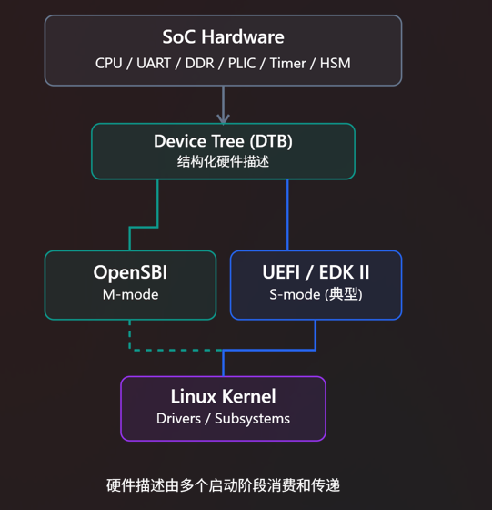
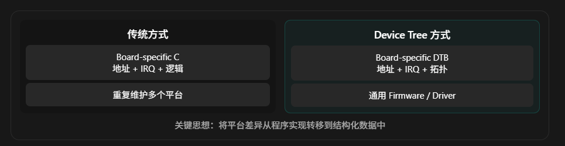
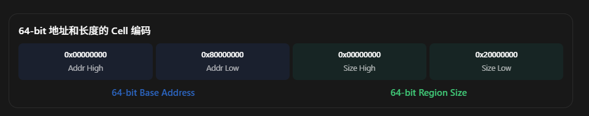

# Device Tree 系统教程：从设计理念到 RISC-V / OpenSBI / UEFI 工程实践

面向 Firmware / OS / SoC Platform Engineer | 理论、架构、源码与 WSL2 实验

## 一、首先建立 Device Tree 的整体认知

先给出一个核心结论：

Device Tree（设备树）本质上不是 Linux 的驱动描述文件，而是一种标准化的硬件描述机制，用于让 Firmware、Bootloader、OS 等不同的软件组件理解同一套硬件平台。

它解决的核心问题是：

如何将硬件平台的具体配置从软件实现中解耦出来，使同一套软件能够适配不同的 SoC 和 Board？

理解这一点之后，再去学习 `DTS`、`DTB`、`compatible`、`reg`、`phandle` 等具体概念，就会容易很多。

### 1.1 Device Tree 在整个系统中的位置

以典型 RISC-V SoC 为例：


概念关系图，并非所有平台都会按此顺序或同时使用三个组件；图中的 DTB 是逻辑上的同一硬件描述，实际启动时可能被复制、修订或替换。

这里最值得注意的是：

- OpenSBI 可以根据 DTB 识别 CPU、串口、Timer、IPI 等硬件。
- UEFI 可以使用 DTB 获取平台信息，并通过标准接口将 DTB 提供给后续软件。
- Linux 根据 DTB 初始化硬件相关子系统、建立设备模型并匹配驱动。

所以，Device Tree 并不属于任何一个特定的软件层级。

OpenSBI 的 Generic Platform 明确采用了基于 `FDT` 的平台描述机制，这正是同一份 OpenSBI 固件能够运行在不同模拟器、FPGA 和物理开发板上的重要基础。

[image](https://www.google.com/s2/favicons?domain=https://github.com\&sz=32)

GitHub+1

---

这里简单介绍一下 `FDT`:

FDT = Flattened Device Tree（扁平化设备树）。

它是 Device Tree 的一种二进制数据表示格式，用于让 OpenSBI、U-Boot、UEFI、Linux 等软件在运行时读取和解析硬件描述信息。

需要区分三个概念：

| 名称        | 全称                                       | 作用             |
| --------- | ---------------------------------------- | -------------- |
| DT        | Device Tree                              | 描述硬件拓扑和资源的数据模型 |
| DTS       | Device Tree Source                       | 人类可读的设备树源码     |
| FDT / DTB | Flattened Device Tree / Device Tree Blob | 经过编译后的二进制设备树   |

它们的关系：

```bash
      board.dts
          |
          | dtc (Device Tree Compiler)
          v
      board.dtb
          |
          | FDT Binary Format
          v
   +------+-------+
   |              |
 OpenSBI         Linux
   |              |
 libfdt          OF APIs
   |              |
   v              v
  解析 CPU、Memory、UART、PLIC 等硬件信息
```

#### 为什么叫 Flattened（扁平化）？

因为 Device Tree 逻辑上是一棵树：

```
/
├── cpus
│   ├── cpu@0
│   └── cpu@1
└── soc
    ├── serial@10000000
    └── interrupt-controller@c000000
```

但在 DTB 中，这棵树被编码为连续的二进制数据，通过 `FDT_BEGIN_NODE`、`FDT_PROP`、`FDT_END_NODE` 等标记表达节点之间的层次关系，而不是使用 C 语言的指针组成链式树结构。

这样 Firmware 只需要一块连续内存和一个解析库（例如 `libfdt`），就可以读取整个设备树。

> 这个过程可以简单的理解为成一个序列化的过程

#### OpenSBI 中的实际使用

例如，在 OpenSBI Generic Platform 中，可以通过类似以下代码获取 FDT：

```cpp
const void *fdt = fdt_get_address();

fdt_serial_init(fdt);
```

其中：

- `fdt_get_address()`：获取当前 FDT 的内存地址。
- `fdt_serial_init(fdt)`：解析设备树中的串口信息，寻找匹配的驱动并初始化 UART。

因此，“基于 FDT 的平台描述机制”意味着 OpenSBI 使用运行时提供的二进制 Device Tree 获取硬件配置信息，而不是把所有 SoC 的硬件参数硬编码在平台代码中。

记住一个最简单的对应关系即可：

DTS 是给工程师编写和维护的；DTB/FDT 是给 Firmware 和 OS 读取和解析的。

---

## 二、Why：为什么需要 Device Tree？

### 2.1 没有 Device Tree，软件如何认识硬件？

假设我们设计了一个 RISC-V SoC，包含：

- 4 个 RISC-V HART
- 512 MiB DDR
- 1 个 UART
- 1 个 PLIC 中断控制器
- 1 个 Timer

Firmware 需要知道 UART 的 MMIO 地址、中断控制器在哪里，以及如何访问定时器。

最直接的方案就是硬编码：

```cpp
#define UART_BASE   0x10000000UL
#define UART_IRQ    10
#define DDR_BASE    0x80000000UL
#define DDR_SIZE    0x20000000UL

void uart_init(void)
{
    // 使用 UART_BASE 初始化 UART
}
```

这个方案对于单一硬件平台完全可行。

但是，当同一套 Firmware 需要支持第二块开发板时：

```
Board A:
    UART_BASE = 0x10000000
    UART_IRQ  = 10

Board B:
    UART_BASE = 0x20000000
    UART_IRQ  = 18
```

就可能出现这样的代码：

```cpp
#ifdef CONFIG_BOARD_A
#define UART_BASE 0x10000000UL
#define UART_IRQ  10
#elif defined(CONFIG_BOARD_B)
#define UART_BASE 0x20000000UL
#define UART_IRQ  18
#endif
```

当平台数量达到几十甚至上百个时，问题会非常明显：

1. 软件源码与 Board 硬件设计高度耦合。
2. 一个通用 Firmware 很难直接支持多个硬件平台。
3. 不同的软件组件可能重复维护同样的硬件配置。
4. 硬件地址、IRQ 或拓扑发生变化，都可能需要修改源码并重新编译。

注意，这不是 C 语言本身的问题，而是硬件配置数据与软件执行逻辑没有实现分离。

### 2.2 Device Tree 的解决思路

Device Tree 把原本硬编码在 C 代码中的硬件配置放到独立的数据结构里。

例如：

```bash
uart0: serial@10000000 {
    compatible = "ns16550a";
    reg = <0x10000000 0x100>;
    interrupts = <10>;
};
```

Firmware 不再需要通过 `#ifdef` 确定 UART 地址，而可以从 DTB 查询。

```bash
uart_base = dt_get_uart_base(fdt);
uart_irq  = dt_get_uart_irq(fdt);

uart_init(uart_base, uart_irq);
```

其中 `dt_get_uart_base()` 是这里为了说明设计思路而写的示意函数，并非标准 API。后面会介绍实际的 `libfdt` API。

现在软件的结构发生了变化：



关键思想：将平台差异从程序实现转移到结构化数据中

但也必须明确：

Device Tree 只能解决硬件描述与配置解耦，并不能自动解决所有硬件兼容问题。如果 Board B 使用了完全不同的 UART IP，那么软件仍然需要对应的 UART Driver。

### 2.3 为什么会存在这样的问题？PCI 不是可以自动发现设备吗？

这是理解 Device Tree 设计动机时非常重要的一点。

在 PC 中，PCI/PCIe 提供了比较成熟的设备枚举机制。例如，OS 可以读取 PCI Configuration Space，获得 Vendor ID、Device ID、BAR、Capability 等信息。

而在 SoC 中，大量外设是固定集成的 MMIO 设备：

```
                     SoC
        +-------------------------+
        |                         |
        | CPU ---- AXI/AHB Bus    |
        |             |           |
        |          +--+-------+   |
        |          |          |   |
        |         UART       SPI  |
        |          |          |   |
        |         I2C       Timer |
        |                         |
        +-------------------------+
```

这种场景中，通常没有一个通用、统一的硬件枚举接口告诉软件：

- UART 的寄存器位于什么地址？
- UART 的中断连接到了哪个 Interrupt Controller？
- SPI 总线下面连接了哪个具体器件？
- 设备依赖哪个 Clock、Reset Controller？
- 哪一块内存被保留给 Firmware？

这些信息必须通过某种方式提供给软件。

Device Tree 就是解决这种不可统一枚举硬件的描述问题的一种标准机制。

当然，PCIe 设备仍然可以通过 PCI 枚举；Device Tree 也可以描述 PCI Host Bridge。二者并不冲突。

### 2.4 为什么它现在会被 OpenSBI / UEFI 使用？

因为 Device Tree 发展成了一种跨软件层的硬件描述接口。

它源于 Open Firmware 体系，在 PowerPC 等平台上有较长的使用历史。后来 Linux、Bootloader 和其他 Firmware 广泛采用 FDT/DTB 的形式传递硬件描述。

[image](https://www.google.com/s2/favicons?domain=https://www.chiark.greenend.org.uk\&sz=32)

The Linux Kernel documentation+1


在今天的 RISC-V 软件生态中，使用 Device Tree 的意义不仅是支持 Linux 驱动，还包括：

- 避免 OpenSBI 中充斥 SoC-specific 硬件地址。
- 使启动固件和 OS 可以使用一致的硬件拓扑。
- 支持 QEMU 动态生成硬件配置。
- 支持不同启动阶段传递或修订硬件配置，而不必重新编译整个软件栈。

这是它从一个看似 Linux-specific 的技术，变成 Firmware / Platform Software 核心知识的根本原因。

## 三、What：Device Tree 到底是什么？

Device Tree 不是一个单独的文件格式，而是一套由数据模型、语法、二进制表示和硬件语义约定组成的规范。

截至目前，Devicetree.org 官方发布的正式规范为 Devicetree Specification v0.4（2023 年 6 月发布）。这是我们学习的基础标准。

[image](https://www.google.com/s2/favicons?domain=https://www.devicetree.org\&sz=32)

devicetree.org+1


### 3.1 Device Tree 的四个重要概念

| 名称        | 全称                                       | 核心作用                     |
| --------- | ---------------------------------------- | ------------------------ |
| DT        | Device Tree                              | 硬件描述数据模型                 |
| DTS       | Device Tree Source                       | 人类可读的源代码形式               |
| DTSI      | Device Tree Source Include               | 可复用的 DTS 源码片段            |
| DTB / FDT | Device Tree Blob / Flattened Device Tree | Firmware、OS 可以直接解析的二进制形式 |

它们的关系是：

```
SoC-level DTSI
       |
       +---- Board-level DTS
                    |
                    v
                  dtc
          Device Tree Compiler
                    |
                    v
                   DTB
                    |
         +----------+----------+
         |          |          |
       OpenSBI     UEFI       Linux
```

这里最容易产生误解的概念是 FDT。

FDT（Flattened Device Tree）不是另一种与 Device Tree 竞争的规范，而是 Device Tree 的扁平化二进制表示。

软件运行时通常解析的是 FDT 格式的内存数据，也就是我们通常说的 `DTB`。

### 3.2 Device Tree 的数据结构

Device Tree 本质上由两类元素组成：

- Node：表示一个硬件组件、总线或者某种硬件相关信息。
- Property：保存对应 Node 的属性。

例如：

```bash
/dts-v1/;

/ {
    model = "My RISC-V Board";
    compatible = "demo,riscv-board";

    soc {
        uart0: serial@10000000 {
            compatible = "ns16550a";
            reg = <0x10000000 0x1000>;
        };
    };
};
```

这里先不讨论地址格式是否完整，只关注数据模型：

```bash
/
├── model
├── compatible
└── soc
    └── serial@10000000
        ├── compatible
        └── reg
```

从数据结构的角度看，它是一棵树。

但由于 Node 还可以通过 `phandle` 引用其他 Node，因此它实际上也能够描述树形层级之外的硬件关联。

例如 UART 和 PLIC 之间的 IRQ 连接，并不要求 PLIC 必须是 UART 的父节点。

### 3.3 为什么使用树形结构？

这是 Device Tree 设计理念中非常重要的一部分。

实际 SoC 的硬件组织就具有明显的层次性：

```bash
SoC
 |
 +-- CPU Cluster
 |    +-- CPU0
 |    +-- CPU1
 |
 +-- Peripheral Bus
 |    +-- UART
 |    +-- SPI Controller
 |    |    +-- SPI Flash
 |    +-- I2C Controller
 |         +-- Temperature Sensor
 |
 +-- DDR
```

树形模型适合描述：

1. 硬件的层级与归属关系。
2. 总线下挂载的子设备。
3. 地址空间及其映射关系。
4. 父节点传递给子节点的上下文。

不过，Device Tree 并不要求树上的每个节点都代表一个能够枚举驱动的设备。`/chosen`、`/aliases`、`/reserved-memory` 等节点就具有不同的语义。

## 四、How：深入理解 `DTS` 的核心语义

这是整个 Device Tree 技术体系最重要的部分。

相比记忆 DTS 语法，我建议优先彻底理解四件事：

设备如何确定身份、地址如何解释、中断如何关联、内存如何管理。

### 4.1 compatible：设备身份与驱动匹配

例如：

```bash
uart0: serial@10000000 {
    compatible = "vendor,soc-uart", "ns16550a";
};
```

这里定义了两个 compatible 字符串。

它们不是两个不同的设备，而是对同一个设备的兼容性声明。

- `vendor,soc-uart`：特定厂商、特定 SoC 的 UART 实现。
- `ns16550a`：表示该设备也兼容相应的通用 UART 编程模型。

通常把更具体的兼容字符串放在前面，通用的放在后面。

Linux Driver 可以声明：

```cpp
static const struct of_device_id uart_of_match[] = {
    { .compatible = "ns16550a" },
    { }
};
```

Linux 的 OF（Open Firmware）匹配机制能够将适合的 Device Tree 节点与 Driver 关联起来。

但这里需要特别理解：

`compatible` 不是硬件设备的唯一实例 ID，也不一定直接对应某一个 C 文件。

它表达的是这份硬件实现遵守哪一种软件可识别的硬件接口契约。

例如两个 UART 的 MMIO 地址可能不同，但如果寄存器模型一致，完全可以使用同一个 UART Driver。

### 4.2 reg：为什么不能简单理解为 MMIO 地址？

这是 Device Tree 初学者最容易出错的地方。

假设：

```bash
reg = <0x10000000 0x1000>;
```

你可能会理解成：

```bash
base = 0x10000000
size = 0x1000
```

这种理解在某些场景下是正确的，但不具有普遍性。

因为 `reg` 的编码需要结合父节点提供的两个属性：

- `#address-cells`
- `#size-cells`

一个 Cell 固定为 32 bit。

例如：

```bash
/ {
    #address-cells = <2>;
    #size-cells = <2>;

    memory@80000000 {
        device_type = "memory";

        reg = <
            0x00000000 0x80000000
            0x00000000 0x20000000
        >;
    };
};
```

这里的含义是：

| 字段   | 组成          | 解析结果                    |
| ---- | ----------- | ----------------------- |
| Base | 2 Cells     | `0x0000000080000000`    |
| Size | 2 Cells     | `0x0000000020000000`    |
| 内存范围 | Base + Size | 0x80000000 开始，共 512 MiB |

也就是说，`reg` 中连续的 4 个 Cell，并不是 4 个彼此独立的整数。



而如果我们使用：

```
#address-cells = <1>;
#size-cells = <1>;
```

那么：

```
reg = <0x10000000 0x1000>;
```

才表示一个 32-bit 的地址和一个 32-bit 的长度。

还有一个关键细节：`#address-cells` 和 `#size-cells` 是由直接父节点定义，用于解释其子节点的 `reg`，不能简单沿着祖先节点无限继承。

这一点在 I2C/SPI 和 PCIe 等多级总线场景中尤其重要。

### 4.3 ranges：如何描述总线地址转换？

Device Tree 不仅描述物理地址，还可以描述总线地址之间的映射关系。

例如：

```
/ {
    #address-cells = <1>;
    #size-cells = <1>;

    bus {
        #address-cells = <1>;
        #size-cells = <1>;

        ranges = <0x0 0x40000000 0x10000>;

        serial@1000 {
            reg = <0x1000 0x100>;
        };
    };
};
```

这里：

```
Child Bus Address 0x00000000
        |
        | ranges 映射
        v
Parent Address    0x40000000
```

因此 UART 地址为：

```
Bus Address      = 0x1000
Parent Address   = 0x40000000 + 0x1000
                 = 0x40001000
```

这其实就是一次地址空间转换。

`ranges` 的每个映射条目由以下部分构成：

```
Child Address
Parent Address
Size
```

各部分占用多少 Cells，分别由当前总线和其父总线的地址、长度编码规则决定。

两个很重要的特殊情况：

- `ranges;`：空属性，通常表示子总线和父总线地址空间是一一对应的，不需要转换。
- 不存在 `ranges`：按照规范，通常表示没有定义子总线到父总线的地址映射，而不是自动认为地址相同。

你可以把 `ranges` 理解为地址空间的映射规则，但它并不是 MMU Page Table，也不会因为声明了 `ranges` 就对硬件总线完成配置。

### 4.4 phandle：设备之间的关系如何表达？

例如，UART 使用 PLIC 中断控制器。

```
plic: interrupt-controller@c000000 {
    compatible = "riscv,plic0";

    interrupt-controller;
    #interrupt-cells = <1>;
};

uart0: serial@10000000 {
    compatible = "ns16550a";

    interrupt-parent = <&plic>;
    interrupts = <10>;
};
```

注意：

```
interrupt-parent = <&plic>;
```

这里的 `&plic` 并不是 C 语言指针。

它是 DTS 编译期对节点标签的引用，编译器会把它解析成对应的 `phandle` 值。

所以：

```
UART Node
   |
   | interrupt-parent = <&plic>
   v
PLIC Node
```

`interrupts = <10>` 的含义需要由 PLIC 的 interrupt binding 解释。在这个例子里，表示该 UART 使用 PLIC 的中断源 ID 10。

不能机械地认为 `interrupts` 属性中的第一个整数永远是 IRQ Number。

例如，某些 GIC interrupt binding 使用多个 Cells 来表示中断类型、中断编号和触发属性。

Device Tree 只负责编码关系；具体编码如何解释，取决于相关硬件 Binding。

### 4.5 为什么还需要 Binding？

这是从“能写 DTS”进入“真正理解 Device Tree 规范”的关键。

考虑：

```
compatible = "vendor,my-uart";
reg = <0x10000000 0x1000>;
clock-frequency = <50000000>;
```

单靠 Device Tree 的基本语法，无法知道：

- `vendor,my-uart` 是否是合法的 compatible。
- `clock-frequency` 是否必须存在。
- 设备是否需要 `clocks` 属性。
- `reg` 应有几组地址资源。
- `interrupts` 应包含几项。

因此需要 Binding。

我们可以这样理解：

```
Device Tree Specification
    |
    +-- 定义基本数据结构
    +-- 定义通用属性的基础语义
    +-- 定义 DTB 二进制格式
    |
    +-- Device-specific Bindings
            |
            +-- 定义 compatible
            +-- 定义 required properties
            +-- 定义取值约束
            +-- 定义硬件资源的解释规则
```

Linux 中的 Device Tree Bindings 主要使用 YAML + JSON Schema 的形式描述，并且可以通过 `dt_binding_check` 和 `dtbs_check` 进行校验。

[image](https://www.google.com/s2/favicons?domain=https://docs.kernel.org\&sz=32)

The Linux Kernel documentation+1


这相当于两个层级的检查：

| 检查           | 解决的问题                      |
| ------------ | -------------------------- |
| `dtc`        | DTS 能否正确编译，基础结构是否存在明显问题    |
| `dtbs_check` | 节点是否符合对应设备的 Binding Schema |

注意：dtc 编译成功，不意味着这个 DTB 能正确驱动硬件。

### 4.6 其他必须认识的重要属性和节点

| 属性 / 节点               | 主要意义              |
| --------------------- | ----------------- |
| `status = "okay"`     | 设备可用              |
| `status = "disabled"` | 设备不可用，通常不进行正常枚举   |
| `/cpus`               | CPU/HART 的拓扑与相关配置 |
| `/memory`             | 物理内存区域            |
| `/chosen`             | 启动参数及启动阶段提供的信息    |
| `/aliases`            | 设备节点的别名           |
| `/reserved-memory`    | 不能按普通可用内存处理的区域    |
| `clocks`              | 设备依赖的时钟资源         |
| `resets`              | 设备依赖的复位控制资源       |
| `interrupts-extended` | 显式引用中断控制器及中断参数    |
| `dma-coherent`        | 描述设备的 DMA 一致性属性   |

其中 `/reserved-memory` 对 Firmware、TEE 和 HSM SoC 尤其重要，后面会展开。

## 五、DTB 的内部二进制格式

DTS 是源码，DTB 才是通常交付给 Firmware 或 OS 的实际数据。

为什么需要 DTB，而不是直接让 Firmware 解析 DTS？

原因非常实际：

- Firmware 不需要集成完整的 DTS 文本解析器。
- DTB 体积相对小。
- DTB 可以进行确定性的结构解析。
- 不需要复杂的字符串语法和预处理流程。
- 可以在比较早的 Boot 阶段使用。

### 5.1 FDT 的整体内存布局

FDT Header

Magic、Total Size、Offset、Version 等

Memory Reservation Block

物理内存保留项列表

Structure Block

Node / Property / End Node 等结构 Token

Strings Block

Property 名称字符串

示意图表示主要逻辑区块；实际位置由 Header 内的 Offset 字段指定，不能假设全部无间隔地紧密排列。

FDT Header 开头的 Magic 是：

```
#define FDT_MAGIC 0xd00dfeed
```

这一固定值可以帮助软件初步识别传入的地址是否指向一个 FDT Blob。

FDT 内部通过一系列结构 Token 描述 Node 和 Property，例如：

```
FDT_BEGIN_NODE
FDT_PROP
FDT_END_NODE
FDT_END
```

真正的节点树在二进制中被展开成顺序排列的结构记录。

这就是 Flattened 的含义。

但在实际项目中，绝大多数情况下不应该自己重新实现一个完整的 FDT Parser。建议使用 `libfdt`。

它提供：

```
fdt_check_header()
fdt_path_offset()
fdt_getprop()
fdt_node_offset_by_compatible()
fdt_next_node()
fdt_setprop()
```

下一部分我们把这些知识与实际启动链联系起来。

## 六、Device Tree 如何贯穿 OpenSBI、UEFI 和 Linux 启动链？

现在把前面的知识放入一个真实的 RISC-V 启动场景。

### 6.1 典型的 RISC-V 启动流程

假设采用 OpenSBI + EDK II UEFI + Linux：

```
             Boot ROM
                |
                v
       Earlier Boot Firmware
       (可能包含安全验证)
                |
                v
         OpenSBI (M-mode)
                |
                | SBI Runtime Services
                v
          EDK II (S-mode)
                |
                | UEFI Boot Services
                v
           Linux EFI Stub
                |
                v
        Linux Kernel (S-mode)
```

这是一个典型方案，并不是 RISC-V 的唯一启动方式。

在这个启动过程中，DTB 的作用可能是：

```
Boot ROM / Earlier Firmware
    |
    | 生成、加载或选择 DTB
    v
OpenSBI
    |
    | 解析硬件信息
    | 初始化平台服务
    | 必要时修订 DTB
    v
UEFI
    |
    | 使用平台描述
    | 安装 DTB Configuration Table
    | 建立 EFI Memory Map
    v
Linux EFI Stub
    |
    | 处理 EFI 信息、DTB
    v
Linux Kernel
    |
    | CPU / Memory / IRQ 初始化
    | 枚举设备并匹配驱动
    v
Drivers
```

注意，每一层读取的硬件信息可能相同，但是使用目的不同。

### 6.2 OpenSBI 为什么需要 Device Tree？

我们先思考一个问题：

OpenSBI 运行在 M-mode，负责提供 Timer、IPI、Hart State Management 等服务。

但是 OpenSBI 如何知道当前 SoC 使用哪种 Timer 硬件？

例如：

```
SoC A:
    CLINT / ACLINT

SoC B:
    其他 Timer/IPI 硬件实现
```

如果采用传统方式，就必须为每一种 SoC 维护相应的平台配置。

而 OpenSBI 的 Generic Platform 采用了 FDT-based 架构。

具体来说，Generic Platform 根据 FDT 发现 CPU/HART、Serial、Timer、Interrupt Controller 等平台信息，再调用对应的驱动实现。它也允许针对特殊硬件平台提供 override。

[image](https://www.google.com/s2/favicons?domain=https://github.com\&sz=32)

GitHub+1


我们来看 OpenSBI 中的真实代码。

源码位置：

[opensbi/platform/generic/platform.c](https://github.com/riscv-software-src/opensbi/blob/master/platform/generic/platform.c?utm_source=chatgpt.com)

其中的初始化逻辑包含：

```
int generic_early_init(bool cold_boot)
{
    const void *fdt = fdt_get_address();
    int rc;

    if (cold_boot) {
        if (semihosting_enabled())
            rc = semihosting_init();
        else
            rc = fdt_serial_init(fdt);

        if (rc)
            return rc;

        fdt_driver_init_all(fdt, fdt_early_drivers);
    }

    return fdt_cmo_init(cold_boot);
}
```

这段代码非常有代表性。

```
const void *fdt = fdt_get_address();
```

首先获取 FDT 地址。

```
rc = fdt_serial_init(fdt);
```

然后通过 FDT 查找、初始化串口，而不是在通用平台代码中硬编码某个 UART Base。

```
fdt_driver_init_all(fdt, fdt_early_drivers);
```

再初始化需要在早期执行的 FDT Driver。

这体现了一个明确的架构原则：

Generic Platform 不直接关心自己运行在哪一块 Board，而是通过 DTB 和相应的硬件 Driver 适配不同的 Board。

当然，如果 DTB 声明了一个 OpenSBI 不支持的硬件控制器，OpenSBI 依然无法凭空支持它。

另外，OpenSBI 也可能修改 Device Tree。例如 Generic Platform 的 `generic_final_init()` 中，会调用 `fdt_cpu_fixup()`、`fdt_fixups()`、`fdt_domain_fixup()` 等处理 FDT 信息，之后重新整理 FDT。

这也说明 Device Tree 不一定是由某一启动阶段创建后就始终完全不变的数据。

[image](https://www.google.com/s2/favicons?domain=https://github.com\&sz=32)

GitHub


### 6.3 FDT 地址是如何传递的？

对于 RISC-V 非 UEFI 的常规 Linux 启动路径，Linux Kernel Boot Requirements 明确规定：

| 寄存器  | 启动参数         |
| ---- | ------------ |
| `a0` | Boot HART ID |
| `a1` | FDT 的内存地址    |

同时，在进入 Kernel 时，`satp` 应为 0。

[image](https://www.google.com/s2/favicons?domain=https://cdn.kernel.org\&sz=32)

The Linux Kernel documentation


可以简单理解为：

```
# 示意汇编，不是完整 bootloader 实现

# a0 = Boot HART ID
# a1 = DTB physical address

mv a0, s0
mv a1, s1

jr t0               # 跳转到 Kernel Entry
```

这里还涉及 Linux 所要求的其他启动前置条件，不能只设置两个寄存器就认为已经满足 Linux Boot Protocol。

还需要区分一件事：

OpenSBI `FW_DYNAMIC` 的 `a2` 可以用于传递 `struct fw_dynamic_info` 的地址。这个结构主要用于描述下一启动阶段的信息，它与 `a1` 中的 FDT 地址不是同一个概念。

[image](https://www.google.com/s2/favicons?domain=https://github.com\&sz=32)

GitHub


### 6.4 UEFI 为什么还需要 Device Tree？

UEFI 并不强制所有平台都使用 Device Tree。

PC/x86 生态通常采用 ACPI 描述硬件，Device Tree 则广泛用于嵌入式 Arm/RISC-V 平台。对于能够支持相应机制的平台，二者可以是不同的硬件描述方案。

UEFI 提供了一个重要机制：

EFI Configuration Table

UEFI Specification 为 Device Tree 定义了：

```
#define EFI_DTB_TABLE_GUID \
    { 0xb1b621d5, 0xf19c, 0x41a5, \
      { 0x83, 0x0b, 0xd9, 0x15, \
        0x2c, 0x69, 0xaa, 0xe0 } }
```

Firmware 可以通过这个 GUID 将 DTB 提供给 UEFI 软件和后续的 OS Boot 过程。

这不是把 DTB 当作一个普通 EFI Driver 来加载，而是将它作为一份结构化的硬件信息表来传递。

UEFI Specification 还规定了重要的生命周期约束：作为 EFI Configuration Table 公布的 DTB，需要放在 `EfiACPIReclaimMemory` 中；一旦系统固件正式安装并公布该表，固件不得再修改这份公开 DTB。UEFI Application 可以按规范修改或替换它。

[image](https://www.google.com/s2/favicons?domain=https://github.com\&sz=32)

GitHub


这就意味着在实际 EDK II Platform Porting 工作中，需要明确：

```
Early Platform DTB
       |
       v
UEFI Platform Initialization
       |
       | 校验 / 复制 / 补充必要信息
       | 处理 Memory Map
       v
Final Published DTB
       |
       v
EFI Configuration Table
       |
       v
OS Loader / EFI Stub
```

还有一个非常重要的 RISC-V 细节：

当 Linux 通过 UEFI 启动时，EFI Memory Map 是 Linux 建立系统内存信息的依据。

UEFI 固件需要正确处理 `/reserved-memory` 等信息，而不能认为 Linux 只会依赖 DTB `/memory` 来管理物理内存。

[image](https://www.google.com/s2/favicons?domain=https://cdn.kernel.org\&sz=32)

The Linux Kernel documentation


所以在工业项目里，如果你需要将 UEFI 移植到一套 RISC-V SoC，Device Tree 的工作远远不止“把 DTB 地址传递出去”。

还必须考虑 Firmware DTB 的获取、内存保留、EFI Memory Map 的一致性，以及与下一个启动阶段的交接。

### 6.5 Linux 如何从 Device Tree 找到 Driver？

Linux 的完整流程可以简化为：

```
DTB
 |
 v
Early Boot FDT Parsing
 |
 +-- CPU / HART Information
 +-- Physical Memory Information
 +-- Reserved Memory
 +-- Interrupt Controller
 |
 v
Kernel Device Model
 |
 v
Device Population
 |
 v
Platform Device
 |
 | compatible matching
 v
Platform Driver
 |
 v
probe()
 |
 +-- ioremap MMIO Resource
 +-- Request IRQ
 +-- Clock / Reset Initialization
 +-- Hardware Initialization
```

这里还有一个很容易混淆的地方：

不是 DTS 中每一个 Node 都会自动创建一个 `platform_device`。

Linux 会根据总线类型、Node 属性和内核的设备枚举规则进行处理。例如 I2C Controller 节点和它下面的 I2C Client 节点，并不是以完全相同的方式创建设备。

[image](https://www.google.com/s2/favicons?domain=https://www.kernel.org\&sz=32)

The Linux Kernel documentation+1


假设有一个自定义 MMIO UART，Linux Driver 中可以这样描述匹配关系：

```
static const struct of_device_id demo_uart_match[] = {
    { .compatible = "demo,my-uart" },
    { }
};

MODULE_DEVICE_TABLE(of, demo_uart_match);
```

相应 DTS：

```
serial@10000000 {
    compatible = "demo,my-uart";
    reg = <0x0 0x10000000 0x0 0x1000>;
};
```

在具备完整 Platform Driver 框架的情况下，probe 函数可使用：

```
static int demo_uart_probe(struct platform_device *pdev)
{
    void __iomem *base;

    base = devm_platform_ioremap_resource(pdev, 0);
    if (IS_ERR(base))
        return PTR_ERR(base);

    /* 根据具体 UART IP 进行硬件初始化 */

    return 0;
}
```

这是片段代码，不是完整的可加载内核模块。

它要表达的思想是：

Device Tree 描述资源，Linux Device Model 负责组织设备，Driver 则负责使用资源并操纵真实硬件。

## 七、面向 HSM / RoT SoC：Device Tree 的安全边界

这部分非常值得单独学习。

假设 SoC 中存在独立的 RISC-V HSM Core，负责：

- Secure Boot 镜像认证
- Root of Trust
- Key Management
- 对主核提供安全服务

在这样的系统里，Device Tree 可以帮助主核软件理解部分硬件资源关系，但绝不能把 Device Tree 当作安全策略的可信根。

### 7.1 Reserved Memory 的作用

假设物理内存有一块区域专供安全 Firmware 或其他驻留 Firmware 使用。

可以通过如下方式声明：

```
reserved-memory {
    #address-cells = <2>;
    #size-cells = <2>;
    ranges;

    secure_fw: firmware@bf000000 {
        reg = <
            0x0 0xbf000000
            0x0 0x01000000
        >;

        no-map;
    };
};
```

它表达：

```
Physical Memory
0x80000000
    |
    | Normal memory
    |
0xBF000000
    |
    | 16 MiB Reserved Region
    | Linux 不应建立普通直接映射
    |
0xC0000000
```

`no-map` 表示 OS 不应为这一区域建立普通的线性映射，也不应允许未经相应处理的推测访问。

但是请注意：

`no-map` 是描述性约束，不是硬件访问控制机制。

如果 Linux 已经被攻破，攻击者能够修改内核页表，并且硬件访问权限没有阻止它，那么单靠 Device Tree 并不能保护这块内存。

要提供真正的安全隔离，需要依靠 SoC 实际支持的安全硬件机制，例如 PMP、总线防火墙、专用安全 SRAM 或其他硬件访问控制机制。

在 RISC-V Linux 的启动约定中，保留给驻留 Firmware 的区域也需要正确标记，避免 Kernel 将不能访问的区域放进 Direct Mapping。

[image](https://www.google.com/s2/favicons?domain=https://cdn.kernel.org\&sz=32)

The Linux Kernel documentation


### 7.2 Device Tree 能不能描述 HSM？

可以，但要明确它所描述的对象。

例如主核通过 Mailbox 与 HSM 通信，就可以为主核可见的 Mailbox Controller 提供 Device Tree 描述：

```
/* 示意：并非标准 HSM Binding */

mailbox@30000000 {
    compatible = "vendor,hsm-mailbox";
    reg = <0x0 0x30000000 0x0 0x1000>;

    /* IRQ、clocks 等属性按真实 Binding 补充 */
};
```

但这不意味着：

```
DTB 描述了 HSM
       =
HSM 信任 DTB 中声明的安全策略
```

两者完全不同。

对独立 HSM Core 而言，它自己的 Boot ROM、可信配置、密钥以及访问控制才决定其安全边界。

主核的 Device Tree 不能因为被写上了 `secure`、`trusted` 或者某种厂商自定义属性，就自动获得安全效力。

这里还需要注意：DTB 自身未必是可信输入。

对 Secure Boot 设计而言，必须明确 DTB 的来源、认证、完整性保护以及运行时是否允许修改。Firmware 在处理 DTB 时还应校验 Header、长度、Offset 和属性编码，避免解析损坏或恶意构造的数据。

这就是 Device Tree 在 HSM SoC 中最重要的架构定位：

它属于硬件描述与系统集成接口，而不是 Root of Trust 本身。

## 八、WSL2 实战：亲手创建、编译、解析 Device Tree

下面开始实际动手。

所有实验都可以在 Windows + WSL2 的 Ubuntu 环境中完成，不需要物理开发板。

我们按照三个层级来做：

| 实验   | 目标                         | 难度 |
| ---- | -------------------------- | -- |
| 实验 1 | 自己编写 DTS，编译为 DTB，再反编译      | 入门 |
| 实验 2 | 使用 libfdt 编写 C 程序读取 DTB    | 中级 |
| 实验 3 | 从 QEMU RISC-V virt 获取真实设备树 | 进阶 |

### 实验 1：创建第一个 RISC-V Device Tree

#### Step 1：安装工具

在 WSL2 Ubuntu 中运行：

```
sudo apt update

sudo apt install -y \
    device-tree-compiler \
    libfdt-dev \
    build-essential \
    qemu-system-misc
```

验证：

```
dtc --version
command -v fdtget
command -v fdtput
command -v qemu-system-riscv64
```

创建工作目录：

```
mkdir -p ~/dt-lab
cd ~/dt-lab
```

#### Step 2：创建完整的 DTS

执行：

```
cat > demo.dts <<'EOF'
/dts-v1/;

/ {
    model = "Demo RISC-V Board";
    compatible = "demo,riscv-board";

    #address-cells = <2>;
    #size-cells = <2>;

    aliases {
        serial0 = &uart0;
    };

    chosen {
        stdout-path = "/soc/serial@10000000";
        bootargs = "console=ttyS0,115200";
    };

    memory@80000000 {
        device_type = "memory";
        reg = <0x0 0x80000000
               0x0 0x20000000>;
    };

    cpus {
        #address-cells = <1>;
        #size-cells = <0>;

        timebase-frequency = <10000000>;

        cpu@0 {
            device_type = "cpu";
            reg = <0>;
            compatible = "riscv";
            riscv,isa = "rv64imac";
            status = "okay";
        };
    };

    soc {
        compatible = "simple-bus";
        #address-cells = <2>;
        #size-cells = <2>;
        ranges;

        intc: interrupt-controller@c000000 {
            compatible = "demo,intc";

            reg = <0x0 0x0c000000
                   0x0 0x00400000>;

            interrupt-controller;
            #address-cells = <0>;
            #interrupt-cells = <1>;
        };

        uart0: serial@10000000 {
            compatible = "demo,uart";

            reg = <0x0 0x10000000
                   0x0 0x1000>;

            interrupt-parent = <&intc>;
            interrupts = <10>;

            status = "okay";
        };
    };
};
EOF
```

这是专门用于学习的 Device Tree。`demo,intc` 和 `demo,uart` 是虚构的硬件兼容标识，并不是能够直接启动 QEMU 或驱动真实外设的完整平台描述。

这里已经用到了前面介绍的所有基础概念：

```
/
├── aliases
├── chosen
├── memory@80000000
├── cpus
│   └── cpu@0
└── soc
    ├── interrupt-controller@c000000
    └── serial@10000000
```

#### Step 3：编译 DTS

```
dtc -@ -I dts -O dtb \
    -o demo.dtb demo.dts
```

其中：

- `-I dts`：输入格式为 DTS。
- `-O dtb`：输出格式为 DTB。
- `-@`：生成符号等相关信息，便于后续研究引用及 Overlay。
- `-o`：指定输出文件。

成功之后：

```
ls -lh demo.dtb
file demo.dtb
```

此时就获得了 Firmware 可以解析的二进制 Device Tree。

#### Step 4：反编译 DTB

```
dtc -I dtb -O dts \
    -o demo-restored.dts demo.dtb
```

查看：

```
cat demo-restored.dts
```

观察你会发现，反编译后的内容与原始 DTS 不一定完全相同。

例如：

```
interrupt-parent = <0x01>;
```

可能取代之前的：

```
interrupt-parent = <&intc>;
```

原因是：

原始的 `&intc` 是编译阶段的节点标签引用，在二进制中会解析为数值形式的 `phandle`。

这也进一步说明 DTB 保存的是设备树的数据结构，不是 DTS 源码文本。

#### Step 5：读取指定节点

查询 UART 的 `compatible`：

```
fdtget -t s demo.dtb \
    /soc/serial@10000000 compatible
```

预期：

```
demo,uart
```

读取 MMIO 地址：

```
fdtget -t x demo.dtb \
    /soc/serial@10000000 reg
```

预期：

```
0 10000000 0 1000
```

这四个数可以解释为：

```
Base = 0x0000000010000000
Size = 0x0000000000001000
```

还可以列出 `/soc` 的子节点：

```
fdtget -l demo.dtb /soc
```

#### Step 6：直接修改 DTB

例如修改 `/chosen` 中的启动参数：

```
fdtput -t s demo.dtb \
    /chosen bootargs \
    "console=ttyS1,115200"
```

重新读取：

```
fdtget -t s demo.dtb /chosen bootargs
```

预期：

```
console=ttyS1,115200
```

到这一步，你已经完成了一次完整的：

```
DTS -> DTB -> Parse -> Modify -> Parse
```

这个过程与实际 Bootloader 中的 Device Tree 处理思路高度一致。

不过，修改 `bootargs` 并不会在 WSL2 中改变当前 Linux 的启动参数；我们只是修改了磁盘上的一个 DTB 文件。

### 实验 2：使用 libfdt 编写 C 程序读取 DTB

这个实验更接近 Firmware 开发。

我们的目标是通过 C 代码：

1. 加载 DTB。
2. 校验 FDT Header。
3. 通过 compatible 搜索 UART。
4. 读取并解析 `reg` 属性。

创建：

```
cat > inspect_fdt.c <<'EOF'
#include <stdio.h>
#include <stdlib.h>
#include <stdint.h>
#include <libfdt.h>

int main(int argc, char **argv)
{
    if (argc != 2) {
        fprintf(stderr, "Usage: %s <dtb>\n", argv[0]);
        return 1;
    }

    FILE *fp = fopen(argv[1], "rb");
    if (!fp) {
        perror("fopen");
        return 1;
    }

    if (fseek(fp, 0, SEEK_END) != 0) {
        fclose(fp);
        return 1;
    }

    long size = ftell(fp);
    rewind(fp);

    if (size <= 0) {
        fclose(fp);
        return 1;
    }

    void *fdt = malloc((size_t)size);
    if (!fdt) {
        fclose(fp);
        return 1;
    }

    if (fread(fdt, 1, (size_t)size, fp) != (size_t)size) {
        fprintf(stderr, "Failed to read DTB\n");
        free(fdt);
        fclose(fp);
        return 1;
    }
    fclose(fp);

    if (fdt_check_header(fdt) != 0 ||
        fdt_totalsize(fdt) > (size_t)size) {
        fprintf(stderr, "Invalid DTB\n");
        free(fdt);
        return 1;
    }

    int node = fdt_node_offset_by_compatible(
        fdt, -1, "demo,uart");

    if (node < 0) {
        fprintf(stderr, "UART not found\n");
        free(fdt);
        return 1;
    }

    int len;
    const fdt32_t *reg =
        fdt_getprop(fdt, node, "reg", &len);

    if (!reg || len != 4 * sizeof(fdt32_t)) {
        fprintf(stderr, "Invalid UART reg\n");
        free(fdt);
        return 1;
    }

    uint64_t base =
        ((uint64_t)fdt32_to_cpu(reg[0]) << 32) |
        fdt32_to_cpu(reg[1]);

    uint64_t region_size =
        ((uint64_t)fdt32_to_cpu(reg[2]) << 32) |
        fdt32_to_cpu(reg[3]);

    printf("UART Base = 0x%llx\n",
           (unsigned long long)base);

    printf("UART Size = 0x%llx\n",
           (unsigned long long)region_size);

    free(fdt);
    return 0;
}
EOF
```

编译并运行：

```
gcc -Wall -Wextra \
    inspect_fdt.c -lfdt \
    -o inspect_fdt

./inspect_fdt demo.dtb
```

预期：

```
UART Base = 0x10000000
UART Size = 0x1000
```

这是一个完整的用户态教学示例。真实 Firmware 中还需要根据平台规定的 DTB 有效内存范围做输入校验，并根据总线地址规则进行转换。

#### 一个特别值得思考的问题

为什么读取 `reg` 时需要：

```
fdt32_to_cpu(reg[0])
```

而不是直接：

```
reg[0]
```

因为 Device Tree 的 Cell 在二进制中采用 Big-endian 编码，而 CPU 的本地字节序不一定是 Big-endian。

在典型 Little-endian RISC-V 平台上，直接将 DTB 属性内容解释成本地 32-bit 整数可能得到错误结果。

这是实际 Firmware 开发中很典型的字节序问题。

### 实验 3：用 QEMU 生成真实 RISC-V DTB

这一实验最有价值，因为它不再使用我们自己虚构的硬件模型。

QEMU `virt` 机器会根据机器配置自动生成 Device Tree，用于描述 CPU、Memory、UART、Interrupt Controller 等虚拟硬件。

[image](https://www.google.com/s2/favicons?domain=https://www.qemu.org\&sz=32)

QEMU documentation


#### Step 1：生成 DTB

```
cd ~/dt-lab

qemu-system-riscv64 \
    -machine virt,dumpdtb=virt.dtb \
    -m 512M \
    -smp 2 \
    -nographic \
    -bios none
```

这里不需要启动 Linux。

正常情况下，QEMU 会把生成的设备树输出到 `virt.dtb`。

检查：

```
ls -lh virt.dtb
```

接着反编译：

```
dtc -I dtb -O dts \
    -o virt.dts virt.dtb
```

注意：QEMU 10.0.0-rc1 曾有 `dumpdtb` 可能导出不完整 DTB 的回归问题。如果导出的内容缺少 CPU、Memory、UART 等预期节点，先检查 QEMU 版本和导出内容，不要把这种情况视为正常硬件模型。

[image](https://www.google.com/s2/favicons?domain=https://gitlab.com\&sz=32)

GitLab


#### Step 2：观察真实硬件描述

执行：

```
grep -nE \
    'cpu@|serial@|plic@|aplic@|imsic@|memory@' \
    virt.dts
```

不同版本的 QEMU、CPU 扩展及 AIA 配置可能影响实际节点名称和内容。

还可以查看：

```
fdtget -l virt.dtb /
```

以及：

```
fdtget -l virt.dtb /soc
```

对于生成了 `/soc/serial@10000000` 的常见 virt 配置，可以执行：

```
fdtget -t s virt.dtb \
    /soc/serial@10000000 compatible
```

你可能看到类似：

```
ns16550a
```

这个值意味着 QEMU 模拟的 UART 满足软件可以识别的 NS16550 兼容模型。

#### Step 3：观察 SMP 与 Device Tree 的关系

再生成一份不同配置：

```
qemu-system-riscv64 \
    -machine virt,dumpdtb=virt4.dtb \
    -m 1G \
    -smp 4 \
    -nographic \
    -bios none
```

反编译：

```
dtc -I dtb -O dts \
    -o virt4.dts virt4.dtb
```

然后比较：

```
diff -u virt.dts virt4.dts
```

重点观察两个变化：

| 配置          | 第一次     | 第二次   |
| ----------- | ------- | ----- |
| CPU/HART 数量 | 2       | 4     |
| DDR 容量      | 512 MiB | 1 GiB |

在正确、完整的 QEMU DTB 中，相关描述应随机器配置变化。

这正是 Device Tree 真正的价值：

同一个通用软件实现，可以依靠 Device Tree 获取不同机器的硬件配置，而不是依靠大量硬编码的 Board 参数。

你可以进一步阅读 QEMU 生成这些节点的源码：

[QEMU hw/riscv/virt.c](https://github.com/qemu/qemu/blob/master/hw/riscv/virt.c?utm_source=chatgpt.com)

重点关注 `create_fdt()` 及相关 `create_fdt_*()` 和设备树处理函数。源码随 QEMU 版本演进，具体函数名和组织方式可能发生变化。

## 九、建议进一步学习的 Device Tree 技术

完成上面的实验后，如果希望达到工业项目开发水平，还需要继续掌握以下几个主题。

| 学习顺序 | 主题                                       | 建议掌握程度                  |
| ---- | ---------------------------------------- | ----------------------- |
| 1    | DTS / DTSI 的组织与复用                        | 能维护 SoC 与 Board 设备树     |
| 2    | Device Tree Bindings / YAML Schema       | 能验证并编写新设备的 Binding      |
| 3    | Clock / Reset / GPIO / Interrupt Phandle | 能分析复杂设备依赖               |
| 4    | Memory / Reserved Memory / DMA           | 能完成 Firmware 与 OS 内存协同  |
| 5    | Device Tree Overlay                      | 理解运行时或启动阶段的硬件配置扩展       |
| 6    | OpenSBI FDT Driver Framework             | 能移植新的 RISC-V 平台服务       |
| 7    | UEFI DTB / ACPI / EFI Memory Map         | 能处理 EDK II 平台初始化和 OS 交接 |
| 8    | DTB 安全性与 HSM / RoT 集成                    | 能分析跨安全域的配置来源和可信边界       |

对你的 RISC-V Firmware / OS 工作来说，我认为其中最值得继续深入的是：OpenSBI 对 FDT 的解析与平台驱动初始化、UEFI 的 DTB 交接与 EFI Memory Map、以及 HSM 相关的内存和安全边界设计。

这三个主题可以围绕同一个 QEMU RISC-V `virt` 平台串起来研究，避免把 Device Tree 学成孤立的 DTS 语法。

## 十、官方参考资料

建议优先使用以下四份资料，而不是从大量零散的博客中记忆 DTS 语法。

[Devicetree Specification v0.4](https://www.devicetree.org/specifications/?utm_source=chatgpt.com)

定义数据模型、标准属性、地址映射、Interrupt Mapping 和 FDT 二进制格式。最基础的规范。

[Linux and the Devicetree](https://docs.kernel.org/devicetree/usage-model.html?utm_source=chatgpt.com)

理解 DTB 怎样影响 Linux 的平台识别、启动配置和设备枚举。

[OpenSBI Generic Platform](https://github.com/riscv-software-src/opensbi/blob/master/docs/platform/generic.md?utm_source=chatgpt.com)

研究 OpenSBI 为什么通过 FDT 驱动多种不同的 RISC-V 平台。

[UEFI Specification — EFI System Table](https://uefi.org/specs/UEFI/2.10/04_EFI_System_Table.html?utm_source=chatgpt.com)

重点阅读 Devicetree Tables，掌握 UEFI 发布 DTB 的接口和生命周期规则。

## 十一、检验自己是否真正理解 Device Tree

01

为什么在 Device Tree 中，reg = <0x0 0x10000000 0x0 0x1000> 不能直接解释为四个整数？

reg 的编码由直接父节点的 #address-cells 和 #size-cells 决定。在父节点分别为 2 和 2 的情况下，它表示一个 64-bit 地址和一个 64-bit 长度。

收起答案&#x20;

02

Device Tree 中的 compatible 是否必须与 Linux Driver 的名字相同？

不需要。compatible 声明硬件接口兼容性，Driver 通过 of_match_table 匹配它。一个 Driver 可以匹配多个 compatible，不同硬件实例也可以共享同一 Driver。

收起答案&#x20;

03

为什么 OpenSBI 能读取 Device Tree，却不意味着它能自动支持所有 SoC？

Device Tree 仅描述硬件。OpenSBI 仍需要实现能够识别相关 compatible、解释属性并操纵硬件的驱动。FDT 不会自动生成驱动逻辑。

收起答案&#x20;

04

如果 /reserved-memory 使用 no-map，是否能够阻止已经拿到 Linux root 的攻击者访问对应物理内存？

不能单独保证。no-map 是 OS 应遵循的内存映射约束，并非硬件访问控制。真正的隔离需要 PMP、总线防火墙或其他可信硬件控制机制。

收起答案&#x20;

05

RISC-V 通过 UEFI 启动 Linux 时，Linux 是否仍然只依靠 Device Tree 的 /memory 节点管理物理内存？

不是。通过 UEFI 启动时，RISC-V Linux 使用 EFI Memory Map 建立系统内存信息。UEFI 固件还必须正确处理 Device Tree 的 Reserved Memory 信息。

收起答案&#x20;

最后总结：

掌握 Device Tree 的真正标志，不是能够写出多少 DTS 属性，而是能够沿着下面这条技术链解释每一步：

```
Hardware Architecture
       |
       v
Device Tree Description
       |
       v
Firmware Hardware Discovery
       |
       v
Boot-time Configuration / Handoff
       |
       v
OS Device Enumeration
       |
       v
Driver Initialization
```

当你能够理解这条链路，并能解释每一层如何读取、使用或修订 DTB，同时清楚 Device Tree 无法提供哪些安全保证时，就已经建立了 Device Tree 的系统性认知模型。
