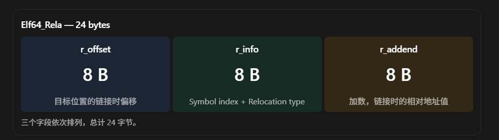

# `R_AARCH64_RELATIVE`：逐条指令理解 `start_a64.S` 中的重定位

先给出结论。这三条指令：

```bash
add x7, x7, x4
add x9, x9, x4
str x9, [x7]
```

实现的是一次 ELF Relative Relocation（相对重定位）：

```bash
*(B + r_offset) = B + r_addend;
```

其中：

- `B`：ELF 被加载到内存后的实际 Load Bias。
- `r_offset`：需要修正的目标位置在 ELF 链接时的相对偏移。
- `r_addend`：需要写入目标位置的相对值。
- `B + r_offset`：最终需要被修改的内存地址。
- `B + r_addend`：最终应该写入该地址的运行时地址。

这三条指令并不是在计算一个普通函数调用地址，而是在修正 ELF 数据段中保存的指针，使这些指针从链接时的地址布局转换成当前运行时的地址布局。

我们逐条拆开，并与 RISC-V 的 `start_rv64.S` 对照。

## 1. 先理解 ELF 为什么需要 Relative Relocation

假设 ldelf 在链接时，链接器认为它会被加载到：

```bash
Link-time base address = 0x00000000
```

ldelf 中有一个全局指针：

```cpp
static int global_value = 100;

static int *global_ptr = &global_value;
```

在链接阶段，链接器知道：

```
global_value 的链接地址 = 0x00004800
global_ptr 变量的链接地址 = 0x00003200
```

因此，ldelf 的 `.data` 中，`global_ptr` 对应的 8 字节内容最初就是：

```
0x0000000000004800
```

也就是说：

```bash
global_ptr 的内容 = global_value 的链接地址
```

但问题来了：ldelf 并不一定会被加载到 `0x00000000`。

例如 OP-TEE Core 将 ldelf 加载到：

```bash
Runtime base address = 0x10000000
```

此时实际内存布局变成：

```bash
Link-time address       Runtime address

0x00003200              0x10003200    global_ptr
0x00004800              0x10004800    global_value
```

如果不做重定位，`global_ptr` 中仍然是：

```bash
0x0000000000004800
```

但程序真正需要的是：

```bash
0x0000000010004800
```

否则执行：

```bash
*global_ptr = 200;
```

时，程序就可能访问错误的地址。

所以我们需要修正两件事：

1. `global_ptr` 这个变量本身被放到了新的位置。
2. `global_ptr` 保存的指针值也必须指向新的位置。

这就是 `R_AARCH64_RELATIVE` 要解决的问题。

### 1.1 什么是 Load Bias？

定义：
```
B = RuntimeBase - LinkTimeBase
```

在刚才的例子中：
```
B = 0x10000000 - 0x00000000
```

所以：
```
B = 0x10000000
```
对于一个位置无关的 ELF 映像，所有需要进行相对重定位的内部地址都需要加上这个 Load Bias。

因此：
```
RuntimeAddress = LinkTimeAddress + B
```

ELF 的 `R_AARCH64_RELATIVE` 重定位计算公式就是：

```bash
*(B + r_offset) = B + r_addend
```

注意，这个公式左右两边分别计算的是：

- 左边：需要修改的目标内存地址。
- 右边：需要写入目标内存的 64-bit 指针值。

它们不是同一个地址。

## 2. 先认识 `Elf64_Rela`：三个字段分别是什么？

`start_a64.S` 和 `start_rv64.S` 都在遍历 `Elf64_Rela` 数组。

一个 `Elf64_Rela` 结构是 24 字节：

```cpp
typedef struct {
    Elf64_Addr   r_offset;  // 8 bytes
    Elf64_Xword  r_info;    // 8 bytes
    Elf64_Sxword r_addend;  // 8 bytes
} Elf64_Rela;
```

内存布局：



以刚才的例子为例：

```
r_offset = 0x3200
r_info   = R_AARCH64_RELATIVE
r_addend = 0x4800
```

它表达的意思是：

> 把 `0x4800` 加上 Load Bias，然后写到 `0x3200` 加上 Load Bias 所指向的内存位置。

因此：

```
*(0x10000000 + 0x3200) =
        0x10000000 + 0x4800;
```

结果：

```
Address to modify = 0x10003200
Value to write    = 0x10004800
```

现在你就可以理解为什么需要两次 `add`，而不是只做一次了。

## 3. 逐条拆解 `start_a64.S` 的三条指令

先看完整上下文。OP-TEE 当前 master 的 `ldelf/start_a64.S`：

```
1:
    ldp x7, x8, [x5], #16
    ldr x9, [x5], #8

    and x8, x8, #0xffffffff
    cmp x8, #R_AARCH64_RELATIVE
    bne 3f

    add x7, x7, x4
    add x9, x9, x4
    str x9, [x7]
```

首先看进入这三条指令之前，各寄存器保存什么。

### 3.1 前面的指令如何准备寄存器？

```
adr x4, reloc_begin_rel
ldr w5, reloc_begin_rel
ldr w6, reloc_end_rel
add x5, x5, x4
add x6, x6, x4
```

这里：

- `x4`：暂时保存 `reloc_begin_rel` 的运行时地址。
- `w5`：读取 relocation table 起始位置的相对偏移。
- `w6`：读取 relocation table 结束位置的相对偏移。
- `x5`：relocation table 的实际运行时起始地址。
- `x6`：relocation table 的实际运行时结束地址。

注意，`reloc_begin_rel` 和 `reloc_end_rel` 后面分别定义为：

```
reloc_begin_rel:
    .word __reloc_begin - reloc_begin_rel

reloc_end_rel:
    .word __reloc_end - reloc_end_rel
```

它们是两个 32-bit 相对偏移量。

为什么不用直接存储绝对地址？

因为 ldelf 自己还没有完成重定位，不能依赖尚未修正的绝对地址。通过当前位置加相对偏移，可以在任意加载位置找到 relocation table。

接着：

```
adr x4, _ldelf_start
```

这时 `x4` 被重新赋值。


关键

`x4` 现在表示 ldelf 入口 `_ldelf_start` 的运行时地址。


在当前 ldelf 的链接布局中，链接基址为零，因此它也就是这段映像使用的 Load Bias：

```
x4 = B
```

严格来说，一般 ELF 模型中的 Load Bias 是：

\\[ B = RuntimeAddress(\_ldelf\\\_start)   - LinkTimeAddress(\_ldelf\\\_start) \\]

这里使用 `adr` 得到入口的运行时地址，是建立在该 ldelf 链接布局约定之上的。

### 3.2 `ldp x7, x8, [x5], #16`

```
ldp x7, x8, [x5], #16
```

这是 AArch64 的 Load Pair with Post-index。

它一次加载两个 64-bit 值：

```
x7 = *(uint64_t *)x5
x8 = *(uint64_t *)(x5 + 8)

x5 = x5 + 16
```

对应：

```
x7 = r_offset
x8 = r_info
```

这里最容易混淆的是：

x7 目前不是最终物理地址或运行时虚拟地址，而是 ELF 中记录的 r_offset。

### 3.3 `ldr x9, [x5], #8`

```
ldr x9, [x5], #8
```

读取第三个字段：

```
x9 = *(uint64_t *)x5

x5 = x5 + 8
```

对应：

```
x9 = r_addend
```

现在整个 `Elf64_Rela` 已经读取完毕：

| Register | 内容                       |
| -------- | ------------------------ |
| `x7`     | `r_offset`               |
| `x8`     | `r_info`                 |
| `x9`     | `r_addend`               |
| `x4`     | Load Bias                |
| `x5`     | 下一个 relocation entry 的地址 |

### 3.4 `and x8, x8, #0xffffffff`

```
and x8, x8, #0xffffffff
```

`r_info` 并不是单纯的 relocation type。

它包含：

```
63                    32 31                  0
+----------------------+----------------------+
|       Symbol Index   |    Relocation Type   |
+----------------------+----------------------+
```

ELF64 的定义可以理解为：

```
#define ELF64_R_SYM(i)  ((i) >> 32)
#define ELF64_R_TYPE(i) ((i) & 0xffffffff)
```

因此：

```
and x8, x8, #0xffffffff
```

就是提取 `r_info` 的低 32 bits，即 relocation type。

然后：

```
cmp x8, #R_AARCH64_RELATIVE
bne 3f
```

当前 ldelf 的早期重定位只支持 `R_AARCH64_RELATIVE`。

如果遇到其他类型，就跳转到 `_ldelf_panic`。

为什么这里可以不查 Symbol Table？

因为 `R_AARCH64_RELATIVE` 的计算不需要解析外部符号。

它直接使用：

```
B + r_addend
```

这是早期 self-relocation 非常重要的设计特点：不需要先建立完整的动态链接器环境，就可以修正自身数据中的指针。

### 3.5 现在看你最关心的三条指令

```
add x7, x7, x4
```

寄存器含义：

```
x7 = r_offset
x4 = B
```

执行之后：

```
x7 = r_offset + B
```

也就是：

\\[ \boxed{x7 = B + r\\\_offset} \\]

x7 现在变成需要修改的目标内存地址。

下一条：

```
add x9, x9, x4
```

执行之前：

```
x9 = r_addend
x4 = B
```

执行之后：

```
x9 = r_addend + B
```

也就是：

\\[ \boxed{x9 = B + r\\\_addend} \\]

x9 现在变成需要写入目标内存的运行时指针值。

最后：

```
str x9, [x7]
```

这条指令将 x9 中的 64-bit 数据存入 x7 指向的地址：

```
*(uint64_t *)x7 = x9;
```

也就是：

\\[ \boxed{\*(B+r\\\_offset)=B+r\\\_addend} \\]

这就是全部计算。

### 3.6 用真实数字模拟三条指令

假设：

```
B         = 0x10000000
r_offset  = 0x00003200
r_addend  = 0x00004800
```

执行之前：

```
x4 = 0x10000000
x7 = 0x00003200
x9 = 0x00004800
```

执行第一条：

```
add x7, x7, x4
```

结果：

```
x7 = 0x10003200
```

执行第二条：

```
add x9, x9, x4
```

结果：

```
x9 = 0x10004800
```

执行第三条：

```
str x9, [x7]
```

结果：

```
Memory[0x10003200] = 0x10004800
```

重定位前

Runtime address: 0x10003200

global_ptr

# 0x00004800

仍然是链接时的 global_value 地址

R_AARCH64_RELATIVE

重定位后

Runtime address: 0x10003200

global_ptr

# 0x10004800

现在指向运行时的 global_value

你可以看到：第一条 ADD 修正 destination，第二条 ADD 修正 value，STR 才是真正写回内存。

## 4. 对比 `start_rv64.S`：RISC-V 实现其实非常直观

我们看 OP-TEE 当前 master 的 `ldelf/start_rv64.S`。

[image](https://www.google.com/s2/favicons?domain=https://raw.githubusercontent.com\&sz=32)

GitHub


完整核心代码：

```
1:
    ld      t1, 0(a2)       /* t1 = r_offset */
    ld      t2, 8(a2)       /* t2 = r_info */
    ld      t3, 16(a2)      /* t3 = r_addend */
    addi    a2, a2, 24

    and     t2, t2, 0xff
    addi    t4, zero, R_RISCV_RELATIVE
    bne     t2, t4, 3f

    /* Update the pointer at r_offset + load offset */
    add    t1, a1, t1
    add    t4, t3, a1       /* *where = load offset + r_addend */
    sd     t4, 0(t1)

    ble    a2, a3, 1b
```

先说整体结论：

AArch64 和 RISC-V 的算法完全相同，只是寄存器分配、指令形式以及 relocation type 的提取方式不同。

### 4.1 先理解 RISC-V 的 Load Bias 是怎么得到的

RISC-V 开头：

```
lla a1, reloc_end_rel
lw  a3, 0(a1)

lla a1, reloc_begin_rel
lw  a2, 0(a1)

add a2, a2, a1
add a3, a3, a1

beq a2, a3, 2f

lla a1, _ldelf_start
```

这里：

- `lla` 是 RISC-V 汇编伪指令，通常展开为 PC-relative 地址计算序列；
- `lw` 读取 32-bit 相对偏移；
- `add` 将偏移转换成运行时地址；
- 最后的 `lla a1, _ldelf_start` 得到 ldelf 入口的运行时地址。

因此：

```
a1 = B
```

和 AArch64 的：

```
adr x4, _ldelf_start
```

作用相同。

### 4.2 RISC-V 如何读取 `Elf64_Rela`？

```
ld t1, 0(a2)
ld t2, 8(a2)
ld t3, 16(a2)
addi a2, a2, 24
```

寄存器对应关系：

| AArch64 | RISC-V | ELF 字段                 |
| ------- | ------ | ---------------------- |
| `x7`    | `t1`   | `r_offset`             |
| `x8`    | `t2`   | `r_info`               |
| `x9`    | `t3`   | `r_addend`             |
| `x4`    | `a1`   | Load Bias              |
| `x5`    | `a2`   | 当前 relocation entry 指针 |
| `x6`    | `a3`   | relocation table end   |

RISC-V 没有使用 `ldp` 这种一次加载两个寄存器的指令，因此分别读取三个 64-bit 字段。

这里的：

```
addi a2, a2, 24
```

相当于 AArch64 中：

```
ldp x7, x8, [x5], #16
ldr x9, [x5], #8
```

区别只是：

- AArch64 使用 post-index addressing；
- RISC-V 使用独立的 `addi` 更新指针。

### 4.3 RISC-V 如何提取 relocation type？

```
and t2, t2, 0xff
addi t4, zero, R_RISCV_RELATIVE
bne t2, t4, 3f
```

这里：

```
t2 = r_info & 0xff
```

对于当前代码所处理的 RISC-V relocation 类型，`R_RISCV_RELATIVE` 的 type 值为 3。

也就是说：

```
R_RISCV_RELATIVE = 3
```

这与 AArch64 的：

```
R_AARCH64_RELATIVE = 1027
```

不同。

这里还要注意一个 ABI 细节：

ELF64 的通用 `r_info` 布局中，type 字段是低 32 bits。当前代码使用 `0xff`，是因为它处理的 RISC-V relocation type 值落在低 8 bits 内，并不是说 ELF64 的通用 relocation type 字段只有 8 bits。

### 4.4 RISC-V 的三条对应指令

现在来到核心：

```
add t1, a1, t1
add t4, t3, a1
sd  t4, 0(t1)
```

逐条解释。

第一条：

```
add t1, a1, t1
```

等价于：

```
t1 = a1 + t1;
```

由于：

```
a1 = B
t1 = r_offset
```

所以：

\\[ t1 = B+r\\\_offset \\]

第二条：

```
add t4, t3, a1
```

等价于：

```
t4 = t3 + a1;
```

由于：

```
t3 = r_addend
a1 = B
```

所以：

\\[ t4 = B+r\\\_addend \\]

第三条：

```
sd t4, 0(t1)
```

等价于：

```
*(uint64_t *)t1 = t4;
```

也就是：

\\[ \*(B+r\\\_offset)=B+r\\\_addend \\]

和 AArch64 完全一致。

### 4.5 两种架构放在一起比较

AArch64

```
add x7, x7, x4
add x9, x9, x4
str x9, [x7]
```

RISC-V RV64

```
add t1, a1, t1
add t4, t3, a1
sd  t4, 0(t1)
```

共同的 C 语义

```
uintptr_t where = B + r_offset;
uintptr_t value = B + r_addend;

*(uint64_t *)where = value;
```

| 维度              | AArch64        | RISC-V RV64    |
| --------------- | -------------- | -------------- |
| Load Bias       | `x4`           | `a1`           |
| 目标偏移            | `x7`           | `t1`           |
| 加数              | `x9`           | `t3`           |
| 目标地址计算          | `add x7,x7,x4` | `add t1,a1,t1` |
| 写入值计算           | `add x9,x9,x4` | `add t4,t3,a1` |
| 写回              | `str x9,[x7]`  | `sd t4,0(t1)`  |
| relocation type | 1027           | 3              |
| 写入宽度            | 64-bit         | 64-bit         |

## 5. 一个非常重要的区别：为什么 AArch64 是 `STR`，RISC-V 是 `SD`？

这也是一个很好的架构细节问题。

AArch64：

```
str x9, [x7]
```

这里 `x9` 是 64-bit 通用寄存器，`STR` 表示 Store Register。

因为操作数是 `x9`，所以写入 64 bits。

RISC-V：

```
sd t4, 0(t1)
```

`SD` 是 Store Doubleword，明确表示写入 64 bits。

两者最终写入的都是：

```
8 bytes
```

因为这是 RV64 / AArch64 的 ELF64 映像，指针宽度是 64 bits。

如果是 32-bit ARM ELF，则对应的重定位类型和写入宽度会有所不同。

## 6. 一个值得注意的源码细节：RV64 循环边界

比较两份代码时，我还注意到一个值得你在源码 review 中单独核对的地方。

AArch64：

```
cmp x5, x6
blo 1b
```

其循环条件是：

```
x5 < x6
```

而 RISC-V：

```
ble a2, a3, 1b
```

其条件是：

```
a2 <= a3
```

两者表面上存在一个边界差异。

我们再看链接脚本 `ldelf/ldelf.ld.S`：

```
__reloc_begin = .;
...
.rela.got : { *(.rela.got) }
...
.rela.dyn : { *(.rela.dyn) }
...
__reloc_end = .;
```

`__reloc_end` 按常规 linker section 语义是 relocation 区间的 end-exclusive 地址，也就是最后一个 entry 之后的位置。

[image](https://www.google.com/s2/favicons?domain=https://raw.githubusercontent.com\&sz=32)

GitHub


RISC-V 代码每次读取 24 bytes 后执行：

```
addi a2, a2, 24
ble  a2, a3, 1b
```

如果 `a2` 已经等于 `a3`，`ble` 仍然会继续循环一次。

因此，按照普通的 end-exclusive 区间语义，这里看起来存在潜在的 off-by-one 风险。正常的循环条件应当是：

```
blt a2, a3, 1b
```

或者采用先检查当前指针、再读取 entry 的循环结构。

我不建议在没有对目标 commit 做实际构建和反汇编验证前，直接断言它一定导致运行时故障；但这是一个值得向 OP-TEE upstream 提出的源码核查点。

你可以这样验证：

```
# 1. Build RV64 ldelf
make CROSS_COMPILE=riscv64-linux-gnu- ...

# 2. Inspect relocation boundaries
riscv64-linux-gnu-readelf -S ldelf/ldelf.elf
riscv64-linux-gnu-readelf -r ldelf/ldelf.elf

# 3. Inspect generated assembly
riscv64-linux-gnu-objdump -dr ldelf/ldelf.elf
```

重点核对：

```
__reloc_begin
__reloc_end
number_of_relocations
relocation_entry_size = 24
```

并确认循环是否会在最后一个 entry 之后再读取一次。

这是一个很好的 Staff Engineer 源码审查案例：不能只看汇编的主体计算正确，还必须检查循环边界、表布局和 linker symbol 的语义是否一致。

## 7. 为什么 ldelf 只需要处理 `R_*_RELATIVE`？

最后补充一个非常关键的设计动机。

ldelf 是一个需要首先完成自我重定位的 ELF Loader。

如果它在自身重定位之前就依赖完整的动态链接机制，会出现循环依赖：

```
ldelf needs relocation
       |
       v
Dynamic linker needs ldelf
       |
       v
Circular dependency
```

所以 OP-TEE 采取了一个非常精简的设计：

1. 链接阶段尽量减少 ldelf 的自引用重定位类型。
2. 将早期需要处理的 Relative Relocation 放在可写区域。
3. `_ldelf_start` 先执行最小化的自重定位。
4. 然后进入 `ldelf()`，正式解析和加载 TA ELF。
5. TA ELF 和其 Shared Library 的其他重定位由后续 ELF Loader 逻辑处理。

这也解释了 `start_a64.S` 开头注释中特别强调的：

```
/*
 * First ldelf needs to be relocated. The binary is compiled to
 * contain only a minimal number of R_AARCH64_RELATIVE relocations
 * in read/write memory, leaving read-only and executable memory
 * untouched.
 */
```

它并不是要实现一个完整的动态链接器，而是要让 ldelf 自己先具备正确运行的条件。

[image](https://www.google.com/s2/favicons?domain=https://raw.githubusercontent.com\&sz=32)

GitHub+1


## 8. 你应该真正掌握的三个层次

第一层：数学语义

\\[ \boxed{\*(B+r\\\_offset)=B+r\\\_addend} \\]

修正目标位置，并修正写入的指针值。

第二层：汇编语义

```
add destination, destination, load_bias
add value, value, load_bias
store value, [destination]
```

第一条算写入地址，第二条算写入内容，第三条执行写回。

第三层：系统设计语义

ldelf 在运行时地址与链接时地址不一致的情况下，必须修正内部指针，才能正确访问自身的全局变量、数据结构和函数相关地址。

我建议你接下来进一步研究一个紧密相关的问题：

为什么 `R_AARCH64_RELATIVE` 只修正 `.data` 中的指针，而不需要修改 `.text` 中所有的 `ADR`、`ADRP`、`AUIPC` 等 PC-relative 指令？

这个问题会把 ELF relocation、PIC、GOT、PLT、AArch64 ADRP 和 RISC-V AUIPC 联系起来。理解之后，你就能真正理解为什么 ldelf 能够在不同加载地址下运行，以及为什么早期 self-relocation 可以做到如此精简。
