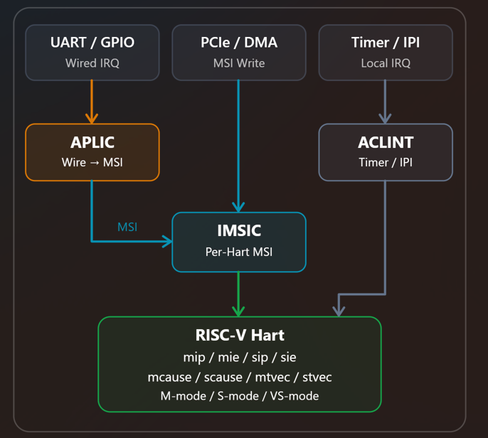
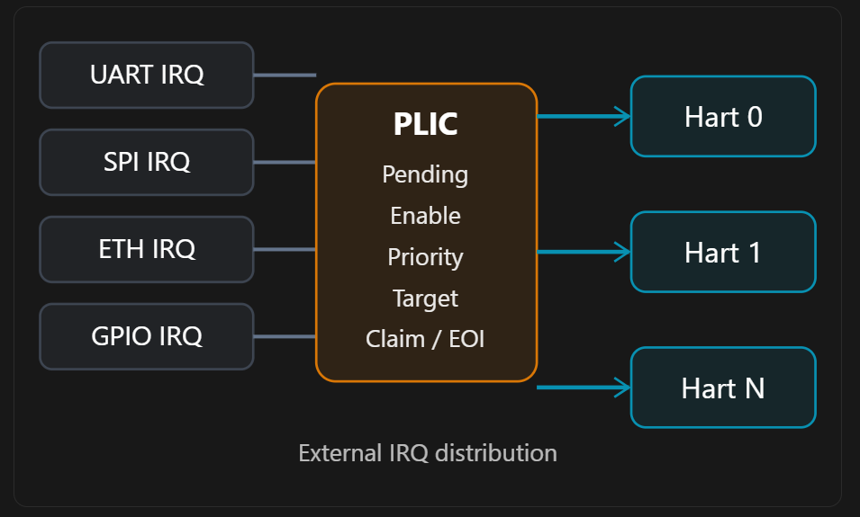

# RISC-V 中断架构系统解析：从 PLIC、APLIC、AIA 到 IMSIC

核心目标：建立完整的 RISC-V Interrupt Architecture 心智模型，并掌握从硬件到 OpenSBI、Linux、OP-TEE 的中断排查方法。

你的困惑实际上来自 RISC-V 和 Arm 在中断架构设计上的一个重要差异：

- Arm GIC 采用相对统一的架构体系，通过 GICv2、GICv3、GICv4 等版本逐步扩展功能。
- RISC-V 则将中断系统拆分为不同功能模块，通过组合这些模块来满足 MCU、Linux SoC、服务器以及虚拟化平台的不同需求。

所以，理解 RISC-V 中断架构的关键，不是分别记忆 PLIC、APLIC、IMSIC 的定义，而是先回答三个问题：

1. 中断从哪里产生？ 例如 UART、PCIe、Timer、IPI。
2. 中断经过哪些组件才能到达 CPU？ 谁负责路由、优先级和中断编号？
3. CPU 最终如何响应中断？ 哪个 CSR 被设置，由 M-mode、S-mode 还是 VS-mode 处理？

只要建立这三层模型，整个中断体系就会变得清晰。

## 一、首先建立全局认识：RISC-V 中断架构的分类

RISC-V 中断体系并不是简单的线性版本升级关系，而是一个分层的架构。

| 名称     | 全称或含义                                    | 核心职责                                  |
| ------ | ---------------------------------------- | ------------------------------------- |
| PLIC   | Platform-Level Interrupt Controller      | 传统外部中断控制器，主要处理 Wired Interrupt        |
| AIA    | Advanced Interrupt Architecture          | 新一代中断架构规范，不是单个控制器                     |
| APLIC  | Advanced PLIC                            | AIA 定义的外部有线中断控制器，支持直接投递或转换为 MSI       |
| IMSIC  | Incoming MSI Controller                  | 每个 Hart 对应的 MSI 接收控制器                 |
| CLINT  | Core Local Interruptor                   | 传统 Timer / Software Interrupt（IPI）实现  |
| ACLINT | Advanced Core Local Interruptor          | 更模块化的 Timer / Software Interrupt 规范方案 |
| CLIC   | Core-Local Interrupt Controller          | 面向低延迟、向量化和中断嵌套的 MCU 中断架构方案            |
| ACLIC  | Advanced Core-Local Interrupt Controller | 基于 AIA 重新设计的 MCU 中断控制器方案，仍在规范演进中      |

这里需要特别指出：

AIC 并不是 RISC-V AIA 规范定义的标准中断控制器名称。 你可能遇到的是 ACLINT、CLIC、ACLIC 的简称或某家厂商的专有 AIC。需要结合对应芯片文档确认，不能直接把它与 APLIC、IMSIC 并列为 RISC-V 标准组件。

AIA 已于 2023 年获得批准，明确将 APLIC 和 IMSIC 定义为两个核心硬件控制器，同时扩展 Hart 的中断相关 CSR 和虚拟化机制。


## 二、最重要的一张架构图

先以一颗具有多个 Hart、运行 Linux、OpenSBI，并且支持 PCIe 的 RISC-V SoC 为例。



通过这张图，可以建立三个非常重要的认识：

第一，APLIC 和 IMSIC 不是竞争关系，而是经常协同工作。

APLIC 处理外设产生的 Wired Interrupt，IMSIC 接收 MSI。APLIC 在 MSI 模式下把有线中断转换为 MSI，交给目标 Hart 的 IMSIC。

第二，不是所有中断都经过 APLIC。

例如 PCIe 设备可以通过 MSI 写操作直接触发 IMSIC，而 Timer Interrupt、Software Interrupt 通常有另一条本地中断路径。

第三，不是所有 RISC-V SoC 都必须具备 APLIC + IMSIC。

一个简单 MCU 可能根本没有 PLIC 或 IMSIC；传统 Linux SoC 可能采用 PLIC + CLINT；支持 AIA 的服务器平台通常采用 IMSIC，并根据有线外设情况配备 APLIC。

这也是为什么你不能简单地把它们理解为 GICv1、GICv2、GICv3 那样的版本序列。

## 三、用 Arm GIC 的知识来理解 RISC-V

你已经熟悉 Arm GICv2/v3，所以这里最有效的办法是进行功能上的对应。

| Arm 中断组件                  | RISC-V 对应组件                        | 说明                 |
| ------------------------- | ---------------------------------- | ------------------ |
| GIC Distributor           | PLIC / APLIC                       | 管理外部 IRQ、使能、路由、优先级 |
| GIC Redistributor         | IMSIC（部分功能类似）                      | 管理 Hart 本地的中断状态    |
| GIC CPU Interface         | Hart Trap CSR + IMSIC / PLIC 接口    | CPU 接收并处理中断        |
| GIC ITS                   | MSI 地址映射、IOMMU、IMSIC 等机制           | 实现 MSI 投递及虚拟化相关功能  |
| GIC SGI                   | IPI / Software Interrupt           | CPU 之间发送中断         |
| Arm Generic Timer         | MTIMER / Sstc 等                    | 定时器中断              |
| GIC Virtual CPU Interface | H Extension + Guest Interrupt File | 支持虚拟机接收中断          |

这里是功能类比，不是严格的一一对应关系。

例如，Arm GICv3 ITS 具有设备 ID、事件 ID 到 LPI 的转换能力，而 IMSIC 主要负责接收、记录和投递 MSI。RISC-V 的 MSI 翻译与虚拟化还可能涉及 IOMMU。

从理解成本上看，可以记住：

- PLIC / APLIC 偏向全局中断分发。
- IMSIC 偏向每个 Hart 的本地 MSI 接收。
- Hart CSR 负责最终 Trap 处理。
- ACLINT / Sstc 处理独立的 Timer、IPI 等路径。

## 四、PLIC：传统 RISC-V 外部中断控制器

先理解 PLIC，再理解 APLIC 会容易很多。

### 4.1 为什么需要 PLIC？

假设一颗 SoC 有 4 个 Hart 和 64 个外设。

如果每个外设直接连接到每个 Hart，就需要大量的中断信号线。

PLIC 的设计是将外部中断集中管理，然后向 Hart 输出少量的外部中断通知信号。



PLIC 主要管理以下信息：

| 概念        | 功能                      |
| --------- | ----------------------- |
| Source ID | 硬件中断源的编号                |
| Priority  | 中断优先级                   |
| Pending   | 是否存在待处理中断               |
| Enable    | 某个 Hart Context 是否允许该中断 |
| Threshold | 中断响应的优先级门限              |
| Claim     | 获取待处理的中断 ID             |
| Complete  | 通知控制器中断处理完毕             |

PLIC 中的 Context 通常对应 Hart 与特权级的组合，例如 Hart 0 的 M-mode Context 或 S-mode Context。

### 4.2 从 UART 中断看 PLIC 的工作流程

假设 UART 对应 PLIC Source ID = 10，Linux 运行在 Hart 1 的 S-mode。

一次中断处理可以拆解为：

```
UART 收到数据
    |
    v
UART IRQ = Assert
    |
    v
PLIC Source 10 Pending = 1
    |
    v
PLIC 检查：
    - Hart 1 S-context Enable
    - Source Priority
    - Context Threshold
    |
    v
PLIC 向 Hart 1 发出 SEIP
    |
    v
Hart 1 满足 S-mode Trap 条件
    |
    v
scause = Interrupt | 9
    |
    v
Linux 读取 PLIC Claim
    |
    v
Claim 返回 Source ID = 10
    |
    v
Linux UART IRQ Handler
    |
    v
清除 UART 中断条件
    |
    v
写入 PLIC Complete = 10
```

这里有一个非常重要的细节：

`scause` 不会告诉你 UART 对应 Source ID 10。

`scause` 仅告诉你发生了 Supervisor External Interrupt，即 Interrupt Code = 9。

至于究竟是 UART、SPI 还是其他设备，需要进一步读取 PLIC 的 Claim 寄存器。

这和 Arm GIC 通过 `ICC_IAR1_EL1` 等接口读取中断号的思路是类似的。

另一个需要注意的地方是，PLIC 需要通过 Complete 通知对应 Gateway，使其能够继续向 PLIC 提交该来源的后续中断请求。

[image](https://www.google.com/s2/favicons?domain=https://docs.riscv.org\&sz=32)

RISC-V 文档+1


### 4.3 PLIC 的局限性是什么？

PLIC 能够满足传统 SoC 的外部中断需求，但面对服务器与虚拟化场景存在一些架构限制。

第一，缺少标准化的 MSI 接收能力。

例如 PCIe 设备通常通过 MSI 或 MSI-X 产生中断，本质上是发起一次 Memory Write。

PLIC 的主要输入是 Wired Interrupt，并没有提供像 IMSIC 那样的标准 MSI Interrupt File 机制。

第二，虚拟化不够方便。

在使用传统 PLIC 的情况下，VM 对物理中断的控制通常需要 Hypervisor 介入，模拟中断控制器或者注入虚拟中断。

第三，PLIC 的全局化设计不总是适合高度扩展的服务器。

尤其当系统需要大量 Hart、PCIe 设备以及虚拟机时，需要一种更适合 MSI 和虚拟化的中断架构。

这些问题推动了 AIA 的设计。

## 五、AIA：真正需要理解的新一代中断架构

首先再次强调：

AIA 是一种架构体系，不是一个硬件 IP。

它的目标不是简单地把 PLIC 升级为 PLICv2，而是将中断系统拆分为相互配合的组件。

### 5.1 AIA 解决了哪些问题？

AIA 的核心设计目标包含以下几个方面。

| 需求                 | AIA 的解决方式                       |
| ------------------ | ------------------------------- |
| 支持 Wired Interrupt | APLIC                           |
| 支持 MSI / MSI-X     | IMSIC                           |
| 支持 Hart 本地中断管理     | IMSIC Interrupt File            |
| 支持中断特权级分离          | APLIC Domain、M/S Interrupt File |
| 支持虚拟机中断            | Guest Interrupt File            |
| 支持现代服务器扩展          | 分布式 MSI 投递                      |
| 支持灵活的中断优先级         | AIA CSR 扩展                      |

AIA 还引入了 `Smaia`、`Ssaia` 等 ISA 扩展名称，用于描述 Hart 层面的中断行为和 CSR 扩展。

但请注意：Hart 支持 Smaia/Ssaia 并不等于 SoC 一定包含某种特定的 APLIC 硬件实现。

这是 ISA 扩展和平台硬件规范之间的区别。

[image](https://www.google.com/s2/favicons?domain=https://docs.riscv.org\&sz=32)

RISC-V 文档+1


### 5.2 APLIC 的两种工作模式

理解 APLIC 只需要抓住一个核心：

APLIC 可以在 Direct Mode 和 MSI Mode 之间选择适合硬件平台的中断投递方式。

Direct Mode

UART / GPIO

APLIC

Hart SEIP / MEIP

无需 IMSIC

MSI Mode

UART / GPIO

APLIC

IMSIC

MSI 投递至 Hart

在 Direct Mode 中，APLIC 的职责类似 PLIC，负责为 Hart 生成外部中断通知。

在 MSI Mode 中，APLIC 变成一个 Wired-to-MSI Translator。

例如：

```
GPIO IRQ #25
      |
      v
APLIC
      |
      | MSI Address = Hart 2 S-file Address
      | MSI Data    = EIID 45
      v
IMSIC of Hart 2
      |
      v
Hart 2 SEIP
```

这里有两个编号：

- Source ID = 25，代表 APLIC 的硬件输入中断源。
- EIID = 45，代表 IMSIC 中断文件内的 External Interrupt Identity。

Source ID 和 EIID 不要求相同。

这是排查 APLIC MSI Mode 时很容易忽略的地方。

APLIC 的寄存器也体现了这个设计，例如 `domaincfg` 的 DM 位决定 Direct / MSI 模式，`sourcecfg` 配置中断源，`target` 决定投递目的地及相应的优先级或 MSI 编号。

[image](https://www.google.com/s2/favicons?domain=https://docs.riscv.org\&sz=32)

RISC-V 文档


### 5.3 APLIC Domain 到底是什么意思？

这是另一个很值得深入的概念。

在 APLIC 内部，Domain 是一个具有独立中断控制接口的管理域。

例如：

```
              APLIC
                |
       M-mode Root Domain
                |
        Source Delegation
                |
        S-mode Domain
                |
            Linux
```

假设某个中断 Source ID = 10 原本由 M-mode Root Domain 管理。

如果 Root Domain 将它 Delegate 给 S-mode Domain，那么该中断源的具体配置与投递控制就可以由 S-mode Domain 接管。

这种机制有利于把普通设备中断交给 Linux，而 M-mode 保留对其他中断资源的控制。

对于实际的安全系统，需要区分：

| 概念                   | 作用                         |
| -------------------- | -------------------------- |
| APLIC Domain         | 中断源和 Hart 的管理、委托与投递        |
| OpenSBI Domain       | OpenSBI 管理的 Hart 与内存访问权限边界 |
| OP-TEE Secure Domain | 由 TEE 架构及平台硬件构建的安全执行边界     |

这三者并不是同一个东西。

APLIC Domain 能帮助划分中断管理权限，但它本身不等于完整的硬件安全隔离机制。安全方案还需要结合 PMP、MMIO 权限、DMA/IOMMU 以及实际的执行域切换设计。

## 六、IMSIC：理解 RISC-V 服务器中断的关键

如果说 PLIC、APLIC 主要管理外设中断的来源和路由，那么 IMSIC 就是 MSI 的最终接收端。

### 6.1 为什么要设计 IMSIC？

假设一颗服务器 SoC 有 16 个 Hart。

每个 Hart 都要接收来自 PCIe、网卡、存储控制器等设备的中断。

在 MSI 架构下，设备不需要为每个中断建立专用的信号线，而是通过 Memory Write 向目标中断控制器发送通知。

IMSIC 的设计就是让每个 Hart 都具有自己的 MSI 接收能力。

### 6.2 IMSIC 的 Interrupt File

一个 IMSIC 不一定只有一个 Interrupt File。

Hart 0 IMSIC（示意）

M-mode Interrupt File

M 权限

S-mode Interrupt File

Linux / HS

Guest Interrupt Files

可选

Guest 1

Guest 2

Guest N

绿色表示示意性的 Pending Bit。真实实现包含 EIP/EIE 等状态，不同 Interrupt File 具有各自的中断编号空间。

每个 Interrupt File 主要包含：

- `EIP`：External Interrupt Pending，记录已收到的中断。
- `EIE`：External Interrupt Enable，决定哪些中断允许被投递。
- `eidelivery`：控制 Interrupt File 的中断投递。
- `eithreshold`：中断优先级门限。
- `*topei`：获取并 Claim 最高优先级的待处理中断。

IMSIC 规范规定了 M、S 以及可选 Guest Interrupt File，同时通过相应 CSR 提供控制接口。

[image](https://www.google.com/s2/favicons?domain=https://docs.riscv.org\&sz=32)

RISC-V 文档


### 6.3 IMSIC 收到 MSI 后，CPU 如何处理？

假设 PCIe 网卡向 Hart 2 的 S-mode Interrupt File 写入 EIID 80。

```
PCIe NIC
    |
    | Memory Write
    | Address = Hart 2 S-file MSI Address
    | Data    = 80
    v
IMSIC Hart 2
    |
    | EIP[80] = 1
    |
    | 检查 EIE[80]
    | 检查 eidelivery
    | 检查 eithreshold
    v
Hart 2 SEIP = 1
    |
    v
CPU Trap to stvec
    |
    | scause = Interrupt | 9
    v
Linux IRQ Entry
    |
    | Claim stopei
    v
EIID = 80
    |
    v
NIC IRQ Handler
```

请注意这里出现了一个和 PLIC 不同的地方：

在 IMSIC 场景下，Linux 通过 `stopei` 获取中断编号，而不是读取 PLIC 的 Claim 寄存器。

对于 IMSIC，使用 `csrrw` 读取并写入 `stopei` 可以原子地 Claim 相应中断，并清除该 Interrupt File 中的 Pending 状态。

示意汇编：

```
csrrw t0, stopei, zero
srli  t1, t0, 16
```

此处 `t1` 得到 Interrupt Identity。

这和 PLIC 的 Claim / Complete 流程不同。IMSIC 没有传统 PLIC 那样单独的 Complete 写操作，但设备侧的中断条件仍然需要按照设备规范清除或确认。

参考：[RISC-V AIA — IMSIC Specification](https://docs.riscv.org/reference/aia/v1.0/IMSIC.html?utm_source=chatgpt.com)

## 七、CLINT、ACLINT、CLIC 又是什么关系？

到这里已经能够理解外部中断了，但 RISC-V 还有两类非常重要的中断：

Timer Interrupt 和 Software Interrupt。

它们通常不走传统 PLIC 的外部 IRQ 路径。

### 7.1 CLINT 与 ACLINT

经典 CLINT 主要提供两类功能：

```
CLINT
 |
 +-- MTIME / MTIMECMP --> Machine Timer Interrupt
 |
 +-- MSIP             --> Machine Software Interrupt
```

ACLINT 将这类功能模块化：

| ACLINT 模块 | 功能                           |
| --------- | ---------------------------- |
| MTIMER    | 提供 Timer Counter 与比较寄存器      |
| MSWI      | 提供 M-mode Software Interrupt |
| SSWI      | 提供 S-mode Software Interrupt |

所以可以将 ACLINT 理解成对传统 CLINT 相关功能进行更清晰的模块化定义。

不过 CLINT 属于长期使用的传统平台实现名称，ACLINT 的公开规范仍应注意其 Draft 状态，不能简单认定所有硬件都会遵循相同的配置方式。

[image](https://www.google.com/s2/favicons?domain=https://github.com\&sz=32)

GitHub


### 7.2 Sstc 解决了什么问题？

传统系统中，Linux 如果需要设置下一次 S-mode Timer Interrupt，通常通过 SBI Timer 接口请求 OpenSBI 帮忙配置定时器。

引入 Sstc 扩展后，在满足硬件和权限条件时，S-mode 可以直接使用 `stimecmp` 来设置计时器中断。

这是 CPU Timer 机制的发展，与 APLIC/IMSIC 的外部中断路由不是同一个问题。

### 7.3 CLIC / ACLIC 是另一条路线

CLIC 主要面向 MCU、实时系统，强调低延迟、Vectored Interrupt 和 Nested Interrupt。

例如在实时控制系统中，希望高优先级中断能够快速抢占低优先级中断，并尽量减少软件保存现场的成本。

RISC-V 在这一方向上长期有 CLIC 方案，随后演进出更强调与 AIA 统一的 ACLIC。

截至 2026 年 11 月，ACLIC 仍处于标准化演进过程中，不能把它当作与 AIA v1.0 相同成熟度的已批准规范。

[image](https://www.google.com/s2/favicons?domain=https://riscv.atlassian.net\&sz=32)

RISC-V Tech Hub+1


对于你的 RISC-V 服务器与 OP-TEE 方向，建议优先掌握 PLIC、APLIC、IMSIC、ACLINT/Sstc，CLIC/ACLIC 主要建立概念即可。

## 八、真正建立工程能力：从 CPU Trap 反推中断控制器

无论外部使用 PLIC 还是 IMSIC，中断最终都会进入 RISC-V Hart 的 Trap 机制。

这是所有中断排查的共同终点。

### 8.1 必须掌握的 CSR

| CSR       | 作用                       | 排查意义                                |
| --------- | ------------------------ | ----------------------------------- |
| `mip`     | M-mode Interrupt Pending | 中断是否进入 Hart 的相应 Pending 状态          |
| `mie`     | M-mode Interrupt Enable  | M-mode 中断使能                         |
| `mstatus` | M-mode 中断全局状态等           | 检查 MIE 等状态                          |
| `mideleg` | 中断 Delegation            | 中断是否允许由 S-mode 处理                   |
| `sip`     | S-mode Interrupt Pending | S-mode 可见的 Pending 状态               |
| `sie`     | S-mode Interrupt Enable  | S-mode 中断使能                         |
| `sstatus` | S-mode 状态                | 检查 SIE                              |
| `scause`  | Trap Cause               | 判断是 Timer、IPI 还是 External Interrupt |
| `stvec`   | S-mode Trap Vector       | 中断最终跳到哪里                            |
| `stopei`  | IMSIC S-mode Claim 接口    | 获取 MSI Interrupt Identity           |

普通非虚拟化场景中，最常见的中断 Cause 编号如下：

| Interrupt Code | 含义                            |
| -------------- | ----------------------------- |
| 1              | Supervisor Software Interrupt |
| 3              | Machine Software Interrupt    |
| 5              | Supervisor Timer Interrupt    |
| 7              | Machine Timer Interrupt       |
| 9              | Supervisor External Interrupt |
| 11             | Machine External Interrupt    |

需要注意，`scause` 的最高位用于标识 Interrupt，剩余字段才是 Cause 编号。

例如 RV64 中：

```
scause = 0x8000000000000009
```

表示 Supervisor External Interrupt，并不表示中断源编号为 9。

### 8.2 三层中断使能模型

以 Linux S-mode 接收一个 IMSIC 外部中断为例，需要检查至少三个层次：

第一层：中断源与上游控制器

UART 是否真正发出了 IRQ？APLIC 是否配置了正确 Source、Target 和 Domain？

第二层：IMSIC 本地状态

对应 EIID 是否 Pending、Enabled？`eidelivery` 与 `eithreshold` 是否允许投递？

第三层：Hart Trap 机制

`mideleg`、`sie.SEIE`、`sstatus.SIE` 是否符合当前运行特权级的中断接收条件？`stvec` 是否正确？

以上是简化模型。具体中断是否能够 Trap，还取决于当前 Privilege Mode、Delegation 规则及虚拟化状态。

## 九、结合 OpenSBI、Linux、OP-TEE 看中断组件的职责边界

对于你的实际开发方向，这部分尤其重要。

### 9.1 OpenSBI 的职责

OpenSBI 主要负责 M-mode Firmware 层面的中断相关工作，例如平台中断控制器的初始化、M-mode Trap 处理、部分硬件资源配置、IPI、Timer 以及中断委托策略。

可以从下面这些源码路径入手：

```
opensbi/
 ├── lib/sbi/
 │   ├── sbi_irqchip.c
 │   ├── sbi_ipi.c
 │   ├── sbi_timer.c
 │   └── sbi_trap.c
 │
 └── lib/utils/irqchip/
     ├── plic.c
     ├── aplic.c
     └── imsic.c
```

具体文件及初始化路径会随 OpenSBI 版本和平台而变化。

一个重要原则：

普通 Linux 外设中断被正确委托给 S-mode 后，不应该每次都由 OpenSBI 软件处理再转交 Linux。

否则会增加额外的 Trap 和上下文切换成本。

### 9.2 Linux 的职责

Linux 负责普通外设 IRQ 的管理与分发，包括设备驱动注册、IRQ Mapping、IRQ Affinity、IRQ Handler，以及中断控制器的相关管理。

推荐阅读的源码入口：

| Linux 文件                                     | 用途                              |
| -------------------------------------------- | ------------------------------- |
| `drivers/irqchip/irq-riscv-intc.c`           | Hart Local Interrupt Controller |
| `drivers/irqchip/irq-sifive-plic.c`          | PLIC                            |
| `drivers/irqchip/irq-riscv-aplic-main.c`     | APLIC 主入口和工作模式选择                |
| `drivers/irqchip/irq-riscv-aplic-direct.c`   | APLIC Direct Mode               |
| `drivers/irqchip/irq-riscv-aplic-msi.c`      | APLIC MSI Mode                  |
| `drivers/irqchip/irq-riscv-imsic-platform.c` | IMSIC 平台初始化                     |
| `drivers/irqchip/irq-riscv-imsic-state.c`    | IMSIC 状态管理                      |

例如 Linux 的 APLIC 驱动会根据设备描述选择 Direct Mode 或 MSI Mode；在 Device Tree 路径中，`msi-parent` 是这一判断的重要依据。

[image](https://www.google.com/s2/favicons?domain=https://github.com\&sz=32)

GitHub+2


### 9.3 OP-TEE 的职责

对于 OP-TEE，你需要额外关注中断处理的安全归属问题。

例如：

```
                      External IRQ
                           |
                           v
                        APLIC
                           |
                           v
                        IMSIC
                           |
                           v
                       RISC-V Hart
                           |
                     Trap Handling
                           |
              +------------+-----------+
              |                        |
         Normal World              Secure World
            Linux                     OP-TEE
```

这是逻辑上的安全域划分，不意味着标准 AIA 本身就提供 Secure/Non-secure World 的自动切换。

如果 Linux 和 OP-TEE 采用不同的执行域，必须进一步回答：

1. 哪个执行域负责接收物理中断？
2. Secure IRQ 如何与 Normal IRQ 区分？
3. OP-TEE 执行期间如果收到普通外设中断，应该暂存、转交还是切换执行域？
4. 多 Hart 情况下，IMSIC 状态、Hart Context 和中断配置由谁维护？
5. 当两个执行域都使用 S-mode 时，Trap Vector、CSR 状态及中断所有权如何隔离或切换？

这些不是仅靠 APLIC 的 Domain Delegation 就能自动解决的问题。

尤其在 RISC-V TEE Porting 中，必须结合具体的 TEE 架构、执行特权级以及硬件隔离机制设计中断路由。不能直接将 Arm TrustZone 的 Secure IRQ / Non-secure IRQ 行为套到标准 RISC-V AIA 上。

## 十、最实用的部分：以后遇到中断问题该从哪里排查？

这部分可以作为日后调试的速查手册。

### 10.1 根据故障现象快速定位

| 故障现象                     | 优先检查                                               |
| ------------------------ | -------------------------------------------------- |
| UART 一直没有中断              | UART IRQ Status、PLIC/APLIC Source                  |
| `scause=9` 但找不到实际外设      | PLIC Claim / APLIC Claim / IMSIC `stopei`          |
| APLIC Pending 但 CPU 没有响应 | Domain、Enable、Target、IMSIC、Hart CSR                |
| PCIe MSI 完全无效            | MSI Address/Data、IMSIC、IOMMU/地址路由                  |
| MSI 已发送但无法进入 S-mode      | IMSIC Interrupt File、`sie`、`sstatus`、Delegation    |
| Timer Interrupt 失效       | MTIMER、`mtimecmp`、Sstc、SBI Timer                   |
| 多核 IPI 失效                | MSWI / SSWI / IMSIC IPI、SBI IPI                    |
| 只有某个 Hart 收不到中断          | Target Hart、Hart Index、IMSIC 本地状态                  |
| VM 内设备中断异常               | Guest Interrupt File、`hgeip`、`hstatus.VGEIN`、IOMMU |
| OP-TEE 执行时中断丢失           | 安全域中断策略、Trap Context、Mask/Unmask、目标 Hart           |

### 10.2 Linux 中的第一轮检查

进入 Linux 后，可以先执行：

```
cat /proc/interrupts
dmesg | grep -Ei 'plic|aplic|imsic|irqchip|interrupt'

cat /proc/cpuinfo
cat /proc/cmdline
```

如果使用 Device Tree：

```
ls /proc/device-tree/
ls /proc/device-tree/cpus/
```

也可以将运行时 Device Tree 导出：

```
dtc -I fs -O dts \
    /proc/device-tree > running.dts
```

然后重点检查：

```
interrupt-controller
interrupt-parent
interrupts
interrupts-extended
msi-parent
riscv,num-sources
```

例如 APLIC 使用 MSI Mode 时，设备树中的 `msi-parent` 应正确关联到 IMSIC。

如果属性或 Phandle 配置错误，Linux 可能无法正确建立 IRQ Domain 关系。

### 10.3 建议记住的中断排查链

1

Device

外设是否产生 IRQ 或 MSI？

IRQ Status / MSI Write

2

PLIC / APLIC

中断源是否正确使能和路由？

Pending / Enable / Target / Domain

3

IMSIC（如有）

MSI 是否进入目标 Interrupt File？

EIP / EIE / eidelivery / EIID

4

Hart CSR

CPU 是否能够响应中断？

mip / sip / sie / mideleg / status

5

Trap Handler

中断编号是否正确读取和分发？

scause / stvec / claim / topei

6

Device Driver

设备中断条件是否清除？

ISR / ACK / EOI / Re-arm

这个流程比记忆单个寄存器更重要。

当某次中断没有进入 Linux Handler 时，你应该从 Device 开始逐级查找，确定中断信号在哪一层消失，而不是直接怀疑 Linux IRQ 子系统。

对于 Palladium、ZeBu 等预硅仿真环境，这种方法尤其有效，因为你通常可以同时观察外设 IRQ Signal、中断控制器寄存器和 Hart Trap 状态。

## 十一、RISC-V Server SoC 的推荐架构

对于新设计的服务器 SoC，AIA 已经不是一个可有可无的研究方向。

RISC-V Server SoC Specification v1.0 明确要求支持 AIA、采用 MSI 向应用处理器 Hart 投递外部中断，并要求 IMSIC 支持 S-mode Interrupt File 和一定数量的 VS-mode Guest Interrupt Files。对于采用有线中断的外设，则要求使用 APLIC 将其转换为 MSI。

[image](https://www.google.com/s2/favicons?domain=https://docs.riscv.org\&sz=32)

RISC-V 文档


所以，针对服务器与机密计算项目，应该重点关注下面这条链：

```
PCIe Device
     |
     | MSI / MSI-X
     v
 IOMMU / MSI Routing
     |
     v
 IMSIC Interrupt File
     |
     v
 RISC-V Hart
     |
     +---- S-mode Linux
     |
     +---- VS-mode Guest
```

而有线外设则通常是：

```
UART / GPIO / SPI
        |
        v
      APLIC
        |
        | Wire -> MSI
        v
      IMSIC
        |
        v
       Hart
```

这两条路径结合起来，就是现代 RISC-V Server SoC 外部中断架构的核心。

## 十二、最后总结：记住这五句话就够了

PLIC 是传统方案。

它集中管理 Wired Interrupt，主要通过 Claim / Complete 完成中断处理。

AIA 是新一代架构规范。

它不等于某个中断控制器，而是将 APLIC、IMSIC、CSR 扩展和虚拟化机制组织到一起。

APLIC 处理 Wired Interrupt。

Direct Mode 直接通知 Hart，MSI Mode 把 Wired Interrupt 转换成 MSI。

IMSIC 负责接收 MSI。

它靠近 Hart，管理 M/S/Guest Interrupt File，是现代 RISC-V 虚拟化中断架构的关键。

CLINT / ACLINT 主要是 Timer 和 IPI 路线。

它们不应该和 PLIC/APLIC 混为一谈；CLIC/ACLIC 则更关注实时 MCU 的快速中断响应。

针对你目前的 RISC-V + OpenSBI + OP-TEE 开发，我建议后续继续深入一个非常具体的工业场景：

在一颗 16-Hart 的 RISC-V Server SoC 中，从 UART 产生 Wired IRQ 开始，逐寄存器追踪 APLIC → IMSIC → `sip.SEIP` → `scause` → Linux IRQ Handler 的完整过程，再分析当 Hart 正在执行 OP-TEE 时，这条路径应该如何处理。

这个实验可以把中断规范、Hart Trap、OpenSBI 初始化、Linux IRQ Domain 和 TEE 安全域切换真正连接起来。
