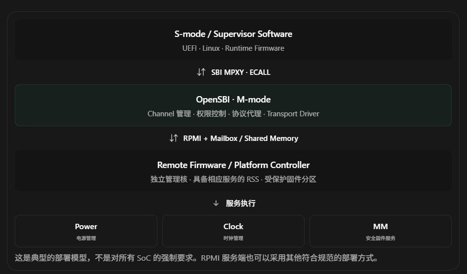

# RISC-V SBI MPXY 深度解析：从设计理念到 OpenSBI、RPMI 与 OP-TEE 集成

学习目标：Why → What → How → Source Code

首先给出一个最重要的结论：

MPXY（Message Proxy Extension）是 RISC-V SBI 定义的通用消息代理接口。它的主要作用，是让运行在 S-mode 的软件，通过 SBI 实现，安全、统一地访问其他固件或管理处理器提供的消息服务，而不必直接控制底层的 Mailbox、共享内存和硬件传输机制。

它本身不是一种具体的消息协议，也不是硬件 Mailbox Controller。

例如，在一个同时集成 OpenSBI、RPMI、UEFI、独立 HSM/RSS 和安全执行环境的 RISC-V SoC 中，可以形成这样的软件架构：



这里需要明确几个职责边界：

- SBI：S-mode 软件与底层固件之间的标准二进制接口。
- MPXY：SBI 中负责通用消息代理的扩展。
- RPMI：定义系统管理消息的服务组、服务 ID、参数及返回值的协议。
- Mailbox：消息实际传输时可能使用的硬件 IPC 机制。
- OpenSBI：SBI 的开源实现，可以承担 MPXY 代理及 RPMI 客户端职责。
- OP-TEE / Standalone MM：可能位于服务提供端，也可能根据具体架构承担安全服务。它们并不是 MPXY 的组成部分。

SBI MPXY 已纳入 SBI 3.0 规范，扩展 ID 为 `0x4D505859`。它与 RPMI 的对接方式也已有标准定义。

[image](https://www.google.com/s2/favicons?domain=https://docs.riscv.org\&sz=32)

docs.riscv.org+1


下面先把这套架构建立起来，再进入真正的源码实现。

# Part I — WHY：为什么 RISC-V 需要 MPXY？

## 1. 从传统 SoC 系统管理架构开始

### 1.1 一个很现实的需求

假设我们设计一颗 RISC-V Server SoC：

- 16 个 Application Harts，分别支持 M/S/U-mode。
- OpenSBI 运行在 Application Harts 的 M-mode。
- Linux 或 UEFI 运行在 S-mode。
- 系统中还有一个独立的 Platform Management Controller。
- Controller 负责电源域、时钟、部分复位以及平台管理服务。

Linux 现在希望关闭某个设备的电源域。

从业务角度看，操作很简单：

```
power_domain_off(DEVICE_POWER_DOMAIN);
```

但真正的硬件操作可能涉及：

1. 确认设备已进入可关闭状态。
2. 向管理核提交电源操作请求。
3. 等待管理核完成相应操作。
4. 获取成功或失败的状态。
5. 将结果返回到 Linux 驱动。

这就引出了一个架构问题：

Linux 应该如何与运行在另一个物理处理器上的管理固件通信？

### 1.2 在 MPXY 出现之前，通常有三种实现方式

#### 方案 A：Linux 直接访问 Mailbox Controller

典型调用链：

```
Linux Power Driver
    |
    v
Linux Mailbox Framework
    |
    v
Mailbox Controller Driver
    |
    v
MMIO / Shared Memory / Doorbell
    |
    v
Platform Management Firmware
    |
    v
Power Management Service
```

这是一种成熟且常见的设计，Arm SCMI 也可以采用 Mailbox 作为底层传输。

但在某些 RISC-V SoC 中，它可能引入几个问题：

问题一：跨越了固件管理的资源边界。

如果 Mailbox 硬件和管理固件已经由 M-mode OpenSBI 控制，那么允许 S-mode Linux 同时直接访问这些资源，就需要额外考虑权限划分、资源所有权以及并发访问。

问题二：OS 需要理解特定的硬件传输实现。

不同 SoC 的 Mailbox Controller 可能完全不同，Linux 需要相应的驱动、设备描述和资源管理机制。

问题三：某些服务不应直接暴露给 S-mode。

例如系统级复位控制、特定的安全固件管理命令，或者管理固件中需要更高权限才能执行的操作。

需要强调，直接 Mailbox 并不是不安全或不合理的方案。对于明确分配给 S-mode、权限设计完善的通信资源，它仍然是非常好的选择。

#### 方案 B：为每种业务增加专用 SBI Extension

例如：

```
Linux
   |
   +--> SBI HSM    --> Hart Management
   |
   +--> SBI SRST   --> System Reset
   |
   +--> SBI CPPC   --> Performance Management
   |
   +--> Vendor SBI --> Vendor Service
```

这种方案的优势是接口简单、职责明确，而且对于具有稳定语义的核心 SBI 服务非常合适。

但是，假设远端管理固件提供几十个不同的 RPMI 服务。

如果每增加一个 RPMI Service，都要定义新的 SBI FID 或 Vendor Extension，那么可能产生：

- SBI 接口数量持续膨胀。
- 不同厂商定义大量相似的私有接口。
- 同一套消息协议需要在 SBI 中重新定义参数和返回格式。
- 各平台难以复用相同的上层协议客户端。

这不是说原有 SBI Extension 设计有缺陷，而是它们并不适合承担所有通用消息传输需求。

#### 方案 C：Vendor-specific SBI 通信接口

例如，厂商可能定义：

```
vendor_sbi_mailbox_send(service_id, buffer, size);
```

Linux 通过 `ecall` 进入 OpenSBI，再由厂商代码把消息发给管理核。

这已经接近 MPXY 的思路。

但它存在一个明显问题：

缺乏跨厂商的标准 ABI。

不同厂商可能采用不同的：

- EID/FID。
- 消息 Buffer 格式。
- Channel 标识方式。
- 同步与异步机制。
- 错误处理机制。
- 服务发现机制。

因此，即便底层都在使用 RPMI，Linux 或 UEFI 仍然可能需要不同的代理驱动。

## 2. MPXY 要解决的核心问题

MPXY 的设计目标可以总结为四个方面。

| 需求        | MPXY 提供的机制            |
| --------- | --------------------- |
| 统一入口      | 固定 SBI EID/FID        |
| 多种消息协议    | Protocol ID + Channel |
| 隐藏硬件传输差异  | SBI 实现负责 Transport    |
| 控制软件可见的服务 | Channel 暴露与服务过滤       |

这里有一个非常重要的设计思想：

MPXY 标准化的是消息代理接口，而不是全部底层消息协议。

因此，Linux 不需要知道 RPMI 到底经过哪一个物理 Mailbox，但 Linux 的 RPMI 客户端仍然必须知道 RPMI Service ID、请求数据格式及响应格式。

这正是 MPXY 与普通 SBI HSM、SRST 等语义型扩展的本质区别。

另外，MPXY 不是通用安全认证系统。它提供权限边界和代理实施的位置，但真正的安全性仍然取决于 PMP/ePMP、内存隔离、Channel 授权、请求验证和远端固件实现。

# Part II — WHAT：MPXY 的架构与设计原理

## 3. MPXY 在软件架构中的位置

从分层架构来看，MPXY 可以划分为四层：

```
+------------------------------------------+
| Application / Firmware Service           |
| Linux Driver / UEFI Driver / OP-TEE Core  |
+------------------------------------------+
| Protocol Client                          |
| RPMI Clock / Power / MM / TEE             |
+------------------------------------------+
| SBI MPXY                                  |
| Channel / Attribute / Message / Shmem    |
+------------------------------------------+
| OpenSBI MPXY Framework                    |
| Channel Registry / Access Control        |
| Protocol Driver / Transport Adapter      |
+------------------------------------------+
| Physical Transport                        |
| Mailbox / Shared Memory / Local Dispatch |
+------------------------------------------+
| Remote Service Implementation            |
+------------------------------------------+
```

这几层承担不同的职责。

例如 Linux 想要设置时钟频率：

- RPMI Clock Client 知道如何构造 CLOCK Service 请求。
- MPXY 知道把消息发到哪一个 Channel。
- OpenSBI 知道如何根据 Channel 找到对应的处理函数。
- RPMI Transport Driver 知道如何操作底层 Mailbox。
- 远端服务端知道如何真正修改 Clock Controller。

MPXY 只负责其中一个抽象层，不直接规定 Clock Controller 应当如何操作。

## 4. Channel：MPXY 最重要的核心抽象

理解 MPXY，首先需要理解 Channel。

一个 MPXY Channel 包含以下关键元素：

```
MPXY Channel
    |
    +-- channel_id       : uint32_t
    |
    +-- protocol_id      : RPMI / Vendor
    |
    +-- protocol_version
    |
    +-- capabilities
    |
    +-- max_message_size
    |
    +-- timeouts
    |
    +-- protocol_attributes
    |
    +-- backend implementation
```

### 4.1 为什么需要 Channel？

因为一套 MPXY 接口可能代理多种不同的服务。

以 RPMI 为例：

| Channel ID（示例） | Protocol ID | RPMI Service Group |
| -------------- | ----------- | ------------------ |
| 0x10           | RPMI = 0    | CLOCK              |
| 0x11           | RPMI = 0    | DEVICE_POWER       |
| 0x12           | RPMI = 0    | MANAGEMENT_MODE    |
| 0x13           | RPMI = 0    | VOLTAGE            |

这里的 Channel ID 只是举例，并不是规范指定的固定编号。

注意：一个 RPMI MPXY Channel 对应一个 RPMI Service Group，而不是对应一个 Service ID。

例如 CLOCK Channel 内部可以有多个服务：

```
Channel ID = 0x10
    |
    +-- Protocol = RPMI
    |
    +-- Service Group = CLOCK
          |
          +-- GET_ATTRIBUTES
          +-- GET_RATE
          +-- SET_RATE
          +-- 其他 CLOCK 服务
```

`message_id` 在这里就是该 Service Group 内的 `SERVICE_ID`。

这是 RPMI 与 MPXY 集成规范明确要求的映射规则。

[image](https://www.google.com/s2/favicons?domain=https://docs.riscv.org\&sz=32)

docs.riscv.org


### 4.2 Channel 是硬件 Channel 吗？

不一定。

这是最容易误解的地方。

MPXY Channel 是软件抽象，Mailbox Channel 则是传输层的通信资源。

二者之间不要求一一对应。

例如：

```
MPXY Clock Channel -------+
                          |
MPXY Power Channel -------+-- OpenSBI --> RPMI Mailbox
                          |
MPXY MM Channel ----------+
```

具体映射取决于底层 RPMI Transport 实现及资源分配。

一个物理 Mailbox 通道可以在满足协议和并发要求的前提下被复用；不同的 MPXY Channel 也可以绑定不同的物理通道或软件服务端。

### 4.3 Channel 的访问权限

在更复杂的安全系统中，可能同时存在：

```
Domain A: Linux / REE
Domain B: OP-TEE / TEE
Domain C: Management Firmware
```

即使这些 Domain 都可以通过 M-mode OpenSBI 发起 SBI 调用，也不意味着它们应该看见相同的 MPXY Channel。

例如：

```
Linux Domain
    CLOCK
    DEVICE_POWER

OP-TEE Domain
    CLOCK
    MANAGEMENT_MODE
    Secure Vendor Service
```

这里的可见性由 SBI 实现根据平台安全策略决定。

当前 OpenSBI 源码中的 `struct sbi_mpxy_channel` 包含 `owner_domain` 字段，并在查找 Channel 时结合当前 Domain 进行检查。因此 Channel 的访问控制不只是一个抽象建议，而是已体现在 OpenSBI 的实现中。

[image](https://www.google.com/s2/favicons?domain=https://github.com\&sz=32)

GitHub


## 5. MPXY 的八个 SBI Function

MPXY 在 SBI 3.0 中定义了以下 Function：

| FID | Function                  | 核心作用          |
| --- | ------------------------- | ------------- |
| 0   | `GET_SHMEM_SIZE`          | 获取共享内存要求      |
| 1   | `SET_SHMEM`               | 注册或更换共享内存     |
| 2   | `GET_CHANNEL_IDS`         | 枚举 Channel    |
| 3   | `READ_ATTRIBUTES`         | 读取 Channel 属性 |
| 4   | `WRITE_ATTRIBUTES`        | 修改可写属性        |
| 5   | `SEND_MSG_WITH_RESP`      | 同步发送并等待响应     |
| 6   | `SEND_MSG_WITHOUT_RESP`   | 发送无需响应的消息     |
| 7   | `GET_NOTIFICATION_EVENTS` | 获取异步通知事件      |

这些函数统一使用：

```
#define SBI_EXT_MPXY 0x4D505859
```

需要注意，FID 5、6 以及相关通知能力是否可用，必须依据 Channel Capability 判断，不能仅因为 MPXY 扩展可用就假设所有通信模式都支持。

[image](https://www.google.com/s2/favicons?domain=https://docs.riscv.org\&sz=32)

docs.riscv.org


## 6. MPXY Shared Memory：为什么不直接用 SBI 寄存器传参？

### 6.1 传统 SBI 调用

例如 SBI HSM：

```
sbi_hart_start(hartid, start_addr, opaque);
```

它的参数数量和数据大小都很有限，使用 `a0~a5` 寄存器就可以完成传递。

但 RPMI 消息通常包含结构化数据，甚至可能包含可变长度的消息 Payload。

假如需要传递：

```
struct firmware_message {
    uint32_t command;
    uint32_t payload_len;
    uint8_t payload[1024];
};
```

显然不适合把整个结构放进几个通用寄存器。

因此 MPXY 采用：

寄存器传递控制信息，Shared Memory 传递消息数据。

### 6.2 完整的通信过程

S-mode 客户端

M-mode OpenSBI

概念时序图。FID 5 的执行期间，OpenSBI 可以通过其他后端处理消息，并在响应完成后返回。

### 6.3 这是 Per-hart Shared Memory

假设 16 个 hart 同时需要使用 MPXY：

```
Hart 0  --> MPXY Shmem[0]
Hart 1  --> MPXY Shmem[1]
Hart 2  --> MPXY Shmem[2]
 ...
Hart 15 --> MPXY Shmem[15]
```

规范要求为每个 hart 配置相应的共享内存。

这样做的好处是：

- 不同 hart 的消息数据不会天然共用同一 Buffer。
- 可以避免所有 hart 在同一消息缓冲区上竞争。
- 不同 hart 可以并行处理各自的 SBI MPXY 请求。
- 与 OpenSBI 的 per-hart runtime state 模型一致。

但有一个容易忽略的细节：

Per-hart Shared Memory 不代表底层 RPMI Transport 一定能够同时执行 16 个请求。

如果底层只有一个必须串行操作的 Mailbox Queue，OpenSBI Transport Driver 仍然需要同步与仲裁。

另外，同一 hart 上不同软件层可能先后使用 MPXY，因此规范还定义了 `OVERWRITE_RETURN` 模式，供运行时固件临时替换并恢复原来的 Shared Memory。

### 6.4 MPXY Shmem 和 RPMI Shmem 是两回事

这需要特别强调。

典型系统中可能有三种不同的共享内存：

| 内存区域                   | 通信双方                  | 作用                                       |
| ---------------------- | --------------------- | ---------------------------------------- |
| MPXY Shmem             | S-mode ↔ OpenSBI      | 传递 SBI MPXY 消息数据                         |
| RPMI Transport Shmem   | OpenSBI ↔ RPMI Server | 底层 RPMI 消息队列与数据传输                        |
| MM Communication Shmem | 非安全客户端 ↔ MM 服务端       | 传递 `EFI_MM_COMMUNICATE_HEADER` 等 MM 业务数据 |

第三种只在相应的 MM 服务场景中出现。

它们可能都使用物理内存，但具有不同的所有权、布局、生命周期和安全要求。

例如，调用 `MM_COMMUNICATE` 时，MPXY Shmem 中通常只放 RPMI 服务定义的 Request 数据，而真正的 UEFI MM Communication Buffer 可以位于另一片专用内存区域。

不能把这三片内存直接当作同一个 Buffer。

## 7. Channel Attributes

MPXY 使用 Attribute 来描述 Channel 的能力。

重点属性包括：

| Attribute ID | 属性                         | 作用            |
| ------------ | -------------------------- | ------------- |
| `0x00`       | `MSG_PROT_ID`              | 指明 RPMI 或其他协议 |
| `0x01`       | `MSG_PROT_VERSION`         | 协议版本          |
| `0x02`       | `MSG_DATA_MAX_LEN`         | 最大消息长度        |
| `0x03`       | `MSG_SEND_TIMEOUT`         | 消息发送超时        |
| `0x04`       | `MSG_COMPLETION_TIMEOUT`   | 消息完成超时        |
| `0x05`       | `CHANNEL_CAPABILITY`       | 发送、通知等能力位     |
| `0x80000000` | RPMI Service Group ID      | 确认具体 RPMI 服务组 |
| `0x80000001` | RPMI Service Group Version | 服务组版本         |

后面两个属于 RPMI Protocol-specific Attributes。

它们之所以从 `0x80000000` 开始，是因为 MPXY 将 Attribute ID 的最高位用于区分标准属性和协议专有属性。

因此，完整的发现过程是：

```
Discover Channel
       |
       v
Read MSG_PROT_ID
       |
       +-- Not RPMI --> Other Protocol Driver
       |
       v
Read RPMI SERVICEGROUP_ID
       |
       +-- CLOCK --> RPMI Clock Client
       |
       +-- MM ----> RPMI MM Client
       |
       +-- POWER -> RPMI Power Client
```

这是一种通用的、可扩展的服务发现设计。

需要注意：Channel ID 的初始发现还依赖 Device Tree、ACPI 等标准硬件描述机制，MPXY 本身并未定义新的硬件发现协议。 `GET_CHANNEL_IDS` 用于在 SBI 已暴露的 Channel 集合中枚举具体 ID。

[image](https://www.google.com/s2/favicons?domain=https://docs.riscv.org\&sz=32)

docs.riscv.org+1


# Part III — HOW：MPXY 如何用于真实业务？

下面选择三个场景，它们代表三种不同的集成模式：

1. Linux → OpenSBI → RPMI Clock / Power Management。
2. UEFI → SBI MPXY → RPMI Management Mode → Standalone MM。
3. Linux → OpenSBI → OP-TEE Secure Domain。

其中前两类可以直接基于现有标准和已实现的 OpenSBI 代码分析。第三类则涉及 2026 年仍在演进的 RISC-V TEE 通信框架。

## 8. 场景一：Linux 调用 RPMI Clock Service

### 8.1 完整调用链

假设 Linux 需要读取时钟频率：

```
Linux Clock Framework
       |
       v
RPMI Clock Client
       |
       | RPMI CLOCK_GET_RATE
       v
Linux MPXY Mailbox Driver
       |
       | SBI MPXY, FID #5
       v
OpenSBI ECALL Dispatcher
       |
       v
OpenSBI MPXY Framework
       |
       | Find channel
       v
RPMI Clock Proxy Driver
       |
       | RPMI Message
       v
RPMI Mailbox Transport
       |
       v
Platform Management Controller
       |
       v
Clock Service
       |
       v
Return Clock Rate
```

这条链路中，Linux 的 Clock Client 并不知道底层 Mailbox 控制器的寄存器地址。

它知道的是：

- RPMI CLOCK Service Group。
- RPMI `GET_RATE` Service ID。
- 需要传递的 Clock ID。
- 响应数据如何解释。

其他部分由 Linux MPXY Driver 和 OpenSBI 实现。

### 8.2 Linux 如何构造消息？

逻辑上可以抽象为：

```
struct rpmi_request {
    uint32_t clock_id;
};

struct rpmi_response {
    int32_t status;
    uint32_t rate_low;
    uint32_t rate_high;
};
```

以上结构只是用于帮助理解 Request/Response 机制的示意，准确的字段和编码应以 RPMI CLOCK 规范及对应代码为准。

上层通过一个已经绑定 CLOCK Service Group 的 Channel 发送 `GET_RATE` 消息。

在 OpenSBI 中，真实的 CLOCK Service 描述位于：

`lib/utils/mpxy/fdt_mpxy_rpmi_clock.c`

它提供了 `clock_services[]`，列举 CLOCK 各个服务的 Request/Response 大小及 Service ID，并通过以下结构将其绑定到 RPMI Service Group：

```
static const struct mpxy_rpmi_data clock_data = {
    .servicegrp_id = RPMI_SRVGRP_CLOCK,
    .num_services = RPMI_CLOCK_SRV_MAX_COUNT,
    .service_data = clock_services,
};
```

因此，OpenSBI MPXY Driver 不需要重新解释 Clock 的业务含义，只需验证服务是否存在及消息尺寸是否合法，再将 Request 发送给真正的 RPMI 服务端。

源码：[OpenSBI RPMI CLOCK MPXY Driver](https://github.com/riscv-software-src/opensbi/blob/master/lib/utils/mpxy/fdt_mpxy_rpmi_clock.c?utm_source=chatgpt.com)

## 9. 场景二：UEFI Variable Service → RPMI Management Mode

这是一个更适合联系 Firmware、Security 和 OP-TEE 知识的例子。

### 9.1 为什么 UEFI Variable 需要安全服务？

UEFI Variable 包括：

- 普通 Firmware Configuration。
- BootOrder 等启动配置。
- Secure Boot 相关变量。
- PK、KEK、db、dbx 等安全策略数据。

它们并不全都需要相同的安全处理，但对于受认证保护的变量，UEFI 必须执行严格的访问控制和认证检查。

一种实现方案是把相关 Variable Service 的处理和受保护存储放到 Standalone MM 中。

UEFI 非安全侧通过 MM Communication Protocol 或等价的 Runtime 通信机制调用受保护的 MM 服务。

对于 RISC-V，RPMI MANAGEMENT_MODE Service Group 可以承载这类通信。

### 9.2 完整架构

```
UEFI Runtime Services
    |
    | SetVariable()
    v
Variable Runtime Driver
    |
    v
MM Communication Client
    |
    | EFI_MM_COMMUNICATE_HEADER
    | + Variable Service Payload
    v
RPMI MANAGEMENT_MODE Client
    |
    | Service ID = MM_COMMUNICATE
    v
SBI MPXY
    |
    | ECALL
    v
OpenSBI MPXY Framework
    |
    v
RPMI MM Proxy Driver
    |
    | Mailbox / Local Forwarding
    v
Management Mode Service Endpoint
    |
    v
Standalone MM Core
    |
    v
Variable MM Driver
    |
    v
Protected Variable Storage
```

这是符合 RPMI/MM 模型的一种集成架构，并不意味着所有 UEFI RISC-V 平台都采用它。MM 服务也不一定运行在独立 HSM 核上；它可以运行在受隔离的 Application Hart 固件 Domain 中。

### 9.3 RPMI MANAGEMENT_MODE 的具体协议

RPMI v1.0 中定义：

RPMI Service Group

MANAGEMENT_MODE

0x000B

| `0x01` | MM_ENABLE_NOTIFICATION |
| ------ | ---------------------- |
| `0x02` | MM_GET_ATTRIBUTES      |
| `0x03` | MM_COMMUNICATE         |

`MM_GET_ATTRIBUTES` 返回 MM Version、MM Shared Memory 物理地址以及 Shared Memory Size。

`MM_COMMUNICATE` 的请求数据由四个连续的 32-bit Word 组成：

| Word | 字段                           | 意义                  |
| ---- | ---------------------------- | ------------------- |
| 0    | `MM_COMM_INPUT_DATA_OFFSET`  | 输入数据在 MM Shmem 内的偏移 |
| 1    | `MM_COMM_INPUT_DATA_SIZE`    | 输入大小                |
| 2    | `MM_COMM_OUTPUT_DATA_OFFSET` | 输出区域偏移              |
| 3    | `MM_COMM_OUTPUT_DATA_SIZE`   | 最大输出大小              |

响应包含：

| Word | 字段                         |
| ---- | -------------------------- |
| 0    | `STATUS`                   |
| 1    | `MM_COMM_RETURN_DATA_SIZE` |

这是 RPMI 定义的业务请求，不是 SBI MPXY 本身定义的格式。

规范来源：[RPMI MANAGEMENT_MODE Service Group](https://github.com/riscv-non-isa/riscv-rpmi/blob/main/src/srvgrp-management.adoc?utm_source=chatgpt.com)

### 9.4 一次 MM_COMMUNICATE 到底如何执行？

假设 MM Shared Memory 位于：

```
MM_SHMEM_PA = 0x90000000
MM_SHMEM_SIZE = 64 KB
```

这里仅使用假设地址说明流程。

UEFI 首先在 MM Shared Memory 中准备业务数据：

```
0x90000000
    |
    +-- EFI_MM_COMMUNICATE_HEADER
    |
    +-- Variable Service Request
    |
    +-- ...
```

随后准备 RPMI Request：

```
uint32_t req[4] = {
    0,       /* input offset */
    1024,    /* input size */
    4096,    /* output offset */
    4096,    /* maximum output size */
};
```

这个请求需要被序列化为 RPMI 规定的 Little-endian 32-bit Word。

接下来，MPXY Client 将这 16 字节写入本 hart 的 MPXY Shared Memory，再执行：

```
SBI MPXY Send Message With Response
    channel_id = MM Channel
    message_id = 0x03
    message_data_len = 16
```

OpenSBI 收到请求后，找到与 MM Channel 绑定的 RPMI Backend。

Backend 将 RPMI Request 转发给 MM 服务端，服务端根据请求中的 Offset 和 Size，从 MM Shared Memory 读取真实的 Variable Request。

完成操作后：

1. MM 服务端将业务结果写到 MM Shared Memory 的 Output 区域。
2. RPMI `MM_COMMUNICATE` 返回 STATUS 和实际写入长度。
3. OpenSBI 将 RPMI Response 放回 MPXY Shared Memory。
4. SBI ECALL 返回 UEFI。
5. UEFI 从 MM Shared Memory 读取最终业务结果。

这里要区分三层返回值：

- `sbiret.error`：SBI MPXY 调用是否成功。
- RPMI Response `STATUS`：RPMI MM Service 是否成功执行。
- Variable Service 的业务返回值：具体 UEFI Variable 操作是否成功。

SBI_SUCCESS 并不等于 SetVariable 一定成功。 它只能说明 SBI MPXY 消息交换已经成功完成。

### 9.5 OpenSBI 已经实现这条链路的哪些部分？

目前公开 OpenSBI 中有：

`lib/utils/mpxy/fdt_mpxy_rpmi_mm.c`

它已经支持 MM GET_ATTRIBUTES 和 MM COMMUNICATE 的处理，并通过 RPMI Mailbox Backend 转发消息。

因此，这并不是完全停留在规范设计阶段的功能。

不过，实现了 OpenSBI 的 MM Proxy，并不等于平台上已经部署 Standalone MM Core、Variable Driver、存储后端以及全部必要的安全策略。

源码：[OpenSBI RPMI Management Mode Driver](https://github.com/riscv-software-src/opensbi/blob/master/lib/utils/mpxy/fdt_mpxy_rpmi_mm.c?utm_source=chatgpt.com)

## 10. 场景三：Linux 通过 MPXY 与 OP-TEE 通信

这一部分要特别区分两种架构：

架构 A：OP-TEE 是 MPXY Client。

```
OP-TEE S-mode Domain
       |
       | SBI MPXY
       v
OpenSBI M-mode
       |
       v
RPMI Management Service
```

架构 B：OP-TEE 是 Linux 所访问的 TEE Service Endpoint。

```
Linux S-mode Domain
       |
       | SBI MPXY
       v
OpenSBI M-mode
       |
       | RPMI TEE Framework
       | Domain Context Switch
       v
OP-TEE S-mode Domain
```

这两种模式的方向完全不同。

第一种是 OP-TEE 主动使用底层平台管理服务；第二种是 Linux 主动请求执行 OP-TEE 的安全服务。

目前 OP-TEE 上游已经有第一种模式对应的 MPXY Client 基础代码。第二种模式所需的 RPMI TEE 框架、Linux OP-TEE RPMI Backend 和 Domain Switch 通信路径在 2026 年仍有上游 RFC 方案推进。

尤其值得关注的是 RPMI v2.0 开发分支中的 TEE Service Group，ID 为 `0x0010`。它包含 TEE Call、内存共享与 Endpoint 管理相关服务，但不能把它当作已经冻结的 RPMI v1.0 功能。

[image](https://www.google.com/s2/favicons?domain=https://github.com\&sz=32)

GitHub+2


接下来我们从已经存在的源码入手。

# Part IV — SOURCE CODE：结合 OpenSBI + OP-TEE 逐层分析

这一部分基于核对过的公开上游源码。为了便于追踪，我会按照真实函数名说明调用链，代码中的少量简化片段会标明是示意逻辑。

## 11. 源码阅读地图

建议先认识下面这些文件：

| 项目      | 源码路径                                     | 主要职责                 |
| ------- | ---------------------------------------- | -------------------- |
| OP-TEE  | `core/arch/riscv/kernel/boot.c`          | MPXY 初始化入口           |
| OP-TEE  | `core/arch/riscv/kernel/sbi_mpxy.c`      | SBI MPXY 客户端         |
| OP-TEE  | `core/arch/riscv/kernel/sbi_mpxy_rpmi.c` | RPMI Protocol Client |
| OP-TEE  | `core/arch/riscv/include/sbi.h`          | SBI ECALL 汇编封装       |
| OpenSBI | `lib/sbi/sbi_trap.c`                     | M-mode Trap 分发       |
| OpenSBI | `lib/sbi/sbi_ecall.c`                    | SBI EID 分发           |
| OpenSBI | `lib/sbi/sbi_ecall_mpxy.c`               | MPXY FID 分发          |
| OpenSBI | `lib/sbi/sbi_mpxy.c`                     | MPXY Core Framework  |
| OpenSBI | `lib/utils/mpxy/fdt_mpxy_rpmi.c`         | RPMI Channel 与消息转发   |
| OpenSBI | `lib/utils/mpxy/fdt_mpxy_rpmi_mm.c`      | MM Service Group     |
| OpenSBI | `lib/utils/mailbox/`                     | RPMI Transport 实现    |

以下的第一条真实代码路径，就是：

```
OP-TEE
  sbi_mpxy_rpmi_send_data()
       |
       v
  sbi_mpxy_send_message_with_response()
       |
       v
  sbi_ecall()
       |
       v
OpenSBI
  sbi_trap_handler()
       |
       v
  sbi_ecall_handler()
       |
       v
  sbi_ecall_mpxy_handler()
       |
       v
  sbi_mpxy_send_message()
       |
       v
  channel->send_message_with_response()
       |
       v
  __mpxy_send_message()
       |
       v
  mbox_chan_xfer()
       |
       v
  RPMI Transport / Remote Server
```

这条链路能够把 OP-TEE 的 SBI 汇编调用和 OpenSBI 的后端回调完整串起来。

## 12. OP-TEE：从 Boot 初始化开始

源码：

[OP-TEE RISC-V boot.c](https://github.com/OP-TEE/optee_os/blob/master/core/arch/riscv/kernel/boot.c?utm_source=chatgpt.com)

在 RISC-V OP-TEE 的 `boot.c` 中：

- Primary Hart 初始化期间调用 `sbi_mpxy_init()`。
- 如果 MPXY 初始化成功，继续调用 `sbi_mpxy_rpmi_probe_channels()`。
- Secondary Hart 初始化期间也会调用 `sbi_mpxy_init()`。

可以将相关逻辑简化为：

```
/* Primary Hart */
if (sbi_mpxy_init() == SBI_SUCCESS)
    sbi_mpxy_rpmi_probe_channels();

/* Secondary Hart */
sbi_mpxy_init();
```

这恰好对应前面提到的两个不同层级：

每个 Hart 都需要自己的 MPXY Shared Memory，但 RPMI Channel Discovery 不需要在每一个 Hart 上独立建立一份全局表。

OP-TEE 当前实现是在 Primary Hart 完成 Channel 探测，再使用一个共享的 RPMI Context 保存发现结果。

### 12.1 `sbi_mpxy_init()`

源码：

[OP-TEE sbi_mpxy.c](https://github.com/OP-TEE/optee_os/blob/master/core/arch/riscv/kernel/sbi_mpxy.c?utm_source=chatgpt.com)

函数首先通过 `sbi_ext_available(SBI_EXT_MPXY)` 检查 OpenSBI 是否支持 MPXY Extension。

如果存在，则调用：

```
sbi_mpxy_set_shmem();
```

接着进入比较关键的内存初始化过程。

### 12.2 `sbi_mpxy_set_shmem()` 逐步分析

该函数完成以下工作：

1. 读取 OpenSBI 要求的共享内存大小

   调用 `sbi_mpxy_get_shmem_size()`，本质上执行 `SBI_EXT_MPXY_GET_SHMEM_SIZE`。
2. 检查 Shared Memory 的合法性

   检查 Size 是否非零，是否满足 4 KB 对齐要求。
3. 屏蔽异常并获取 Per-hart Context

   使用 `thread_mask_exceptions(THREAD_EXCP_ALL)` 避免当前 Hart 上的异常处理与初始化流程发生冲突。
4. 分配共享内存

   通过 `memalign(SMALL_PAGE_SIZE, shmem_size)` 分配内存，然后清零。
5. 将虚拟地址转换为物理地址

   调用 `virt_to_phys()`，得到实际提供给 OpenSBI 的物理内存地址。
6. 通过 SBI ECALL 注册 Shared Memory

   调用 `SBI_EXT_MPXY_SET_SHMEM`，采用 `OVERWRITE` 模式。
7. 设置初始化完成状态

   保存 Shared Memory VA、PA、Size，并将当前 Hart 标记为 `shmem_active`。

这里的 Per-hart 结构在 OP-TEE 中定义为 `struct mpxy_core_local`，包含：

```
shmem         -- Virtual Address
shmem_pa      -- Physical Address
shmem_size    -- Buffer Size
shmem_active  -- Initialization Status
```

其数组按 `CFG_TEE_CORE_NB_CORE` 分配，具体元素通过 `get_core_pos()` 选择。

这也说明为什么 OP-TEE 需要在初始化期间正确建立 `hartid → core_pos` 映射。

### 12.3 为什么必须传 Physical Address？

因为 SBI 接口跨越了 S-mode 与 M-mode。

OP-TEE Core 在 S-mode 下使用的地址通常经过 `satp` 所控制的地址转换，而 OpenSBI 在 M-mode 下并不会直接使用 OP-TEE 当前的 S-mode 虚拟地址空间。

所以：

```
OP-TEE VA
    |
    | virt_to_phys()
    v
Physical Address
    |
    | SBI SET_SHMEM
    v
OpenSBI
```

这是 Firmware/OS 工程中最基础，但又非常容易出错的地址空间边界。

尤其应当检查：

- PA 是否正确。
- 内存是否属于调用方的 SBI Domain。
- OpenSBI 是否有权限访问该区域。
- 缓存一致性和内存属性是否满足平台要求。

## 13. OP-TEE：SBI ECALL 的汇编级实现

源码：

[OP-TEE RISC-V SBI ABI 定义](https://github.com/OP-TEE/optee_os/blob/master/core/arch/riscv/include/sbi.h?utm_source=chatgpt.com)

OP-TEE 在 `sbi.h` 中定义了 `_sbi_ecall()` 宏。

它的核心实现是把函数参数放入固定的 RISC-V ABI 寄存器，然后执行：

```
ecall
```

以 MPXY FID 5 为例，调用前寄存器的语义是：

| 寄存器     | 数值或含义              |
| ------- | ------------------ |
| `a0`    | `channel_id`       |
| `a1`    | `message_id`       |
| `a2`    | `message_data_len` |
| `a3~a5` | 未使用，传 0            |
| `a6`    | `5`（FID）           |
| `a7`    | `0x4D505859`（EID）  |

因此，可以构造一个用于学习的汇编示例：

```
# 例如 channel_id = 0x12
li a0, 0x12

# MM_COMMUNICATE service
li a1, 0x03

# Request 大小为 16 bytes
li a2, 16

li a3, 0
li a4, 0
li a5, 0

# SBI Function ID
li a6, 5

# SBI Extension ID (MPXY)
li a7, 0x4D505859

ecall
```

这个例子假设当前 Hart 已注册 MPXY Shared Memory，Request Data 已被放入 Shared Memory，且 `0x12` 确实对应一个可用的 MM Channel。

### 13.1 CPU 执行 ECALL 后发生什么？

假设当前处于 S-mode，执行 `ecall`。

在典型的 OpenSBI M-mode SBI 部署中：

1. CPU 触发 Environment Call from S-mode Exception。
2. `mcause` 记录异常原因，Exception Code 为 9。
3. `mepc` 记录触发 `ecall` 的 PC。
4. `mstatus.MPP` 记录原来的特权模式。
5. CPU 跳转到 `mtvec` 指定的 M-mode Trap Handler。
6. OpenSBI 保存 Trap Context 并分发异常。
7. 最终进入 SBI ECALL Dispatcher。

这里有一个架构细节：S-mode 发起的 ECALL 在这种设计中不能被委托给普通的 S-mode Trap Handler，否则它就不会进入预期的 M-mode SBI 实现。

### 13.2 OpenSBI 如何识别 MPXY？

源码：

[OpenSBI SBI ECALL Dispatcher](https://github.com/riscv-software-src/opensbi/blob/master/lib/sbi/sbi_ecall.c?utm_source=chatgpt.com)

在 `sbi_ecall_handler()` 中，OpenSBI 从保存的寄存器获得：

```
extension_id <- regs->a7
func_id      <- regs->a6
```

然后根据 Extension ID 寻找对应的 `struct sbi_ecall_extension`。

对于 MPXY：

```
EID = 0x4D505859
    |
    v
ecall_mpxy
    |
    v
sbi_ecall_mpxy_handler()
```

正常完成时，OpenSBI 对保存的 Trap Context 执行相当于以下的操作：

```
mepc += 4
a0 = SBI Error
a1 = Return Value
```

这里 `mepc += 4` 的意义非常重要：`ecall` 是一条 32-bit 指令，返回后应当继续执行下一条指令，而不是再次执行同一个 `ecall`。

随后 Trap Return 使用恢复后的 Context 返回调用方。

### 13.3 返回寄存器是什么？

对于 `SEND_MSG_WITH_RESP`：

```
a0 = SBI_SUCCESS / Error Code
a1 = Response Data Length
```

注意：`a1` 并不是 RPMI Response 中的 STATUS。

RPMI Response 实际位于前面注册的 MPXY Shared Memory 内。

因此 OP-TEE 收到 SBI 返回后，需要：

1. 检查 `a0` 是否为 `SBI_SUCCESS`。
2. 使用 `a1` 判断 Response 的实际长度。
3. 检查返回长度不超过本地 Shared Memory 和目标 Buffer。
4. 将 Response 从 MPXY Shmem 复制到调用者提供的 Buffer。
5. 由上层 RPMI Client 解析业务 STATUS。

这就是 SBI 返回值与 RPMI 返回值分层的具体代码体现。

## 14. OpenSBI：MPXY ECALL Dispatcher

源码：

[OpenSBI sbi_ecall_mpxy.c](https://github.com/riscv-software-src/opensbi/blob/master/lib/sbi/sbi_ecall_mpxy.c?utm_source=chatgpt.com)

这个文件相当于一个非常薄的 Adapter。

它不处理 RPMI Clock、Power 或 MM 的具体业务，而是依据 FID 分发请求。

例如：

```
FID 0 --> sbi_mpxy_get_shmem_size()
FID 1 --> sbi_mpxy_set_shmem()
FID 2 --> sbi_mpxy_get_channel_ids()
FID 3 --> sbi_mpxy_read_attrs()
FID 4 --> sbi_mpxy_write_attrs()
FID 5 --> sbi_mpxy_send_message()
FID 6 --> sbi_mpxy_send_message()
FID 7 --> sbi_mpxy_get_notification_events()
```

FID 5 与 FID 6 都调用 `sbi_mpxy_send_message()`，但传入的 Response Length Pointer 不同。

FID 5 传入有效的 `&out->value`，要求等待响应。

FID 6 则传入 `NULL`，表示无需响应。

还有一个细节：

`ecall_mpxy` 只有在 `sbi_mpxy_channel_available()` 为真时才会注册。

因此，OpenSBI 编译时包含 MPXY 代码，不代表运行时一定可以通过 SBI Probe 发现 MPXY Extension。

如果平台没有注册可用的 MPXY Channel，上层就不应假设这个扩展可用。

## 15. OpenSBI：MPXY Core Framework

源码：

[OpenSBI MPXY Core Framework](https://github.com/riscv-software-src/opensbi/blob/master/lib/sbi/sbi_mpxy.c?utm_source=chatgpt.com)

这个文件是整套架构的核心。

### 15.1 Channel Registry

OpenSBI 内部维护一个 Channel List。

每个 Channel 的主要信息由 `struct sbi_mpxy_channel` 表示，包括：

```
channel_id
owner_domain
attrs
read_attributes()
write_attributes()
send_message_with_response()
send_message_without_response()
get_notification_events()
```

这里的函数指针非常重要。

可以把 MPXY Framework 看作一个面向消息协议的驱动框架：

```
SBI MPXY Core
       |
       +-- Channel Registry
       |
       +-- Domain Visibility
       |
       +-- Generic Attribute Handling
       |
       +-- Protocol Driver Callbacks
                 |
                 +-- RPMI Clock
                 +-- RPMI Power
                 +-- RPMI MM
```

这种设计把通用 ABI 与具体协议处理分开了。

### 15.2 Per-Domain + Per-Hart 状态

值得注意的是，当前 OpenSBI 的实现比单纯的 Per-hart State 更进一步。

它通过 `sbi_domain_register_state()` 注册 MPXY 状态，并在每个 Domain 内为相应 Hart 建立 Context。

逻辑上可以表示为：

```
OpenSBI
  |
  +-- REE Domain
  |     |
  |     +-- Hart 0 MPXY State
  |     +-- Hart 1 MPXY State
  |
  +-- TEE Domain
        |
        +-- Hart 0 MPXY State
        +-- Hart 1 MPXY State
```

这意味着 Linux Domain 和 OP-TEE Domain 即使使用相同的物理 Hart，也不必共享同一个 MPXY Shared Memory 注册状态。

从实现角度看，这是支持受隔离 Supervisor Domain 的重要基础。

### 15.3 Channel Domain Check

当前实现中，`mpxy_channel_visible()` 的核心判断是 Channel 的 `owner_domain` 是否与当前 Domain 相同。

因此：

```
Linux Domain
    |
    +-- Channel belongs to REE?
           |
           +-- Yes --> Accessible
           |
           +-- No ---> Not exposed
```

在 `sbi_mpxy_send_message()` 中，OpenSBI 会查找当前 Domain 可见的 Channel。

如果找不到，返回 `SBI_ERR_NOT_SUPPORTED`。

这不只是错误码选择的问题。

对于不应暴露的 Channel，返回 Not Supported 可以避免直接向调用方暴露其他 Domain 中存在的具体服务。

### 15.4 Shared Memory Address Validation

在 `sbi_mpxy_set_shmem()` 中，OpenSBI 会检查：

- Flags 是否有效。
- 地址是否满足页对齐要求。
- 物理地址是否符合当前 XLEN 相关约束。
- 当前 Domain 对指定内存范围是否具备 S-mode Read/Write 权限。

最后一项使用 `sbi_domain_check_addr_range()` 实现。

这里 OpenSBI 实际承担的是一种内存访问边界的检查职责：调用者不能任意选择一个它无权访问的物理地址，要求 OpenSBI 将那里当作 Shared Memory。

处理 Shared Memory 时，当前实现还会使用 `sbi_hart_protection_temp_map_range()` 与相应的 Unmap 操作，以配合 Hart Protection 机制。

这对于使用 PMP/ePMP 或其他 M-mode 保护机制的系统尤其重要。

## 16. 真正发送一条消息：`sbi_mpxy_send_message()`

现在进入最关键的函数。

位于：

`lib/sbi/sbi_mpxy.c`

它的逻辑可归纳为：

```
sbi_mpxy_send_message()
    |
    +-- Locate current Domain + Hart State
    |
    +-- Check MPXY Shmem registered
    |
    +-- Find Channel in current Domain
    |
    +-- Check send capability
    |
    +-- Validate message length
    |
    +-- Map Shared Memory for firmware access
    |
    +-- Invoke Channel backend callback
    |
    +-- Unmap Shared Memory
    |
    +-- Check response length and result
    |
    +-- Return SBI status
```

下面解释其中最值得关注的几个环节。

### 16.1 获取当前 Domain 和 Hart

OpenSBI 会取得当前 Hart 的 MPXY State，以及当前 Domain。

这是运行时判断。

同样的 SBI EID 和 FID，从不同 Domain 发起，可能访问到不同的 Channel 集合。

也就是说：

SBI MPXY 是统一的 ABI，但背后的资源视图可以是 Domain-specific 的。

### 16.2 验证 Channel 和 Message Size

OpenSBI 会检查：

- Shared Memory 是否存在。
- Channel 是否可见。
- 当前 Channel 是否支持要求的发送方式。
- Request Length 是否超过 MPXY Shmem Size。
- Request Length 是否超过 Channel 的 `MSG_DATA_MAX_LEN`。

这些检查之后，才进入 Protocol Backend。

### 16.3 调用 Channel Callback

真正执行通信的是 Channel 所提供的 Callback，例如：

`channel->send_message_with_response()`

这就意味着 MPXY Core 不需要知道：

- RPMI Service 是 Clock 还是 MM。
- RPMI Transport 是何种 Mailbox。
- Remote Endpoint 是独立 MCU 还是本地受保护固件。
- 实际的硬件 Doorbell 如何触发。

这些事情交给具体 Backend。

这里正是 MPXY 设计最有价值的地方：通过稳定的 SBI ABI 和 Callback 机制，把 Supervisor 客户端与底层传输实现解耦。

## 17. OpenSBI：RPMI Protocol Driver

源码：

[OpenSBI RPMI MPXY Protocol Driver](https://github.com/riscv-software-src/opensbi/blob/master/lib/utils/mpxy/fdt_mpxy_rpmi.c?utm_source=chatgpt.com)

在这个文件中，可以找到 `__mpxy_send_message()`。

它主要完成：

1. 根据 `message_id` 查找对应 RPMI Service。
2. 验证该 Service 支持的 Request/Response Length。
3. 构建 `rpmi_message_args`。
4. 构建 `mbox_xfer`。
5. 调用 Transport 或 Group-specific Transfer Callback。
6. 将响应长度返回 MPXY Framework。

其中值得关注的是 `rpmi_message_args` 的几个字段：

```
type
flags
service_id
rx_data_len
```

当调用要求同步响应时，Driver 使用 RPMI `NORMAL_REQUEST`。

当调用不要求响应时，使用 RPMI `POSTED_REQUEST`。

因此：

```
SBI MPXY FID 5
       |
       v
RPMI NORMAL_REQUEST

SBI MPXY FID 6
       |
       v
RPMI POSTED_REQUEST
```

最终通过 `mbox_chan_xfer()` 或 Group-specific 的 `xfer_group()` 执行实际传输。

到这里，MPXY 与 RPMI 的边界就非常清楚了：

- SBI MPXY 负责接收并管理抽象消息请求。
- RPMI Driver 负责构建符合协议的 Service Message。
- Mailbox Framework 负责实际通信。
- Remote Firmware 负责执行服务。

### 17.1 为什么需要 `xfer_group()`？

这是一个很有意思的扩展点。

并不是所有 Service Group 都需要原样把请求发送到远端。

例如 MANAGEMENT_MODE Driver 可能需要在本地缓存 MM Shared Memory 属性，或者对部分请求进行本地处理。

因此，OpenSBI 提供了 Group-specific Transfer Callback。

它允许特定 RPMI Service Group 在通用传输之前执行一些特殊逻辑。

这并不破坏 MPXY 的通用设计，因为特殊逻辑始终被限制在相应的 RPMI Backend 中。

## 18. OpenSBI：RPMI MANAGEMENT_MODE 的具体实现

现在来看：

`lib/utils/mpxy/fdt_mpxy_rpmi_mm.c`

这个文件非常适合作为理解 MPXY 的第一个真实案例，因为代码量不大，但包含完整的协议代理过程。

### 18.1 Service Table

文件内部有一个 `mm_srvcdata[]` 数组，描述：

- `RPMI_MM_SRV_ENABLE_NOTIFICATION`
- `RPMI_MM_SRV_GET_ATTRIBUTES`
- `RPMI_MM_SRV_COMMUNICATE`

每个 Service 指定允许的最小、最大 Request 和 Response 长度。

这样，在 RPMI Backend 调用底层 Mailbox 之前，就已经可以检查消息格式。

### 18.2 `mpxy_rpmi_mm_setup()`

这是一个尤其重要的初始化函数。

它首先使用 RPMI `MM_GET_ATTRIBUTES` 从远端服务端查询：

```
MM Version
MM Shmem Physical Address
MM Shmem Size
```

随后将这片 MM Shared Memory 注册到对应 SBI Domain 的内存区域中。

真实代码使用：

`sbi_domain_add_memrange()`

以及相应的 `SBI_DOMAIN_MEMREGION_SHARED_SURW_MRW` 属性。

这里应当关注两个问题。

第一，为什么需要修改 Domain Memory Region？

因为调用该 MM 服务的 Supervisor Software 需要访问 MM Shared Memory。

如果 MM Shared Memory 不属于当前 Domain 的可访问范围，即使 MPXY 消息本身可以发送，业务数据也不一定能够被正确读写。

第二，这是否意味着该 Shared Memory 是完全可信的？

不是。

MM Shared Memory 是跨信任边界的数据交换区域。

MM 服务端必须自行验证：

- Offset 和 Size 是否越界。
- 整数加法是否溢出。
- 输入与输出区域是否满足协议要求。
- 业务请求是否有权限执行。
- 是否存在 TOCTOU 问题。
- 返回数据大小是否超过 Output Buffer。

PMP 或 Domain Memory Region 配置只能解决部分访问隔离问题，不能代替 MM 的业务安全验证。

### 18.3 `mpxy_rpmi_mm_xfer()`

这个函数承担 MM Service Group 的具体消息处理。

对于 `MM_GET_ATTRIBUTES`，它可以直接利用初始化期间缓存的结果构建响应。

对于 `MM_COMMUNICATE`，它调用底层 `mbox_chan_xfer()` 转发。

因此，整体逻辑是：

```
RPMI MM Request
      |
      v
mpxy_rpmi_mm_xfer()
      |
      +-- GET_ATTRIBUTES
      |      |
      |      v
      |   Return cached MM attributes
      |
      +-- COMMUNICATE
             |
             v
          mbox_chan_xfer()
             |
             v
          MM Service Endpoint
```

这里已经体现了一个很成熟的 Firmware 设计模式：

Metadata 可以在初始化阶段缓存，真正的服务调用则转发给具有实际执行能力的服务端。

另外，当前这个 MM Driver 在 OpenSBI 中仍标记了 `experimental = true`。因此，在正式产品中使用时，需要结合所采用的 OpenSBI 版本确认其接口、设备树绑定和兼容性状态。

## 19. OP-TEE：RPMI Protocol Client 的完整实现

源码：

[OP-TEE sbi_mpxy_rpmi.c](https://github.com/OP-TEE/optee_os/blob/master/core/arch/riscv/kernel/sbi_mpxy_rpmi.c?utm_source=chatgpt.com)

前面已经分析了 OP-TEE 如何初始化 MPXY Shared Memory，以及如何通过 `ecall` 进入 OpenSBI。

现在需要解决另一个问题：

OP-TEE 如何知道哪个 MPXY Channel 对应 RPMI？又如何找到具体的 RPMI Service Group？

### 19.1 `sbi_mpxy_rpmi_probe_channels()`

这个函数负责建立 OP-TEE 内部的 RPMI Channel Table。

调用顺序如下：

```
sbi_mpxy_rpmi_probe_channels()
    |
    +-- sbi_mpxy_get_shmem_size()
    |
    +-- Allocate RPMI Context
    |
    +-- sbi_mpxy_get_channel_count()
    |
    +-- sbi_mpxy_get_channel_ids()
    |
    +-- For each channel:
    |      |
    |      +-- sbi_mpxy_read_attributes()
    |      |
    |      +-- Check msg_proto_id == RPMI
    |      |
    |      +-- sbi_mpxy_rpmi_read_attributes()
    |      |
    |      +-- Allocate Notification Buffer
    |
    +-- Store discovered RPMI Channels
```

其中最重要的判断是：

```
if (channel->attrs.msg_proto_id != SBI_MPXY_MSGPROTO_RPMI_ID)
    continue;
```

只有 Protocol ID 为 RPMI 的 Channel 才会被保留。

然后读取 RPMI Protocol-specific Attributes：

```
sbi_mpxy_read_attributes(
    channel->channel_id,
    SBI_MPXY_ATTR_MSGPROTO_ATTR_START,
    sizeof(channel->rpmi_attrs) / sizeof(uint32_t),
    &channel->rpmi_attrs);
```

其中 `SBI_MPXY_ATTR_MSGPROTO_ATTR_START` 是 `0x80000000`。

读取后，Channel 就拥有了两组信息：

```
sbi_mpxy_rpmi_channel
    |
    +-- MPXY attributes
    |      |
    |      +-- protocol ID
    |      +-- protocol version
    |      +-- maximum message size
    |      +-- capabilities
    |
    +-- RPMI attributes
           |
           +-- servicegroup_id
           +-- servicegroup_version
           +-- implementation_id
           +-- implementation_version
```

因此，如果未来 OP-TEE 需要调用 RPMI MANAGEMENT_MODE 服务，可以在已发现的 Channel 中寻找：

```
channel->rpmi_attrs.servicegroup_id ==
    RPMI_SRVGRP_MANAGEMENT_MODE
```

注意，这里的 `servicegroup_id` 是从 OpenSBI 获取的，不能根据 Channel ID 猜测。

### 19.2 `sbi_mpxy_rpmi_send_data()`

这是 OP-TEE RPMI Client 的核心发送接口。

它接收：

```
struct sbi_mpxy_rpmi_channel *channel;
void *data;
```

其中 `data` 指向：

```
struct sbi_mpxy_rpmi_message
```

这个结构包含：

```
type
    |
    +-- GET_ATTRIBUTE
    +-- SET_ATTRIBUTE
    +-- SEND_WITH_RESPONSE
    +-- SEND_WITHOUT_RESPONSE
    +-- NOTIFICATION_EVENT

data
    |
    +-- service_id
    +-- request
    +-- request_len
    +-- response
    +-- response_len
    +-- max_response_len

error
```

这里还有一个必须区分的概念：

`struct sbi_mpxy_rpmi_message` 是 OP-TEE 内部软件 API 的数据结构，不是放进底层 RPMI Mailbox 的原始消息头。

真正传递给 MPXY 的 Request Payload 是 `message->data.request` 指向的数据。

在 `SEND_WITH_RESPONSE` 分支中，源码最终调用：

```
sbi_mpxy_send_message_with_response(
    channel->channel_id,
    message->data.service_id,
    message->data.request,
    message->data.request_len,
    message->data.response,
    message->data.max_response_len,
    &message->data.response_len);
```

接下来就进入前面分析过的：

```
OP-TEE sbi_mpxy.c
    |
    v
SBI ECALL
    |
    v
OpenSBI sbi_ecall_mpxy.c
    |
    v
OpenSBI sbi_mpxy.c
    |
    v
RPMI Backend
```

### 19.3 一个容易遗漏的返回值细节

目前 `sbi_mpxy_rpmi_send_data()` 在处理消息后，会执行：

```
message->error = ret;

return RPMI_SUCCESS;
```

因此，正常进入消息处理分支后，函数本身返回 `RPMI_SUCCESS`，并不代表发送操作成功。

调用方还需要检查：

```
message.error
```

另外，RPMI Response 中还可能包含独立的业务 `STATUS`。

因此，实际需要区分：

| 层次                | 返回值                             | 表示什么            |
| ----------------- | ------------------------------- | --------------- |
| OP-TEE Client API | `sbi_mpxy_rpmi_send_data()` 返回值 | Client API 调度结果 |
| SBI MPXY          | `message.error`                 | 消息代理是否完成        |
| RPMI Service      | Response 中的 `STATUS`            | 对应 RPMI 服务是否成功  |
| MM/TEE Business   | 业务结果                            | 最终安全服务是否成功      |

这是集成过程中很容易出现错误处理遗漏的位置。

## 20. 将 OP-TEE 到 OpenSBI 的完整调用链串起来

下面给一个基于当前接口设计的示例。

假设 OP-TEE 要向 RPMI MANAGEMENT_MODE Channel 发送 `MM_COMMUNICATE`。

首先找到已经发现的 MM Channel。

随后构建请求：

```
/*
 * 示例代码：展示现有 OP-TEE MPXY/RPMI API 的使用方式。
 * 并非上游已存在的完整 MM Client。
 *
 * MM Shared Memory 必须已经初始化并填充业务数据。
 * 请求字段需要采用 RPMI 规定的小端序编码。
 */

#define RPMI_MM_COMMUNICATE_ID  0x03

struct sbi_mpxy_rpmi_message msg = { 0 };

/* 四个 RPMI MM_COMMUNICATE 请求字段 */
uint32_t req[4] = {
    0,       /* input offset */
    1024,    /* input size */
    4096,    /* output offset */
    4096,    /* maximum output size */
};

/* STATUS + actual output data size */
uint32_t resp[2] = { 0 };

sbi_mpxy_rpmi_init_send_with_response(
    &msg,
    RPMI_MM_COMMUNICATE_ID,
    req,
    sizeof(req),
    resp,
    sizeof(resp));

ret = sbi_mpxy_rpmi_send_data(channel, &msg);

if (ret || msg.error) {
    /* MPXY / RPMI Client 处理失败 */
}
```

真实产品代码还需要完成字节序转换、Response Length 校验、RPMI STATUS 检查、MM Shared Memory 的准备与同步，以及错误码映射。

这个例子的价值，是建立以下明确的参数关系：

```
OP-TEE Message
    |
    +-- channel->channel_id
    |       |
    |       +-- 用于 OpenSBI 查找 MM Channel
    |
    +-- message.data.service_id = 0x03
    |       |
    |       +-- 用于 RPMI Backend 查找 MM_COMMUNICATE
    |
    +-- message.data.request
    |       |
    |       +-- 放入 MPXY Shared Memory
    |
    +-- message.data.response
            |
            +-- 保存 RPMI Response
```

其中：

Channel ID 决定消息发往哪个协议服务组，Service ID 决定在该服务组内执行哪项操作。

这是整个 MPXY/RPMI 设计中最值得牢固掌握的关系。

还有一个重要的源码现状：在本次核对的 OP-TEE 主分支中，`sbi_mpxy_rpmi_send_data()` 的仓库搜索结果是函数定义和声明，尚未找到使用它执行具体 MM 业务操作的上游调用方。因此，它证明的是 OP-TEE 已有通用 RPMI-over-MPXY 客户端能力，不能据此认为完整的 Standalone MM Client 已经在 OP-TEE 中集成完成。

# Part V — MPXY 与 OP-TEE Secure Domain 的关系

## 21. MPXY 是消息接口，不是 Domain Switch 机制

假设我们有：

```
Physical RISC-V Hart
       |
       +-- M-mode OpenSBI
       |
       +-- S-mode Linux Domain
       |
       +-- S-mode OP-TEE Domain
```

现在 Linux 希望调用 OP-TEE 中的 TA。

它需要解决两类完全不同的问题。

第一类：消息语义。

例如：

```
Open Session
Invoke Command
Close Session
Share Memory
```

这属于 TEE 通信协议问题。

第二类：执行上下文切换。

例如：

```
Linux Domain
    |
    | Trap into M-mode
    v
OpenSBI
    |
    | Save REE Context
    | Establish TEE Protection
    | Restore TEE Context
    v
OP-TEE Domain
```

这属于 RISC-V Privilege Architecture、SBI Domain、内存保护和 Context Switch 问题。

MPXY 解决第一类问题所需的通用消息代理接口，但不直接定义第二类问题的完整实现。

换句话说：

不能因为 Linux 能够发出 SBI MPXY ECALL，就认为 OpenSBI 已经具备将 Linux 切换到 OP-TEE Secure Domain 的全部能力。

还需要对应的 TEE Framework、Domain 调度逻辑、内存共享和执行上下文管理。

## 22. RPMI TEE Service Group：新的集成方向

在目前公开的 RPMI v2.0 开发规范中，TEE Service Group 定义为：

```
Service Group ID = 0x0010
```

其中包括：

| Service ID | 服务                          |
| ---------- | --------------------------- |
| `0x02`     | `TEE_PROBE_FEATURES`        |
| `0x03`     | `TEE_PROBE_SYSTEM`          |
| `0x09`     | `TEE_MEMORY_PARCEL_CREATE`  |
| `0x0A`     | `TEE_MEMORY_PARCEL_ACCEPT`  |
| `0x0B`     | `TEE_MEMORY_PARCEL_RELEASE` |
| `0x0C`     | `TEE_MEMORY_PARCEL_RECLAIM` |
| `0x13`     | `TEE_CALL`                  |

这里的 `TEE_CALL` 主要用于 REE/TEE Endpoint 之间的调用。

Memory Parcel 则用于描述跨 Endpoint 的内存共享、借用和所有权转移等操作。

规范源码：

[RPMI TEE Service Group](https://github.com/riscv-non-isa/riscv-rpmi/blob/main/src/srvgrp-tee.adoc?utm_source=chatgpt.com)

特别注意：这里是 RPMI v2.0 的开发内容，不应当作为已经定型的 RPMI v1.0 接口使用。

### 22.1 Linux 调用 OP-TEE 的目标架构

可以抽象为：

```
Linux Userspace
       |
       | TEE Client API
       v
Linux OP-TEE Driver
       |
       | TEE RPC / Command
       v
RPMI TEE Client
       |
       | TEE_CALL
       v
Linux MPXY Mailbox
       |
       | SBI ECALL
       v
OpenSBI MPXY
       |
       v
RPMI TEE Framework
       |
       +-- Endpoint Routing
       |
       +-- Domain Context Switch
       |
       +-- Memory Parcel Management
       |
       v
OP-TEE Secure Domain
       |
       v
OP-TEE Core
       |
       v
Trusted Application
```

从系统设计角度来看，MPXY 让 Linux 端的通用 RPMI 消息传输能够复用已有的 SBI 基础设施。

而 RPMI TEE Framework 则负责 TEE Endpoint 的业务语义及资源管理。

这两者可以组合，但不能互相替代。

### 22.2 当前上游实现状态

这一点需要结合时间明确说明。

截至本次核对的 2026 年 11 月 10 日：

- Linux 主线已经具有 `drivers/mailbox/riscv-sbi-mpxy-mbox.c`，实现了通用 SBI MPXY Mailbox Controller。
- OP-TEE 主分支已经具有 RISC-V MPXY/RPMI 客户端基础代码。
- Linux OP-TEE RPMI Backend、RPMI TEE Service Framework 和相关的 RISC-V Secure Domain 集成仍有 RFC 补丁方案在推进。

因此，这三者不能简单理解成已经完全打通的上游产品级调用链。

[image](https://www.google.com/s2/favicons?domain=https://lkml.rescloud.iu.edu\&sz=32)

lkml.rescloud.iu.edu+1


其中 Linux MPXY Mailbox Driver 值得一起阅读：

[Linux RISC-V SBI MPXY Mailbox Driver](https://github.com/torvalds/linux/blob/master/drivers/mailbox/riscv-sbi-mpxy-mbox.c?utm_source=chatgpt.com)

它已经实现：

- MPXY Extension Probe。
- Per-CPU Shared Memory 初始化。
- Channel Enumeration。
- Channel Attributes 查询。
- 与 Linux Mailbox Framework 的集成。
- RPMI Message Send/Response。
- 相关通知能力的处理。

这也解释了为什么 MPXY 的设计能够促进代码复用：Linux 端不必为每一种 RPMI Service Group 重新开发底层 SBI ECALL 驱动。

# Part VI — 工业项目中如何验证和排查 MPXY？

## 23. 建议按层验证，而不是直接测试完整服务

如果需要在真实 RISC-V SoC 上集成 MPXY、RPMI 和 OP-TEE，我建议按照以下顺序验证：

1. 第一阶段：验证 SBI Extension

   确认 OpenSBI 已经注册 `SBI_EXT_MPXY`。先检查 Platform Init、Channel Registration 和 SBI Base Probe，避免将“编译开启 MPXY”误认为“运行时 MPXY 可用”。
2. 第二阶段：验证 Per-hart Shared Memory

   测试 `GET_SHMEM_SIZE`、`SET_SHMEM`，检查 4 KB 对齐、Physical Address、Domain Memory Permissions 和 Cache Coherency。
3. 第三阶段：验证 Channel Discovery

   枚举 Channel ID，读取 Standard Attributes 和 RPMI Protocol-specific Attributes，确认 Protocol ID、Service Group ID 以及 Channel Capability 正确。
4. 第四阶段：验证最简单的 RPMI Service

   先使用 `GET_ATTRIBUTES`、`GET_NUM_CLOCKS` 等读操作，验证 Request/Response 和错误码处理，不要一开始就执行电源关闭或复杂安全服务。
5. 第五阶段：验证多 Hart 和多 Domain

   并发发送请求，检查 Shared Memory 互不覆盖、Transport 序列化、Channel 授权及 Domain Switch 后的注册状态。
6. 第六阶段：验证真实 MM/TEE 业务

   最后才验证 `MM_COMMUNICATE`、MM Buffer 边界检查、TEE Memory Parcel 或 TEE Call 等复杂流程。

## 24. 常见错误及定位位置

| 现象                        | 优先检查位置                      | 可能原因                         |
| ------------------------- | --------------------------- | ---------------------------- |
| MPXY Probe 不可用            | OpenSBI `sbi_ecall_mpxy.c`  | 没有成功注册 Channel               |
| `SBI_ERR_NO_SHMEM`        | OP-TEE `sbi_mpxy.c`         | 当前 Hart 尚未注册 Shmem           |
| `SBI_ERR_INVALID_ADDRESS` | OpenSBI `sbi_mpxy.c`        | PA、对齐或 Domain 权限错误           |
| 枚举不到期望的 Channel           | OpenSBI Channel Registry    | Channel 属于其他 Domain          |
| 发送消息返回 Not Supported      | RPMI Service Table          | Service ID 不存在或不属于该 Group    |
| SBI 成功但服务操作失败             | RPMI Response               | 业务 STATUS 返回错误               |
| 多 Hart 并发异常               | MPXY State / Mailbox Driver | 共享 Buffer 竞争或 Transport 同步问题 |
| MM 调用失败                   | MM Shared Memory / MM 服务端   | Offset、Size、权限或缓存同步错误        |

在实际调试中，最好沿每层记录：

```
hartid
domain
channel_id
protocol_id
servicegroup_id
service_id
request_len
response_len
sbi_error
rpmi_status
```

但需要谨慎：不要直接把 RPMI Payload 全部打印出来，因为它可能包含安全变量、密钥相关数据或其他敏感信息。

另外，`SBI_SUCCESS` 只能证明 SBI 层调用成功，并不能保证远端服务执行成功，这一点在故障分析时应始终牢记。

## 25. 从 Staff Engineer 角度，需要重点考虑的设计问题

我认为真正掌握 MPXY，不是记住八个 SBI FID，而是能够回答下面几个问题：

问题一：16 个 Hart 同时发出 RPMI 请求，如何保证并发安全？

答案不能只停留在 Per-hart Shared Memory。还需要考虑 Mailbox Controller 是否支持多个并行事务、RPMI Transport 的 Queue 深度、事务匹配、锁粒度及超时恢复。

问题二：REE 和 TEE 是否应该共用 MPXY Channel？

不应简单地共享同一个 Channel ID 和权限上下文。要根据 Domain 所有权、服务最小权限及资源隔离设计 Channel 可见性，并确保相同物理 Transport 的并发和授权策略可控。

问题三：为什么不能将任意 Physical Address 直接传给 MM/TEE 服务端？

因为一个地址并不包含所有权、生命周期、访问权限或缓存一致性的全部语义。复杂 TEE 场景需要额外的 Memory Parcel 或等价的内存共享机制。

问题四：如果 OpenSBI 已有 RPMI HSM/Reset Backend，是否还需要将 HSM/Reset 经 MPXY 暴露给 Linux？

不一定。已有的 SBI HSM/SRST 等专用扩展应继续承担相应职责。MPXY 不是替代现有 SBI 扩展，而是为适合通用消息代理的服务提供统一通道。是否需要额外暴露，应根据标准定义、安全边界及具体业务需求决定。

问题五：OP-TEE 作为 MPXY Client 和作为 TEE Service Endpoint，哪一个改动更复杂？

通常是后者。作为 Client，主要是发现 Channel、构造消息及执行 SBI ECALL；作为 Service Endpoint，则需要 Endpoint 身份、Domain 切换、内存共享、RPC、异常处理、调度及安全生命周期管理。

# 总结：建立一个完整的 MPXY 心智模型

我们最终可以把 MPXY 的设计理解成：

Business Layer

Linux · UEFI · OP-TEE

Message Protocol

RPMI Service Group + Service ID + Payload

SBI MPXY

通用 ABI · Channel · Attributes · Shared Memory

OpenSBI Backend

Domain Check · Protocol Adapter · Transport

Service Endpoint

Management Controller · MM Firmware · TEE Framework

可以用四句话记住它：

第一，MPXY 是 SBI 层的通用消息代理接口，不是 RPMI，也不是硬件 Mailbox。

第二，RPMI 定义业务消息语义，MPXY 定义这些消息如何被 Supervisor Software 通过 SBI 代理。

第三，OpenSBI 通过 Channel、Domain、Callback 和 Transport Driver 将通用 SBI 接口映射到实际服务端。

第四，MPXY 与 OP-TEE 的关系具有双向性：OP-TEE 可以作为 MPXY Client 使用平台管理服务，也可以在更完整的 RPMI TEE Framework 中成为 REE 请求的目标 Endpoint。

对于后续深入源码，最值得做的是一个具体的端到端实验：从 OP-TEE 构造 RPMI Request 开始，经过 SBI ECALL、OpenSBI 的 MPXY Channel Callback，一直跟踪到 RPMI Mailbox 的真实传输函数及返回路径。

这样不仅能掌握 MPXY，还能把 RISC-V Trap、OpenSBI Domain、PMP、Shared Memory、RPMI 和 OP-TEE 的知识真正串联起来。
