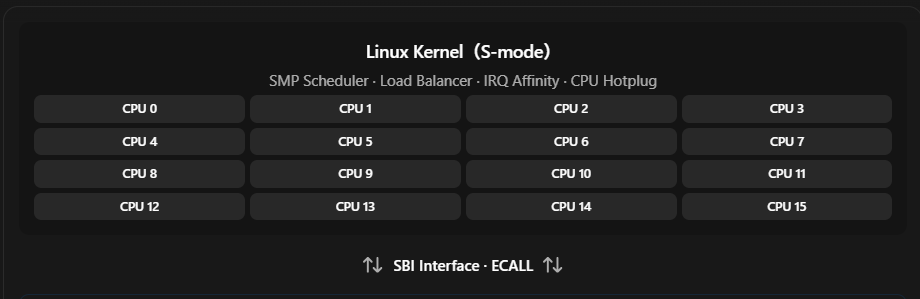
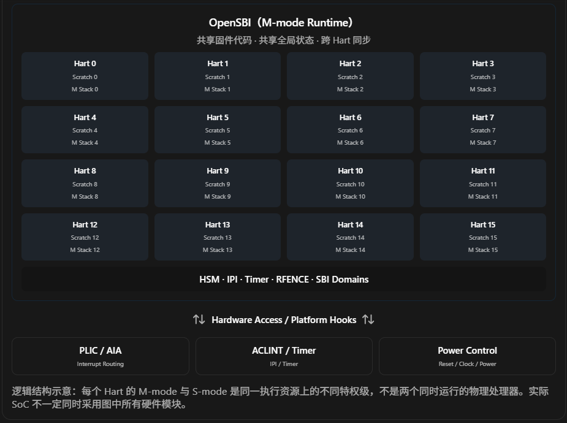
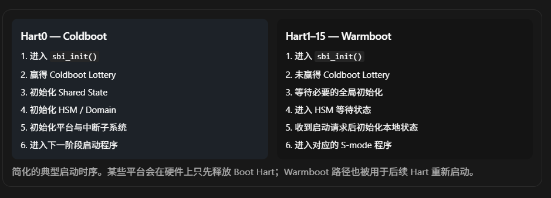
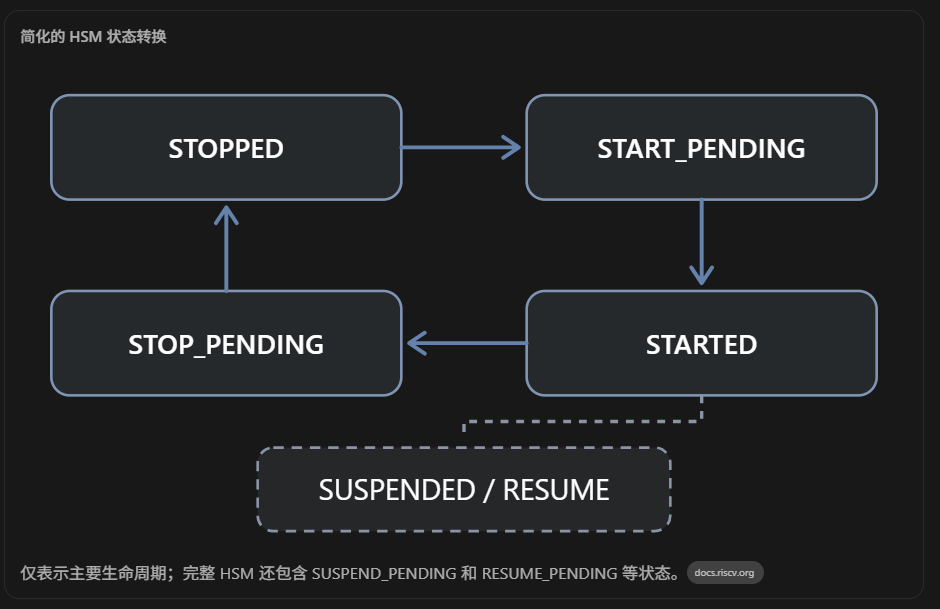
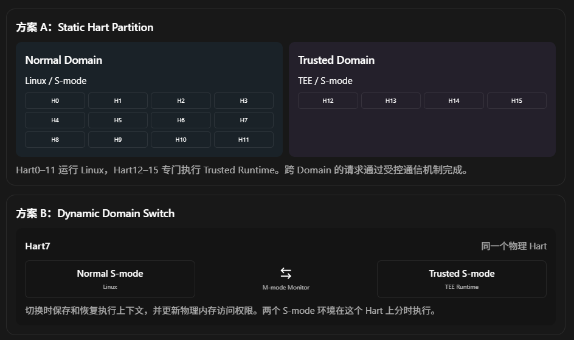
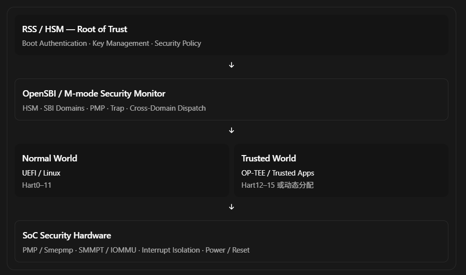

这是一个非常关键的 RISC-V 多核架构问题。要理解 OpenSBI 如何管理 16 个 Hart，首先需要区分三个概念：

1. OpenSBI 的执行实例（Execution Context）
2. OpenSBI 的软件镜像（Firmware Image）
3. 整个 SoC 的多核协调与管理机制（SMP Management）

这三个概念很容易混淆，尤其是从 Arm TF-A / PSCI / SCP 架构转向 RISC-V 时。

## 一、先说结论

假设一个 RISC-V SoC 有 16 个应用处理器 Hart，所有 Hart 都实现 M-mode，并使用 OpenSBI 作为 M-mode Runtime Firmware。

通常情况下，16 个 Hart 共享同一份 OpenSBI 固件镜像，但每个 Hart 都有自己的 M-mode 执行上下文和 per-Hart 数据。

也就是说：

- 从固件镜像角度：可以认为整个 SoC 部署了一份 OpenSBI。
- 从 CPU 执行角度：16 个 Hart 都能够进入并执行 OpenSBI，各自拥有独立的寄存器、栈和运行状态。
- 从数据管理角度：一部分数据属于每个 Hart 私有，一部分数据属于整个 OpenSBI 系统共享。
- 从系统管理角度：OpenSBI 并不负责 Linux 线程调度与负载均衡，也不需要一个额外的中央 Core 来统一调度 16 个 Hart。

更重要的是：

OpenSBI 不是 RISC-V 系统中的多核调度器，而是为 S-mode 操作系统提供机器级服务的固件。

我们可以先从整个 SoC 的系统架构看起，再深入 OpenSBI 的内部代码，重点分析 Hart 初始化、启动同步、IPI、HSM（Hart State Management）以及中断路由。

## 二、16-Hart SoC 的真实软件架构

下面是一个典型的 16-Hart RISC-V Linux SMP 平台。




逻辑结构示意：每个 Hart 的 M-mode 与 S-mode 是同一执行资源上的不同特权级，不是两个同时运行的物理处理器。实际 SoC 不一定同时采用图中所有硬件模块。

这里有一个重要的架构设计思想：

16 个 Hart 是对等的执行主体，OpenSBI 采用分布式的 per-Hart 执行模型，而不是一个 Master OpenSBI 调度另外 15 个 Slave OpenSBI。

启动过程中确实存在一个特殊的 Coldboot Hart，但这个角色主要负责一次性初始化，并不意味着它在运行时成为管理其他 15 个 Hart 的中央控制器。

### 2.1 各项职责到底由谁承担？

| 功能                 | 主要负责人                                    |
| ------------------ | ---------------------------------------- |
| Linux 线程调度         | Linux SMP Scheduler                      |
| CPU 负载均衡           | Linux Scheduler / Scheduling Domains     |
| 外设 IRQ 的目标 Hart 选择 | Linux IRQ 子系统 + 中断控制器                    |
| IRQ 的实际投递          | PLIC / APLIC / IMSIC 等硬件                 |
| CPU 间的软件 IPI       | Linux 发起，SBI 或硬件机制传递                     |
| Hart 启动 / 停止       | Linux 提出请求，OpenSBI HSM 执行                |
| Hart 电源 / 时钟控制     | Platform Firmware + SoC Power Controller |
| PMP / 机器级隔离配置      | OpenSBI 或其他 M-mode 安全固件                  |
| 系统级安全启动和认证         | Boot ROM / RoT / RSS（依具体实现）              |

特别说明一下负载均衡：Linux 的 Scheduler 使用 per-CPU Runqueue 和 Scheduling Domains 在 CPU 之间迁移任务。OpenSBI 不负责决定哪些进程应该分配到哪些 Hart 上。

[image](https://www.google.com/s2/favicons?domain=https://www.kernel.org\&sz=32)

The Linux Kernel documentation+2


这与你熟悉的 Armv8-A Linux SMP 架构非常类似：TF-A/PSCI 并不负责 Linux 的线程调度，OpenSBI/HSM 也同样如此。

## 三、重点：从 OpenSBI 源码看“共享一个实例”到底意味着什么

这是我认为最值得深入理解的部分。

### 3.1 同一段 OpenSBI 代码，可以被 16 个 Hart 同时执行

假设 OpenSBI Firmware 的布局如下（虚构地址，仅用于解释）：

```
Physical Memory
+-----------------------------------+
| 0x80000000                        |
|                                   |
| OpenSBI .text    (shared)         |
| OpenSBI .rodata  (shared)         |
| OpenSBI global state              |
|                                   |
+-----------------------------------+
| Hart0  Scratch + M-mode Stack     |
+-----------------------------------+
| Hart1  Scratch + M-mode Stack     |
+-----------------------------------+
| Hart2  Scratch + M-mode Stack     |
+-----------------------------------+
| ...                               |
+-----------------------------------+
| Hart15 Scratch + M-mode Stack     |
+-----------------------------------+
```

所有 Hart 可以读取同一个 OpenSBI `.text` 区域，执行其中的函数。但各自使用独立的 `sp` 和 `mscratch`。

例如：

```
Hart0:
    PC = sbi_trap_handler
    SP = Stack_Hart0
    mscratch = Scratch_Hart0

Hart1:
    PC = sbi_trap_handler
    SP = Stack_Hart1
    mscratch = Scratch_Hart1

Hart2:
    PC = Linux Kernel
    Privilege = S-mode

...
```

Hart0 与 Hart1 即使同时执行相同的 `sbi_trap_handler()`，也不会天然发生上下文冲突。

因为：

- `PC` 是各 Hart 独立的。
- `GPR` 和 `CSR` 是各 Hart 独立的。
- `sp` 指向各自的栈。
- `mscratch` 指向各自的 OpenSBI Scratch Space。

而共享的全局状态必须通过 Atomic、Spinlock、Memory Barrier 等机制实现并发安全。

### 3.2 OpenSBI 最关键的数据结构：`struct sbi_scratch`

官方源码：

`include/sbi/sbi_scratch.h`

OpenSBI 提供了一个非常重要的宏：

```
#define sbi_scratch_thishart_ptr() \
    ((struct sbi_scratch *) \
        csr_read_relaxed(CSR_MSCRATCH))
```

这个宏并不是根据某个全局变量判断当前 Hart，而是直接读取当前 Hart 的 `mscratch`。

于是：

```
struct sbi_scratch *scratch;

scratch = sbi_scratch_thishart_ptr();
```

相同的一段 C 代码：

- Hart0 执行，得到 `Scratch_Hart0`。
- Hart1 执行，得到 `Scratch_Hart1`。
- Hart15 执行，得到 `Scratch_Hart15`。

源码还维护了 Hart Index 与 Scratch Pointer 之间的映射，使一个 Hart 可以找到其他 Hart 的状态数据。

[image](https://www.google.com/s2/favicons?domain=https://github.com\&sz=32)

GitHub+1


这里要强调：`mhartid` 与 OpenSBI 的 `hartindex` 并不是同一个概念。`mhartid` 是硬件标识，而 `hartindex` 是固件内部用于索引管理对象的编号，不能假设所有 SoC 的 Hart ID 都从 0 开始连续排列。

### 3.3 汇编层面如何设置每个 Hart 的 Stack 和 `mscratch`？

我们直接看 OpenSBI 的启动汇编：

`firmware/fw_base.S`

下面是从实际逻辑摘取的关键指令：

```cpp
/* tp 已经指向当前 Hart 的 scratch */

csrw CSR_MSCRATCH, tp

/* 设置当前 Hart 的 M-mode 栈 */
add sp, tp, zero

/* 配置 M-mode Trap Handler */
lla a4, _trap_handler
csrw CSR_MTVEC, a4

/* 进入 OpenSBI 初始化 */
csrr a0, CSR_MSCRATCH
call sbi_init
```

原文件中的实际代码还会根据 CPU 特性选择适当的 Trap Handler。

[image](https://www.google.com/s2/favicons?domain=https://github.com\&sz=32)

GitHub


注意这个实现：

每个 Hart 都设置自己的 `mscratch`、`sp` 和 `mtvec`，最后调用同一个 `sbi_init()` 入口。

因此，我们可以给出一个更准确的概念描述：

> OpenSBI 是一个支持 SMP 的共享 Runtime Firmware。其固件代码与部分全局数据可以由多个 Hart 共享，而每个 Hart 拥有独立的执行上下文和 per-Hart Runtime State。

这和 Linux Kernel 的运行模式有一定相似性：你不会因为 Linux 运行在 16 个 CPU 上，就认为存在 16 个彼此独立的 Linux Kernel。

当然，OpenSBI 不需要 Linux 那样复杂的任务调度器，因为 OpenSBI 本身不是通用操作系统。

## 四、16 个 Hart 启动时，OpenSBI 如何协调？

这个问题要结合 OpenSBI 的 Coldboot / Warmboot 机制以及 HSM 状态机一起理解。

### 4.1 Coldboot Hart：负责一次性的全局初始化

OpenSBI 的核心入口位于：

`lib/sbi/sbi_init.c`

其中有一段关键逻辑：

```cpp
static atomic_t coldboot_lottery =
    ATOMIC_INITIALIZER(0);

/* sbi_init() 中的关键逻辑 */
if (sbi_platform_cold_boot_allowed(plat, hartid)) {
    if (next_mode_supported &&
        atomic_xchg(&coldboot_lottery, 1) == 0)
        coldboot = true;
}

if (coldboot)
    init_coldboot(scratch, hartid);
else
    init_warmboot(scratch, hartid);
```

这就是 Coldboot Lottery 机制：符合平台条件的 Hart 通过 Atomic 操作竞争 Coldboot 资格，只有一个获胜。

[image](https://www.google.com/s2/favicons?domain=https://github.com\&sz=32)

GitHub


假设 Hart0 获得 Coldboot 资格：



Coldboot Hart 完成全局初始化后，其余 Hart 才能安全访问这些共享状态。

这涉及两个不同范围的初始化：

- `cold_boot = true`：包含一次性的全局初始化。
- `cold_boot = false`：执行当前 Hart 必需的本地初始化。

源码中的 `sbi_hart_init()`、`sbi_timer_init()`、`sbi_irqchip_init()` 等都使用这类参数区分不同阶段。

### 4.2 HSM：不是集中式管理器，而是分布式状态机

HSM 是 Hart State Management。

它的核心功能是维护每个 Hart 的生命周期状态。


简化的 HSM 状态转换

仅表示主要生命周期；完整 HSM 还包含 SUSPEND_PENDING 和 RESUME_PENDING 等状态。

[image](https://www.google.com/s2/favicons?domain=https://docs.riscv.org\&sz=32)

docs.riscv.org

OpenSBI 源码：

`lib/sbi/sbi_hsm.c`

最重要的结构之一是：

```cpp
struct sbi_hsm_data {
    atomic_t state;
    unsigned long suspend_type;
    unsigned long saved_mie;
    unsigned long saved_mip;
    unsigned long saved_medeleg;
    unsigned long saved_mideleg;
    u64 saved_menvcfg;
    atomic_t start_ticket;
};
```

注意，这个结构是 per-Hart 的 HSM 状态，不是整个 SoC 只有一个 `state`。

Coldboot 初始化时，会遍历所有 Hart 并初始化各自的 HSM 状态。

而且状态改变使用 `atomic_cmpxchg()` 等原子操作，避免两个 Hart 同时启动同一个 Target Hart。

[image](https://www.google.com/s2/favicons?domain=https://github.com\&sz=32)

GitHub


### 4.3 举例：Linux 如何启动 Hart5？

假设 Hart0 正在运行 Linux，Hart5 处于 `STOPPED` 状态。

```

Hart0 (Linux, S-mode)
    |
    | SBI HSM: hart_start(5, entry, opaque)
    v
Hart0 (OpenSBI, M-mode)
    |
    | 检查 Hart5 是否属于可访问的 Domain
    | 检查 Hart5 HSM State
    | 设置 Hart5 Scratch 的启动参数
    | STOPPED -> START_PENDING
    | 请求平台唤醒 Hart5
    v
Hardware Wakeup / IPI
    |
    v
Hart5 (OpenSBI, M-mode)
    |
    | 执行本地初始化
    | 配置 CSR / PMP 等
    | START_PENDING -> STARTED
    | sbi_hart_switch_mode(...)
    v
Hart5 (Linux, S-mode)
    |
    +--> secondary CPU startup

```

这里有两个非常关键的细节。

第一，Hart0 是通过它自己的 M-mode 执行上下文处理 `hart_start()`，然后操作 Hart5 的共享状态，并通过平台机制让 Hart5 启动。

第二，Hart5 最终在 自己的 M-mode 完成必要初始化，然后切换到自己的 S-mode，而不是由 Hart0 替它执行 M-mode 初始化。

具体代码可以阅读：

- `sbi_hsm_hart_start()`：建立 Hart5 的启动状态。
- `sbi_hsm_hart_wait()`：等待启动请求，必要时执行 `wfi` 或平台停核操作。
- `sbi_hsm_hart_start_finish()`：更新 HSM 状态并调用 `sbi_hart_switch_mode()`。

特别值得注意：`STOPPED` 并不必然意味着物理断电。它只保证该 Hart 不再执行 S-mode 或更低特权级的软件。是否实际 Power Off，取决于 SoC 的硬件能力及 OpenSBI 平台实现。

[image](https://www.google.com/s2/favicons?domain=https://github.com\&sz=32)

GitHub+1


## 五、16 个 Hart 之间如何传递 IPI？

对于 SMP Kernel，这也是最核心的跨核协调机制之一。

假设 Hart2 想通知 Hart7 进行一次 TLB Shootdown。

典型的软件协作逻辑如下：

```
Hart2 (Linux)
    |
    | 请求远端 TLB Flush
    v
Hart2 (OpenSBI)
    |
    | 更新 Hart7 的请求状态
    | 必要时触发 Hardware IPI
    v
Hardware Interrupt Mechanism
    |
    | Target = Hart7
    v
Hart7 (OpenSBI)
    |
    | 读取本 Hart 的 IPI Event
    | 执行对应 TLB Flush 操作
    | 更新完成状态
    v
Hart2 得知操作完成
```

实际 Linux 会根据可用扩展、硬件以及内核实现选择远端刷新路径；上面展示的是通过 OpenSBI RFENCE 处理的一种典型情况。

再看 OpenSBI `lib/sbi/sbi_ipi.c` 的关键逻辑：

```
remote_scratch =
    sbi_hartindex_to_scratch(remote_hartindex);

ipi_data =
    sbi_scratch_offset_ptr(remote_scratch,
                           ipi_data_off);

/* Atomic 更新目标 Hart 的 IPI 事件位 */
if (!__atomic_fetch_or(&ipi_data->ipi_type,
                       BIT(event),
                       __ATOMIC_RELAXED))
    ret = sbi_ipi_raw_send(remote_hartindex, false);
```

这段代码说明了两个非常重要的机制。

第一：共享内存承担消息状态的传递。 发送方通过原子操作更新目标 Hart 的 IPI 事件位。

第二：硬件中断承担通知和唤醒。 目标 Hart 处理自己的 IPI，而不是由发送方代替执行。

目标 Hart 会进入 `sbi_ipi_process()`，清除硬件 IPI，读取本地事件位并执行对应的处理函数。

[image](https://www.google.com/s2/favicons?domain=https://github.com\&sz=32)

GitHub+1


对于普通的 S-mode 软件 IPI，也可能由 OpenSBI 在目标 Hart 上设置 Supervisor Software Interrupt Pending，让 Linux 内核接着处理中断。

在具有 AIA / IMSIC 的现代平台上，某些 IPI 可以直接通过 S-mode IMSIC 交付，未必每一次都需要陷入 M-mode。因此不能认为所有 RISC-V IPI 都必须经过 OpenSBI。

## 六、外设中断路由是谁负责的？

现在回答你的另外一个重要问题：16 个 Hart 的中断到底由谁派发？

这里建议你把两件事情严格区分：

- Interrupt Routing Policy：谁决定中断送往哪个 Hart？
- Interrupt Delivery Mechanism：什么硬件真正把中断送过去？

### 6.1 使用 PLIC 的平台

```
              PCIe / NIC / UART
                     |
                     v
                  [ PLIC ]
                     |
        +------------+-------------+
        |            |             |
        v            v             v
      Hart0        Hart1         Hart15
      S-mode       S-mode        S-mode
```

以 Linux 为例，驱动和 IRQ 子系统根据 IRQ Affinity、CPU 在线状态、设备能力等条件，配置中断目标。

PLIC 通过每个 Context 的中断使能、优先级和 Threshold 等配置实现中断通知，目标 Hart 通过 Claim/Complete 处理具体 IRQ。

注意 PLIC 可以允许同一中断源对多个 Context 使能，实际由某个 Context 竞争 Claim 成功，因此不能简单认为 PLIC 中断始终只能路由给一个 Hart。

[image](https://www.google.com/s2/favicons?domain=https://docs.riscv.org\&sz=32)

docs.riscv.org+1


### 6.2 使用 AIA 的现代 RISC-V SoC

对于服务器级 RISC-V SoC，更值得研究的是 APLIC + IMSIC。

```
            NIC / Storage / PCIe
                     |
              Wired IRQ / MSI
                     |
                     v
           APLIC / MSI Routing
                     |
       +-------------+------------+
       |             |            |
       v             v            v
    IMSIC0         IMSIC1       IMSIC15
       |             |            |
       v             v            v
     Hart0         Hart1        Hart15
```

这里的软件负责配置路由策略，硬件负责实际投递 MSI。IMSIC 通常与 Hart 紧密关联，接收对应目标 Hart 及其特权级的 MSI。

AIA 还支持将中断路由到适当的 Supervisor / Virtual Supervisor 上下文，以改善虚拟化性能。

[image](https://www.google.com/s2/favicons?domain=https://docs.riscv.org\&sz=32)

docs.riscv.org+1


OpenSBI 通常不是 Linux 外设 IRQ 的统一分发中心。 能够直接交付 S-mode 的外部中断，会由 S-mode 的中断处理程序处理，不需要先由某个中央 OpenSBI 代为路由。

## 七、需要额外引入 SCP Processor 来管理 16 个 Hart 吗？

答案是：不需要，但高端 SoC 完全可能有一个独立的 System Control Processor。

重点在于这个 Processor 的职责是什么。

| 机制                         | 是否需要独立 Core | 作用                          |
| -------------------------- | ----------- | --------------------------- |
| Linux SMP Scheduler        | 不需要         | 任务调度、负载均衡                   |
| OpenSBI HSM                | 不需要         | Hart 生命周期管理接口               |
| PLIC / AIA                 | 不需要独立通用 CPU | 硬件中断路由                      |
| Power Controller           | 不一定         | 控制 Power Domain、Clock、Reset |
| SCP / Management Processor | 可选          | 复杂的系统电源、时钟、热管理和系统控制         |
| RSS / 独立 HSM               | 可选，依安全架构    | Root of Trust、安全启动和密钥管理     |

例如，你现在接触的 RISC-V 服务器 SoC，如果带有独立 RSS/HSM 核，可以设计为：

```
              RSS / HSM Core
              Root of Trust
                    |
         Boot Authentication
         Security Policy
                    |
                    v
          16 Application Harts
                    |
                  OpenSBI
                    |
                   Linux
```

这个独立核可以验证启动镜像、控制安全启动流程、配置安全策略，甚至通过 Mailbox 协调部分 Power/Reset 操作。

但它不一定管理 Linux 的线程调度，也不一定承担中断分发。

因此，即使一个 16-Hart SoC 具备 SCP、RSS、Power Controller 等硬件，也不意味着存在一个运行在 OpenSBI 之下的通用 SMP 管理层。

换句话说，系统控制与 CPU 负载调度属于不同的 Control Plane。

## 八、进一步联系 TEE：16 个 Hart 能否属于不同的安全 Domain？

这个问题与你的 RISC-V OP-TEE 工作非常相关。

OpenSBI 本身支持 SBI Domain 机制。每个 Domain 可以包含一定的 Hart 集合、内存区域和设备访问权限。

假设进行一种静态分区：

```
16-Hart SoC

Domain A: Normal World
    Hart0 ~ Hart11
    Linux
    Normal DRAM

Domain B: Isolated Execution
    Hart12 ~ Hart15
    Trusted Runtime
    Protected DRAM
```

OpenSBI 可以维护 Hart 与 Domain 的对应关系，并配合 PMP/ePMP 等硬件机制配置访问限制。HSM 也会检查操作是否符合 Domain 归属和地址权限。

[image](https://www.google.com/s2/favicons?domain=https://github.com\&sz=32)

GitHub+1


但有两个限制需要明确。

首先，SBI Domain 不等价于完整的 TEE 架构。如果你需要让 Normal World 与 Secure World 在同一个 Hart 上动态切换，就必须有相应的 Security Monitor、上下文切换协议、隔离配置以及安全中断处理机制。OpenSBI 的 Domain 支持本身并不自动提供一个与 Arm TrustZone 对等的 Secure/Normal World Switch。

其次，per-Hart PMP 并不能天然约束所有 DMA Master。TEE 还需要考虑 SoC 级总线隔离、设备访问控制及 DMA 访问权限。例如你正在研究的 SMMPT 类机制，其作用就不能简单地由 PMP 替代。

这也引出了一个非常重要的 RISC-V TEE 设计原则：

CPU 安全上下文是 per-Hart 的，但隔离策略必须在整个 SoC 范围内成立。

## 九、最后总结：用 Arm 的经验理解这个模型

你已经有 Arm TF-A、PSCI、OP-TEE 的开发经验，可以建立如下对应关系。

| Arm 体系                         | RISC-V 体系                        |
| ------------------------------ | -------------------------------- |
| PE                             | Hart（概念接近）                       |
| TF-A BL31 / EL3 Runtime        | OpenSBI / M-mode Runtime（职责部分相似） |
| PSCI CPU_ON/OFF                | SBI HSM Hart Start/Stop          |
| Per-CPU EL3 Context            | Per-Hart M-mode Context          |
| Per-CPU Trusted Firmware State | Per-Hart OpenSBI Scratch         |
| GIC IRQ Routing                | PLIC / APLIC / IMSIC             |
| Linux SMP Scheduler            | Linux SMP Scheduler              |
| SCP / Platform Management MCU  | 可选的 SoC Management Processor     |

最应该记住的并不是某个 API，而是下面这个架构思想：

> 一个 16-Hart RISC-V SoC 通常不需要一个中央 Master Hart 来协调其他 15 个 Hart 的执行。所有 Hart 都是对等的处理器执行主体，Linux 负责 CPU 调度，OpenSBI 提供分布式机器级服务，中断控制器负责硬件投递，而必要的跨 Hart 同步通过共享内存、Atomic、IPI 及平台控制机制实现。

### 我建议接下来深入的三个源码主题

1\. OpenSBI Coldboot / Warmboot 的完整 16-Hart 启动时序：从 `fw_base.S` 到 `sbi_init()`、`sbi_hsm_init()`，最后到 `sbi_hart_switch_mode()`，把每个 Hart 的执行路径推演清楚。

2\. OpenSBI IPI 与并发同步机制：深入分析 `sbi_ipi_send_many()`、`sbi_ipi_process()` 和 Remote TLB Shootdown，解释 Atomic / Fence 为什么必须存在。

3\. 多 Hart TEE Domain 的安全管理：重点理解每个 Hart 的 PMP/SMEPMP、Trap 上下文与跨 Domain 通信，以及在 Trust Domain 动态切换时 OpenSBI 的职责边界。

其中我最推荐先研究第一个主题，因为它可以从汇编入口、内存布局、Hart 状态机三个维度，彻底解释你最初提出的疑问：为什么 16 个 Hart 可以共享同一份 OpenSBI，而又各自独立运行 M-mode Firmware。

----

下面是结合源码对上述的3种场景的具体情景分析

# OpenSBI / RISC-V TEE Architecture 深度专题

## 16-Hart SoC 的启动管理、跨核同步与安全 Domain

本教程围绕一颗拥有 16 个 RV64 Application Harts 的服务器级 SoC，从真实 OpenSBI 源码出发，研究三个相互关联的问题：

| 专题                             | 核心问题                              | 主要源码                                                          |
| ------------------------------ | --------------------------------- | ------------------------------------------------------------- |
| 01. Multi-Hart Boot & HSM      | 16 个 Hart 如何初始化、协调启动和停止？          | `fw_base.S`、`sbi_init.c`、`sbi_hsm.c`                          |
| 02. IPI & Remote TLB Shootdown | 多个 Hart 如何交换事件、实现并发同步与内存一致性？      | `sbi_ipi.c`、`sbi_tlb.c`、`sbi_ecall_rfence.c`                  |
| 03. Multi-Hart TEE Domain      | 多个 Hart 如何形成安全隔离域？如何在 Domain 间切换？ | `sbi_domain.c`、`sbi_domain_context.c`、`sbi_hart_protection.c` |

分析基于本次核对的 [OpenSBI 上游源码](https://github.com/riscv-software-src/opensbi?utm_source=chatgpt.com)（`master`，2026-11-03），并参照 RISC-V SBI 规范与特权架构规范。由于上游源码持续变化，实际开发应固定到同一个 commit。

文中会明确区分三种内容：

- 上游实现：OpenSBI 中确实存在的函数、数据结构与执行机制。
- 情景推演：使用 16-Hart SoC 构造的执行示例。
- TEE 设计方案：需要在 OpenSBI 基础上增加的软件协议、安全状态机或 SoC 硬件机制。

涉及较长函数时，我会给出保持执行语义的简化伪代码，再说明对应的真实函数，避免把概念性代码误认为可以直接编译的上游实现。

# 专题一：16-Hart Boot & HSM

## 1.1 先建立完整执行场景

假设我们现在设计一颗 SoC：

```
SoC: RV64 Server SoC

Application Processing Complex:
    Hart0  ~ Hart15
    RV64GC
    Privilege: M/S/U
    PMP / MMU / Atomic

Other Components:
    Shared DRAM
    Shared LLC / Coherent Interconnect
    Interrupt Controller
    IPI Controller
    Power / Reset Controller
    Optional RSS / SCP

Software:
    BootROM / Earlier Boot Firmware
        |
        v
    OpenSBI (M-mode)
        |
        v
    UEFI or directly Linux (S-mode)
        |
        v
    Linux SMP Kernel
```

这里先做一个假设：所有 16 个 Hart 都能够运行 M-mode OpenSBI，并且共享一个一致的物理内存视图。

这不意味着所有 16 个 Hart 必须在同一时刻启动。是否同时从 Reset 中释放，是 SoC 硬件设计和前一级 Boot Firmware 决定的。

## 1.2 OpenSBI 启动存在两个不同层级的 Boot Hart 选举

这是理解上游实现时容易忽略的地方。

Stage A：Firmware Early Boot

`firmware/fw_base.S`

选出一个 Hart，负责固件重定位、早期内存与 Scratch 初始化

所有可参与的 Hart 汇合到 `_start_warm`

Stage B：OpenSBI Runtime Coldboot

`lib/sbi/sbi_init.c`

从满足条件的 Hart 中选出 Coldboot Hart，负责全局 Runtime 初始化

Coldboot

全局初始化 + 本地初始化

Warmboot

等待启动 + 本地初始化

这两个选举分别使用不同的共享状态：

| 阶段                     | 选举变量               | 主要用途                         |
| ---------------------- | ------------------ | ---------------------------- |
| Firmware Entry         | `_boot_lottery`    | 保证早期固件初始化只有一个执行者             |
| Runtime Initialization | `coldboot_lottery` | 保证 OpenSBI 全局 Runtime 只初始化一次 |

这两个角色通常可能落到同一个 Hart，但不能把它们当作架构上必然相同的角色。

[image](https://www.google.com/s2/favicons?domain=https://github.com\&sz=32)

GitHub+1


## 1.3 Stage A：从 `fw_base.S` 进入 OpenSBI

我们重点看四个入口：

```
firmware/fw_base.S

_start
  |
  v
_start_real
  |
  +--> Early Boot Lottery
  |      |
  |      +--> Winner
  |      |      Firmware relocation
  |      |      Scratch initialization
  |      |      FDT handling
  |      |      Mark boot ready
  |      |
  |      +--> Other Harts
  |             Wait for boot ready
  |
  v
_start_warm
  |
  +--> Read mhartid
  +--> Translate hartid -> hartindex
  +--> Calculate per-Hart Scratch
  +--> Setup mscratch / sp / mtvec
  |
  v
sbi_init()
```

### 1.3.1 为什么必须先进行 Early Boot Lottery？

想象 16 个 Hart 都从同一个 `_start` 入口执行。

如果没有同步措施，可能发生：

```
Hart0: Initialize shared .data
Hart1: Initialize shared .data
Hart2: Relocate firmware
Hart3: Relocate firmware
...
```

此时多个 Hart 都在修改同一份全局数据，甚至可能在另一个 Hart 执行代码的同时修改该代码对应的重定位内容。

因此，需要在所有 Hart 开始使用共享固件状态之前，选出一个执行者。

上游 `fw_base.S` 根据编译支持的原子扩展，通过 `amoswap.w` 或 LR/SC 形式完成早期选举。

等价伪代码：

```
/* 概念性伪代码 */
if (atomic_exchange(&boot_lottery, 1) == 0) {
    firmware_early_initialize();
    publish_boot_ready();
} else {
    while (!boot_ready)
        cpu_relax();
}

enter_start_warm();
```

这里涉及两个性质：

Mutual Exclusion：只有一个 Hart 负责执行 Early Boot 初始化。

Publication / Visibility：其他 Hart 必须在所依赖的共享状态初始化完成且可见之后，才能继续执行。

原始汇编使用 `fence` 与共享 Boot Status 等机制维护相应的初始化顺序。

[image](https://www.google.com/s2/favicons?domain=https://github.com\&sz=32)

GitHub


### 1.3.2 16 个 Hart 如何找到自己的 Scratch？

这是 `fw_base.S` 的关键部分。

所有 Hart 可能执行相同指令，但每个 Hart 的 `mhartid` 不同。

实际源码的核心寄存器操作包括：

```
csrr s6, CSR_MHARTID

/* 此处根据 Hart ID 找到 hartindex */
/* 并计算当前 Hart 的 Scratch 地址 */

csrw CSR_MSCRATCH, tp
add  sp, tp, zero
```

上面省略了地址计算部分，并不是完整汇编函数。完整实现还包含对非连续 Hart ID 的映射，以及平台 Hart 数量、Stack Size 的检查。

[image](https://www.google.com/s2/favicons?domain=https://github.com\&sz=32)

GitHub


假设：

- 固件预留了连续的 Hart 私有内存。
- 每个 Hart 使用一个固定大小的 Stack/Scratch 区域。
- 每个区域的 Scratch 起始地址不同。

那么可以抽象为：

\\[ Scratch(h)=Base+Offset(h) \\]

其中 `Offset(h)` 由 OpenSBI 的 Hart Index 和固件布局决定。

对于 Hart7：

```
mhartid = 7
   |
   v
hartindex = 7
   |
   v
tp = Scratch_Hart7
   |
   +--> mscratch = Scratch_Hart7
   |
   +--> sp = Stack_Hart7
```

因此，一个 Hart 从 S-mode 进入 OpenSBI 时，即使其他 15 个 Hart 也正在执行 OpenSBI，仍然可以通过自己的 `mscratch` 快速找到私有上下文。

这里 `mscratch` 的重要意义不是简单地保存一个指针，而是让 M-mode Trap Entry 拥有一个不依赖 Linux 当前栈的、可靠的 per-Hart 上下文入口。

### 1.3.3 `sp` 为什么可以设置为 Scratch 指针？

从 `fw_base.S` 的布局看，Scratch 和 Stack 在同一块为该 Hart 预留的内存区域中。

向低地址增长的栈可以从 Scratch 附近的相应边界开始使用。

注意这里不是说 `struct sbi_scratch` 本身被当作普通 C Stack 使用，而是这个地址同时承担了固定内存布局中的边界定位作用。

具体需要结合 `SBI_SCRATCH_SIZE`、`SBI_PLATFORM_HART_STACK_SIZE` 和固件链接布局分析。

### 1.3.4 设置 `mtvec` 后进入 C 层

当前上游汇编还会根据 Hypervisor 扩展选择 Trap Handler，最终执行：

```
csrw CSR_MTVEC, a4
csrr a0, CSR_MSCRATCH
call sbi_init
```

至此，每一个进入 Runtime 初始化路径的 Hart 都拥有自己的：

- M-mode Stack；
- Scratch；
- `mtvec`；
- `mscratch`；
- CSR 状态和 GPR 执行上下文。

但它们仍然在执行同一个 OpenSBI 固件映像。

[image](https://www.google.com/s2/favicons?domain=https://github.com\&sz=32)

GitHub


## 1.4 Stage B：`sbi_init()` 如何决定 Coldboot / Warmboot？

现在进入：

`lib/sbi/sbi_init.c`

实际函数：

```
void __noreturn sbi_init(
    struct sbi_scratch *scratch);
```

它首先判断目标特权级是否受当前 Hart 支持，然后根据平台策略判断该 Hart 是否有资格成为 Coldboot Hart。

简化后的逻辑是：

```
/* 伪代码：保留关键判断顺序 */

bool coldboot = false;

if (platform_allows_coldboot(hartid) &&
    supports_next_mode(scratch->next_mode)) {

    if (atomic_exchange(&coldboot_lottery, 1) == 0)
        coldboot = true;
}

platform_nascent_init();

if (coldboot)
    init_coldboot(scratch, hartid);
else
    init_warmboot(scratch, hartid);
```

为什么还要检查 `scratch->next_mode`？

因为 Coldboot Hart 在初始化后会直接进入下一启动阶段。

如果下一阶段需要 S-mode，而某个 Hart 不支持 S-mode，就不能让它赢得 Coldboot 资格。

这也意味着多核系统的 Boot Hart 选举，并不只是一个普通的 Atomic Lottery，还受到 Hart 能力和平台策略 的约束。

[image](https://www.google.com/s2/favicons?domain=https://github.com\&sz=32)

GitHub


## 1.5 `init_coldboot()` 的完整初始化思想

我们不需要死记每个函数的调用顺序，但必须理解为什么会区分全局初始化与本地初始化。

典型关键路径：

```
init_coldboot()
   |
   +--> sbi_scratch_init()
   |
   +--> sbi_heap_init()
   |
   +--> sbi_domain_init()
   |
   +--> sbi_hsm_init(..., true)
   |
   +--> wake_coldboot_harts()
   |
   +--> sbi_hart_init(..., true)
   |
   +--> Trap / Timer / Interrupt / IPI ...
   |
   +--> Platform Initialization
   |
   +--> Domain Finalization
   |
   +--> Hart Protection Configuration
   |
   +--> sbi_hsm_hart_start_finish()
```

这个调用链重点说明三个原则。

第一：全局基础设施必须只初始化一次。

例如共享 Heap、Domain 列表、Scratch Offset 分配器、全局 IPI Event Registry，都不能由 16 个 Hart 无保护地同时初始化。

第二：每个 Hart 的硬件状态需要独立配置。

例如：

- `mtvec` 与 Trap 状态；
- `medeleg` / `mideleg`；
- PMP；
- 每 Hart 的 Timer；
- 本地中断使能；
- per-Hart 的 HSM 状态。

即使这 16 个 Hart 属于同一个 Domain，某些机器级 CSR 仍然需要分别设置。

第三：Coldboot 完成一次性的基础初始化后，不代表所有 Hart 都已进入 Linux。

当前 OpenSBI 的 `wake_coldboot_harts()` 发生在全局 HSM 状态初始化之后，目的是允许 Warmboot Hart 进入 HSM 状态机，而不是把其余 Hart 直接全部启动到 S-mode。

对应的全局同步使用 `__smp_store_release()` 和 `__smp_load_acquire()`。

[image](https://www.google.com/s2/favicons?domain=https://github.com\&sz=32)

GitHub


## 1.6 Warmboot Hart 为什么要先进入 HSM？

假设 Hart0 获得 Coldboot 资格。

Hart1–15 在经过固件入口后，最终会执行：

```
init_warmboot()
    |
    +--> wait_for_coldboot()
    |
    +--> Read HSM State
    |
    +--> SUSPENDED?
    |      |
    |      +--> Resume Path
    |
    +--> Other States
           |
           +--> init_warm_startup()
```

注意，OpenSBI 的 Warmboot 并不只有 CPU 第一次启动这个场景。

它还可能用于：

- Secondary Hart 的初次启动；
- CPU Hotplug 后重新启动；
- 某些 Suspend/Resume 路径；
- Platform Power Controller 再次释放 Hart。

因此，Warmboot 是一种 Hart Runtime Entry Path，不能简单理解为整个 SoC 的 Warm Reset。

## 1.7 深入 HSM：Linux 启动 Hart7 时发生了什么？

假设 Linux 先在 Hart0 上启动，Hart7 停止运行 S-mode。

Linux 现在准备 Online CPU7。

### 第一步：Linux 调用 SBI HSM

SBI HSM 的调用语义可抽象为：

```
sbi_hart_start(
    hartid = 7,
    start_addr = linux_secondary_entry,
    opaque = boot_data
);
```

S-mode 通过 `ecall` 陷入当前 Hart0 的 M-mode。

调用入口使用 SBI HSM Extension，其标准 EID 是 `0x48534D`，`hart_start` 的 FID 为 0。

[image](https://www.google.com/s2/favicons?domain=https://docs.riscv.org\&sz=32)

RISC-V Documentation


### 第二步：Hart0 进入 `sbi_hsm_hart_start()`

函数位于：

`lib/sbi/sbi_hsm.c`

关键参数包括：

```
sbi_hsm_hart_start(
    scratch,
    dom,
    hartid,
    saddr,
    smode,
    arg1
);
```

注意 `scratch` 是调用方 Hart0 的 Scratch，而 `hartid` 是目标 Hart7。

这是两套不同的数据。

OpenSBI 会检查：

1. Hart7 是否属于允许访问的 Domain。
2. 启动地址是否具备相应 Domain 的执行权限。
3. Hart7 是否具有合法的 Scratch 和 HSM 状态。
4. Hart7 是否为 `STOPPED`。
5. 是否允许此次状态转换。

其中 `start_ticket` 用于序列化对目标 Hart 的启动操作，防止多个调用方并发写入其启动参数。

[image](https://www.google.com/s2/favicons?domain=https://github.com\&sz=32)

GitHub


### 第三步：发布 Hart7 的启动参数

目标 Hart7 的 Scratch 会写入：

```
/* 真实字段名，简化展示 */
rscratch->next_addr = saddr;
rscratch->next_mode = smode;
rscratch->next_arg1 = arg1;
```

随后将 HSM 状态从：

```
STOPPED
   |
   v
START_PENDING
```

通过原子状态转换发布。

为什么不能先设置 `START_PENDING`，然后再写入 `next_addr`？

因为 Hart7 可能已经开始执行，发现状态为 `START_PENDING`，立即读取自己的启动参数。

如果这些参数尚未写入或尚未对 Hart7 可见，就可能跳转到错误地址。

正确的逻辑必须满足：

\\[ Write(boot\ parameters) \\;\rightarrow\_{hb}\\; Read(boot\ parameters) \\]

这里的 \\(hb\\) 表示 happens-before 关系。它需要通过具有正确内存排序语义的状态发布操作，以及目标 Hart 的匹配同步来建立。

当前实现使用带相应同步语义的 `atomic_cmpxchg()` 完成关键状态转换。

[image](https://www.google.com/s2/favicons?domain=https://github.com\&sz=32)

GitHub


这其实是一个典型的跨核发布-订阅（Publish/Subscribe）模型。

### 第四步：决定如何唤醒 Hart7

不是所有 SoC 都使用相同的启动机制。

源码中存在两类典型路径：

```
Hart7 supports platform hotplug / secondary boot
        |
        +--> hsm_device_hart_start()
                 |
                 +--> Power/Reset Controller

Otherwise, Hart7 already waits in M-mode
        |
        +--> sbi_ipi_raw_send()
                 |
                 +--> IPI wakeup
```

上游 `sbi_hsm_hart_start()` 根据平台能力和 Hart 的初始化计数选择这些路径。

[image](https://www.google.com/s2/favicons?domain=https://github.com\&sz=32)

GitHub


这就回答了你最初关于 SCP 的问题：

当 SoC 需要真正打开 CPU Power Domain 时，OpenSBI 可以通过平台 HSM Driver 请求 Power Controller，甚至通过 Mailbox 通知 SCP。

但如果 Hart7 只是处于 M-mode 的 `wfi` 等待状态，就可能只需要一次 IPI。

SCP 是可能的硬件执行者，而不是所有 SMP 系统必须具备的中央调度器。

### 第五步：Hart7 完成自己的初始化

当 Hart7 从等待状态返回，或由硬件重新进入 Warmboot Entry 时，会执行其本地初始化。

最终：

```
Hart7 M-mode

sbi_hsm_hart_start_finish()
    |
    +--> START_PENDING -> STARTED
    |
    +--> Read next_addr / next_mode
    |
    +--> sbi_hart_switch_mode()
    |
    v
Hart7 S-mode

Linux secondary CPU entry
```

这里需要特别注意：

Hart0 只能请求 Hart7 启动，无法替代 Hart7 执行那些必须在 Hart7 自己的 M-mode 上完成的 CSR 配置。

因为 `pmpcfg`、`pmpaddr`、`mstatus`、`mtvec`、`mie` 等都是 Hart 本地的 CSR 状态。

## 1.8 `sbi_hart_switch_mode()` 的底层原理

这里和你熟悉的 Arm `eret` 比较相似。

RISC-V 中，M-mode 进入 S-mode 的典型过程如下：

```
/* 示意汇编，并非完整上游函数 */

# 修改 mstatus.MPP，指定返回 S-mode
csrr t0, mstatus
li   t1, ~(3 << 11)
and  t0, t0, t1
li   t1, (1 << 11)
or   t0, t0, t1
csrw mstatus, t0

# 设置 S-mode 的入口地址
csrw mepc, a2

# 交付下一阶段启动参数
mv   a0, a3
mv   a1, a4

# 切换特权级
mret
```

在这个示意中：

- `a2` 预先保存了目标入口地址；
- `a3` / `a4` 预先保存了目标入口参数；
- `MPP=S`，让 `mret` 返回 S-mode；
- `mepc` 指向 Linux Secondary Entry。

真正的 OpenSBI 实现还要处理 `mstatus` 的相关位、运行时上下文、架构扩展和平台要求，不能直接用这个片段代替上游函数。

最关键的思想是：

OpenSBI 并不是调用一个普通 C 函数来启动 Linux，而是通过配置 Machine CSR，再执行 `mret`，完成真实的硬件特权级转换。

## 1.9 工程排障：Hart7 卡在启动流程中怎么办？

假设 Palladium 或 ZeBu 的日志显示：

```
Linux:
CPU7: failed to come online
```

我建议按下面的顺序定位。

| 检查点                             | 可能的问题                                  |
| ------------------------------- | -------------------------------------- |
| Hart7 的 `mhartid` / `hartindex` | Hart ID 映射错误                           |
| Hart7 Scratch 地址                | Per-Hart 内存布局重叠                        |
| Hart7 的 HSM State               | 未正确进入 `STOPPED` 或状态转换失败                |
| `start_ticket`                  | 并发启动请求或启动过程未完成                         |
| `next_addr` / `next_mode`       | Linux Secondary Entry 地址错误             |
| `hsm_device_hart_start()`       | Power / Reset Controller 或 Mailbox 未响应 |
| IPI Pending                     | 中断没有到达目标 Hart                          |
| `sbi_hsm_hart_start_finish()`   | 状态转换或本地初始化失败                           |
| `mepc` / `mstatus.MPP`          | M-mode 到 S-mode 跳转异常                   |
| `scause` / `stval`              | Hart7 已进入 Linux，但 S-mode 发生异常          |

另一个非常实用的判断方法是区分：

- Hart7 从未进入 OpenSBI；
- Hart7 已进入 Warmboot，但未被唤醒；
- Hart7 已经进入 `START_PENDING`，但没有完成初始化；
- Hart7 已进入 S-mode，但 Linux Secondary Boot 失败。

这四个故障属于完全不同的层次。

专题一的结论：

16 个 Hart 共享同一份 OpenSBI 固件代码，但各自执行本地 Runtime Context；Coldboot 负责建立共享基础设施，HSM 负责协调 Hart 生命周期，平台驱动负责必要的硬件唤醒与电源控制。

这一模型不依赖一个长期驻留的 Master Hart。

# 专题二：IPI、Atomic、Memory Ordering 与 Remote TLB Shootdown

这个专题比单纯理解 IPI 寄存器更重要。

因为它真正涉及的是：

在 16 个 Hart 同时执行的情况下，OpenSBI 怎样确保共享状态的更新、远端执行和操作完成通知是正确的。

我们选择一个实际操作贯穿全章：

> Hart2 上的 Linux 修改了一段 Page Table，需要让 Hart3、Hart7、Hart11 清除旧的 TLB Translation，然后才能安全完成后续的内存管理操作。

## 2.1 为什么需要跨 Hart TLB Shootdown？

假设 Linux 在 Hart2 修改了一个 PTE：

```
Virtual Address: 0x40000000

Old PTE:
    VA 0x40000000 -> PA 0x90000000
    Permission: RW

New PTE:
    VA 0x40000000 -> PA 0xA0000000
    Permission: RO
```

但是 Hart7 可能缓存了旧的地址翻译：

```
Hart2:
    Page Table = New PTE

Hart7:
    TLB = Old PTE

Hart11:
    TLB = Old PTE
```

在这种情况下，即使共享内存中的 Page Table 已经更新，也不能认为所有 Hart 立即使用了新映射。

因为 MMU 的地址翻译缓存与普通数据 Cache 不是同一个概念。

每个 Hart 的地址翻译可能独立缓存，并具有自己的有效性生命周期。

因此，需要显式执行相应的 TLB 同步。

### 2.1.1 为什么 Hart2 不能只执行一次 `sfence.vma`？

因为：

```
sfence.vma
```

作用于执行该指令的 Hart 的相关地址翻译同步。

它不会自动让其他 15 个 Hart 的 TLB 都失效。

因此：

```
Hart2: sfence.vma
        |
        +--> Hart2 translation synchronized
        |
        +--> Hart7 translation may remain stale
```

跨核 TLB Shootdown 必须有额外的协调机制。

在没有更直接的软件/硬件接口的典型实现中，这个协调由 Linux 发起，由 OpenSBI RFENCE 配合 IPI 完成。

## 2.2 整体调用链

Hart2 — 发起方

Linux 修改 PTE

SBI RFENCE ECALL

OpenSBI `sbi_tlb_request()`

写入远端 FIFO

发送 IPI

等待完成

Hart7 — 目标方

收到 Machine IPI

`sbi_ipi_process()`

读取本地 IPI Event

消费 TLB FIFO

执行 `sfence.vma`

更新完成计数

基于 OpenSBI RFENCE + Machine IPI 的典型软件路径。使用 S-mode IMSIC 等机制的系统可能采用其他路径。

源码主要涉及：

```
lib/sbi/sbi_ecall_rfence.c
lib/sbi/sbi_tlb.c
lib/sbi/sbi_ipi.c
lib/sbi/sbi_trap.c
```

从函数级别看：

```
sbi_ecall_rfence_handler()
    |
    v
sbi_tlb_request()
    |
    v
sbi_ipi_send_many()
    |
    v
sbi_ipi_send()
    |
    +--> tlb_update()
    |
    +--> sbi_ipi_raw_send()
    |
    v
Target Hart Machine Interrupt
    |
    v
sbi_ipi_process()
    |
    v
tlb_process()
    |
    v
tlb_entry_process()
    |
    v
sfence.vma
```

这个调用链是专题二的主线。

[image](https://www.google.com/s2/favicons?domain=https://github.com\&sz=32)

GitHub+2


## 2.3 第一层：SBI RFENCE 是软件契约

RFENCE 是 Remote Fence Extension。

例如：

```
struct sbiret sbi_remote_sfence_vma(
    unsigned long hart_mask,
    unsigned long hart_mask_base,
    unsigned long start_addr,
    unsigned long size);
```

其作用是要求目标 Hart 执行覆盖指定地址范围的 `SFENCE.VMA`。

这属于 SBI 接口语义，并没有要求底层必须使用某种特定的中断控制器。

因此，SBI 将两个层次解耦：

```
Linux:
    I need remote TLB invalidation.

OpenSBI:
    I decide how to communicate with remote harts.

Hardware:
    I deliver the required notification.
```

这也是 Firmware Abstraction 的设计价值。

规范还定义了 `REMOTE_FENCE_I`、`REMOTE_SFENCE_VMA_ASID` 和 H-extension 对应的 `HFENCE` 操作。

[image](https://www.google.com/s2/favicons?domain=https://docs.riscv.org\&sz=32)

RISC-V Documentation


## 2.4 第二层：`sbi_tlb_request()` 如何处理范围？

进入：

`lib/sbi/sbi_tlb.c`

当前上游的 `sbi_tlb_request()` 主要负责验证请求、处理大范围 Flush，并交给通用 IPI 机制。

关键逻辑可以概括为：

```
/* 简化伪代码 */

if (invalid_tlb_type(tinfo))
    return SBI_EINVAL;

if (tinfo->size > tlb_range_flush_limit) {
    tinfo->start = 0;
    tinfo->size = SBI_TLB_FLUSH_ALL;
}

return sbi_ipi_send_many(
    hmask, hbase, tlb_event, tinfo);
```

为什么大范围 Flush 需要升级成 Flush All？

因为按 Page 逐个执行 `sfence.vma` 存在成本。

假设：

- 要 Flush 的地址范围为 1 GiB；
- Page Size 为 4 KiB；
- 不采用大页优化。

那么需要处理：

\\[ \frac{1\ \mathrm{GiB}}{4\ \mathrm{KiB}}=262144 \\]

个 Page。

这种情况下，直接执行更宽范围的 Flush 可能更高效。

因此，OpenSBI 会根据 `tlb_range_flush_limit` 决定是否将请求扩大为全范围 Flush。具体阈值由实现决定，不能假定是某个固定常数。

[image](https://www.google.com/s2/favicons?domain=https://github.com\&sz=32)

GitHub


## 2.5 第三层：`sbi_ipi_send_many()` 怎样找到目标 Hart？

这里有一个有意思的设计：

发起者不能无条件向任何 Hart 发送 SBI IPI。

OpenSBI 首先依据 HSM 状态和 Domain 访问权限，计算合法的目标 Hart Mask。

其流程可以概括为：

```
sbi_ipi_send_many()
    |
    +--> Get current domain
    |
    +--> Get interruptible harts
    |
    +--> Decode hart_mask / hart_mask_base
    |
    +--> Validate target domain membership
    |
    +--> Intersect target masks
    |
    +--> Send event to each target
    |
    +--> Event-specific sync
```

这里有两个不同的过滤条件。

Domain Membership： 当前 Domain 是否有权向这些 Hart 发起操作？

HSM State： 这些 Hart 当前是否属于能够处理相应 IPI 的状态？

例如 Hart7 已经停止，而 Hart11 处于 `STARTED`，最终允许发送的 Target Mask 可能不包含 Hart7。

当前 OpenSBI 通过 `sbi_hsm_hart_interruptible_mask()` 获取相应集合，并限制目标到当前 Domain。

[image](https://www.google.com/s2/favicons?domain=https://github.com\&sz=32)

GitHub


这在安全架构里很重要：如果 Domain A 可以随意对 Domain B 的 Hart 发送 Machine IPI 或 RFENCE，就可能构成跨 Domain 干扰，甚至引发拒绝服务。

## 2.6 第四层：`sbi_ipi_send()` 的 Event Bitmask

假设 Hart2、Hart3 同时向 Hart7 发送 IPI。

```
Hart2:
    Send TLB Event -> Hart7

Hart3:
    Send S-mode IPI Event -> Hart7
```

如果每个事件都立即触发一次硬件中断，就可能造成不必要的 MMIO 写入和重复中断。

OpenSBI 因此把软件事件状态和物理中断通知分离。

核心数据可以简化为：

```
struct ipi_data_concept {
    unsigned long ipi_type;
};
```

其中 `ipi_type` 是 Event Bitmask。

例如：

```
Bit0 = S-mode IPI
Bit1 = TLB Event
Bit2 = HALT Event
...
```

具体事件的 Bit 编号由运行时 Event Registry 分配，不能假定上面的编号就是上游固定值。

### 2.6.1 为什么使用 Atomic OR？

上游使用类似下面的操作：

```
/* 关键机制示意 */

old = atomic_fetch_or(
    &target->ipi_type,
    BIT(event));

if (old == 0)
    send_hardware_ipi(target);
```

关键在于 Atomic RMW。

假设两个 Hart 并发更新：

```
Initial:
    ipi_type = 0

Hart2:
    OR TLB_EVENT

Hart3:
    OR SMODE_EVENT
```

最终应该得到：

```
ipi_type = TLB_EVENT | SMODE_EVENT
```

如果使用普通的 Read-Modify-Write：

```
tmp = ipi_type;
tmp |= event_bit;
ipi_type = tmp;
```

可能出现 Lost Update：

```
Hart2 read 0
Hart3 read 0
Hart2 write TLB_EVENT
Hart3 write SMODE_EVENT

Final = SMODE_EVENT
```

TLB Event 被覆盖，Hart7 永远没有处理它。

所以，这里 Atomic 的价值不只是避免 Data Race，而是保证多个事件能够正确合并。

### 2.6.2 为什么只在原值为 0 时触发硬件 IPI？

假设：

```
Hart2:
    ipi_type: 0 -> TLB_EVENT
    Send hardware IPI

Hart3:
    ipi_type: TLB_EVENT
           -> TLB_EVENT | SMODE_EVENT
    No new hardware IPI
```

因为 Hart7 已经存在一个待处理的硬件通知。

它进入 `sbi_ipi_process()` 后，可以一次性读取并处理多个 Event。

这是一种经典的 Event Coalescing 设计，可以减少硬件 IPI 操作。

实际代码使用 `__atomic_fetch_or(..., __ATOMIC_RELAXED)`，只负责 Event Bitmask 的原子更新；不能因为看到 Atomic 操作就推断它单独提供了完整的跨核发布顺序。

[image](https://www.google.com/s2/favicons?domain=https://github.com\&sz=32)

GitHub


## 2.7 第五层：为什么还需要 `wmb()`？

继续观察：

`lib/sbi/sbi_ipi.c`

在 `sbi_ipi_raw_send()` 中，上游在调用硬件 `ipi_send()` 之前执行了：

```
wmb();
```

这是关键的 Memory Ordering 设计。

假设：

```
Hart2:
    1. Write Hart7's TLB FIFO
    2. Write Hart7's IPI Pending Register
```

如果硬件或内存系统允许这些写入以错误顺序被目标 Hart 观察：

```
Hart7 sees IPI first
    |
    v
Reads FIFO
    |
    v
FIFO appears empty
```

就会发生：

Interrupt 已经到达，但所通知的数据尚不可见。

因此，在向 IPI 设备发送通知前，OpenSBI 需要建立适当的写入顺序。

`wmb()` 使前面的相关内存/MMIO 写入，在允许观察的顺序上先于后续 IPI 设备写入。

而接收侧的 `sbi_ipi_raw_clear()` 也有相应的写入屏障，用于维护 Clear 与后续写入之间的顺序。

[image](https://www.google.com/s2/favicons?domain=https://github.com\&sz=32)

GitHub


需要从架构上明确三个不同机制：

| 机制             | 解决的问题              |
| -------------- | ------------------ |
| Atomic RMW     | 并发事件更新不丢失          |
| Memory Barrier | 约束共享状态和设备通知的可见顺序   |
| IPI            | 让远端 Hart 知道有工作需要执行 |

IPI 本身不是 Memory Barrier。

这一点在 SoC Bring-up 中尤其重要。即使 Cache Coherency 已经正常，也不能省略必要的内存排序语义。

同时，`wmb()` 不是对任意非一致性 DMA 内存都自动有效的万能操作。IPI Payload 所在内存必须满足平台的 Cache Coherency 和可见性要求。

## 2.8 第六层：Hart7 收到 Machine Software Interrupt

Hart7 的典型处理路径是：

```
Hardware sets Machine Software Interrupt
    |
    v
M-mode Trap Entry
    |
    v
sbi_trap_handler()
    |
    v
sbi_trap_nonaia_irq()
    |
    +--> IRQ_M_SOFT
            |
            v
        sbi_ipi_process()
```

在上游 `sbi_trap.c` 中，普通非 AIA IRQ 分发路径对于 `IRQ_M_SOFT` 会调用 `sbi_ipi_process()`；AIA 路径也具有相应分发逻辑。

[image](https://www.google.com/s2/favicons?domain=https://github.com\&sz=32)

GitHub


进入 `sbi_ipi_process()` 后，逻辑可简化为：

```
/* 保留核心语义的伪代码 */

clear_hardware_ipi();

events = atomic_exchange(
    &this_hart_ipi_type, 0);

while (events != 0) {
    event = next_pending_event(events);
    event_ops[event].process(this_hart);
    remove_event(&events, event);
}
```

为什么需要 `atomic_exchange(..., 0)`？

因为接收 Hart 需要取得一批待处理 Event，同时允许其他 Hart 继续发送新 Event。

设：

```
Hart7:
    atomic_exchange -> old_events
    ipi_type becomes 0
```

如果 Hart2 在这之后又发送新的 Event，它会发现 Event Bitmask 之前为 0，从而按规则发出新的硬件通知。

接收方处理的是已经领取的一批事件，新事件则保留在共享状态中等待后续处理。

这避免了简单地：

```
events = ipi_type;
ipi_type = 0;
```

可能产生的并发事件丢失问题。

[image](https://www.google.com/s2/favicons?domain=https://github.com\&sz=32)

GitHub


## 2.9 第七层：真正执行 Remote TLB Flush

现在 Hart7 已经确认存在一个 TLB Event。

进入：

```
tlb_process()
    |
    v
tlb_process_once()
    |
    v
sbi_fifo_dequeue()
    |
    v
tlb_entry_process()
    |
    v
tlb_entry_local_process()
    |
    v
Local SFENCE / HFENCE / FENCE.I
```

这里最值得学习的是：IPI Event Bitmask 只负责告诉 Hart7 有 TLB 工作，而具体的 TLB 请求保存在独立 FIFO 中。

例如：

```
Hart7 IPI State:
    TLB_EVENT = 1

Hart7 TLB FIFO:
    Entry0:
        Type  = SFENCE_VMA
        Start = 0x40000000
        Size  = 0x1000

    Entry1:
        Type  = SFENCE_VMA_ASID
        Start = 0x50000000
        Size  = 0x2000
        ASID  = 3
```

为什么不能只用一个 Event Bit？

因为一个 Event Bit 无法保存所有需要执行的请求参数。

Bitmask 是 Notification；FIFO 是 Work Queue。

这是两个不同层次。

实际的 `tlb_entry_local_process()` 会根据请求类型，调用本地 `sfence.vma`、`hfence.gvma`、`hfence.vvma` 或 `fence.i` 等操作。

[image](https://www.google.com/s2/favicons?domain=https://github.com\&sz=32)

GitHub


## 2.10 为什么 RFENCE 需要 Completion Synchronization？

前面只解决了：

```
Hart2 notifies Hart7
```

但是 Hart2 怎么知道 Hart7 已经执行完成？

不能在硬件 IPI 发送完成后就认为 Flush 完成。

因为：

```
IPI Send Completed
    !=
Remote TLB Flush Completed
```

所以 OpenSBI TLB 子系统还维护了同步计数。

### 2.10.1 同步流程

假设 Hart2 向 Hart3、Hart7、Hart11 发出三个远端请求。

发送方维护的完成计数概念上是：

```
Hart2 tlb_sync = 0

Queue request for Hart3  -> +1
Queue request for Hart7  -> +1
Queue request for Hart11 -> +1

tlb_sync = 3
```

每个目标完成操作后，更新对应发起方的同步状态。

```
Hart3 finished  -> 2
Hart7 finished  -> 1
Hart11 finished -> 0
```

只有相关操作真正完成之后，发起方才能结束等待。

在实际源码中，`struct sbi_tlb_info` 包含用于标识请求来源的 `smask`，接收方通过这个信息找到需要更新的发送方同步计数。多个请求可能被合并，因此不能简单地理解为一个请求永远对应一次硬件中断。

[image](https://www.google.com/s2/favicons?domain=https://github.com\&sz=32)

GitHub


### 2.10.2 为什么要使用 FIFO，而不是每个请求一个 IPI？

因为 FIFO 可以保存多个操作，并允许进行一定程度的请求合并。

上游 `tlb_update_cb()` 实现了 Range 合并优化。

举例：

```
Request A:
    SFENCE.VMA
    Start = 0x40000000
    Size  = 0x4000

Request B:
    SFENCE.VMA
    Start = 0x40001000
    Size  = 0x1000
```

B 完全包含在 A 的范围内。

因此，对于相同语义的 Flush 请求，可以尝试合并，而不必重复执行。

涉及 ASID 的请求还必须考虑 ASID 是否一致，不能随意合并不同 Address Space 的刷新操作。

[image](https://www.google.com/s2/favicons?domain=https://github.com\&sz=32)

GitHub


## 2.11 一个 Staff Engineer 必须理解的问题：双向 TLB Shootdown Deadlock

现在考虑更复杂的场景。

```
Hart2:
    Requests TLB Flush on Hart7
    Waiting for completion

Hart7:
    Requests TLB Flush on Hart2
    Waiting for completion
```

如果实现成：

```
send_ipi(target);

while (!remote_finished) {
    /* spin */
}
```

而本地在 Busy Wait 中完全不处理远端请求，就可能发生：

```
Hart2 waits for Hart7
Hart7 waits for Hart2
```

双方都不能前进。

OpenSBI 为此在 `tlb_sync()` 等待期间执行：

```
/* 真实实现中的核心思想 */
while (atomic_read(tlb_sync) > 0) {
    tlb_process_once(scratch);
}
```

这意味着：

Hart2 等待 Hart7 时，也会处理进入 Hart2 FIFO 的 TLB 请求。

这样就能打破一类对称等待死锁。

不过需要注意，当前源码在 FIFO Full 的处理路径中仍有重试逻辑和相关 TODO，不能把这个机制理解为对所有饱和、递归或任意并发组合都已经形式化证明无死锁。

[image](https://www.google.com/s2/favicons?domain=https://github.com\&sz=32)

GitHub+1


这是一段很值得研究的工业级并发设计代码。

## 2.12 对比：S-mode IPI 与 RFENCE IPI

它们虽然都可能通过 OpenSBI 的 IPI 框架发送，但最终动作不同。

| 类型         | 目标 Hart 的动作                    | 是否需要远端完成同步                |
| ---------- | ------------------------------ | ------------------------- |
| S-mode IPI | 设置 `mip.SSIP`，让 S-mode 处理中断    | 通常不等待 S-mode Handler 执行完成 |
| RFENCE     | 在目标 Hart 执行 Fence 操作           | OpenSBI TLB 路径具有完成同步      |
| HALT IPI   | 使目标 Hart 进入停止流程                | 语义与 RFENCE 不同             |
| HSM Start  | 请求目标 Hart 从 STOPPED 转向 STARTED | 通过 HSM 状态机协调              |

上游 `sbi_ipi_process_smode()` 的核心动作就是设置 `MIP_SSIP`，而不是替 Linux 执行 Scheduler 或 Linux IPI Handler。

[image](https://www.google.com/s2/favicons?domain=https://github.com\&sz=32)

GitHub


这解释了为什么同一套 Machine IPI 传输设施可以支持多种完全不同的软件行为。

## 2.13 工业场景：TLB Shootdown 偶发卡死如何排查？

假设 16-Hart 压测中，系统偶发停在跨核 TLB Flush。

我会按以下分层判断。

| 层次         | 应检查的状态                           | 典型故障                |
| ---------- | -------------------------------- | ------------------- |
| SBI 入口     | RFENCE Function ID / Target Mask | 参数错误或越权             |
| 事件注册       | `tlb_event`                      | Event 未注册           |
| FIFO       | 目标 Hart `tlb_fifo`               | FIFO Full、请求丢失或合并错误 |
| 发送方同步      | `tlb_sync`                       | 计数未归零               |
| IPI Event  | `ipi_type`                       | Event Bit 未正确发布     |
| 硬件 IPI     | Pending、Enable、Target Hart       | Interrupt Route 错误  |
| 目标 Trap    | `mcause`、`mtvec`                 | Trap 没有进入正确 Handler |
| Flush 执行   | `tlb_entry_process()`            | 类型处理错误              |
| Completion | `atomic_sub_return()`            | 发起方未收到完成通知          |

特别要关注两种场景。

第一种是 发起方同步计数不归零。可能是目标 Hart 没有收到中断，也可能是 FIFO 中的请求没有被正确消费。

第二种是 请求已经完成，但依旧发生旧映射访问。此时要排查 Linux 页表更新时序、目标 Hart 集合是否完整、ASID/VMID 范围、DMA/IOMMU 翻译缓存，以及同步顺序，而不能只盯着 IPI 本身。

### 专题二的核心结论

OpenSBI 的跨核通信不是简单的“向目标 Hart 写一个 IPI 寄存器”。

它实际建立了一条分层执行流水线：

```
Shared State / FIFO
        |
        v
Atomic Publication
        |
        v
Memory Ordering
        |
        v
Hardware IPI
        |
        v
Remote Event Processing
        |
        v
Completion Synchronization
```

理解这个设计之后，再去研究 OP-TEE 的跨核 TLB Shootdown、TEE Domain Shootdown、跨安全域请求通知，就有了可以复用的并发模型。

# 专题三：Multi-Hart TEE Domain 与安全上下文切换

这是三个专题中与 RISC-V OP-TEE Porting 最密切的部分。

前两个专题解决了两个基础问题：

- 如何让 16 个 Hart 正确运行同一份 OpenSBI；
- 如何让这些 Hart 通过共享状态、Atomic、IPI 与 RFENCE 协同工作。

第三个专题要解决的是：

当这 16 个 Hart 不再运行同一个可信程度的软件系统时，如何保证 Hart、内存、设备、中断以及执行上下文之间的安全隔离？

我们从两个架构场景进行推演。

## 3.1 两种基本的 TEE 部署模型

首先必须区分 Static Partition 与 Dynamic Domain Switch。



两种模型都可以利用 OpenSBI Domain，但它们对 TEE 软件架构的要求完全不同。

| 设计维度                 | Static Partition     | Dynamic Switch        |
| -------------------- | -------------------- | --------------------- |
| Hart 分配              | 固定或较少变化              | 运行时动态变化               |
| TEE 响应               | 跨核通信                 | 同 Hart 安全切换           |
| 上下文切换                | 不必每次请求都切换 Hart 的执行域  | 每次跨域运行通常需要切换          |
| PMP                  | 各 Hart 按所属 Domain 配置 | Domain 切换时重新配置        |
| 性能特点                 | 存在跨核通信成本             | 存在上下文/PMP 切换成本        |
| 实现难度                 | 中等                   | 较高                    |
| 与 Arm TrustZone 的相似性 | 更偏物理资源隔离             | 更接近同核 World Switch 模型 |

这里需要强调：RISC-V 普通 M/S/U 特权架构没有直接定义 Arm TrustZone 那样的 Secure / Non-secure 状态。因此即使 Dynamic Domain Switch 的软件效果接近 TrustZone World Switch，也不能直接视为硬件语义完全等价。

## 3.2 从源码理解 Domain 到底是什么

上游主要数据结构：

`include/sbi/sbi_domain.h`

其中 `struct sbi_domain` 的关键成员可以抽象为：

```cpp
/* 字段摘录，省略其余成员 */

struct sbi_domain {
    u32 index;
    char name[64];

    struct sbi_hartmask assigned_harts;
    const struct sbi_hartmask *possible_harts;

    struct sbi_domain_memregion regions[...];

    u32 boot_hartid;
    unsigned long next_addr;
    unsigned long next_mode;
    unsigned long next_arg1;
};
```

这个结构体现出 OpenSBI Domain 至少包含三个维度：

\\[ Domain = (HartSet,\ MemoryPolicy,\ BootContext) \\]

更完整的实现还包含初始化次序、Reset/Suspend 权限、内部状态和同步锁。

[image](https://www.google.com/s2/favicons?domain=https://github.com\&sz=32)

GitHub


### 3.2.1 `possible_harts` 与 `assigned_harts` 的区别

这两个字段非常值得深入理解。

`possible_harts` 表示某个 Hart 是否允许成为这个 Domain 的成员。

`assigned_harts` 表示某个 Hart 当前实际归属于哪个 Domain。

假设：

```
Normal Domain:
    possible_harts = Hart0 ~ Hart15
    assigned_harts = Hart0 ~ Hart11

Trusted Domain:
    possible_harts = Hart12 ~ Hart15
    assigned_harts = Hart12 ~ Hart15
```

此时 Hart7 不能直接进入 Trusted Domain，因为它不属于 Trusted Domain 的 `possible_harts`。

如果要允许 Hart7 动态进入：

```
Trusted Domain:
    possible_harts = Hart7, Hart12 ~ Hart15
```

那么 Hart7 才有成为 Trusted Domain 成员的基本资格。

但这只是授权条件之一，不意味着调用者已经完成安全切换。

当前 OpenSBI 允许一个 Hart 在满足条件时改变 Domain 归属，但同一个时刻该 Hart 只能处于一个 Domain Context。

[image](https://www.google.com/s2/favicons?domain=https://github.com\&sz=32)

GitHub


### 3.2.2 Domain 与 Linux CPU Affinity 不同

Linux CPU Affinity 是一个调度概念：

```
Task A may execute on CPU0, CPU1, CPU2
```

Domain Hart Membership 是一个隔离和资源归属概念：

```
Hart7 currently belongs to Domain A
```

Linux Scheduler 不能通过更改 CPU Affinity，直接把某个 Hart 变成另一个安全 Domain 的成员。

否则 Linux 就可以绕过安全隔离边界。

因此 Domain Assignment 的修改必须由可信管理者控制，而不能无条件信任 Normal World 的要求。

## 3.3 Domain Memory Region 如何形成隔离？

继续查看：

`struct sbi_domain_memregion`

它主要描述：

```
base
order
flags
```

其中：

\\[ RegionSize=2^{order} \\]

`flags` 指定该区域允许的访问方式，包括 M-mode 和 S/U-mode 权限，以及内存或 MMIO 属性。

实际支持的权限包括：

```
SBI_DOMAIN_MEMREGION_M_READABLE
SBI_DOMAIN_MEMREGION_M_WRITABLE
SBI_DOMAIN_MEMREGION_M_EXECUTABLE

SBI_DOMAIN_MEMREGION_SU_READABLE
SBI_DOMAIN_MEMREGION_SU_WRITABLE
SBI_DOMAIN_MEMREGION_SU_EXECUTABLE
```

上游还提供了用于更精细控制的 Shared Region 和权限强制执行标志。

[image](https://www.google.com/s2/favicons?domain=https://github.com\&sz=32)

GitHub


### 3.3.1 构造一个 16-Hart TEE 内存布局

假设：

```
Physical Address Space

0x80000000 - 0x81FFFFFF
    OpenSBI Firmware + Reserved

0x82000000 - 0x9FFFFFFF
    Normal DRAM

0xA0000000 - 0xA3FFFFFF
    Trusted DRAM (64 MiB)

0xA4000000 - 0xA40FFFFF
    Shared Memory (1 MiB)
```

地址为教学示例，并非上游平台默认地址。

期望的隔离关系：

| 内存区域             | Linux Domain | Trusted Domain |
| ---------------- | ------------ | -------------- |
| OpenSBI Firmware | S/U 不可访问     | S/U 不可访问       |
| Normal DRAM      | RWX（按策略）     | 按最小权限开放        |
| Trusted DRAM     | 不可访问         | RWX（按策略）       |
| Shared Memory    | RW           | RW             |

其中 Linux Domain 绝不能仅仅依靠自己的 Page Table 不映射 Trusted DRAM。

因为 Linux Kernel 是 Normal World 的高特权软件，假设已经被攻击者控制，它可以任意修改自己的页表。

所以 Trusted DRAM 的访问必须受到 Linux 无法修改的、更高层物理地址访问控制约束。

这就是 PMP 等机制的重要意义。

## 3.4 PMP 是 per-Hart 的：这对 TEE 意味着什么？

假设 Hart7 属于 Normal Domain。

它的 PMP 配置需要阻止 S/U-mode 访问 Trusted DRAM。

而 Hart13 属于 Trusted Domain。

它的 PMP 配置需要允许对应的 Trusted Runtime 使用 Trusted DRAM。

```
Hart7 PMP:
    Normal DRAM  -> Allowed
    Trusted DRAM -> Denied

Hart13 PMP:
    Normal DRAM  -> Restricted
    Trusted DRAM -> Allowed
```

虽然两个 Hart 访问同一份物理 DRAM，但它们的 PMP 配置可以不同。

因此：

PMP 是 Hart 本地的访问控制机制，而 Domain 是软件管理的全局安全策略。

OpenSBI 的任务是把全局 Domain Policy 转换成各个 Hart 的实际 PMP 配置。

### 3.4.1 OpenSBI 如何配置 PMP？

上游涉及：

```
lib/sbi/sbi_hart_protection.c
lib/sbi/sbi_hart_pmp.c
lib/sbi/sbi_domain.c
```

可以抽象为：

```
Get Current Domain
        |
        v
Enumerate Domain Memory Regions
        |
        v
Convert Permissions to PMP Encoding
        |
        v
Program pmpaddr / pmpcfg
        |
        v
Apply Required Translation Fences
        |
        v
Return to S/U-mode Runtime
```

当前上游的 `sbi_hart_protection_configure()` 提供了保护机制的统一接口，再由已注册的 Memory Protection 实现完成实际配置。PMP/Smepmp 是其中的重要实现。

[image](https://www.google.com/s2/favicons?domain=https://github.com\&sz=32)

GitHub+1


### 3.4.2 为什么 PMP Entry 的数量很关键？

假设安全策略需要描述：

- OpenSBI Firmware；
- Normal DRAM；
- Trusted DRAM；
- Shared Memory；
- Secure UART；
- Secure DMA；
- Non-secure MMIO；
- 中断控制器寄存器；
- 其他保留区域。

如果 PMP Entry 数量有限，就可能无法把所有区域精确表达出来。

还需要考虑：

- PMP 最小 Granularity；
- NAPOT 对齐要求；
- PMP Entry 优先级；
- Overlapping Region；
- Locked Entry；
- Domain 动态切换需要的临时 Entry。

因此在 SoC Security Architecture 阶段，就应该确认 PMP 的容量与地址匹配能力，而不能到 OP-TEE 移植后期才发现硬件资源不够。

## 3.5 为什么服务器级 TEE 特别需要关注 Smepmp？

普通 PMP 的一个重要限制是：在标准 PMP 规则下，M-mode 通常拥有比 S/U-mode 更高的物理访问权限，某些规则对 M-mode 的限制需要依靠 Lock 等机制。

Smepmp 通过 `mseccfg` 进一步引入：

| 字段     | 主要作用                                      |
| ------ | ----------------------------------------- |
| `MML`  | 改变 PMP 权限解释，支持更严格的 M-mode / S/U-mode 访问隔离 |
| `MMWP` | 未匹配 PMP 规则的 M-mode 访问默认拒绝                 |
| `RLB`  | 在特定条件下允许绕过 Locked Rule 的修改限制              |

这使固件可以构建比普通 PMP 更严格的内存安全策略。

[image](https://www.google.com/s2/favicons?domain=https://docs.riscv.org\&sz=32)

RISC-V Documentation


但这里有一个重要的工程约束。

如果一个设计要求 Domain 动态切换，并且需要运行时重新配置 PMP，就必须考虑哪些 PMP Entry 可以修改、哪些 Entry 已锁定，以及 `RLB` 的实际可用性与安全风险。

例如当前上游 Smepmp 配置路径中存在对 `MSECCFG_RLB` 和 `MSECCFG_MML` 的处理，而且显式保留某些固件 PMP Entry，避免 Domain Switch 时意外使 M-mode 固件自身失去访问权限。

[image](https://www.google.com/s2/favicons?domain=https://github.com\&sz=32)

GitHub


这正是 Firmware Security 与 CPU Architecture 深度耦合的地方。

## 3.6 重点：OpenSBI 已经支持 Domain Context Switch

这里要纠正一种容易形成的认识：

> OpenSBI Domain 只能用于静态 Hart 分区。

对于当前上游代码，这个说法并不准确。

OpenSBI 已经包含：

`lib/sbi/sbi_domain_context.c`

主要接口包括：

```
int sbi_domain_context_enter(struct sbi_domain *dom);

int sbi_domain_context_exit(void);
```

这说明 OpenSBI 的确具有在同一个 Hart 上保存和恢复不同 Domain Context 的基础能力。

[image](https://www.google.com/s2/favicons?domain=https://github.com\&sz=32)

GitHub


但需要注意：

这些是 OpenSBI 内部的 C 接口，不能据此认为普通 Linux 可以直接通过一个标准 SBI Domain-Switch ECALL 任意调用它们。

完整 TEE 仍需要受控入口、调用协议和安全状态管理。

### 3.6.1 核心数据结构：`struct hart_context`

当前上游结构可以归纳为：

```
struct hart_context

    trap_ctx
        GPRs
        mepc
        mstatus
        Other trap state

    sstatus
    sie
    stvec
    sscratch
    sepc
    scause
    stval
    sip
    satp
    scounteren
    senvcfg
    ...

    fp_ctx
    vec_ctx

    dom
    prev_ctx
    initialized
```

这里最重要的是：

每个符合条件的 Hart，可以在不同 Domain 中拥有各自独立的执行上下文。

例如：

```
Hart7

Normal Domain Context:
    satp = Linux Page Table
    sepc = Linux execution point
    GPRs = Linux state
    PMP  = Normal Policy

Trusted Domain Context:
    satp = Trusted Page Table
    sepc = Trusted execution point
    GPRs = Trusted state
    PMP  = Trusted Policy
```

切换时需要保存前一组状态、恢复后一组状态，并确保不会泄露安全敏感寄存器内容。

[image](https://www.google.com/s2/favicons?domain=https://github.com\&sz=32)

GitHub


## 3.7 进入 `switch_to_next_domain_context()`

这是当前专题最值得阅读的源码函数。

源码位置：

`lib/sbi/sbi_domain_context.c`

函数：

```
static int switch_to_next_domain_context(
    struct hart_context *ctx,
    struct hart_context *dom_ctx);
```

它的主要逻辑可以整理成：

```
1. Validate source and destination context

2. Update Domain Hart Assignment

3. Save source S-mode CSRs
   Restore destination S-mode CSRs

4. Save / Restore FP Context

5. Save / Restore Vector Context

6. Save / Restore Trap Context

7. Reconfigure Hart Memory Protection

8. If destination context not initialized:
       Start corresponding Domain runtime
   Else:
       Return using restored context
```

其中实际 CSR 处理大量采用 `csr_swap()`，例如：

```
/* 实际函数中的典型操作 */
ctx->satp = csr_swap(CSR_SATP, dom_ctx->satp);
```

这行代码非常值得分析。

它同时做了两件事情：

1. 把当前 Hart 的 `satp` 保存到 Source Context；
2. 把 Target Context 的 `satp` 恢复到当前 Hart。

也就是说，在同一个物理 Hart 上，两个 Domain 可以使用不同的 Address Space。

但仅仅修改 `satp` 不等于所有翻译缓存都已经正确同步。

上游随后调用 `sbi_hart_protection_reconfigure()`，其 PMP 实现还会执行必要的本地 `SFENCE/HFENCE`。

[image](https://www.google.com/s2/favicons?domain=https://github.com\&sz=32)

GitHub+1


### 3.7.1 Domain 切换时为什么必须处理 Trap Context？

假设 Hart7 正在执行 Linux：

```
PC = Linux scheduler
Privilege = S-mode
```

随后通过某个受控入口进入 M-mode Security Monitor。

Monitor 需要保存：

```
Linux GPRs
Linux Return PC
Linux Status
Linux Address Space
Linux Interrupt State
```

因为 TEE 执行完成后必须恢复 Linux 原来的运行点。

如果只切换 `satp` 和 PMP，却不保存 `mepc`、GPR 等状态，那么从 TEE 返回时就无法正确恢复 Linux。

反过来，如果 Linux 的 GPR 中包含 Normal World 数据，而切换时没有清理或正确恢复，也可能产生跨 Domain 信息泄露。

因此：

安全切换必须同时维护控制流完整性、寄存器机密性和物理访问权限。

### 3.7.2 Domain 切换时为什么需要处理 FP / Vector？

假设 Linux 在 Hart7 上运行一个利用 RVV 的应用。

随后调用 TEE。

如果 Trusted Runtime 能直接读取之前的 Vector Registers，就可能观察到 Linux 应用的敏感数据。

反方向问题同样存在：

如果 Trusted Runtime 使用 Vector 寄存器存放密钥材料，切换回 Normal World 时不能暴露这些内容。

因此，上游的 Domain Context 实现包含 FP/Vector Context Save/Restore。

这里要特别指出一个当前值得关注的上游问题：

2026 年 10 月 23 日的 OpenSBI RFC Patch Series，专门讨论补充 Domain Switch 的 Hypervisor、Sstc、AIA、Vector 等架构状态保存问题。它说明不能因为一个结构体保存了部分 CSR，就直接认定全部 ISA Extensions 的上下文隔离已经完整。该补丁系列在引用时仍属于 RFC，不能视作全部已合并的正式能力。

[image](https://www.google.com/s2/favicons?domain=https://lore-kernel.gnuweeb.org\&sz=32)

lore-kernel.gnuweeb.org


对于工业级 TEE，这属于必须认真审核的安全边界。

## 3.8 构造一次 Linux → OP-TEE Domain Switch

现在进入最重要的工业场景推演。

假设：

```
Hart7:
    Linux running in Normal Domain

Trusted Domain:
    OP-TEE Runtime

Security Monitor:
    M-mode
    Based on OpenSBI mechanisms
```

假设 SoC 已扩展出一个安全调用入口：

```
secure_call(
    command,
    parameter_address
);
```

注意：这是架构示意，不是上游标准 SBI API。

完整过程可以设计为：

```
Linux User Process
    |
    v
TEE Client API
    |
    v
Linux TEE Driver
    |
    | Secure Call
    v
M-mode Security Monitor
    |
    | 1. Validate caller
    | 2. Validate shared memory
    | 3. Save Normal Context
    | 4. Select Trusted Domain
    | 5. Reconfigure PMP
    | 6. Restore Trusted Context
    |
    v
OP-TEE Runtime (S-mode)
    |
    v
Trusted Application
    |
    | TEE Return
    v
M-mode Security Monitor
    |
    | 1. Save Trusted Context
    | 2. Restore Normal PMP
    | 3. Restore Normal Context
    |
    v
Linux TEE Driver
    |
    v
User Process
```

这个模型在概念上与 Arm 的：

```
Linux
  -> SMC
  -> EL3 Monitor / Dispatcher
  -> OP-TEE
  -> EL3 Monitor
  -> Linux
```

相似。

区别在于 Arm TrustZone 提供了明确的安全状态和异常级别关系，而这里的 RISC-V 方案需要由 M-mode Monitor、PMP/Smepmp 及平台安全硬件共同实现隔离。

RISC-V International 曾公开介绍过利用 OpenSBI Dynamic Domain Context 支持 TEE 服务的相关探索，这也说明该方向并不是纯粹理论上的设计。

[image](https://www.google.com/s2/favicons?domain=https://riscv.org\&sz=32)

RISC-V International


## 3.9 一个非常危险的问题：Domain Switch 的原子性

这是 Staff Engineer 级别必须考虑的安全问题。

假设 Hart7 正在从 Normal Domain 进入 Trusted Domain。

切换涉及多个状态：

```
Current Domain Pointer
Assigned Hart Mask
S-mode CSRs
PMP Policy
Interrupt State
Trap Context
```

这些状态不可能通过一条 CPU 指令同时完成更新。

因此，安全设计必须考虑中间状态。

例如：

```
Step A:
    Set Current Domain = Trusted

Step B:
    Update PMP to Trusted Policy
```

在 A 与 B 之间，软件 Domain 归属已经改变，但硬件 PMP 可能仍然采用 Normal Policy。

若此时发生 Machine Interrupt、异步错误、重入或其他 Hart 观察共享状态，就需要清楚定义系统行为。

上游 `switch_to_next_domain_context()` 确实会修改 Domain Assignment、保存/恢复 CSR、重新配置保护机制，但它不是一个通用的、单条指令完成的硬件原子安全切换。

[image](https://www.google.com/s2/favicons?domain=https://github.com\&sz=32)

GitHub


### 工业实现应明确的安全不变量

Domain Switch Security Invariants

在切换完成前，不得让不可信 S/U-mode 执行访问 Trusted Memory 的指令

寄存器与 Trap Context 不得从 Trusted Domain 泄露到 Normal Domain

切换期间发生的 Interrupt 必须按照明确定义的策略处理

Domain Assignment 与硬件 PMP 状态不得出现可利用的不一致窗口

任何保护配置失败，都不得以更宽松权限继续运行

跨域共享内存、缓存及 DMA 权限必须与当前安全状态一致

对安全固件来说，尤其要关注保护配置失败路径。

例如，当前上游 `sbi_hart_protection_reconfigure()` 是带错误返回值的接口，而所分析版本的 Domain Context 切换代码调用它时没有直接处理该返回值。这个位置值得作为安全代码审查点：需要结合平台实现证明失败是否可发生、失败后是否会继续恢复不可信上下文，以及是否具备 Fail-Closed 行为。不能仅凭这一处源码就认定存在可利用漏洞。

[image](https://www.google.com/s2/favicons?domain=https://github.com\&sz=32)

GitHub+1


## 3.10 16-Hart TEE 中，中断又如何处理？

现在把专题二与专题三结合起来。

假设：

```
Hart7 = Normal Domain
Hart13 = Trusted Domain
```

如果一个安全外设产生中断：

```
Secure Crypto Engine
       |
       v
Interrupt Controller
       |
       v
Hart13
```

这看起来很直接。

但在动态切换模型中，情况复杂得多：

```
Hart7:
    Normal Domain
         |
         v
    Switch to Trusted Domain
         |
         v
    Secure Device Interrupt
```

此时必须考虑：

- Interrupt 应进入哪个 Domain？
- S-mode 的 `stvec` 应使用哪份 Context？
- 如果 Normal IRQ 在 Trusted Domain 执行时到来怎么办？
- 是否应该切换回 Normal Domain，再处理对应中断？
- Machine Interrupt Handler 如何识别当前安全状态？
- Secure IRQ 是否可以抢占 Normal World？
- 是否允许跨 Hart 转发 Secure IRQ？

这些问题不是简单调用 `sbi_domain_context_enter()` 就能全部解决。

对于需要强安全隔离的设计，建议建立专门的 Interrupt Ownership Policy。

例如：

```
IRQ Owner:
    Secure Crypto IRQ -> Trusted Domain
    Normal NIC IRQ    -> Normal Domain
    Machine RAS IRQ   -> M-mode / Platform Handler
```

同时需要明确，发生 Domain Switch 时对 Pending、Enable、Priority、Target 等状态的处理协议。

如果使用 AIA / IMSIC，还要考虑每 Hart、每特权级的中断文件（Interrupt File）及对应虚拟化上下文。

Interrupt Routing 必须与 Domain Ownership 结合，而不能完全由 Linux 自主配置 Secure Device IRQ。

## 3.11 最大的安全盲点之一：PMP 不控制所有 DMA Master

假设 Hart7 的 PMP 已正确阻止 Linux 访问 Trusted DRAM。

```
Hart7 CPU Load/Store
        |
        v
       PMP
        |
        +--> Trusted DRAM: Denied
```

此时 Linux 控制的 PCIe/NIC 设备可能通过 DMA 发起访问：

```
Untrusted PCIe Device
        |
        v
   DMA Transaction
        |
        v
  Trusted DRAM
```

CPU PMP 不会天然约束这个设备的所有 DMA 事务。

因此，安全隔离不能止步于 CPU PMP。

需要额外的 SoC 级机制，例如：

- IOPMP / IOMMU；
- SoC Memory Protection Table（如特定平台的 SMMPT）；
- Bus Firewall；
- Secure Device Attribution；
- PCIe 相关地址转换与缓存失效控制。

具体硬件支持以 SoC 实现为准。

### 3.11.1 把 SMMPT 加进 16-Hart TEE 架构

可以设计成：

```
               16 Application Harts
                        |
                       PMP
                        |
                        v
                  Coherent Fabric
                        |
                 Memory Controller
                        |
                        v
                      DRAM


               NIC / PCIe / DMA
                        |
                   IOMMU / SMMPT
                        |
                        v
                  Memory Fabric
                        |
                        v
                      DRAM
```

这里有两种独立的保护对象：

CPU Access Control：CPU 在不同 Privilege/Domain 下，可以访问哪些物理地址？

Device Access Control：设备使用 DMA 发起请求时，可以访问哪些物理地址？

两者都必须正确，才能形成完整的系统级内存隔离。

举例：

```
Normal DMA Requester:
    Normal DRAM  -> Allowed
    Trusted DRAM -> Denied

Trusted DMA Requester:
    Trusted DRAM -> Allowed
    Shared DRAM  -> Policy Controlled
```

在动态共享设备场景中，还需要考虑 Device Ownership Transfer，以及 IOTLB/ATC 等缓存状态失效和 In-flight DMA 请求的排空。

否则 CPU Domain 已完成切换，但旧设备访问权限仍然有效，就可能出现安全窗口。

## 3.12 将 RSS / HSM 纳入完整的安全启动链

假设这颗服务器 SoC 还有一个独立的 RSS 核，负责 Root of Trust。

可以建立以下分层：



这里四层分工应该非常清楚。

| 组件                         | 安全职责                          |
| -------------------------- | ----------------------------- |
| RSS                        | 建立系统信任根、验证启动镜像、保护密钥           |
| OpenSBI / Security Monitor | 管理 Hart、机器级状态、Domain 隔离和安全切换  |
| OP-TEE                     | 提供 Trusted OS、TA 执行环境与 TEE 服务 |
| SoC Security Hardware      | 对 CPU/设备的物理访问实施实际约束           |

还需要满足一条非常重要的信任链：

RSS 验证 OpenSBI，不代表 OpenSBI 的所有运行时配置天然安全。

固件完整性验证只是建立可信代码身份的一部分。

运行时仍然需要正确的：

- PMP / SMMPT 配置；
- Domain 初始化；
- 中断隔离；
- 安全入口参数检查；
- 跨域共享内存管理；
- Runtime Firmware 更新与恢复策略。

## 3.13 面向 OP-TEE Porting：应该先做 Static 还是 Dynamic？

如果目标是在新 SoC 上尽快跑通 Linux + OP-TEE，我更建议把 Static Partition 作为第一阶段的 Architecture Validation Baseline，前提是 SoC 允许保留专用 Hart，并且你的 TEE 设计目标允许独立 Trusted Execution Cluster。

原因不是 Static Partition 更先进，而是它可以先把以下问题分离出来：

```
OP-TEE Runtime Initialization
    |
    +--> PMP / SMMPT Isolation
    |
    +--> Trusted DRAM Access
    |
    +--> Shared Memory Communication
    |
    +--> Interrupt Ownership
    |
    +--> Cross-Hart Synchronization
```

在这些基础能力稳定之后，再引入：

```
Same-Hart Dynamic Domain Switch
    |
    +--> Context Save / Restore
    |
    +--> PMP Reconfiguration
    |
    +--> Secure Call Dispatcher
    |
    +--> Interrupt Preemption
    |
    +--> FP / Vector Context
    |
    +--> SMP Security State Management
```

但也有另一种情况：如果项目要求与 Arm OP-TEE 一样在所有应用 CPU 上按需进入安全执行环境，那么 Static Partition 只能作为验证平台，不能替代最终的 Dynamic Switch 设计。

这是一个架构需求决定的问题，而不只是 Porting 难度问题。

## 3.14 工业级 TEE Bring-up 验证矩阵

下面这张表可以直接作为预硅环境中的基础验证 Checklist。

| 验证场景                                     | 预期行为                   |
| ---------------------------------------- | ---------------------- |
| Linux 访问 Trusted DRAM                    | 被物理访问控制拒绝              |
| Linux 修改 Page Table 后再次访问 Trusted DRAM   | 仍然被拒绝                  |
| Trusted Runtime 访问自己的 DRAM               | 正常                     |
| Normal DMA 访问 Trusted DRAM               | 被 SMMPT/IOMMU 等拒绝      |
| Hart7 从 Normal 切到 Trusted                | Context 正确保存，PMP 正确切换  |
| Hart7 从 Trusted 返回 Normal                | Trusted Context 不泄露    |
| 同时多个 Hart 调用 TEE                         | 并发状态一致，无法越权            |
| Secure IRQ 到来                            | 仅按可信策略投递               |
| Domain Switch 期间发生异常                     | 进入正确的故障处理或恢复流程         |
| Hart13 在 Trusted Domain 内 Suspend/Resume | 安全配置恢复后才允许继续执行         |
| TEE 运行中 Linux 触发 CPU Hotplug             | 不破坏 Domain 所有权         |
| RSS 或安全控制器发出 Reset/Revocation            | 受影响的执行状态与 DMA 权限得到正确处理 |

其中我认为最需要在预硅阶段验证的是：

Domain Switch + Interrupt + DMA 三者同时发生时的行为。

很多安全问题并不是发生在稳定运行状态，而是发生在安全域转换、复位、重启及资源所有权变化的边界。

# 四、把三个专题串联：一个完整的 16-Hart TEE 系统

现在再回到最初的问题。

16 个 Hart 是否各自有自己的 OpenSBI 实例？

经过三个专题，可以从更准确的层次回答。

| 层次                        | 共享还是独立           | 说明                           |
| ------------------------- | ---------------- | ---------------------------- |
| OpenSBI Firmware Image    | 通常共享             | 同一份代码可以在多个 Hart 执行           |
| M-mode CSR                | Per-Hart         | 每个 Hart 有独立机器状态              |
| M-mode Stack              | Per-Hart         | 避免执行上下文冲突                    |
| `sbi_scratch`             | Per-Hart         | 保存各 Hart 的 Runtime 数据        |
| HSM State                 | Per-Hart         | 每个 Hart 独立维护生命周期             |
| SBI Domain Definition     | 共享管理对象           | 全局定义各 Domain 的资源和权限          |
| Current Domain Assignment | Per-Hart 归属、共享管理 | 每个 Hart 有当前 Domain           |
| TLB / IPI FIFO            | Per-Hart 资源      | 远端通过共享状态协作                   |
| PMP Configuration         | Per-Hart         | 由 Domain Policy 映射到 Hart CSR |
| Linux Scheduler           | OS 层负责           | 不属于 OpenSBI                  |
| SCP/RSS                   | 独立可选管理处理器        | 不承担通常意义上的 Linux SMP 调度       |

因此最准确的总结是：

> OpenSBI 是一个多 Hart 共享固件代码、分布式执行、具有 per-Hart Runtime State 和共享全局管理状态的 M-mode Runtime。它通过 SBI、HSM、IPI、RFENCE、Domain 与平台抽象机制，为上层操作系统及可信运行环境提供机器级服务。

它不是一个中央调度器，也不要求另有 SCP 才能协调 16 个 Hart。

# 五、Staff Engineer 级思考题与参考分析方向

为了验证是否真正理解这三个专题，建议重点研究下面六个问题。

### Q1. 如果 16 个 Hart 同时进入 OpenSBI，但只有其中 8 个支持某项 ISA Extension，Coldboot 与 Warmboot 应如何处理？

需要分析 Hart Capability Discovery、Coldboot Eligibility、per-Hart Features、后续启动阶段的 ISA 要求，以及 Linux 如何处理异构 Hart。

不能假设所有 Hart 具有相同的 Extension Set。

### Q2. Hart2 与 Hart7 同时向对方发出 RFENCE，如何证明整个系统不会发生死锁？

需要分析 FIFO 的 Enqueue/Dequeue、同步计数、等待期间的工作处理、FIFO Full、锁顺序和 Progress Guarantee。

尤其要区分：

- 无死锁；
- 无活锁；
- 有界延迟；
- 公平性。

OpenSBI 的当前实现针对某些对称等待做了前进性处理，但对所有情况的完整证明仍需结合具体代码与平台条件。

### Q3. 同一个 Hart 从 Domain A 切换到 Domain B 时，PMP 已更改，但某些 TLB Translation 仍然有效，会造成什么后果？

需要从 PMP 与地址翻译缓存的关系分析：

- 已有地址翻译是否仍被使用；
- `sfence.vma` 与 `hfence.gvma` 的作用范围；
- Domain 切换时是否需要同步其他 Hart；
- 是否存在旧权限和旧地址翻译共同构成的风险。

关键是不能只考虑当前 Hart 的 `satp`。

### Q4. 如果 Normal World 控制了一个 DMA Engine，即使 Trusted Domain 的 PMP 完全正确，能否保证 Trusted DRAM 不被访问？

不能。

必须分析 DMA Requester 的硬件身份、IOMMU/SMMPT 策略、IOTLB、In-flight DMA、共享缓存及设备隔离。

还需要考虑攻击者能否通过修改设备描述符或中断路由绕过预期策略。

### Q5. 为什么保存 `sstatus`、`satp`、`sepc`、GPR 和 FP/Vector 状态之后，仍然不能证明 Domain Switch 的安全性完整？

因为完整安全状态远不止这些寄存器。

还要检查：

- Hypervisor / Virtual Supervisor 状态；
- AIA / IMSIC 与 Pending Interrupt；
- Sstc；
- 设备与 DMA 状态；
- 缓存和微架构残留；
- M-mode Trap 重入；
- Side Channel；
- 中断归属；
- 安全异常恢复。

当前 OpenSBI Domain Context 的扩展工作正说明了这一点。

[image](https://www.google.com/s2/favicons?domain=https://lore-kernel.gnuweeb.org\&sz=32)

lore-kernel.gnuweeb.org


### Q6. 设计一个同时支持 Linux CPU Hotplug、TEE Dynamic Domain Switch 和 SCP Power Management 的 16-Hart SoC，如何避免三者竞争同一个 Hart？

必须首先统一 Hart 的生命周期与所有权模型。

例如：

```
Hart7:

Normal-Running
    |
    +--> TEE Enter Pending
    |
    +--> Trusted-Running
    |
    +--> TEE Exit Pending
    |
    +--> Normal-Running
    |
    +--> Hotplug Pending
    |
    +--> Stopped / Powered Off
```

不能让 Linux HSM、TEE Monitor 和 SCP 各自维护一份互不协调的最终状态。

需要设计明确的状态转换授权、同步协议、失败回滚和超时处理。尤其应避免在 Domain 切换中途直接进行 Power Off，而没有保存或撤销相应的安全执行状态。

## 六、建议继续深入阅读的源码

按优先级，我建议建立如下源码阅读顺序：

| 优先级 | 源文件                                                                                                                                             | 阅读目标                           |
| --- | ----------------------------------------------------------------------------------------------------------------------------------------------- | ------------------------------ |
| P0  | [firmware/fw_base.S](https://github.com/riscv-software-src/opensbi/blob/master/firmware/fw_base.S?utm_source=chatgpt.com)                       | Early Boot、Scratch、M-mode 入口   |
| P0  | [lib/sbi/sbi_init.c](https://github.com/riscv-software-src/opensbi/blob/master/lib/sbi/sbi_init.c?utm_source=chatgpt.com)                       | Coldboot/Warmboot 同步与初始化       |
| P0  | [lib/sbi/sbi_hsm.c](https://github.com/riscv-software-src/opensbi/blob/master/lib/sbi/sbi_hsm.c?utm_source=chatgpt.com)                         | Hart 生命周期与跨核启动                 |
| P0  | [lib/sbi/sbi_ipi.c](https://github.com/riscv-software-src/opensbi/blob/master/lib/sbi/sbi_ipi.c?utm_source=chatgpt.com)                         | Event、Atomic 与 IPI             |
| P0  | [lib/sbi/sbi_tlb.c](https://github.com/riscv-software-src/opensbi/blob/master/lib/sbi/sbi_tlb.c?utm_source=chatgpt.com)                         | Remote Fence 与 FIFO 同步         |
| P0  | [lib/sbi/sbi_domain_context.c](https://github.com/riscv-software-src/opensbi/blob/master/lib/sbi/sbi_domain_context.c?utm_source=chatgpt.com)   | 同 Hart 的 Domain Context Switch |
| P1  | [lib/sbi/sbi_domain.c](https://github.com/riscv-software-src/opensbi/blob/master/lib/sbi/sbi_domain.c?utm_source=chatgpt.com)                   | Domain 策略、Hart Assignment      |
| P1  | [lib/sbi/sbi_hart_protection.c](https://github.com/riscv-software-src/opensbi/blob/master/lib/sbi/sbi_hart_protection.c?utm_source=chatgpt.com) | 保护机制抽象                         |
| P1  | [lib/sbi/sbi_hart_pmp.c](https://github.com/riscv-software-src/opensbi/blob/master/lib/sbi/sbi_hart_pmp.c?utm_source=chatgpt.com)               | PMP / Smepmp 实际配置              |
| P1  | [docs/domain_support.md](https://github.com/riscv-software-src/opensbi/blob/master/docs/domain_support.md?utm_source=chatgpt.com)               | Domain DT 配置与设计约束              |

对于你的 RISC-V OP-TEE Architecture & Porting 路线，下一阶段最有价值的实践，是把这三个专题整合到一套 16-Hart Linux + OpenSBI + OP-TEE 的端到端安全执行时序图 中，并落实到 Trap Entry 汇编、per-Hart Context、Domain Switch、PMP/SMMPT 与 Secure Call Return 的源码路径。

最终目标不只是能解释 OpenSBI 如何管理 Hart，而是能够独立设计并审查一套 RISC-V 多核 TEE 的机器级执行与隔离架构。

