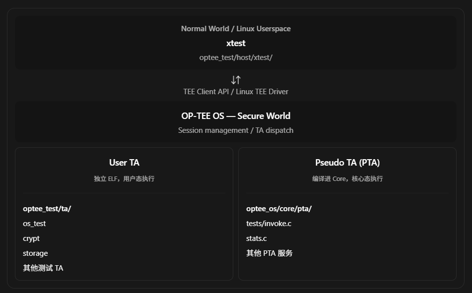

## 一、先给结论：你的记忆没有错，但这里容易混淆两种不同的测试 TA

我检查了 OP-TEE 的最新公开源码，包括 2026 年 10 月 16 日发布的 OP-TEE 4.11.0，以及截至 2026 年 11 月的 `master` 分支。

[image](https://www.google.com/s2/favicons?domain=https://github.com\&sz=32)

GitHub


结论是：

OP-TEE 并没有把原来 xtest 使用的 User TA 全部重构成 PTA。当前的 xtest 测试体系实际上同时使用 User TA 和 PTA，而且这两种实现长期共存。

你观察到 `optee_os/core/pta/` 下存在大量与测试相关的 PTA，是正确的；但它们只是 xtest 测试体系中的一部分。

有一个概念需要先澄清：严格来说，xtest 本身不是一个 TA，而是运行在 Normal World 的测试程序。 它通过 TEE Client API 调用 Secure World 中的多个测试 TA。

### 当前源码的整体组织



两条路径最大的区别在于：

- User TA：存在独立的 TA ELF 镜像，通常以 UUID 命名为 `.ta` 文件，运行时经过 TA Loader 加载。
- PTA：直接编译进 OP-TEE Core，借助 `pseudo_ta_register()` 注册服务，不需要通过 `ldelf` 加载独立 ELF 文件。

OP-TEE 的 TA 架构文档明确保留了 User TA 的独立加载机制，源码也仍然存在 `ta/os_test/` 和 `core/pta/tests/invoke.c` 两条实现路径。

[image](https://www.google.com/s2/favicons?domain=https://github.com\&sz=32)

GitHub+1


## 二、先对比 2023 年与 2026 年的源码

为了确认是不是近年来发生过重构，我专门比较了 2023 年发布的 `3.22.0` 和最新 `master`。

| 检查项                                | 2023 年 v3.22.0 | 2026 年 master |
| ---------------------------------- | -------------- | ------------- |
| `optee_test/host/xtest`            | 存在             | 存在            |
| `optee_test/ta/os_test`            | 独立 User TA     | 仍是独立 User TA  |
| `optee_test/ta/crypt`              | 独立 User TA     | 仍是独立 User TA  |
| `optee_test/ta/storage`            | 独立 User TA     | 仍是独立 User TA  |
| `optee_os/core/pta/tests/invoke.c` | 已经存在           | 仍然存在          |
| `pseudo_ta_register()`             | 已用于测试 PTA      | 仍在使用          |

因此，有一个很重要的历史事实：

早在 2023 年，xtest 就已经同时使用 User TA 和 PTA，并不是最近几年才将 xtest 的测试逻辑迁移到 PTA。

可以直接比较这两个版本：

[2023 年测试 TA 构建](https://github.com/OP-TEE/optee_test/blob/3.22.0/ta/Makefile?utm_source=chatgpt.com)[最新测试 TA 构建](https://github.com/OP-TEE/optee_test/blob/master/ta/Makefile?utm_source=chatgpt.com)

[2023 年测试 PTA](https://github.com/OP-TEE/optee_os/blob/3.22.0/core/pta/tests/invoke.c?utm_source=chatgpt.com)[最新测试 PTA](https://github.com/OP-TEE/optee_os/blob/master/core/pta/tests/invoke.c?utm_source=chatgpt.com)

## 三、源码分析一：User TA 仍然单独构建和加载

我们以 `os_test` 为例。

### 3.1 编译阶段

最新 `optee_test/Makefile` 依然有以下构建关系：

```
all: xtest ta test_plugin

xtest:
	$(MAKE) -C host/xtest ...

ta:
	$(MAKE) -C ta ...
```

注意：`xtest` 与 `ta` 是两个不同的构建目标。

进入 `optee_test/ta/Makefile`，仍能看到：

```
TA_DIRS := create_fail_test \
           crypt \
           os_test_lib \
           os_test_lib_dl \
           os_test \
           rpc_test \
           sims \
           storage \
           storage2 \
           concurrent \
           ...
```

这里的 `os_test`、`crypt`、`storage` 都是独立测试 TA。

继续查看 `ta/os_test/Makefile`：

```
BINARY = 5b9e0e40-2636-11e1-ad9e-0002a5d5c51b

include ../ta_common.mk
```

最终会生成类似：

```
5b9e0e40-2636-11e1-ad9e-0002a5d5c51b.ta
```

文件名就是 TA 的 UUID。

最新顶层 `Makefile` 的 `install` 目标还明确将这些 `.ta` 文件安装至：

```
/lib/optee_armtz/
```

而 `xtest` 程序单独安装到 `/bin`。

这说明原来你熟悉的 User TA 构建与部署机制仍在使用。

[image](https://www.google.com/s2/favicons?domain=https://github.com\&sz=32)

GitHub


### 3.2 运行阶段

看 `optee_test/host/xtest/regression_1000.c` 中的测试用例 1006。

简化后：

```
static void xtest_tee_test_1006(ADBG_Case_t *c)
{
    TEEC_Session session = { };
    TEEC_Operation op = TEEC_OPERATION_INITIALIZER;

    xtest_teec_open_session(
        &session,
        &os_test_ta_uuid,
        NULL,
        &ret_orig);

    op.paramTypes = TEEC_PARAM_TYPES(
        TEEC_MEMREF_TEMP_INPUT,
        TEEC_NONE,
        TEEC_NONE,
        TEEC_NONE);

    TEEC_InvokeCommand(
        &session,
        TA_OS_TEST_CMD_BASIC,
        &op,
        &ret_orig);

    TEEC_CloseSession(&session);
}
```

其中 `xtest_teec_open_session()` 是对 `TEEC_OpenSession()` 的薄封装。

它的实际执行逻辑仍然是：

```
xtest
  |
  +-- TEEC_OpenSession(os_test_ta_uuid)
  |
  +-- Linux TEE Driver
  |
  +-- OP-TEE Core
        |
        +-- 查找 TA UUID
        |
        +-- 查找并加载 User TA
        |     |
        |     +-- tee-supplicant (REE FS TA)
        |     +-- 验证 TA 镜像
        |     +-- ldelf
        |     +-- 建立 User TA 地址空间
        |
        +-- TA_CreateEntryPoint()
        +-- TA_OpenSessionEntryPoint()
        |
        +-- TA_InvokeCommandEntryPoint()
              |
              +-- TA_OS_TEST_CMD_BASIC
```

实际代码中，`optee_test/ta/os_test/ta_entry.c` 仍提供了完整的 GlobalPlatform User TA 生命周期函数：

```
TEE_Result TA_CreateEntryPoint(void);

TEE_Result TA_OpenSessionEntryPoint(
    uint32_t paramTypes,
    TEE_Param params[4],
    void **sessionContext);

TEE_Result TA_InvokeCommandEntryPoint(
    void *sessionContext,
    uint32_t commandID,
    uint32_t paramTypes,
    TEE_Param params[4]);
```

这里的 `TA_InvokeCommandEntryPoint()` 使用 `switch (nCommandID)` 分派到 OS 功能测试，包括 `TA_OS_TEST_CMD_BASIC`。

这一条路径与你在 2023 年做 AArch64 OP-TEE 移植时熟悉的架构并没有根本区别。

源码：[os_test/ta_entry.c](https://github.com/OP-TEE/optee_test/blob/master/ta/os_test/ta_entry.c?utm_source=chatgpt.com)

## 四、源码分析二：为什么能在 OP-TEE Core 内看到分散的测试代码？

我们再看你最近注意到的部分。

### 4.1 测试代码确实被放进 Core

在 `optee_os/core/pta/sub.mk` 中：

```
subdirs-$(CFG_TEE_CORE_EMBED_INTERNAL_TESTS) += tests
```

继续进入 `core/pta/tests/sub.mk`：

```
srcs-y += invoke.c
srcs-y += misc.c
srcs-y += mutex.c
srcs-y += aes_perf.c
srcs-y += aslr.c
srcs-y += stack_protector.c
```

这些代码会在配置允许时直接编译进 OP-TEE Core。

但这里还存在第二个容易混淆的地方：

并不是 `tests/` 目录下的每一个 `.c` 文件都注册为独立 PTA。

例如 `mutex.c`、`aes_perf.c` 等更多是测试逻辑的实现文件。它们可以通过 `invoke.c` 中的 PTA 命令入口被调用，而不是每个文件都对应一个独立的 PTA UUID。

### 4.2 以 invoke_tests.pta 为例

打开：

`optee_os/core/pta/tests/invoke.c`

可以看到：

```
#define TA_NAME "invoke_tests.pta"
```

文件末尾通过以下代码注册 PTA：

```
pseudo_ta_register(
    .uuid = PTA_INVOKE_TESTS_UUID,
    .name = TA_NAME,
    .flags = PTA_DEFAULT_FLAGS |
             TA_FLAG_SECURE_DATA_PATH |
             TA_FLAG_CONCURRENT |
             TA_FLAG_DEVICE_ENUM,
    .create_entry_point = create_ta,
    .destroy_entry_point = destroy_ta,
    .open_session_entry_point = open_session,
    .close_session_entry_point = close_session,
    .invoke_command_entry_point = invoke_command);
```

这就是一个真正的 PTA。

它的 `invoke_command()` 中有这样的分发逻辑（省略部分分支）：

```
static TEE_Result invoke_command(
    void *session_ctx,
    uint32_t cmd_id,
    uint32_t param_types,
    TEE_Param params[TEE_NUM_PARAMS])
{
    switch (cmd_id) {
    case PTA_INVOKE_TESTS_CMD_TRACE:
        return test_trace(param_types, params);

    case PTA_INVOKE_TESTS_CMD_PARAMS:
        return test_entry_params(param_types, params);

    case PTA_INVOKE_TESTS_CMD_SELF_TESTS:
        return core_self_tests(param_types, params);

    case PTA_INVOKE_TESTS_CMD_MUTEX:
        return core_mutex_tests(param_types, params);

    case PTA_INVOKE_TEST_CMD_AES_PERF:
        return core_aes_perf_tests(param_types, params);

    default:
        break;
    }

    return TEE_ERROR_BAD_PARAMETERS;
}
```

这意味着测试入口和测试实现可以分布在多个文件中，但它们并不一定是多个不同的 PTA。

源码：

[image](https://www.google.com/s2/favicons?domain=https://github.com\&sz=32)

GitHub


### 4.3 xtest 如何调用这个 PTA？

同样在 `optee_test/host/xtest/regression_1000.c`，测试用例 1002 使用：

```
res = xtest_teec_open_session(
    &session,
    &pta_invoke_tests_ta_uuid,
    NULL,
    &ret_orig);

op.paramTypes = TEEC_PARAM_TYPES(
    TEEC_MEMREF_TEMP_INOUT,
    TEEC_NONE,
    TEEC_NONE,
    TEEC_NONE);

TEEC_InvokeCommand(
    &session,
    PTA_INVOKE_TESTS_CMD_PARAMS,
    &op,
    &ret_orig);
```

区别在于，它使用的 UUID 是：

```
PTA_INVOKE_TESTS_UUID
```

而不是：

```
TA_OS_TEST_UUID
```

因此，Session 会指向内置 PTA，不会走 User TA ELF 加载流程。

## 五、OP-TEE Core 到底如何决定使用 PTA 还是 User TA？

我认为这一段是理解整个机制最关键的源码。

在：

`optee_os/core/kernel/tee_ta_manager.c`

找到 `tee_ta_init_session()`。

最新源码中的关键逻辑如下：

```
/* Look for pseudo TA */
res = tee_ta_init_pseudo_ta_session(uuid, s);

if (res == TEE_SUCCESS ||
    res != TEE_ERROR_ITEM_NOT_FOUND) {
    mutex_unlock(&tee_ta_mutex);
    goto out;
}

/* Look for user TA */
res = tee_ta_init_user_ta_session(uuid, s);

mutex_unlock(&tee_ta_mutex);

if (res == TEE_SUCCESS)
    res = tee_ta_complete_user_ta_session(s);
```

这里有一个非常有价值的设计细节：

OP-TEE 优先查找 PTA，如果没有找到，才尝试初始化 User TA。

但在此之前，函数还会检查已经存在的 TA Context，并处理 Standalone MM 等特殊分支，所以这段代码代表的是新建 Session 时的关键分派部分，不是完整函数。

对于 PTA，`tee_ta_init_pseudo_ta_session()` 会在编译进 Core 的 `pseudo_tas` 注册表中查找对应的 UUID。

而 `pseudo_ta_register()` 的底层定义是：

```
#define pseudo_ta_register(...) \
    SCATTERED_ARRAY_DEFINE_PG_ITEM(
        pseudo_tas, struct pseudo_ta_head) = {
            __VA_ARGS__
        }
```

其本质是通过链接阶段组织 PTA 描述符，构建一个可遍历的注册表。

运行时查找成功之后，Core 创建 PTA Context，设置对应的操作函数，例如：

```
static const struct ts_ops pseudo_ta_ops = {
    .enter_open_session = pseudo_ta_enter_open_session,
    .enter_invoke_cmd = pseudo_ta_enter_invoke_cmd,
    .enter_close_session = pseudo_ta_enter_close_session,
    .destroy = pseudo_ta_destroy,
};
```

执行 `TEEC_InvokeCommand()` 时，最终通过对应的 PTA Function Pointer 调用内置函数。

User TA 则走另一条路径：

```
tee_ta_init_user_ta_session()
    |
    +-- tee_ta_complete_user_ta_session()
            |
            +-- ldelf_load_ldelf()
            +-- ldelf_init_with_ldelf()
                    |
                    +-- TA ELF loading
```

这条路径会涉及 ELF 装载、内存映射、重定位以及 User TA 执行环境建立。

源码：

[tee_ta_manager.c](https://github.com/OP-TEE/optee_os/blob/master/core/kernel/tee_ta_manager.c?utm_source=chatgpt.com)[pseudo_ta.c](https://github.com/OP-TEE/optee_os/blob/master/core/kernel/pseudo_ta.c?utm_source=chatgpt.com)[user_ta.c](https://github.com/OP-TEE/optee_os/blob/master/core/kernel/user_ta.c?utm_source=chatgpt.com)

## 六、为什么 OP-TEE 需要同时保留 User TA 和 PTA 测试？

这并非仅仅出于代码组织习惯，而是因为两者覆盖的测试对象存在根本区别。

| 测试方面                             | User TA 更适合 | PTA 更适合  |
| -------------------------------- | ----------- | -------- |
| GlobalPlatform Internal Core API | 是           | 否，执行环境不同 |
| User TA ELF Loader / `ldelf`     | 是           | 否        |
| TA 用户态虚拟地址空间                     | 是           | 否        |
| User TA 异常隔离及 Context Switch     | 是           | 不能等价覆盖   |
| OP-TEE Core 内部 Mutex             | 通常不直接测试     | 是        |
| Core 内部地址转换、内存管理                 | 通常不直接测试     | 是        |
| Core 内部安全数据路径                    | 部分可测试       | 是        |

PTA 的优势是能够直接调用 Core 内部函数，覆盖普通 User TA 无法访问的实现细节。

但是反过来，PTA 不能替代 User TA 验证 `ldelf`、TA 地址空间隔离以及用户态异常处理。

这就是为什么两者需要长期共存。

同时也要注意，测试 PTA 往往拥有比普通 User TA 更高的执行权限。最新 `mk/config.mk` 中：

```
CFG_ENABLE_EMBEDDED_TESTS ?= n

CFG_TEE_CORE_EMBED_INTERNAL_TESTS ?= \
    $(CFG_ENABLE_EMBEDDED_TESTS)
```

也就是说，这些内置测试默认不启用，除非平台配置覆盖。

更值得注意的是，你目前关注的 RISC-V 平台：当前 `core/arch/riscv/plat-spike/conf.mk` 甚至明确配置了：

```
$(call force,CFG_TEE_CORE_EMBED_INTERNAL_TESTS,n)
```

所以如果你在 RISC-V OP-TEE 环境中找不到 `invoke_tests.pta`，首先需要检查平台编译配置，而不是直接怀疑 PTA 的注册机制有问题。

在 `xtest 1002` 中，如果 `PTA_INVOKE_TESTS_UUID` 不存在，测试框架也会显式提示并跳过该测试。

## 七、建议你用两个具体用例在开发板上验证

在有完整 xtest 环境的开发板或 QEMU 上运行：

```
# 测试 PTA 参数传递
xtest 1002

# 测试 User TA 基本 OS 功能
xtest 1006
```

然后分别跟踪两个调用：

xtest 1002 — PTA 路径

`PTA_INVOKE_TESTS_UUID`

`TEEC_OpenSession()` → `tee_ta_init_pseudo_ta_session()` → `pseudo_ta_enter_invoke_cmd()` → `invoke_command()`

不经过 ldelf，不加载独立 TA ELF

xtest 1006 — User TA 路径

`TA_OS_TEST_UUID`

`TEEC_OpenSession()` → `tee_ta_init_user_ta_session()` → `ldelf` → `TA_OpenSessionEntryPoint()` → `TA_InvokeCommandEntryPoint()`

需要独立 User TA 镜像及对应装载支持

这两个用例在对比 `PTA` 与 `User TA` 的初始化、Session 生命周期和 Command Dispatch 时，非常有代表性。

## 八、最后总结

回到最初的问题：

你在 2023 年记得 xtest 使用独立 TA，完全有源码依据；但认为现在 xtest 已经整体变成 PTA，则不准确。

实际上，2023 年的 OP-TEE 已经存在这两种测试架构。2026 年的最新版本继续沿用它们，只是在测试覆盖面、内部测试代码及配置上不断扩展。

对于你现在做的 RISC-V OP-TEE 移植，我更建议关注一个非常具体的问题：

如果 xtest 中的 PTA 测试全部通过，是否意味着 OP-TEE 的 User TA Loading 和 Execution 已经实现正确？

答案是否定的。

PTA 不涉及独立 ELF 装载，不能充分验证 User TA Loader、动态链接、用户态地址空间、页表切换和异常返回等功能。

因此，在 RISC-V 平台的 OP-TEE Bring-up 中，应该分别验证 PTA Dispatch 和 User TA Loading 两套机制。前者验证 Core 内部服务调用，后者才真正覆盖 User TA 执行环境。这也是判断一次 OP-TEE 移植是否完整的重要区别。

