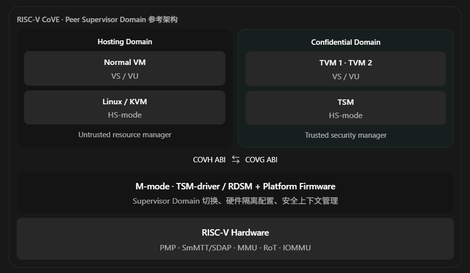
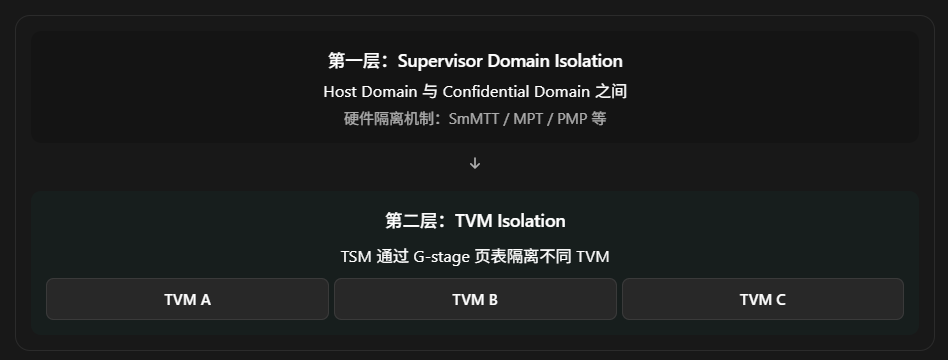
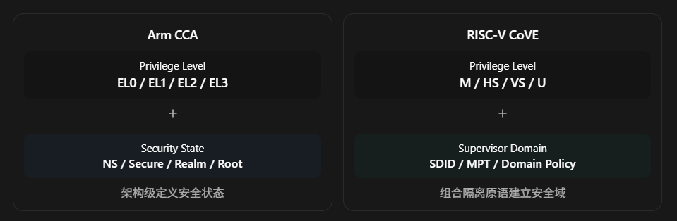
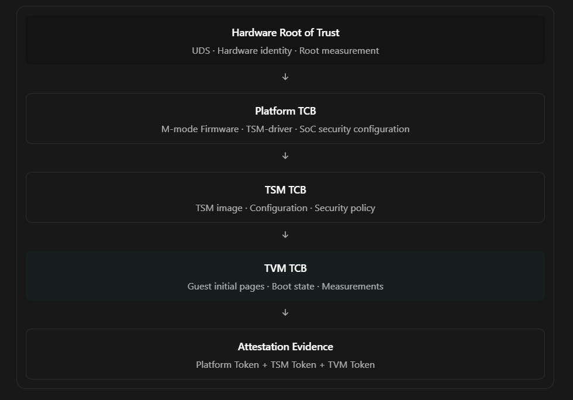

# RISC-V CoVE 深度解析：从设计哲学理解 CoVE 与 Arm CCA 的架构差异

## 一、先建立最重要的结论

理解 RISC-V CoVE（Confidential VM Extension），最好的切入点不是 TSM、MTT 或者 SBI，而是下面这个问题：

如何在不信任 Host OS / Hypervisor 的情况下，利用 RISC-V 现有的特权架构，建立一个能够运行完整 Linux VM 的可信执行环境？

这与 Arm CCA 要解决的问题完全一致，但两者选择的架构路径存在明显差异。

我认为可以用两句话概括：

- Arm CCA： 在 Arm 特权架构中引入新的 Realm Security State，通过 RME 建立独立的安全世界，再利用 RMM 管理其中的 Realm VM。
- RISC-V CoVE： 在 RISC-V 现有特权与虚拟化体系之上，引入 Supervisor Domain 隔离能力、TSM 安全管理层及标准化 ABI，在不可信 Hypervisor 之外建立可信的 VM 执行环境。

这里要特别强调：CoVE 并不是简单照搬 Arm CCA，也不是仅仅给 OpenSBI 增加几个 SBI Extension。

CoVE 更值得研究的地方，是它如何将硬件隔离机制、可信软件管理层和标准化软件接口进行解耦。

这意味着它可以适配不同 SoC 的安全硬件设计，而不强制所有平台采用完全相同的安全世界组织方式。

### 1.1 首先明确规范状态

截至 2026 年 11 月，CoVE 仍在 RISC-V International 的标准化过程中。公开的 AP-TEE 规范仓库明确注明尚未 ratify；2026 年 10 月的工作组材料也显示，多个设计和 ABI 细节仍在修订。

因此，下面会区分三种层次：

1. 架构目标与设计原则： 可以作为理解 CoVE 的稳定基础。
2. 公开草案中的参考实现： 例如 TSM、TSM-driver、SmMTT、COVH/COVG。
3. 平台实现选择： 例如 TSM 是否运行在 HS-mode、是否使用独立安全处理器、是否提供 DRAM 加密。

第三类不能误认为 CoVE 在所有 RISC-V SoC 上都强制规定了同一种实现。

[image](https://www.google.com/s2/favicons?domain=https://github.com\&sz=32)

GitHub+2


## 二、CoVE 设计理念的起点：Privilege 不等于 Trust

这是我认为整个 CoVE 架构中最值得深入理解的思想。

### 2.1 传统 RISC-V 的特权模型

你已经比较熟悉：

```
                  M-mode
              Machine Firmware
                  OpenSBI
                     │
                     ▼
                   HS-mode
             Linux/KVM Hypervisor
                     │
                     ▼
                  VS-mode
                 Guest Linux
                     │
                     ▼
                  VU-mode
                Guest Process
```

传统体系中：

- M-mode 可以管理底层机器资源。
- HS-mode 可以通过 H-extension 管理 Guest。
- VS-mode 的 Guest Linux 通过两阶段地址翻译获得虚拟化环境。

注意一个事实：

HS-mode 虽然比 M-mode 低，但相对于 Guest VS-mode，它仍然具有极大的管理权限。

例如：

```
Guest VA
    │
    │ VS-stage translation
    ▼
Guest Physical Address
    │
    │ G-stage translation
    │ controlled by HS-mode
    ▼
System Physical Address
    │
    ▼
DRAM
```

因为 G-stage Page Table 由 Hypervisor 管理，普通 VM 的隔离建立在信任 Hypervisor 的前提上。

因此，即使 Guest Linux 的页表权限设置得完全正确，也不能阻止恶意 Hypervisor 通过自己的映射访问 Guest 物理内存。

### 2.2 CoVE 要改变什么？

CoVE 希望实现：

```
                   RISC-V SoC
                       │
         ┌─────────────┴─────────────┐
         │                           │
    Hosting Domain            Confidential Domain
         │                           │
    Linux/KVM Host                    TSM
         │                           │
    Normal VM                         TVM
         │                           │
         └──────────┬────────────────┘
                    │
            Hardware Isolation
                    │
              Security Root
```

这里最重要的变化是：

Hosting Domain 与 Confidential Domain 之间的信任关系，不再简单地由 M/HS/VS/U 特权等级决定。

即使 Host Linux 运行在 HS-mode，它也不能因为自己拥有更高的虚拟化特权，就任意访问 TVM 的私有数据。

这个思想在 RISC-V Supervisor Domain 规范中被明确表达：一个 Supervisor Domain 中的软件即使具有更高的软件特权，也不因此自动获得其他 Domain 的资源访问权限。

这也是理解 CoVE 与传统 OP-TEE / OpenSBI Domain 机制关系的重要起点。

## 三、CoVE 的宏观架构：为什么需要 TSM 和 TSM-driver？

我们先看 CoVE 的典型参考部署模型。


> 概念架构图。实际的接口调用和 Trap 路由需要通过 M-mode 可信组件完成，图中的 COVH/COVG 不表示两个 HS-mode Domain 能直接互相调用。参考 CoVE 草案及 Rivos 的参考模型。

这张图包含三个非常关键的设计决策。

### 3.1 决策一：Host Linux 和 TSM 可以处于相同的特权等级

你可能会产生疑问：

> 如果 TSM 和 Host Linux 都运行在 HS-mode，那么 TSM 凭什么阻止 Host Linux 访问自己的内存？

这恰好体现了 CoVE 的设计哲学。

特权等级相同，不代表资源访问权限相同。

在支持 Supervisor Domain 隔离的实现中：

```
Host Linux:
    Privilege = HS
    Domain    = Host

TSM:
    Privilege = HS
    Domain    = Confidential
```

虽然两个组件都运行在 HS-mode，但它们所处的 Supervisor Domain 不同。

硬件可以对二者施加不同的物理内存访问权限。

例如：

| Physical Memory | Host Domain | Confidential Domain |
| --------------- | ----------- | ------------------- |
| Host Kernel     | R/W/X       | 视策略而定               |
| TSM Code        | Deny        | R/X                 |
| TSM Data        | Deny        | R/W                 |
| TVM Private RAM | Deny        | 通过 TSM 管理的映射访问      |
| Shared Memory   | Allow       | Allow               |

这里的权限是概念示例，而非实际 MPT Entry 编码。

请特别注意：

CoVE 并不是把所有 TVM 的内存都直接分配给 Host 无法访问的不同 Supervisor Domain。

在主要参考模型中，多个 TVM 可以共享同一个 Confidential Supervisor Domain，而 TSM 再使用 G-stage 页表隔离这些 TVM。

这引出了 CoVE 最重要的双层隔离设计。

### 3.2 决策二：Domain 负责大边界，TSM 负责小边界

可以将 CoVE 的内存隔离拆成两层。



因此：

```
SmMTT / MPT
    解决：
    Host 是否能访问 Confidential Domain 的内存？

G-stage Page Table
    解决：
    TVM A 是否能访问 TVM B 的内存？
```

这两种隔离并不冗余。

因为：

- 如果只有 G-stage，恶意 Host Hypervisor 仍可能绕过 VM 映射，访问底层物理内存。
- 如果只有 Domain 隔离，多个 TVM 处于同一个 Confidential Domain 时，还需要一个可信组件管理它们之间的隔离。

所以 TSM 必须掌握 TVM 的安全关键映射，而不可信 Host 只保留资源管理与调度决策。

这与 Arm CCA 的设计非常相似：

```
Arm GPT/GPC
    ↓
隔离 Normal / Realm 世界

Arm RMM + Realm Stage-2
    ↓
隔离 Realm A / Realm B
```

CoVE 和 CCA 实际上都采用“外层安全域隔离 + 内层 VM 隔离”的分层设计。

二者最大的不同，在于外层安全域如何由硬件表达。

[image](https://www.google.com/s2/favicons?domain=https://www.usenix.org\&sz=32)

USENIX+2


### 3.3 决策三：TSM 不负责复杂的资源调度

CoVE 不希望 TSM 成为另一个完整的 Linux Hypervisor。

否则：

```
TSM
 ├── Scheduler
 ├── Device Driver Framework
 ├── File System
 ├── Network Stack
 ├── VM Manager
 └── Memory Manager
```

代码越来越大，TCB 也越来越大。

而 TCB 越大：

- 安全审计越困难。
- 漏洞面越大。
- 形式化验证成本越高。
- Firmware 更新和 Attestation 策略越复杂。

因此 CoVE 把职责划分为：

| Host Linux / KVM | TSM          |
| ---------------- | ------------ |
| 决定何时调度 VM        | 安全地执行 TVM    |
| 请求分配内存           | 验证并维护内存归属与映射 |
| 请求创建 TVM         | 构建可信执行上下文    |
| 负责普通设备管理         | 保护 TVM 私有状态  |
| 负责整体资源回收策略       | 验证安全释放条件     |
| 不可信              | TCB 的一部分     |

这里有一个关键思想：

> Host 负责做决定，TSM 负责保证这些决定不会违反机密计算的安全不变量。

Arm CCA 的 RMM 也遵循同样的原则。

[image](https://www.google.com/s2/favicons?domain=https://www.arm.com\&sz=32)

Arm®+1


## 四、深入 CoVE 的硬件设计：为什么需要 SmMTT？

现在开始触及真正的微观架构。

如果你理解了传统 PMP，就可以从一个问题出发：

既然 M-mode 已经有 PMP，为什么 CoVE 还需要 Supervisor Domain Access Protection？

### 4.1 传统 PMP 的局限

假设有一台 RISC-V 服务器，安装了 128 GiB DRAM。

上面运行：

```
Host Linux
 ├── Normal VM 1
 ├── Normal VM 2
 ├── TVM A
 └── TVM B
```

TVM A 当前使用：

```
0x8000_0000 - 0x800F_FFFF
```

随后需要动态申请一个内存页面：

```
PA = 0xA123_4000
Size = 4 KiB
```

如果采用 PMP 管理隔离，就可能出现：

1. PMP Entry 数量有限。
2. 动态分配的内存可能高度碎片化。
3. PMP Entry 需要由 M-mode 管理。
4. 多核系统要协调各 hart 上相关的保护状态。
5. 页面频繁转换可能带来很大的重配置成本。

PMP 可以实现一些 CoVE 部署模型，特别是静态划分的受限系统，但它不适合单独承担大型服务器里所有动态、细粒度内存管理任务。

SmMTT/SDAP 的目的，就是引入更适合这类场景的物理资源隔离机制。

[image](https://www.google.com/s2/favicons?domain=https://github.com\&sz=32)

GitHub+1


### 4.2 SmMTT 与 MPT 的关系

这里需要注意规范术语的演进。

早期 CoVE 文档常使用：

```
MTT = Memory Tracking Table
```

而目前 SmMTT 工作仓库中的草案使用了更具体的术语：

```
SDAP = Supervisor Domain Access Protection

Smsd = Supervisor Domains

Smmpt = Machine-mode Memory Protection Table

MPT = Memory Protection Table
```

因此你在不同版本文档中看到 MTT、MPT、Smmtt、Smmpt，不能简单认为它们完全无差别。它们反映了相关提案在演进中的不同抽象与命名。

当前公开的 Smmpt 草案提供以物理地址为索引、类似多级页表的 MPT 机制。

[image](https://www.google.com/s2/favicons?domain=https://github.com\&sz=32)

GitHub+1


### 4.3 从硬件访问流程理解 MPT

假设有两个 Supervisor Domain：

```
Domain 0: Host Linux
Domain 1: TSM + TVMs
```

在某个简化实现中，每个 Domain 对物理页具有不同访问权限。

概念上：

```
             Hart
               │
      Current Domain ID
               │
               ▼
        Virtual Address
               │
               ▼
        Stage-1 / G-stage
               │
               ▼
        Physical Address
               │
               ▼
        Memory Protection
             Lookup
               │
       ┌───────┴────────┐
       │                │
     Allow             Deny
       │                │
       ▼                ▼
  Memory Access      Access Fault
```

你应该注意两个相互独立的信息：

```
Address:
我要访问哪里？

Domain:
我当前代表谁？
```

传统 MMU 重点处理第一件事情。

SmMTT/SDAP 增加第二层判断：

当前执行 Domain 对这个物理地址是否具有访问权限？

严格来说，它不是把软件权限检查简单叠在 MMU 之后，而是新增一套独立于 Guest/Host 页表、由更可信层控制的物理资源访问约束。

### 4.4 继续深入 CSR：`mmpt`

当前的 Supervisor Domain 草案中，`mmpt` 是一个重要的 M-mode CSR。

它包含：

```
mmpt
 ├── MODE
 │    Memory protection scheme
 │
 ├── SDID
 │    Supervisor Domain Identifier
 │
 └── PPN
      Root of Memory Protection Table
```

对应的 CSR 编号在当前草案中为：

```
mmpt = 0x382
```

但请注意，这是尚未最终批准的扩展草案中的定义，不是可以无条件假设所有 RV64 CPU 都实现的标准 CSR。

例如：

```
Hart 0:

mmpt.SDID = Host
mmpt.PPN  = Host MPT Root
```

随后切换到 Confidential Domain：

```
Hart 0:

mmpt.SDID = Confidential
mmpt.PPN  = Confidential MPT Root
```

这样同一个 hart 可以在不同时间进入不同的 Supervisor Domain。

另外，草案中的 SDID 是 hart-local Identifier，并不是可以直接作为全 SoC 总线事务安全标签的全局 ID。跨设备与互连的访问控制还需要相应的平台机制。

[image](https://www.google.com/s2/favicons?domain=https://github.com\&sz=32)

GitHub+1


### 4.5 为什么还需要 `MFENCE.PA`？

这里开始出现你熟悉的 MMU/TLB 问题。

假设：

```
原来：

PA = 0x9000_0000
Host 可访问
```

现在 TSM 要将它转换为 Confidential Memory：

```
新的权限：

Host Deny
Confidential Allow
```

问题来了：

MPT 修改完成后，CPU 中以前缓存的权限检查结果怎么办？

这和：

```
sfence.vma
hfence.gvma
```

所解决的问题存在相似之处，但同步对象不同。

当前草案提供：

```
mfence.pa
```

用于同步 Memory Protection Table 修改与后续访问。

因此：

```
修改 MPT
    │
    ▼
执行所需的 MFENCE.PA
    │
    ▼
旧权限检查缓存失效/同步
    │
    ▼
按照新的权限执行后续访问
```

对于多 hart，还必须处理跨 hart 同步、并发访问、in-flight memory transactions，以及页面在不同 Domain 间切换时的数据清理问题。

这也是为什么不能只在 M-mode 添加一个“修改 MPT Entry”的函数，就宣称完成了安全的内存委派。

[image](https://www.google.com/s2/favicons?domain=https://github.com\&sz=32)

GitHub


### 4.6 需要记住一个关键区别

```
satp
    管理普通 S-stage 地址翻译

vsatp
    管理 VS-stage 地址翻译

hgatp
    管理 G-stage 地址翻译

mmpt
    在相关草案中管理物理内存保护配置
```

它们管理的是不同维度。

特别是：

`hgatp` 决定 TVM 的 GPA 映射到什么物理地址；MPT 决定当前 Supervisor Domain 是否有权访问该物理地址。

这就是 CoVE 中 MMU 与安全 Domain 架构衔接的地方。

## 五、CoVE 为什么要设计多种 Deployment Model？

到目前为止，我们讨论的是一种典型的 Peer Supervisor Domain 模型。

但 CoVE 与 Arm CCA 有一个相当重要的区别：

CoVE 不要求所有平台都采用同一种 TSM 部署方式。

这与 RISC-V 的开放性、SoC 异构性以及从嵌入式到服务器的适用范围有关。

### 5.1 Model 1：Host 和 TSM 作为平级 Supervisor Domain

这就是前面重点介绍的方案。

```
          RISC-V Hart
               │
       ┌───────┴─────────┐
       │                 │
     Host               TSM
    HS-mode           HS-mode
       │                 │
   Normal VM            TVM
       │                 │
       └────────┬────────┘
                │
         M-mode TSM-driver
                │
       Supervisor Domain HW
```

特点：

- Host 和 TSM 可以同为 HS-mode。
- 通过硬件 Supervisor Domain 机制相互隔离。
- M-mode 的可信管理组件负责 Domain 之间的安全切换。
- TSM 负责内部 TVM 的隔离。
- 适合需要动态内存管理、多租户和相对较高资源利用率的系统。

这种模型和 Arm CCA 最相似。

但不意味着它们采用相同的硬件实现。

### 5.2 Model 2：TSM 独占真正的 HS-mode

第二种设计更接近传统 Hypervisor 嵌套。

```
          M-mode
        Machine Firmware
              │
              ▼
          HS-mode
             TSM
              │
      ┌───────┴─────────┐
      │                 │
   Host OS             TVM
   VS-mode           VS-mode
```

这里：

```
真正掌握 H-extension 控制权：
    TSM

原来的 Host Hypervisor：
    降级到 Guest 上下文
```

因此 Host OS 不再直接持有最高的虚拟化控制权。

但代价是：

- 可能需要嵌套虚拟化。
- 虚拟化 CSR 和 Trap 处理更复杂。
- Host 的 KVM 模型可能需要较多修改。
- 可能增加虚拟化切换开销。

这种设计可以减少对“两个 HS-mode 软件栈平级隔离”的硬件要求，但增加了 TSM 的虚拟化职责。

### 5.3 Model 3：TSM 运行在 M-mode

还有一种偏向高保证、简单实现的模型。

```
            M-mode
     ┌─────────────────┐
     │ TSM             │
     │ TSM-driver      │
     └─────────────────┘
              │
       Static Partition
              │
     ┌────────┴─────────┐
     │                  │
   Host                TVM
```

这里可以使用 PMP 等机制进行静态隔离。

优点是：

- 设计简单。
- 减少动态安全状态转换。
- 更容易进行形式化验证。
- 适合一些受限或高保证系统。

缺点是：

- 动态资源管理灵活性较低。
- 静态保留的 Confidential Memory 可能利用率不足。
- 不一定适合高密度、多租户云服务器。

2026 年的 CoVE 工作组材料明确列出了这三类部署思路，其中 M-mode TSM 模型也在规范附录中单独讨论。

[image](https://www.google.com/s2/favicons?domain=https://riscv.atlassian.net\&sz=32)

RISC-V Tech Hub+1


### 5.4 这里体现了 CoVE 的第一个架构特色

Arm CCA 基于一套相对确定的 RME 安全状态体系：

```
Normal
Secure
Root
Realm
```

而 CoVE 希望在不同底层机制之上提供相对统一的接口：

```
      CoVE Host / Guest ABI
               │
     ┌─────────┼──────────┐
     │         │          │
  Peer SD    Root HS     M-mode TSM
     │         │          │
    MPT      G-stage     PMP
```

也就是说：

CoVE 将“对外提供什么安全能力”与“底层如何建立安全域”进行了更明显的解耦。

这带来了更高的架构灵活性，但也意味着不同 SoC 实现之间的安全功能完整度、性能和 TCB 规模需要单独评估。

## 六、CoVE 与 Arm CCA 的核心差异分析

现在有了前面的基础，可以真正从设计理念比较两者，而不只是比较名词。

### 6.1 差异一：如何表达 Security Domain

这是最根本的不同。


Arm CCA 的出发点是：

> 在 Arm 原有安全状态体系中引入一个新的、专门为机密计算设计的 Realm State。

例如：

```
Normal EL2:
    KVM

Realm EL2:
    RMM

Realm EL1:
    Realm Linux
```

硬件根据当前 Security State 和目标 Physical Address Space 执行 GPC。

而 CoVE 的出发点更偏向：

> 已有的 M/HS/VS 特权架构不需要直接变成“Root / Realm / Normal”这四种固定状态；可以通过独立的 Supervisor Domain 隔离机制建立所需的安全边界。

例如：

```
HS + Domain 0:
    Host Linux

HS + Domain 1:
    TSM

VS + Domain 1:
    TVM
```

这代表两者采用了不同的架构抽象方式。

不过，不能因此推导出 CoVE 完全不需要新的 ISA 扩展。Supervisor Domain 隔离本身就可能需要新增 CSR、内存保护表、Fence 指令等硬件能力。

### 6.2 差异二：GPT 与 MPT 的设计目的是否一样？

我认为这是你应该特别深入的部分。

先看 Arm。

```
Physical Address
       │
       ▼
      GPT
       │
       ▼
Physical Address Space

   NS / Secure / Realm / Root
```

GPT 回答：

这块 Physical Granule 当前属于哪个 PAS？

然后 GPC 判断当前请求者能否通过对应 PAS 访问它。

在基础模型中，Normal / Secure / Realm / Root 是有限且定义明确的安全状态，所有 Realm 共享 Realm PAS 的概念；多个 Realm 之间的具体隔离由 RMM 管理的 Stage-2 等机制完成。

再看 CoVE 的 Supervisor Domain 方案：

```
Current Supervisor Domain
             +
Physical Address
             │
             ▼
        MPT Lookup
             │
             ▼
       Access Permission
```

MPT 更强调：

当前 Supervisor Domain 对这块物理内存有什么访问权限？

这类机制可以服务于 Confidential Computing，也可以用于其他相互隔离的 Supervisor 软件栈。

因此：

| 比较      | Arm GPT/GPC            | RISC-V Supervisor Domain / MPT |
| ------- | ---------------------- | ------------------------------ |
| 基础抽象    | Physical Address Space | Supervisor Domain 访问权限         |
| 安全状态    | Arm RME 定义的状态          | 由 Domain 管理机制配置                |
| 内存粒度    | Granule                | 支持页/区域的保护机制                    |
| 配置主体    | Root 状态的可信固件           | M-mode 可信管理组件                  |
| TVM 间隔离 | RMM 管理 Stage-2         | TSM 管理 G-stage                 |
| 应用范围    | Arm 安全状态体系，支持 CCA      | 可用于 CoVE 和其他 Supervisor 隔离场景   |

注意，GPT 和 MPT 是功能上可比较的硬件隔离组件，不是数据结构或语义完全相同的两个规范。

尤其不能简单理解成：

```
GPT = MPT
```

也不能理解成：

```
一个 Supervisor Domain 必须对应一个 TVM
```

这两个结论都不正确。

[image](https://www.google.com/s2/favicons?domain=https://www.usenix.org\&sz=32)

USENIX+2


### 6.3 差异三：RMM 与 TSM 的关系

在软件层面，它们是最值得一一比较的组件。

| Arm CCA     | RISC-V CoVE           | 职责                       |
| ----------- | --------------------- | ------------------------ |
| RMM         | TSM                   | 安全管理 Confidential VM     |
| EL3 Monitor | TSM-driver / RDSM     | 安全域切换与底层隔离配置             |
| RMI         | COVH                  | Host 侧管理接口               |
| RSI         | COVG                  | Confidential Guest 侧服务接口 |
| REC         | TVM vCPU Context      | 安全执行上下文                  |
| Realm RTT   | TSM 管理的 G-stage Table | 受保护 Guest 地址翻译           |

但请记住：

这是一张功能映射表，不是严格的一对一规范映射表。

例如，Arm RMM 明确运行在 R-EL2。

CoVE 的 TSM 则取决于部署模型，可以运行在不同的软件位置。

此外，Arm 的 EL3 Monitor 是 RME 架构中特定的 Root-state 固件组件，而 CoVE 的 TSM-driver/RDSM 由相关 RISC-V Supervisor Domain 机制和平台实现决定。

### 6.4 差异四：谁真正掌握最底层的安全控制权？

Arm CCA：

```
EL3 Monitor
    │
    ├── GPT ownership transitions
    ├── Root state switching
    └── Realm / Normal / Secure transitions
```

CoVE 典型模型：

```
M-mode Trusted Component
    │
    ├── Supervisor Domain transitions
    ├── Physical isolation configuration
    ├── Security context protection
    └── TSM entry / exit
```

这里它们其实是相似的。

二者都需要一个处于更底层、无法被普通 Host Hypervisor 篡改的可信执行基础。

真正不同的是这个基础与处理器特权架构的绑定方式。

Arm 把它统一描述为 Root Security State 与 EL3 Monitor。

RISC-V 则允许使用 M-mode 和 Supervisor Domain 机制实现，并允许不同的可信固件组织方式。

但是 CoVE 并没有神奇地消除对 M-mode 可信代码的信任。

例如，当前 CoVE Attestation 草案将相关 M-mode Firmware 和 TSM-driver 计入 Platform TCB。

这意味着一个有能力任意篡改可信 M-mode 固件的攻击者，仍然可能破坏 CoVE 的安全保证。

[image](https://www.google.com/s2/favicons?domain=https://github.com\&sz=32)

GitHub


### 6.5 差异五：硬件抽象的标准化程度

这是架构工程上的重要取舍。

Arm CCA 是更紧密集成的硬件与软件架构：

```
Arm RME
   │
   ├── Security States
   ├── PAS
   ├── GPT / GPC
   ├── Realm execution
   └── RMM software interface
```

RISC-V CoVE 更强调分层标准化：

```
CoVE Non-ISA ABI
   │
   ├── COVH
   ├── COVG
   ├── Measurement / Attestation
   └── TVM Lifecycle

Supervisor Domain ISA Extensions
   │
   ├── SDID
   ├── MPT
   ├── Protection fences
   └── Domain isolation

Platform mechanisms
   │
   ├── Hardware RoT
   ├── Memory protection
   ├── IOMMU / DMA isolation
   └── Optional platform cryptographic protection
```

CoVE 规范希望上层 Host、Guest 软件可以依赖统一 ABI，而不必完全了解底层使用了哪种隔离实现。

这也是它能够支持多种 Deployment Model 的根本原因。

但这种灵活性对应一个挑战：

同样声称支持 CoVE 的两个 SoC，其物理攻击防护、DRAM 加密、DMA 安全、性能与迁移能力不一定完全相同。

因此，真正判断平台安全能力时，要同时检查：

```
CoVE ABI compliance
+
Supervisor Domain isolation
+
Platform security profile
+
Attestation policy
```

不能只查看是否有 `COVH`、`COVG` 接口。

## 七、用一次 TVM 创建过程串起 CoVE 的设计

现在我们做一个实际的情景分析。

假设 Host Linux/KVM 想要创建：

```
TVM_A
    vCPU = 4
    RAM  = 2 GiB
    OS   = Linux
```

以下流程按照 Peer Supervisor Domain 模型进行说明。它是架构级时序，不表示草案中每一步都有唯一固定的 SBI Function ID。

CoVE TVM 创建与执行生命周期

1. Host 请求创建 TVM

   Linux/KVM 通过 COVH 接口请求可信层建立 TVM 对象。
2. 分配并转换 Memory

   Host 提供物理页面，TSM/RDSM 验证条件并通过硬件机制完成隔离。
3. 建立受保护的 G-stage 映射

   TSM 为 TVM 配置内存区域、页表和安全执行状态。
4. 加载并度量 TVM

   加载初始代码与数据，形成初始 Measurement，并最终固定初始状态。
5. 创建 vCPU、进入 TVM

   Host 决定调度哪个 vCPU，可信层完成安全上下文切换并运行 Guest。
6. Attestation 与 Secret Provisioning

   TVM 通过 COVG 获取 Evidence，由外部 Verifier 决定是否释放 Secret。
7. 退出、恢复与销毁

   可信层保护 CPU State、Memory Ownership，并在资源回收时执行必要的清理。

### 7.1 特别关注内存转换

假设 Host 分配：

```
PA = 0x9000_0000
```

最开始：

```
Host Domain:
    access = allowed

Confidential Domain:
    根据平台权限策略
```

请求转换后，必须建立：

```
Host Domain:
    access = denied

Confidential Domain:
    access = allowed
```

但工程上绝不能只做一个 MPT Entry 更新。

一个安全的转换流程还必须处理：

- Host 旧映射和可能存在的访问权限缓存。
- MPT 相关的同步。
- 其他 hart 的并发访问。
- DMA 与 IOMMU 映射。
- 页面原有数据的清除或受控初始化。
- TSM 对 TVM GPA 与 HPA 绑定关系的检查。

如果数据清除、权限同步或 DMA 隔离不正确，可能出现新的泄露或者跨 Domain 攻击。

因此：

> Memory Conversion 是一项安全事务，而不是普通的内存分配操作。

### 7.2 TVM 的 G-stage 为什么必须由 TSM 管理？

假设 TVM A：

```
GPA 0x4000_0000
    │
    ▼
HPA 0x9000_0000
```

如果 Host 可以直接修改 TVM A 的安全关键 G-stage Entry：

```
GPA 0x4000_0000
    │
    ▼
HPA 0xA000_0000
```

就可能制造恶意重映射、错误数据注入或跨 TVM 映射。

因此必须由可信 TSM 检查和控制映射的有效性及其对应的内存归属。

Host 可以请求：

```
Map this page.
```

TSM 必须判断：

```
Is this page owned by the correct domain?

Is this HPA already assigned elsewhere?

Is this memory private or shared?

Can this GPA legally map this HPA?

Is the requested transition permitted?
```

只有条件满足，才可以建立安全映射。

这与 Arm RMM 管理 Realm Stage-2 的理由完全相同。

### 7.3 TVM 的 vCPU 切换为什么也需要可信管理？

这是一个容易被忽略的安全问题。

假设：

```
TVM A
    a0 = secret
    s0 = private pointer
    sepc = confidential PC
```

发生 VM Exit。

如果直接把这些状态交给 Host KVM：

```
TVM register
     │
     ▼
Untrusted Host
```

那么：

```
Memory isolation = 成功

CPU register isolation = 失败
```

所以 TSM 必须保证安全相关的 vCPU State 只存储在可信上下文中，或者经过相应的保护处理。

它需要管理的可能包括：

```
GPRs
VS CSRs
Virtualization state
Guest entry / exit context
Interrupt state
Architectural extended state
```

同时 Host 仍然需要获得足够的、经过限制的退出原因和设备仿真信息。

因此必须严格区分：

```
Host-visible exit information
```

和：

```
TVM private architectural state
```

这与 Arm CCA 中 RMM 管理 REC 的目的高度一致。

## 八、CoVE 的 Attestation：为什么特别强调分层信任链？

前面我们已经建立了：

```
Hardware
    │
    ▼
TSM-driver / RDSM
    │
    ▼
TSM
    │
    ▼
TVM
```

但这里存在一个重要问题：

远程用户到底是在信任 TVM，还是在信任整个 SoC？

答案是：它必须验证一个由硬件到 TVM 的可信依赖链。

### 8.1 CoVE 的 Layered Attestation

CoVE 的公开草案采用了与 IETF RATS、DICE 相结合的分层证明思路。



这种分层设计有几个优点。

第一，Verifier 可以分别评估 Platform、TSM 和 TVM 的可信状态。

第二，当 TSM 更新时，可以针对 TSM 软件及其测量值调整验证策略，而不必将平台所有软件笼统地视为同一个不可分割对象。

第三，DICE 将各层身份和测量值通过密钥派生与签名联系起来，使后续层的证据可以追溯到硬件 Root of Trust。

当前 CoVE 草案提供了 `sbi_covg_get_evidence()` 等 Guest 接口来获取证明材料。

### 8.2 与 Arm CCA 的 Attestation 比较

Arm CCA 也采用分层证明，但其标准 Token 的组织主要体现为：

```
CCA Attestation Token
    │
    ├── Platform Token
    │      Platform state
    │      Platform measurements
    │
    └── Realm Token
           Realm measurement
           Realm configuration
           Challenge
```

CoVE 草案则显式表达：

```
CoVE Attestation Evidence
    │
    ├── Platform Token
    │
    ├── TSM Token
    │
    └── TVM Token
```

这体现了两种规范对可信软件分层的不同表达方式，并不代表 Arm CCA 不度量 RMM，或 CoVE 天然比 CCA 更安全。

两者最终都需要完成：

```
Hardware identity verification
        +
Software measurements verification
        +
Security configuration appraisal
        +
Challenge freshness
        =
Attestation decision
```

另外，Attestation 证明的是特定的测量状态与安全声明，并不自动证明 Guest Linux 的全部代码不存在漏洞。

[image](https://www.google.com/s2/favicons?domain=https://learn.arm.com\&sz=32)

Arm Learning Paths+1


## 九、CoVE 如何处理 Interrupt、DMA 和 I/O？

对于一名 SoC Firmware 工程师，这是一个不能忽视的问题。

假设你已经完成：

```
Host Domain
    ✘
TVM private memory
```

但恶意 Host 可以控制某个 DMA 设备。

如果这个 DMA 设备能够直接访问 TVM private memory：

```
Device
   │
   │ DMA
   ▼
TVM Private RAM
```

那么 CPU 侧再完善的隔离也可能被绕过。

### 9.1 CPU 内存隔离不等于系统级隔离

完整的 Confidential Computing 至少需要考虑：

```
CPU Access
     │
     ▼
Domain Protection

DMA Access
     │
     ▼
IOMMU / IOPMP / Platform Access Control

Device Communication
     │
     ▼
Trusted I/O mechanisms
```

换句话说：

Memory Ownership 必须能够约束 SoC 中所有可能访问该内存的 Requester，而不只是 CPU Hart。

这与 Arm CCA 的 GPC、SMMU 以及相关设备访问控制问题有本质上的共同点。

### 9.2 CoVE-IO 的设计

CoVE-IO 在 CoVE 基础上扩展可信设备分配能力。

它考虑通过以下机制支持 TVM 的可信 I/O：

- SPDM：建立设备身份认证及安全管理会话。
- PCIe IDE：保护 PCIe 数据传输。
- TDISP：管理可信设备接口的分配、锁定与运行状态。
- IOMMU：限制设备 DMA 访问范围。
- CoVE-IO ABI：协调 Host、TSM 和 TVM 的设备绑定流程。

它仍然遵循同一个设计理念：

```
Host:
    负责选择和分配设备

TSM:
    负责建立和检查可信设备绑定

TVM:
    验证并接受设备
```

例如 CoVE-IO 草案中的：

```
sbi_covh_bind_interface(...);
sbi_covg_start_interface(...);
```

分别体现 Host 侧的绑定请求和 Guest 侧的可信接受/启动操作。

[image](https://www.google.com/s2/favicons?domain=https://github.com\&sz=32)

GitHub+1


这可以看作 Memory Donation 设计理念在 I/O 领域的延伸。

### 9.3 Interrupt 也存在安全边界

考虑一个恶意 Host：

```
Host KVM
   │
   │ Inject interrupt
   ▼
TVM vCPU
```

如果 Host 能随意篡改可信中断状态，可能造成不正确的执行行为，甚至与其他漏洞组合形成攻击链。

因此 CoVE 的相关设计也涉及 COVI 等中断管理接口，并与 AIA/IMSIC 等 RISC-V 中断架构能力配合。

但我们必须区分两件事：

- Host 允许通过受控路径请求事件递送。
- Host 不允许任意修改 TVM 的私有执行上下文和受保护的中断控制状态。

因此，Interrupt Virtualization 也是 Confidential Computing 的攻击面，不只是普通的设备虚拟化功能。&#x20;

[image](https://www.google.com/s2/favicons?domain=https://github.com\&sz=32)

GitHub


## 十、结合 RISC-V SoC 安全架构，应该如何理解 CoVE 与 OpenSBI、OP-TEE 和独立 RoT 的关系？

假设现在有一颗 RISC-V 服务器 SoC，具有：

```
Application Harts
    │
    ├── M-mode
    ├── HS-mode
    ├── VS-mode
    └── U-mode

Platform Components
    │
    ├── OpenSBI
    ├── OP-TEE
    ├── Independent Security Processor
    ├── IOMMU
    └── Memory Protection Hardware
```

如果要加入 CoVE，我建议从四个架构问题开始设计。

### 10.1 哪个组件是平台信任根？

独立 Security Processor 可以承担：

```
Secure Boot
Image Authentication
Root Keys
Measurement
Key Derivation
Attestation Support
```

但它本身并不自动提供 TVM 隔离。

还需要 CPU 侧的 Supervisor Domain / PMP / MMU 以及 SoC 侧访问控制机制共同建立保护边界。

因此：

```
Root of Trust
    ≠
Confidential VM Isolation
```

Root of Trust 是建立和证明可信状态的基础。

TSM 则负责在运行时维护 TVM 的安全属性。

### 10.2 OpenSBI 是否自然成为 TSM-driver？

不一定。

OpenSBI 常见职责包括：

```
SBI HSM
SBI TIME
SBI IPI
SBI RFENCE
Platform initialization
M-mode services
```

CoVE 的 TSM-driver/RDSM 则有新的安全职责：

```
Supervisor Domain transition
Confidential memory protection
TSM context isolation
Secure execution transitions
```

这些职责可以与特定 M-mode 固件集成，但不能仅凭“OpenSBI 运行在 M-mode”，就认为它已经具备 CoVE 所要求的所有安全能力。

尤其需要回答：

普通 M-mode Firmware 是否全部属于 TCB？如果不属于，硬件如何将可信 M-mode 管理代码与其他 M-mode 代码隔离？

这是具体 SoC 设计必须解决的问题。

### 10.3 OP-TEE 能不能直接充当 TSM？

从功能上讲，两者存在交集，但不能直接画等号。

OP-TEE 主要面向：

```
Trusted Application
Secure Service
Key Management
Secure Storage
GlobalPlatform TEE API
```

CoVE TSM 主要面向：

```
Confidential VM Lifecycle
TVM Memory Isolation
TVM vCPU State
G-stage Management
TVM Attestation
```

它们可能共享：

```
Trusted memory allocator
Cryptographic primitives
Attestation services
Secure communication
```

但 OP-TEE 若要承担 TSM 的职责，就必须增加 TVM 管理、虚拟化与域隔离所需能力。

因此我更倾向于从架构上把它们理解为：

> OP-TEE 是一种 TEE OS；CoVE TSM 是一种 Confidential VM Security Manager。二者服务对象和核心接口不同，可以在某些实现中整合，但不存在天然等价关系。

### 10.4 一个合理的概念架构

```
                    RISC-V Server SoC

                   Application Harts
                            │
                ┌───────────┴───────────┐
                │                       │
          Hosting Domain        Confidential Domain
                │                       │
             Linux/KVM                  TSM
                │                       │
             Normal VMs                 TVMs
                │                       │
                └───────────┬───────────┘
                            │
                      M-mode Layer
                            │
                ┌───────────┴───────────┐
                │                       │
             OpenSBI            Trusted RDSM
                │                       │
                └───────────┬───────────┘
                            │
                   Hardware Isolation
                            │
            ┌───────────────┼───────────────┐
            │               │               │
          MPT/PMP         IOMMU          Memory HW
                            │
                            ▼
                 Independent Security RoT
```

这张图是设计分析模型，不是已验证的某款 SoC 软件部署方案。

在真实设计中，OpenSBI 与 RDSM 的可信边界、执行位置、接口及 RoT 的连接方式，都需要进一步确定。

但它清楚展示了两个相互独立的职责：

```
Root of Trust:
    建立与证明信任

TSM + Isolation Hardware:
    在运行时维持安全边界
```

## 十一、CoVE 与 Arm CCA 最终对照

| 维度            | Arm CCA                    | RISC-V CoVE                   |
| ------------- | -------------------------- | ----------------------------- |
| 主要目标          | Confidential Realm VM      | Confidential TVM              |
| 核心理念          | 管理权与访问权分离                  | 管理权与访问权分离                     |
| 基础安全架构        | RME Security States        | Supervisor Domain 等隔离原语       |
| 安全管理组件        | RMM                        | TSM                           |
| 底层可信管理组件      | EL3 Monitor                | TSM-driver / RDSM，依部署而定       |
| 主要内存保护        | GPT/GPC                    | MPT、PMP 等                     |
| VM 内部隔离       | Realm Stage-2              | TSM 管理 G-stage                |
| Host 接口       | RMI                        | COVH                          |
| Guest 接口      | RSI                        | COVG                          |
| Guest CPU 上下文 | REC                        | TVM vCPU State                |
| Attestation   | CCA Platform + Realm Token | Platform + TSM + TVM Evidence |
| 安全架构灵活性       | RME 模型相对统一                 | 支持多种部署模型                      |
| 底层硬件要求        | 依赖 RME                     | 取决于 CoVE 部署模型与安全扩展            |
| 标准化状态         | 已有成熟的 RME/RMM 规范           | CoVE ABI 和相关扩展仍在演进            |

这里的总体结论是：

Arm CCA 更强调通过架构级 Security State 建立统一的可信执行模型；RISC-V CoVE 更强调组合可复用的硬件隔离原语，并用统一 ABI 抽象多种可信执行部署。

不过不要把这个差异夸大成：

```
Arm CCA = Hardware Security
RISC-V CoVE = Software Security
```

这是错误的。

两者都依赖不可绕过的硬件安全机制，也都依赖一个较小的可信软件管理层。

## 十二、从 Staff Engineer 的角度，哪些问题最值得继续研究？

对于真实的 RISC-V SoC 机密计算项目，我认为以下六个问题比记忆术语更重要。

1. 为什么 Host 和 TSM 即使同为 HS-mode，仍能建立可信隔离？\
   需要深入 SDID、MPT、Domain Switch、M-mode 控制权限，以及缓存中的 Domain 相关状态。
2. 如果 Host 在 TVM 运行时修改 G-stage 页表，会发生什么？\
   需要区分 Host 不可信映射和 TSM 受保护映射，分析 Alias、Replay、Page Ownership 以及共享内存边界。
3. 当一个 Confidential Page 被回收到 Host 时，如何防止数据泄露？\
   需要考虑物理内存清理、跨 hart 同步、MPT Fence、DMA、缓存与在途事务。
4. TVM 退出时，哪些 CPU Context 可以暴露给 Host？\
   需要从 `VS CSR`、`H CSR`、`GPR`、Interrupt State 和扩展架构状态分析真实保存/恢复路径。
5. 独立 Security Processor 与 TSM 之间如何建立 Attestation 信任链？\
   需要理解 Secure Boot、Measurement、DICE、CDI、Evidence 和密钥派生之间的关系。
6. 同一个 SoC 同时支持 OP-TEE 和 CoVE 时，如何组织安全 Domain？\
   需要确定两个安全管理系统是否共享隔离硬件、哪些部分进入共同 TCB，以及它们之间是否存在可信服务调用关系。

## 十三、建议接下来深入的源码与规范

如果我们要从目前的架构讨论走到实际代码，我建议优先阅读以下项目：

| 项目                                                                                       | 重点                                |
| ---------------------------------------------------------------------------------------- | --------------------------------- |
| [RISC-V CoVE ABI](https://github.com/riscv-non-isa/riscv-ap-tee?utm_source=chatgpt.com)  | CoVE 参考架构、COVH/COVG、TVM 生命周期      |
| [Supervisor Domain / SmMTT](https://github.com/riscv/riscv-smmtt?utm_source=chatgpt.com) | `mmpt`、SDID、MPT、`MFENCE.PA`       |
| [Salus TSM](https://github.com/rivosinc/salus?utm_source=chatgpt.com)                    | RISC-V Trusted Hypervisor 设计与具体代码 |
| [Arm TF-RMM](https://github.com/TF-RMM/tf-rmm?utm_source=chatgpt.com)                    | RMI、RTT、REC、Realm 内存管理            |

其中 Salus 是一个很有价值的源码研究对象，提供 Rust 实现的 RISC-V 微型 Hypervisor/TEE 实验代码。不过原仓库已在 2026 年 2 月 27 日归档，所以适合研究架构思想，而不能直接当成符合最新 CoVE 草案的生产级实现。

[image](https://www.google.com/s2/favicons?domain=https://github.com\&sz=32)

GitHub


需要注意，CoVE 的相关接口仍在变化。例如 2025 年 11 月的规范讨论就同时涉及 `promote_to_tvm()` 与显式 `create_tvm()` 等不同的 TVM 创建方式。所以分析源码时，要明确对应的草案版本和实现分支。

[image](https://www.google.com/s2/favicons?domain=https://github.com\&sz=32)

GitHub


## 最后总结：CoVE 真正值得理解的是什么？

如果只记住三个层次，我希望你记住的是：

第一层：CoVE 改变的是信任边界。

```
Privilege Level ≠ Trust Boundary
```

HS-mode 不意味着对所有 Guest 都拥有绝对访问权。

第二层：CoVE 使用分层隔离。

```
Supervisor Domain Protection
             +
     TSM-managed G-stage
             =
      Confidential VM
```

前者阻止 Host 接触 Confidential Domain；后者隔离不同 TVM。

第三层：CoVE 分离机制与接口。

```
Hardware:
    Enforce isolation

TSM:
    Manage security state

Host:
    Manage resources

CoVE ABI:
    Standardize cooperation
```

而 Arm CCA 与 CoVE 最深层的共同点，恰恰就是二者都不再把 Hypervisor 当作天然可信的软件。

我认为你接下来最有价值的一条深入路径是：

从一次 Host → TSM 的切换开始，沿着 `ecall → M-mode RDSM → Supervisor Domain Switch → TSM → G-stage → TVM`，一路分析到真实的 CSR、Page Table、Trap 和 Hart Context。

这条路径能够把你目前已经掌握的 RISC-V Privileged ISA、OpenSBI、MMU、PMP/Smmpt 和 TEE 架构真正串联起来，也是从理解 CoVE 的设计理念走向具备实际架构设计与调试能力的关键。
