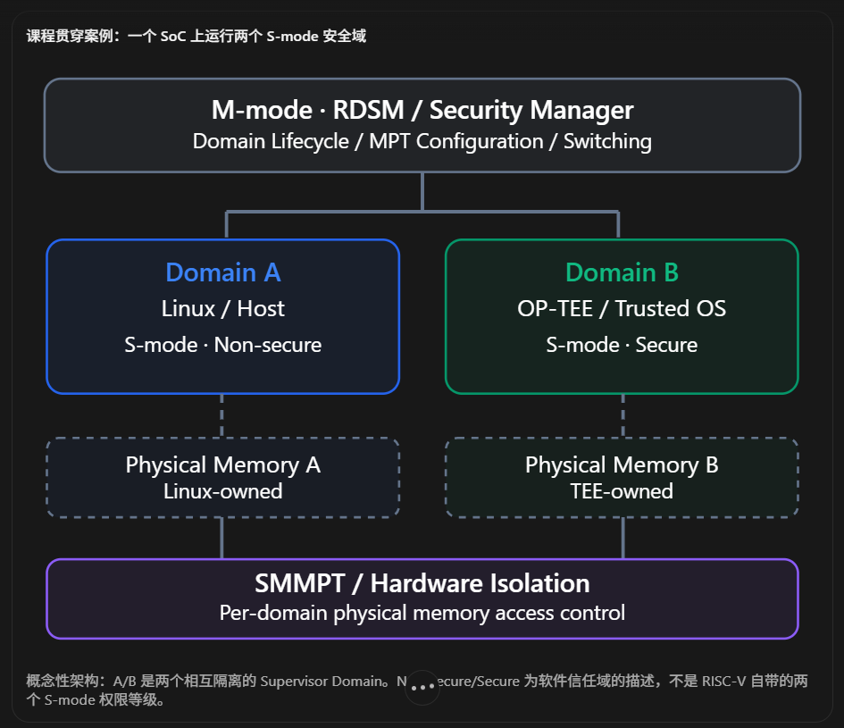

# RISC-V SMMPT 架构深度解析：从硬件隔离原理到 OP-TEE 工程实现

课程设计大纲 · Why → What → How → Source Code → Engineering

我建议把 SMMPT 组织成一套以 SoC 安全架构设计为主线、以实际 Firmware/OS 实现为落点的系统课程，而不是按照 SMMPT Specification 的章节顺序逐条解释。

整个课程希望解决三个层次的问题：

- 架构层面： RISC-V 为什么需要 SMMPT？它究竟解决了传统 PMP、MMU、Hypervisor 无法很好解决的什么问题？
- 机制层面： SMMPT 如何利用 MPT、SDID、CSR、硬件权限检查以及 Domain Switching，实现 S-mode 之间的安全隔离？
- 工程层面： 如何真正将 SMMPT 集成到 OpenSBI、OP-TEE 和 Linux 的完整软件栈？涉及哪些数据结构、函数调用、汇编指令和硬件协作机制？

我希望最终达到的效果是：不仅能够读懂 SMMPT 规范，还能够从软件系统架构师的角度，独立设计一套基于 SMMPT 的 RISC-V TEE 隔离方案，并定位实际硬件上的问题。

## 一、先明确 SMMPT 在 RISC-V 安全架构中的位置

这里先纠正一个容易混淆的术语。

Smmpt 指的是 Machine-mode Memory Protection Table 机制。按照 RISC-V 目前公开的 Supervisor Domain Access Protection 规范，`Smmpt` 是 MPT 机制的名称，而 `Smsd` 是整合了 Supervisor Domain 标识和 MPT 配置机制的架构扩展。

2026 年 8 月 19 日公开的规范版本为 v0.9.0，相关内容已经整合为 `Smsd`，但 `Smmpt` 仍然是讨论内存保护机制时使用的重要名称。课程将以这一公开版本及规范仓库为依据，并区分已定义的架构行为与尚需平台实现的功能。

理解 SMMPT，首先需要认识到一个根本问题：

RISC-V 的 Privilege Level 并不天然等于独立的安全域。

传统的 S-mode Linux Kernel 和另一个 S-mode Security OS，即使采用相同的权限等级，也可能需要互相隔离。

例如，考虑下面的设计场景：



这个案例将贯穿整个课程。

我们会逐渐回答：

1. 两个 Domain 都运行在 S-mode，硬件如何区分？
2. Linux 的 `satp` 和 OP-TEE 的 `satp` 如何与 MPT 配合？
3. 为什么 Linux 即使控制自己的全部页表，也不能访问 OP-TEE 的 Private Memory？
4. 一个 Hart 从 Linux Domain 切换到 OP-TEE Domain 时，哪些状态需要切换？
5. 如果允许 Linux 与 OP-TEE 共享内存，如何安全地分配、授权、回收？
6. DMA、Interrupt 和多 Hart 并发访问会不会绕过隔离？

这里还有一个十分重要的架构边界：SMMPT 负责的是物理地址访问权限，不是虚拟地址转换；CPU 端的 MPT 检查也不能自动覆盖 DMA。 因此，我们必须把 MMU、PMP、IOMMU、I/O MPT Checker 放在完整架构中一起研究。

# 二、推荐的课程总体结构

我建议将课程设计为 6 个部分、20 个 Chapter，按知识依赖逐步深入。

Part I -> 架构基础与设计哲学 -> Chapter 01–03 · 建立正确的隔离模型

Part II -> SMMPT 核心硬件机制 -> Chapter 04–09 · 读懂 CSR、MPT 与权限检查

Part III -> 系统级资源隔离 -> Chapter 10–13 · 从 CPU 延伸到 SoC

Part IV -> Firmware 与软件实现 -> Chapter 14–16 · 深入 RDSM、OpenSBI 和 OP-TEE

Part V -> 工程调试与系统验证 -> Chapter 17–19 · 构建可验证的工程方案

Part VI -> 高级设计与架构评审 -> Chapter 20 · 达到独立设计与审查能力

接下来是每一章的详细设计。

## Part I：架构基础与设计哲学

目标：先理解为什么需要 SMMPT，再理解它如何改变传统的安全隔离模型。

### Chapter 01 — 为什么 RISC-V 需要 SMMPT？

核心问题：PMP 已经能够保护物理内存，为什么还要重新设计一个基于 Table 的保护机制？

1. RISC-V 传统 Privilege Model 的安全边界与局限。
2. PMP 的设计理念、Region Matching 和权限控制。
3. 基于 PMP 实现多个 S-mode Domain 的方案。
4. PMP Entry 数量有限，以及动态重编程带来的问题。
5. 当内存需要频繁分配、回收、迁移时，PMP 为什么不再适合？
6. 为什么 RISC-V 选择类似 Page Table 的数据结构来管理物理内存权限？
7. SMMPT 的设计目标、适用场景和不解决的问题。
8. 引入 SMMPT 之后，RISC-V `TEE 架构`发生了哪些变化？

贯穿案例： 假设一个 SoC 有 16GB DDR，Linux 和 OP-TEE 分别运行在不同 S-mode Domain。我们尝试先使用 PMP 设计隔离方案，再逐步推导`为什么需要 SMMPT`。

### Chapter 02 — 理解 RISC-V 内存保护体系的全貌

重点建立下面这些机制之间的关系：

| 机制                    | 核心职责                         |
| --------------------- | ---------------------------- |
| PMP / Smepmp          | M-mode 控制的物理内存权限             |
| SPMP                  | S-mode 管理的物理访问保护             |
| MMU / `satp`          | 虚拟地址转换和页表权限                  |
| H-extension / `hgatp` | Guest Physical Address 转换与隔离 |
| SMMPT                 | Supervisor Domain 级物理内存访问控制  |
| IOMMU                 | DMA 地址转换及相关访问控制              |
| I/O MPT Checker       | 将 Domain 的 MPT 保护扩展到 I/O 路径  |

重点讲解为什么 SMMPT 不能简单地认为是“又一套 MMU”，以及这些机制如何组合成最终的访问权限。

最后将 RISC-V SMMPT 与 Arm TrustZone、Arm CCA GPT/GPC、RMM、AMD SEV-SNP RMP 作架构比较。

### Chapter 03 — Supervisor Domain：SMMPT 最重要的抽象

这一章是后续所有内容的基础。

1. 什么是 Supervisor Domain？它与 Privilege Mode 有什么区别？
2. 一个 Domain 包含哪些资源：Hart、Memory、Device、Interrupt？
3. RDSM（Root Domain Security Manager）是什么？
4. SDSM（Supervisor Domain Security Manager）是什么？
5. RDSM 与 OpenSBI、OP-TEE 的潜在关系。
6. Supervisor Domain Identifier（SDID）的作用。
7. 一个 Hart 能否在不同时间运行不同 Domain？
8. 多 Hart 系统中如何维护一致的 Domain 安全策略？
9. 同一个物理内存页面可否同时属于多个 Domain？
10. Root Domain 为什么必须成为可信计算基的一部分？

本章实战： 设计一个具备 Linux Domain、OP-TEE Domain 和 `Root Security Manager` 的 RISC-V 系统架构。

## Part II：SMMPT 核心硬件机制

目标：从 `CSR`、`MPTE`、`Table Walk`、权限判定一直深入到汇编指令及缓存同步。

这是全课程的核心技术部分，建议投入最多精力。

### Chapter 04 — `mmpt` CSR 与 Domain 上下文

1. `mmpt` 寄存器的整体结构。
2. `MODE`、`PPN`、`SDID` 字段的精确含义。
3. `Bare`、`Smmpt34`、`Smmpt43`、`Smmpt52`、`Smmpt64`。
4. RV32 和 RV64 的设计差异。
5. `msdcfg` 的作用与可选扩展配置。
6. CSR 初始化、读取和修改的汇编实现。
7. 不同 Hart 各自维护 `mmpt` 时如何保证系统隔离策略一致？
8. `Domain Context Switch` 如何修改 `mmpt`？
9. `SDID` 复用与缓存失效的关系。

会结合 RISC-V 汇编逐条分析，而不是仅介绍寄存器定义。

### Chapter 05 — MPT 数据结构与多级保护表

这一章相当于 SMMPT 的 MMU Page Table 专题。

1. MPT（Memory Protection Table）的本质。
2. MPT 与传统 Page Table 的共同点和区别。
3. `Root MPT` 的创建和内存分配。
4. 多级 Radix Tree 的地址拆分。
5. MPTE（Memory Protection Table Entry）的字段。
6. Leaf 与 Non-leaf MPTE。
7. `V`、`L`、`N`、`XWR` 权限字段。
8. 4KB 页面粒度与一个 MPTE 覆盖多个页面的编码设计。
9. 大页面与 NAPOT 权限区域。
10. Table Memory Overhead 与查询成本。

本章实战： 手动构建一套 RV64 Smmpt43 MPT，逐级计算 MPTE 地址，并解析一个真实的物理地址如何匹配到权限。

### Chapter 06 — 一次内存访问如何经过 SMMPT 硬件检查？

从以下代码开始：

```cpp
volatile uint64_t *ptr = (uint64_t *)0x90000000;

uint64_t value = *ptr;
```

假设它由 Linux Domain 执行，我们追踪：

1. CPU 发起 Load 指令。
2. `satp` 参与虚拟地址转换。
3. 得到物理地址。
4. SMMPT 根据当前 `mmpt` 选择 MPT。
5. MPT 硬件 Page Walk。
6. 检查对应的 Read 权限。
7. 允许访存，或产生 Access Fault。
8. 进入 Trap Handler，定位错误原因。

进一步研究隐式页表访问、Instruction Fetch、Store/AMO、MPRV 以及硬件可能采用的权限缓存。

### Chapter 07 — SMMPT、MMU、PMP 之间的协同与异常

1. 一次访存可能经过哪些权限检查？
2. Sv39 / Sv48、G-stage、MPT 和 PMP 各自检查什么？
3. Page Fault 与 Access Fault 的区别。
4. 多种权限同时不满足时，如何依据架构确定异常行为？
5. MMIO 访问是否受 MPT 控制？
6. Page Table 本身如何受到保护？
7. 防止恶意 Linux 修改 Secure Domain 的 MPT。
8. Secure Domain 如何安全地访问共享内存？

本章实战： 构造几组故障，分别验证 MMU、PMP、MPT 权限违规，并从 `scause`、`mcause` 等状态分析异常来源。

### Chapter 08 — MPT Cache、Fence 与多 Hart 同步

这是另一个非常关键的底层章节。

1. 为什么 MPT 需要类似 TLB 的缓存？
2. 修改 MPTE 后，硬件为什么不一定立即观察到新权限？
3. `MFENCE.PA` 的具体语义。
4. `MINVAL.PA` 等细粒度失效机制。
5. `SFENCE.VMA` 为什么不能直接替代 MPT 同步？
6. MPT 更新时的 Memory Ordering。
7. Local Hart 与 Remote Hart 的同步差异。
8. 跨 Hart Shootdown 的 Firmware 实现。
9. Domain Switching 中的缓存标签与 SDID 复用。
10. 错误同步为什么可能产生安全漏洞？

本章实战： 一个 Hart 修改 MPT，另一个 Hart 正在访问同一物理页面。我们分析如何设计正确的同步协议。

规范明确描述了 `MFENCE.PA`、`MINVAL.PA` 等机制及其作用范围，因此这一章会以实际指令语义为核心，而不是笼统地讨论“刷新 TLB”。

### Chapter 09 — MPT 管理算法与性能设计

1. Root MPT 的分配与释放。
2. MPTE 创建、修改、删除。
3. 多级表内存分配器设计。
4. 大粒度权限映射与 NAPOT 优化。
5. MPT Cache Miss 的性能影响。
6. Domain Switching 的开销。
7. Per-Hart 与跨 Hart 数据结构设计。
8. 如何降低频繁内存授权操作产生的 Fence 成本？
9. RCU、锁及原子更新与安全内存管理。
10. 设计一个简化版的 MPT Manager。

完成这一部分后，应当能够从软件角度理解并实现 MPT 管理所需的核心算法。

## Part III：从 CPU 内存保护扩展到整个 SoC

目标：理解为什么仅保护 CPU 的访存路径，还不足以构建真正安全的 TEE。

### Chapter 10 — 跨 Domain 内存生命周期与安全共享

1. Domain Private Memory、Shared Memory 和 Root-owned Memory。
2. 如何建立完整的 Memory Ownership 模型？
3. 分配、授权、撤销、归还的状态变化。
4. 为什么内存回收前必须检查并清除敏感信息？
5. 共享内存的缓存一致性问题。
6. Domain A 向 Domain B 传递一块内存时的安全流程。
7. 多 Hart 并发访问与授权竞态。
8. 防止 Use-after-Revoke、TOCTOU 和残留数据泄漏。

本章实战： 以 OP-TEE 与 Linux 之间的一块共享内存为例，设计完整的安全生命周期。

### Chapter 11 — IOMMU 与 I/O MPT：DMA 如何受到保护？

这是 SoC 安全架构设计中不可缺少的一章。

1. 为什么 CPU SMMPT 无法自动阻止 DMA 越权访问？
2. 设备如何与 Supervisor Domain 建立关联？
3. IOMMU 与 I/O MPT Checker 的职责边界。
4. Device ID、Requester ID 与 Domain Classification。
5. DMA 地址转换与 MPT 权限检查如何配合？
6. 多个 Domain 共享设备时如何保证隔离？
7. I/O MPT 配置、缓存及失效。
8. DMA In-flight Transaction 的安全撤销。
9. IOMMU Fault 与 MPT Fault 的区分。
10. PCIe ATS、设备侧地址转换缓存对安全设计的影响。

本章实战： 设计一次 DMA 越权访问实验，证明 Linux 设备无法读取 OP-TEE 的私有内存。

### Chapter 12 — Domain Interrupt Isolation 与 AIA

1. 为什么内存隔离不等于中断隔离？
2. PLIC、APLIC、IMSIC 在多 Domain 场景中的角色。
3. `Smsdia` 扩展。
4. Supervisor Interrupt Domain 与 Supervisor Domain 的关系。
5. MSI、中断文件与路由配置。
6. `mideleg` 在 Domain Switching 时如何管理？
7. 安全设备中断如何投递到 OP-TEE Domain？
8. 中断到达时目标 Domain 未运行，该怎么办？
9. 多 Hart 中断分配与安全状态同步。

### Chapter 13 — Debug、Trace、QoS 与 Confidential Computing

1. Debug Interface 为什么可能破坏 Domain 隔离？
2. Supervisor Domain 的外部 Debug、Trace 控制。
3. 安全调试的授权策略。
4. QoS 与 Shared Cache 的资源隔离。
5. MPT 权限隔离与 Memory Encryption 的区别。
6. 与内存加密上下文、Metadata Selection 的关系。
7. `Attestation` 与 SMMPT 的关系。
8. SMMPT 如何支持 CoVE，以及它不提供哪些能力？

这里会明确区分基础 SMMPT、相关可选扩展和平台特定的加密/证明机制，不会将这些功能都混为 SMMPT 的内建能力。

## Part IV：Firmware 与 OP-TEE 软件实现

目标：把规范映射到真实代码、初始化流程及 Domain 管理机制。

### Chapter 14 — 从 Reset 到建立第一个 Supervisor Domain

围绕一条完整 Boot Flow：

```bash
SoC Reset
    |
    v
ROM / Root of Trust
    |
    v
M-mode Firmware Initialization
    |
    v
PMP / MPT Initialization
    |
    v
Root Domain Security Manager
    |
    +-- Create Linux Domain
    |
    +-- Create OP-TEE Domain
    |
    +-- Configure Memory Protection
    |
    v
Boot Supervisor Software
```

重点包括 Boot Memory Layout、MPT 初始化顺序、Trust Boundary 建立、M-mode 到 S-mode 的跳转、冷启动和 Warm Boot 以及 Secondary Hart 的初始化。

### Chapter 15 — OpenSBI 与 RDSM：Domain 管理如何实现？

我建议以真实 OpenSBI 源码为切入点，分析：

1. `sbi_domain` 现有软件抽象。
2. OpenSBI Domain 与架构 Supervisor Domain 的关系和区别。
3. OpenSBI 基于 PMP 的隔离方案。
4. RDSM 是否必须与 OpenSBI 集成？
5. 使用 OpenSBI 作为基础构建 RDSM 的设计方案。
6. 每个 Hart 的 Domain State 如何维护？
7. Domain 创建、切换和销毁的核心数据结构。
8. SBI `ecall` 与 Domain Switch 的关系。
9. MPT 操作 API 应如何设计？
10. SMP、Locking、IPI、Fence 的实现。

重要约束： OpenSBI 现有 `sbi_domain` 机制不能直接等同于完整的 `Smsd/SMMPT RDSM` 实现。我们会分别分析已有上游源码和为了支持 SMMPT 需要新设计的代码。

### Chapter 16 — OP-TEE 与 SMMPT 的完整集成设计

重点章节

这一章将作为课程的工程核心，围绕 OP-TEE 设计一套完整的软件集成方案。

1. OP-TEE 在 RISC-V 上的执行模式与隔离方案选择。
2. OP-TEE 独立 S-mode Domain 的架构前提。
3. OP-TEE Boot、Core Initialization 和 Memory Layout。
4. `core/mmu` 与 `MPT` 的职责边界。
5. Secure DDR、Non-secure DDR、Shared Memory 的管理。
6. Linux CA → OP-TEE TA 的跨域调用路径。
7. Context Switch 与 Trusted Thread 的关系。
8. `ecall`、Trap、RDSM、OP-TEE Entry 的完整调用链。
9. Secure Interrupt 与 RPC 的处理。
10. SMP、CPU Affinity 和 Secondary Hart Support。
11. 内存授权及撤销操作的软件接口设计。
12. SMMPT Violations 如何向 OP-TEE / RDSM 报告？
13. 如何设计一个可移植的 SMMPT Backend？
14. 如何将平台特定实现与 OP-TEE 通用代码解耦？

本章会重点采用情景分析 + C 源码 + RISC-V 汇编 + CSR 状态变化的方式讲解。

## Part V：工程调试与系统验证

### Chapter 17 — Linux、UEFI、Device Tree 与 SMMPT 系统集成

1. Linux 如何感知 Domain 内允许使用的物理内存？
2. Device Tree 中的 Reserved Memory 和 Domain Memory 描述。
3. Bootloader/UEFI 传递物理内存信息的方式。
4. Linux Memory Allocator 与 Domain Ownership。
5. OP-TEE Driver、SMC ABI 与 RISC-V 调用接口适配。
6. SMMPT 与 IOMMU Driver 的配置边界。
7. 如何设计跨 Firmware、Linux、OP-TEE 的集成接口？

### Chapter 18 — SMMPT 的底层调试与故障定位

结合 QEMU（在支持相应扩展的实现上）、FPGA 或 Palladium/ZeBu 等环境，分析典型问题：

1. CSR 初始化失败。
2. MPT Root Address 配置错误。
3. MPTE 编码错误。
4. Linux 访问 Secure Memory 导致 Access Fault。
5. OP-TEE 访问共享内存失败。
6. Domain Switching 后访问异常。
7. 多 Hart 间 MPT Cache 不一致。
8. DMA 越权访问。
9. Interrupt Routing 错误。
10. 利用 GDB、TRACE32、Waveform 和 Firmware Trace 定位问题。

### Chapter 19 — SMMPT 验证体系与安全测试

1. 规范符合性测试。
2. MPTE 编码和边界测试。
3. Fault Injection。
4. Domain Isolation Negative Tests。
5. Memory Ownership 转移测试。
6. 并发访问和 Race Condition。
7. Multi-Hart Stress Test。
8. DMA 安全测试。
9. Performance Benchmark。
10. Coverage Matrix 与 Regression Test。

这一章最终形成一份可用于项目 Bring-up、设计验证和后续回归的测试矩阵。

## Part VI：高级架构设计与最终实战

### Chapter 20 — 从零设计一套基于 SMMPT 的 RISC-V TEE 平台

作为整套课程的最终项目，假设芯片拥有：

- 16 个 RV64 Hart
- OpenSBI 与 M-mode Security Manager
- Linux / UEFI
- OP-TEE
- SMMPT
- IOMMU、AIA
- 独立安全 Root of Trust

我们从需求开始，完整设计：

1. 安全威胁模型与 Trust Boundary。
2. Supervisor Domain 划分方案。
3. 物理内存安全布局。
4. MPT 数据结构及权限策略。
5. Firmware 初始化流程。
6. Domain Switch Protocol。
7. OP-TEE 调用及共享内存接口。
8. DMA 与中断安全方案。
9. SMP 与缓存同步方案。
10. 性能、可维护性与安全性的架构评审。

最终输出一份简化但完整的 SMMPT + OP-TEE Integration Architecture Design，包括模块接口、关键数据结构、Boot Flow、调用时序以及验证方案。

# 三、每一章采用什么讲解方式？

为了达到“像书籍一样深入浅出”的效果，我建议每章采用相同的学习结构，而不是从规范定义直接跳到代码。

1. 真实问题与场景（Why）

   先构建一个工程问题，说明传统方案存在的局限，推导为什么需要当前机制。
2. 架构设计与取舍（What）

   解释设计原则、信任边界、硬件与软件分工，并与 Arm/AMD 等架构进行必要的对照。
3. 硬件工作原理（How）

   以数据流、时序图、CSR 位域、状态机和地址计算为核心，把规范机制讲到能够独立推演的程度。
4. 实际源码与汇编（Implementation）

   追踪 OpenSBI、OP-TEE、Linux 的现有源码。对尚未具备成熟开源实现的功能，给出明确标记的参考设计或实验代码。
5. 动手实验与 Debug（Practice）

   每章设置可验证结果的实验，包括正常路径和故意构造的失败路径。
6. Staff Engineer 级问题（Review）

   章节结尾提供 5–8 个架构设计、源码分析、性能优化和安全故障定位问题，并配备参考答案。

例如讲到 MPT Table Walk 时，不会只介绍 MPTE 格式，还会实际给出一个 RV64 物理地址、一套 MPT 表项和对应的内存内容，然后手动逐级查询，最终判断某条 Load/Store 指令是否允许执行。

这种方式能够将规范里相对抽象的概念转化为具体的 CPU 行为和软件代码。

# 四、学习优先级与课程安排

考虑到目标是进行 RISC-V SMMPT 与 OP-TEE 的实际集成，我建议不要机械地从 Chapter 01 到 Chapter 20 一路平均投入精力。

| 优先级 | Chapter  | 重点                         |
| --- | -------- | -------------------------- |
| P0  | 01–08    | 必须掌握的架构与硬件机制               |
| P0  | 14–16    | Firmware、OpenSBI、OP-TEE 集成 |
| P1  | 09–11    | 动态内存管理、共享内存、DMA            |
| P1  | 18–19    | Debug 和验证                  |
| P2  | 12–13、17 | 中断、扩展安全机制和系统联动             |
| P2  | 20       | 完整架构设计与评审                  |

其中我认为有三个最值得深入到汇编和真实代码层面的专题：

专题 A：MPT 权限检查。 从一条 Load 指令开始，一直追踪到物理地址、MPT Walk、权限位和 Fault Handling。

专题 B：Domain Switching。 从 Linux 进入 OP-TEE，追踪 Trap Entry、M-mode RDSM、CSR 更新、缓存同步及返回 S-mode 的完整过程。

专题 C：Memory Ownership Transfer。 一块物理内存从 Linux 管理转为 OP-TEE 私有，再授权共享、撤销共享、最终回收，分析安全性与并发问题。

这三个专题串起来，基本就抓住了 SMMPT 在真实 TEE 系统中的主要工程价值。

## 五、课程采用的主要技术资料

为防止规范与工程实现混淆，后续讲义会以公开标准为架构依据，以代码仓库为实现依据，遇到缺少上游实现的部分，会明确标注为参考实现。

| 资料                                                                                                        | 用途                                      |
| --------------------------------------------------------------------------------------------------------- | --------------------------------------- |
| [RISC-V Supervisor Domain Access Protection](https://github.com/riscv/riscv-smmtt?utm_source=chatgpt.com) | SMMPT / Smsd 等机制的规范来源                   |
| [Specification Releases](https://github.com/riscv/riscv-smmtt/releases?utm_source=chatgpt.com)            | 核对版本和规范变更                               |
| [OpenSBI](https://github.com/riscv-software-src/opensbi?utm_source=chatgpt.com)                           | M-mode、Domain、Trap、SMP 和 Firmware 代码    |
| [OP-TEE OS](https://github.com/OP-TEE/optee_os?utm_source=chatgpt.com)                                    | Core MMU、Thread、Entry、Shared Memory 等实现 |
| [RISC-V Security Model](https://github.com/riscv/riscv-security-model?utm_source=chatgpt.com)             | 安全边界和不同保护机制之间的关系                        |

另外一个重要的现实限制是：标准定义了硬件应该提供什么，并不意味着主线 OpenSBI、OP-TEE 或通用 QEMU 已经完整支持这些功能。因此实验部分会区分真实源码分析、软件参考模型、支持扩展的仿真器以及实际 SoC 验证，避免写出无法在目标环境中运行的示例。

## 六、我的课程设计建议

这套课程最重要的，不是掌握多少个 CSR、多少种 MPTE Encoding，而是最终形成一种系统性思维：

SMMPT 不是单纯的 Memory Protection 技术，而是 RISC-V 用于构建独立 Supervisor Domain 信任边界的基础机制之一。

如果只研究 MPT 的格式，很容易陷入和阅读 MMU Spec 类似的困境：理论都明白，但一涉及实际系统的 Domain Switching、Shared Memory、DMA 和 SMP 就无法把它们串联起来。

因此我建议：

从 Chapter 01：为什么 RISC-V 需要 SMMPT？ 开始，按照这套大纲逐章深入。前期重点建立整体架构模型，中期彻底理解 MPT 和 CSR，后期以 OpenSBI + OP-TEE 集成为主线，把技术细节逐一连接到真实代码上。

每章尽可能独立完整，同时保持一个连续的 Linux/OP-TEE 双 Domain 案例。

最终目标不是简单地“学会 SMMPT”，而是具备独立实现、调试、验证和评审一套 RISC-V SMMPT 安全隔离系统的能力。
