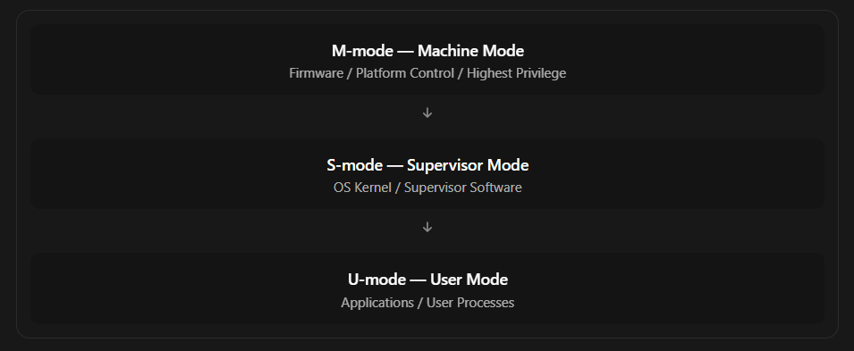
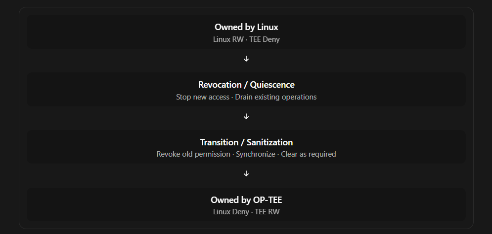
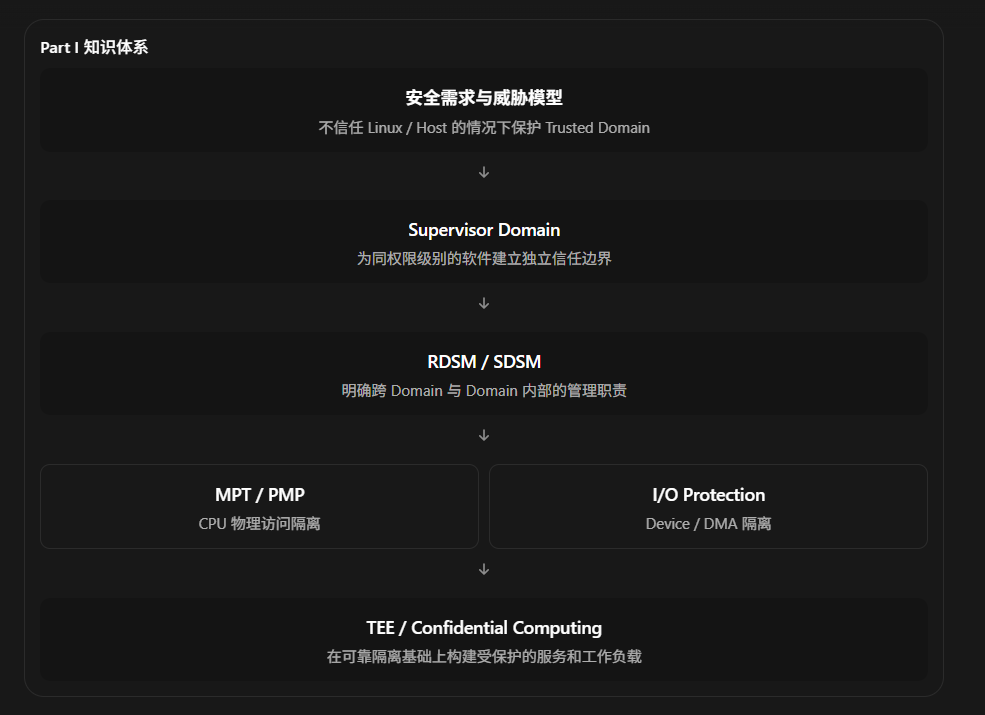

# RISC-V SMMPT 深度技术课程

Part I · 架构基础与设计哲学 · Chapter 01–03

这一部分我们暂时不急于深入 MPTE 的 Bit Definition，也不急于编写 `mmpt` CSR 的初始化代码。

首先要解决的是一个更重要的问题：

为什么 RISC-V 在已经具备 Privilege Mode、MMU、PMP 和 Hypervisor 的情况下，仍然需要一套 Supervisor Domain Access Protection 架构？

理解了这个问题，后面的 MPT、SDID、RDSM、Domain Switching 就不再是彼此孤立的技术概念，而是为解决同一个安全架构问题所设计的不同机制。

## 学习目标

完成 Part I 后，应当具备以下能力：

1. 能从安全威胁模型出发，解释 PMP 为什么难以支撑大规模、动态的 Supervisor Domain 隔离。
2. 能清晰区分 Privilege Isolation、Address Space Isolation 和 Security Domain Isolation。
3. 能分析 `satp`、`hgatp`、PMP、SPMP、MPT、IOMMU 的职责边界。
4. 能解释 SMMPT 在整个 CPU Memory Access Pipeline 中的作用。
5. 能理解 Supervisor Domain、RDSM、SDSM 和 SDID 的架构关系。
6. 能初步设计一个 Linux + OP-TEE 双 Domain 的 RISC-V SoC 安全模型。
7. 面对具体的安全漏洞或访问异常，能够判断问题应从哪个架构层次开始排查。

规范基线： 采用 RISC-V Supervisor Domain Access Protection 公开规范 v0.9.0（2026 年 8 月 19 日发布）。在这一版本中，`Smsd` 是 Supervisor Domains 扩展，包含 `mmpt`、`msdcfg` 以及 MPT 机制；`Smmpt` 用于指称其中的内存保护表机制及相应模式。目前该公开版本尚不应视为正式批准的 Ratified 版本。

# Chapter 01 — 为什么 RISC-V 需要 SMMPT？

核心问题：PMP 已经可以保护物理内存，为什么还需要基于 Table 的隔离机制？

## 1.1 从一个真实的安全需求开始

假设我们正在设计一颗 RISC-V Server SoC，硬件配置如下：

| 组件         | 配置                                |
| ---------- | --------------------------------- |
| CPU        | 16 × RV64 Hart                    |
| DDR        | 16 GiB                            |
| Firmware   | OpenSBI / M-mode Security Manager |
| Normal OS  | Linux                             |
| Trusted OS | OP-TEE                            |
| 目标         | Linux 与 OP-TEE 物理内存隔离             |
| 后续需求       | Confidential Computing            |

现在有一个安全需求：

> Linux Kernel 即使被攻击者完全控制，也不能读取或修改 OP-TEE 的私有内存，包括 Trusted Application 的代码、数据、Heap 和 Stack。

注意，这里的攻击者不是普通的 Linux User Process，而是已经获得了 Linux Kernel 的最高控制权。

它可以修改 Linux Page Table，修改 `satp`，映射任意允许访问的物理地址，加载任意 Kernel Module，甚至可以控制部分设备的 DMA。

这意味着，我们不能再依靠 Linux 自己实现的权限管理保护 OP-TEE。

一个被攻击者控制的组件，不能作为阻止该攻击者访问资源的唯一安全执行者。

这是我们设计安全架构时最重要的原则之一。

### 1.1.1 先尝试利用 MMU 保护 OP-TEE

假设物理内存布局如下：

```
Physical Memory Layout

0x8000_0000
    |
    | Linux Normal Memory
    | 1 GiB
    |
0xC000_0000
    |
    | OP-TEE Private Memory
    | 128 MiB
    |
0xC800_0000
    |
    | Linux / OP-TEE Shared Memory
    | 16 MiB
    |
0xC900_0000
    |
    | Remaining Memory
    v
```

第一种设计方案是：

在 Linux 中将 `0xC000_0000 ~ 0xC7FF_FFFF` 标记为 Reserved Memory，不允许 Kernel Memory Allocator 使用。

这样是不是就保护了 OP-TEE？

答案是否定的。

Reserved Memory 只是告诉 Linux：“这块内存不要当成普通内存使用。”

但是 Linux Kernel 自己有权修改页表。

例如，攻击者可以尝试构造下面的映射：

```
Linux Virtual Address
    0xFFFF_FFC0_1000_0000
           |
           | Malicious PTE
           v
Physical Address
    0xC000_1000
           |
           v
OP-TEE Private Data
```

如果没有独立的物理访问保护机制阻止 Linux 访问这块 PA，恶意 Linux 就可以通过自己建立的映射读取目标内存。

因此，我们得到第一个结论：

MMU 能够让 Linux 隔离其管理的进程，但不能单独保证 Linux 本身与另一个同权限级别的安全 OS 互相隔离。

原因不是 MMU 的实现不够完善，而是 MMU 的页表控制权本来就交给了操作系统。

### 1.1.2 为什么提高 OP-TEE 的权限级别不是唯一答案？

可以提出另一种方案：

让 OP-TEE 运行在 M-mode，而 Linux 运行在 S-mode。

这样可以利用 RISC-V 已有的权限层级：

```
M-mode
  └── OP-TEE / Security Monitor

S-mode
  └── Linux

U-mode
  └── Linux Applications
```

这在某些系统中确实可行，传统 RISC-V TEE 也可以采用 M-mode Security Monitor 管理安全执行环境的设计。

但它带来了另一个问题：M-mode 原本承担底层 Firmware、Trap、Hart 管理、硬件安全策略等职责。

如果把规模较大的 Trusted OS 全部放到 M-mode，就可能扩大具有最高硬件权限的软件代码规模。

我们更希望达到：

```
M-mode
   Small Trusted Security Manager

S-mode Domain A
   Linux

S-mode Domain B
   OP-TEE
```

这样：

- M-mode 保留最核心的硬件控制权。
- Linux 仍然是 S-mode OS。
- OP-TEE 也可以作为独立的 S-mode OS。
- 两者之间通过硬件机制实施物理内存隔离。
- 不需要让全部 Trusted OS 代码都获得 M-mode 权限。

注意，这不意味着所有 RISC-V OP-TEE 实现都必须采用双 S-mode Domain。它是本课程要研究的一种目标架构，而不是 OP-TEE 的唯一部署方式。

## 1.2 RISC-V Privilege Model 的设计目标与局限

RISC-V 传统权限体系可以概括为：



这种体系本质上是按照软件功能与控制权限分层：

- Machine Firmware 管理 Supervisor。
- Supervisor 管理 User Process。
- User Process 不能直接控制 Supervisor 的关键资源。

但请思考：

如果系统中存在两个 S-mode OS，Linux 和 OP-TEE，谁来控制谁？

按照传统 Privilege Model，它们拥有相同的基本架构权限。

这就暴露了一个基础问题：

Privilege Level 描述软件具备什么级别的控制能力，却不直接描述软件属于哪个独立的信任边界。

### 1.2.1 Privilege 与 Trust 是两个不同维度

举一个更容易理解的例子。

一台服务器有三个管理员：

- 管理员 A 负责公司 A 的系统。
- 管理员 B 负责公司 B 的系统。
- 管理员 C 负责底层平台。

管理员 A 和管理员 B 都具有各自系统内的最高管理权限，但不能因此允许 A 访问 B 的敏感数据。

对于硬件架构也是一样：

```
Privilege Level:
    S-mode == S-mode

Security Domain:
    Domain A != Domain B
```

因此，我们需要把权限模型扩展为两个维度：

```
SecurityContext=(PrivilegeLevel, Domain)
```

这只是帮助理解的抽象模型，真实硬件还包括地址转换状态、设备上下文和其他安全属性。

例如：

```bash
(S-mode, Domain A)  → Linux
(S-mode, Domain B)  → OP-TEE
(M-mode, Root)      → RDSM
```

这样就不必依靠更高的 Privilege Level 来区分每个 OS 的安全归属。

这正是 Supervisor Domain 架构希望建立的能力。

## 1.3 使用 PMP 是否可以解决？

答案是：可以解决一部分问题，并且对静态隔离来说往往已经足够。

这是我们理解 SMMPT 动机时非常重要的一点。

不能简单地认为 PMP 是旧机制，所以一定不能实现 TEE。

### 1.3.1 PMP 的本质

PMP（Physical Memory Protection）由 M-mode 控制，能够对低权限软件发起的物理地址访问实施 R/W/X 检查。

每个 PMP Entry 通常包含：

```bash
PMP Entry
    |
    +-- Address Matching
    |      TOR / NA4 / NAPOT
    |
    +-- Permissions
    |      R / W / X
    |
    +-- Lock
           L
```

其作用可以理解为：

```
Memory Access
    |
    v
Physical Address
    |
    v
PMP Address Matching
    |
    v
Permission Check
    |
    +-- ALLOW
    |
    +-- DENY
```

注意，PMP 由每个 Hart 的配置状态决定。同一个物理地址，在两个 Hart 上可以因为 PMP 配置不同而得到不同的访问结果。

### 1.3.2 使用 PMP 构建 Linux / OP-TEE 隔离

假设系统将两个 OS 固定在不同 Hart 上运行。

```
Hart 0 - Hart 11
    |
    +-- Linux
    +-- PMP Policy A

Hart 12 - Hart 15
    |
    +-- OP-TEE
    +-- PMP Policy B
```

可以为 Linux 配置：

```
Linux Memory       RWX
OP-TEE Private     ---
Shared Memory      RW-
Firmware Memory    ---
```

为 OP-TEE 配置：

```
Linux Memory       --- / selected access
OP-TEE Private     RWX
Shared Memory      RW-
Firmware Memory    ---
```

这里假设物理内存分区固定、PMP Entry 足够，并且所有未授权区域也经过正确的保护策略处理。

结果就是：

Linux 即使使用自己的页表将 OP-TEE Private Memory 映射成可读，也会被 PMP 拒绝。

所以，PMP 确实可以构建不同 S-mode 软件之间的硬件隔离。

这不是理论上的可能性。OpenSBI 的 Domain Framework 就包含使用 PMP 等机制实施系统分区隔离的设计。

## 1.4 PMP 的第一个局限：Region 数量与内存碎片

现在改变我们的需求。

假设 OP-TEE 不再只需要一块连续的 128MiB 内存，而是希望支持动态分配：

```
Physical Memory

+-----------------------+
| Linux                |
+-----------------------+
| TEE Page A   (4 KiB)  |
+-----------------------+
| Linux                |
+-----------------------+
| TEE Page B   (4 KiB)  |
+-----------------------+
| Linux                |
+-----------------------+
| TEE Page C   (4 KiB)  |
+-----------------------+
| Linux                |
+-----------------------+
| TEE Page D   (4 KiB)  |
+-----------------------+
| ...                   |
```

### 1.4.1 PMP 为什么开始变得困难？

PMP 的基本描述单位是物理地址区域（Region）。

例如：

```
Entry 0 : Region A
Entry 1 : Region B
Entry 2 : Region C
Entry 3 : Region D
...
```

硬件 PMP Entry 的数量是有限的。实际 SoC 可能实现十几到几十个 Entry，具体取决于硬件设计和架构支持情况。

假设我们有 16 个可用 PMP Entry，而 TEE 需要保护 100 个互不相邻的物理区域。

如果每个碎片都需要单独描述，就会面临 Entry 数量不够的问题。

虽然可以使用 TOR、NAPOT、Entry 优先级和适当的内存重排减少所需条目，但这无法从根本上解决大规模碎片化内存管理的可扩展性问题。

### 1.4.2 为什么不直接增加 PMP Entry 数量？

我们可以设想增加到 256、1024，甚至更多。

但需要注意，PMP 是配置在 Hart 上的硬件保护机制。

随着 Entry 数量增加：

- CSR 配置状态增多。
- 硬件地址匹配成本可能增加。
- Context Switch 时需要处理更多配置状态。
- 不同 Hart 的保护策略同步更复杂。
- 硬件设计面积、功耗和时序实现存在取舍。

这些开销并非每一项都会严格线性增长，具体取决于硬件实现，但“无限增加 PMP Entry”并不是经济有效的通用方案。

### 1.4.3 为什么 Server SoC 特别容易遇到这个问题？

因为 Server OS 对 Memory 的使用具有强烈的动态性。

例如：

- Linux 动态分配和回收 4KiB 页面。
- TEE 动态加载多个 Trusted Application。
- Confidential VM 需要动态分配机密内存。
- 内存在不同 Domain 之间授权、撤销和重新分配。
- 多个独立安全域同时运行。
- 大量内存区域可能既不连续，也不具备一致的权限。

如果系统有 16GiB DDR，以 4KiB 页面计算：

```
N(pages) = (16 * 2^30) / 4096 = 4_194_304
```

这不代表 MPT 必须保存四百多万个独立表项，也不代表 PMP 一定需要同样多的 Entry。

它只是说明：系统的内存管理粒度可能达到数百万个页面，而传统 PMP 的资源描述模型主要面向有限个物理区域。

当需要动态地追踪大量页面的所有权时，Region-based PMP 不再是最自然的数据结构。

## 1.5 PMP 的第二个局限：动态重编程

现在再提出一个更复杂的问题。

假设我们允许 Linux 将一个物理页面转交给 OP-TEE。

初始：

```
Physical Page P

Owner: Linux

Linux: RW
TEE:   No Access
```

转移之后：

```
Physical Page P

Owner: OP-TEE

Linux: No Access
TEE:   RW
```

如果使用 PMP，这意味着相关 Hart 的 PMP 配置可能需要修改。

### 1.5.1 为什么不能简单地修改两个 Entry？

假设系统有 16 个 Hart：

```
Hart 0    Linux
Hart 1    Linux
Hart 2    Linux
...
Hart 11   Linux
Hart 12   OP-TEE
...
Hart 15   OP-TEE
```

当 Page P 从 Linux 转移给 OP-TEE 时，必须保证：

任何 Linux Hart 在转移完成后，都无法继续访问 Page P。

因此，至少需要考虑：

1. 禁止 Linux 发起新的相关访问。
2. 处理正在执行或尚未完成的访问。
3. 在所有相关 Hart 上撤销旧权限。
4. 确保权限更新已经成为硬件实际使用的状态。
5. 处理数据清理、缓存及其他平台相关要求。
6. 为 OP-TEE 建立新的访问权限。
7. 向软件报告内存转移完成。

对于 PMP，这通常涉及多个 Hart 的本地硬件配置更新。

如果频繁执行这样的操作，成本就会不断积累。

还要特别注意，PMP Lock 机制及 Smepmp 的扩展策略可能限制某些配置的运行时修改。因此动态系统必须在 Boot 阶段正确设计可变与不可变的保护边界。

### 1.5.2 PMP 的局限其实是数据结构与管理方式的问题

到这里，可以重新总结 PMP 的特点：

| 方面                   | PMP        |
| -------------------- | ---------- |
| 权限管理粒度               | 物理区域       |
| 配置存储位置               | Hart 本地寄存器 |
| 动态更新                 | 需要修改相关硬件配置 |
| 内存碎片管理               | 不够灵活       |
| 静态安全分区               | 非常合适       |
| 大规模动态 Page Ownership | 扩展性受限      |

到这里，SMMPT 的设计动机已经逐渐清晰。

RISC-V 需要的是一种：

- 能够描述大量非连续物理页面；
- 可以通过内存中的数据结构动态维护；
- 不必为每个页面提供独立 PMP CSR；
- 能够随着 Domain 运行状态选择不同权限映射；
- 可以由 M-mode 统一管理的物理访问控制机制。

下一步自然会想到：既然操作系统利用 Page Table 管理大量虚拟内存页面，是否也能采用类似的数据结构来管理物理内存权限？

这就是 MPT 的设计出发点。

## 1.6 SMMPT 的设计思想：把访问权限组织成 Memory Protection Table

理解 SMMPT 最简单的方法，是从它和 MMU 的相似性入手，再找出它们本质上的不同。

### 1.6.1 MMU 是怎么解决大量页面管理问题的？

以 Sv39 为例：

```
Virtual Address
      |
      v
   satp.PPN
      |
      v
  Root Page Table
      |
      v
  Intermediate Table
      |
      v
   Leaf PTE
      |
      v
Physical Address + Permissions
```

多级 Page Table 的好处在于：

- 数据结构保存在内存中。
- 可以描述大量虚拟页面。
- 不需要为每个页面创建一个独立 CSR。
- 可以按需分配页表。
- 可以通过 TLB 缓存转换结果。

但 MMU 解决的是：

```bash
VirtualAddress -> PhysicalAddress
```

并同时实施虚拟地址空间中的访问权限。

### 1.6.2 如果只想检查物理内存权限呢？

SMMPT 的思路可以概括为：

```
Physical Address
      |
      v
Current Supervisor Domain
      |
      v
Memory Protection Table
      |
      v
Find MPTE
      |
      v
Check R / W / X
      |
      +-- Allow
      |
      +-- Deny
```

核心区别是：

MPT 不将一个物理地址转换成另一个地址，而是回答当前 Domain 是否有权访问这个物理地址。

例如，同一个物理地址：

```
PA = 0xC000_1000
```

对于 Linux Domain：

```
MPT_Linux[PA] = No Access
```

对于 OP-TEE Domain：

```
MPT_TEE[PA] = Read + Write
```

这样即使 Linux 能通过自己的页表得到 `PA=0xC000_1000`，它仍然不能完成对这块内存的访问。

MPT 从物理地址出发进行权限查询，不依赖 Linux 对自身页表的诚实配置。

这正是将访问控制放在 OS 控制边界之外的意义。公开规范也明确指出，MPT 不执行地址转换，而是根据物理地址提供访问权限。

### 1.6.3 MPT 与 Page Table 相似，但控制权完全不同

| 属性    | MMU Page Table             | MPT                         |
| ----- | -------------------------- | --------------------------- |
| 输入    | 虚拟地址或 Guest PA             | Supervisor Physical Address |
| 目的    | 地址转换与访问权限                  | Domain 级物理权限检查              |
| 根表寄存器 | `satp` / `vsatp` / `hgatp` | `mmpt`                      |
| 典型管理者 | OS / Hypervisor            | M-mode RDSM                 |
| 查询结果  | 目标地址及权限                    | R/W/X 权限                    |
| 缓存    | TLB                        | MPT 相关权限缓存                  |
| 安全边界  | OS/VM 内部                   | Supervisor Domain 之间        |

这里最重要的不是数据结构，而是控制权。

Linux 可以修改自己的 Page Table，却不能修改受 RDSM 保护的 MPT。

因此，Linux 的管理权限只在它被允许访问的物理资源范围内有效。

## 1.7 SMMPT 引入之后，整个 TEE 架构发生了什么变化？

传统设计往往依靠 Privilege Level 建立隔离：

```
          Higher Privilege
                 |
                 v
      Security Monitor / TEE
                 |
                 v
             Normal OS
```

在 Supervisor Domain 模型中，可以把多个 OS 组织在同一个基本权限层级：

```
                  M-mode
                  RDSM
                    |
          +---------+---------+
          |                   |
          v                   v
    Domain A              Domain B
    Linux                 OP-TEE
    S-mode                S-mode
          |                   |
          v                   v
      MPT_A                  MPT_B
          |                   |
          +---------+---------+
                    |
                    v
             Physical Memory
```

这是概念化的安全架构，而非要求每个产品都采用完全相同的软件分层。

### 1.7.1 最根本的改变：从 Privilege-based Trust 转向 Domain-based Trust

以前我们可能会认为：

S-mode 软件具有比 U-mode 更高的权限，所以它天然可信。

但在 Confidential Computing 场景下，Host Kernel/Hypervisor 完全可能属于不可信侧。

因此，安全性不能只依赖 Privilege Level。

安全模型需要表达：

- Host 对自己的资源具有管理权限。
- Trusted Domain 对自己的敏感资源具有控制权。
- Host 即使拥有 S/HS-mode 权限，也不能越过 Domain 边界。
- RDSM 在最小可信底座内维护跨 Domain 的隔离策略。

### 1.7.2 缩小 TCB

TCB（Trusted Computing Base）指保证某一安全属性成立所必须信任的硬件、软件和配置集合。

如果要求整个 Linux Kernel 都可信，TCB 会非常大。

如果 Linux 与 OP-TEE 由底层硬件隔离：

```
Common TCB
    |
    +-- Hardware Isolation
    +-- RDSM
    +-- Security Root of Trust
    +-- Relevant Platform Firmware
```

则 Linux 不再必须成为 OP-TEE 私有内存保密性的可信组成部分。

但要注意，OP-TEE 自己的代码仍然属于其服务的 TCB。RDSM、芯片实现以及负责授权的固件也必须可信。

将 OP-TEE 放在独立 Domain 中，并不意味着 OP-TEE 不需要进行内部漏洞防护。

### 1.7.3 SMMPT 不能独立提供完整的机密计算

这一点很重要。

SMMPT 可以帮助实现物理内存访问控制，但不会自动提供：

- Boot Image Authentication。
- Remote Attestation。
- Memory Encryption。
- DMA 隔离。
- Secure Interrupt Routing。
- Secure Debug。
- Side-channel Resistance。

这些能力需要其他架构扩展、硬件模块及可信软件共同完成。

因此：

```
SMMPT != {完整的 Confidential Computing}
```

SMMPT 是其安全隔离基础之一，而不是整个 Confidential Computing 系统。

## 1.8 用一个真实工程场景比较 PMP 与 MPT

现在回到最初的 16-Hart SoC。

假设存在两类产品需求。

场景 A：固定分区的嵌入式安全系统

- 4 个 Hart。
- Linux 和 Trusted OS 使用固定物理内存。
- 基本没有动态跨域内存转移。
- Device 分区固定。
- PMP Entry 足够。

对于这种系统，PMP 可能更加直接，内存开销也更容易控制。

场景 B：RISC-V Server Confidential Computing

- 16 个 Hart。
- Linux Host 与多个 Trusted Domain。
- 不同 Domain 随时可能获得或释放物理内存。
- 分配粒度可能是 4KiB。
- 同一 Hart 需要运行不同 Domain 的软件。
- 内存频繁共享与撤销。

这样的系统更适合采用可扩展的、由 M-mode 管理的 MPT 结构。

但 MPT 自身也带来代价：内存中的表结构需要额外存储空间，硬件需要执行 MPT Walk，并处理缓存一致性与权限更新同步问题。

所以，SMMPT 并不是消除所有复杂性，而是把有限 Region 的配置问题，转化为可扩展的表管理与缓存同步问题。

### Chapter 01 总结

这一章需要真正记住四个判断：

1. MMU 隔离的是由对应 OS/Hypervisor 管理的地址空间，不天然隔离两个互不信任的 S-mode OS。
2. PMP 能实现 Supervisor Domain 之间的物理隔离，但在大量碎片化页面和动态重配置场景下扩展性有限。
3. MPT 使用物理地址进行权限查询，由 RDSM 维护，普通 Supervisor 软件不能自行改变其安全边界。
4. SMMPT 是内存访问控制机制，不等于完整 TEE，也不等于 Confidential Computing。

## Chapter 01 — Staff Engineer 级测试题

建议先独立完成这些题目，再查看参考要点。

10 道场景题 · 每题 10 分

查看参考要点

Q1. 你正在设计一个双 S-mode OS 系统。Linux 使用 Sv48，并且所有 OP-TEE Private Memory 都没有出现在 Linux Page Table 中。评审认为这已经足够安全，你如何证明或反驳？
需要区分页表配置与页表修改权。被攻陷的 Linux 可以建立新的映射；应通过独立的 PMP/MPT 访问控制拒绝目标 PA，不能仅依赖 unmapped 或 reserved-memory。


Q2. 一个 8-Hart SoC 只有 16 个 PMP Entry，TEE 占用连续 64MiB，设备和 MMIO 都是固定分区。是否必须引入 SMMPT？
不必。先评估 PMP Region 编码、优先级、资源数量与安全策略。若静态布局能被正确表达，PMP 可能更简单。需要同时审查 DMA 与设备隔离。


Q3. 为什么动态分配的 4KiB TEE 页面会给 PMP 带来压力？如果这些页面恰好连续，结论是否变化？
碎片化导致大量 Region。连续且权限一致的页面可以合并为较大 Region；问题与页面数量、地址连续性和权限分布均有关。


Q4. RDSM 修改一个 PMP Entry，随后向 Linux 返回成功。另一 Hart 仍使用旧配置继续访问被撤销的内存。问题的本质是什么？
PMP 是 Hart 本地状态，修改一个 Hart 不等于修改所有 Hart。需要跨 Hart 的权限撤销协议、完成确认、并发访问约束和适当的执行同步。


Q5. 某工程师提出把 OP-TEE 全部放到 M-mode，认为这样无需设计 Supervisor Domain。请从 TCB、权限、安全性和维护成本进行评价。
属于可行的替代架构，但会扩大 M-mode 高权限代码范围；评估代码量、故障隔离、服务接口、硬件约束及与现有 Firmware 的兼容性。


Q6. 为什么我们可以让 Linux 修改 satp，却不能让它修改保护自身的 MPT？
satp 代表 OS 内部地址空间控制权；MPT 代表跨 Domain 安全边界。如果不可信 OS 可任意修改其跨域权限，就能直接撤销隔离。


Q7. 一个系统采用 MPT 保护 TEE Private DDR，但没有 IOMMU 或 I/O MPT。Linux 控制一个 DMA Engine。能否宣称隔离完整？
不能。CPU MPT 不能自动覆盖所有设备访问路径。必须审查 DMA 是否经过受保护的 I/O 检查机制，且设备自身不能绕过保护。


Q8. 有人认为 MPT 与 MMU 都是 Radix Tree，因此可以删除 Linux MMU，只使用 MPT。哪里错误？
MPT 不提供 VA→PA 转换，也不能替代进程虚拟地址空间、Demand Paging、用户态权限隔离等 OS MMU 职责。


Q9. 在一颗成本敏感的 SoC 上，你如何决定使用 PMP 还是 SMMPT？给出评估维度。
考察 Region 数量、动态分配频率、Hart 数量、上下文切换开销、表内存开销、性能与安全目标、实现复杂度、验证成本及硬件可用性。


Q10. 假设 Linux 与 OP-TEE 已经通过 MPT 实现隔离，如何判断 TCB 是否真正减小？
识别能修改 MPT、Domain 状态、Boot Chain、设备路由和密钥的组件；比较信任依赖是否从整个 Linux 缩减为 RDSM、硬件 RoT、相关 Firmware 和 TEE 自身。

掌握标准： 如果能够独立解释其中 8 道以上，并且能讲清楚威胁模型、硬件边界和设计取舍，就说明已经具备进入 Chapter 02 的基础。

# Chapter 02 — RISC-V 内存保护体系的全貌

核心问题：MMU、PMP、SPMP、MPT 和 IOMMU 到底分别保护什么？它们如何组成完整的安全系统？

第一章我们通过安全需求推导出了 SMMPT。

但实际 SoC 中还有许多看起来相似的内存保护组件：

```
PMP
Smepmp
SPMP
MMU / satp
H-extension / hgatp
SMMPT
IOMMU
IOPMP
I/O MPT Checker
```

如果只是逐个学习这些组件的寄存器定义，很容易越学越混乱。

我建议从一个更根本的角度理解：

每一种保护机制，都在某个特定信任边界上，由特定的软件控制者，对特定类型的访问实施限制。

只需要回答四个问题，就能把这些组件串起来：

- 谁在访问资源？
- 访问的是虚拟地址还是物理地址？
- 谁拥有配置权限的控制权？
- 想保护的对象不受谁的攻击？

## 2.1 三种不同的隔离问题

首先将系统隔离分成三个层次。

### 2.1.1 Process Isolation

目标：防止普通应用程序互相访问内存。

```
Linux Kernel
    |
    +-- Process A
    |      VA Space A
    |
    +-- Process B
           VA Space B
```

Linux 通过 `satp` 和 Page Table 维护不同进程的虚拟地址空间。

Process A 不能直接访问 Process B 的 Private Memory。

但是，如果 Linux Kernel 被攻击者控制，就不能继续依靠这套隔离阻止 Linux 读取进程内存。

因为 Linux 本来就是这些 Page Table 的管理者。

### 2.1.2 VM Isolation

目标：防止一个 Guest OS 访问另一个 Guest OS 的内存。

```
Hypervisor
    |
    +-- Guest VM A
    |
    +-- Guest VM B
```

RISC-V H-extension 提供 VS-stage 与 G-stage 地址转换。

其中 G-stage 由 Hypervisor 控制，可以限制 Guest Physical Address 到 Supervisor Physical Address 的映射。

因此，一个普通 Guest 无法随意访问其他 Guest 的资源。

但如果 Hypervisor 本身被攻击者控制，它也能够修改自己管理的 G-stage Page Table。

所以，传统 H-extension 并不天然实现“抵御恶意 Host Hypervisor”的 Confidential Computing。

### 2.1.3 Supervisor Domain Isolation

目标：让多个 OS/Hypervisor 相互独立，即使它们都拥有较高的 Supervisor 权限。

```
M-mode RDSM
    |
    +-- Supervisor Domain A
    |      Linux / Host
    |
    +-- Supervisor Domain B
           Trusted OS / Secure VM
```

这个隔离边界不依赖 Domain A 的 OS 是否诚实。

它由更高可信级别的 RDSM 和硬件控制。

所以可以将三个问题概括为：

| 隔离目标              | 典型机制                  | 安全策略控制者     |
| ----------------- | --------------------- | ----------- |
| Process ↔ Process | MMU / SPMP            | OS          |
| Guest ↔ Guest     | H-extension / G-stage | Hypervisor  |
| Domain ↔ Domain   | PMP/Smepmp / MPT      | M-mode RDSM |

要特别强调：SPMP 并非 MMU 的必然替代物，H-extension 也没有自动解决 Host 对自身所管理 VM 的威胁。各种机制需要按照具体平台的能力和安全需求组合。

## 2.2 MMU：虚拟地址转换与 OS 内部隔离

我们先从最熟悉的 MMU 开始。

### 2.2.1 `satp` 的职责

在通常的 RV64 S-mode 环境中，`satp` 保存当前地址转换模式、ASID 和页表根地址。

可以将其抽象为：

```
satp
 |
 +-- MODE : Sv39 / Sv48 / ...
 +-- ASID : Address Space Identifier
 +-- PPN  : Root Page Table PPN
```

当 Linux 执行一条 Load 指令：

```
ld a0, 0(a1)
```

假设：

```
a1 = 0xFFFF_FFC0_1000_0000
```

MMU 使用当前地址转换上下文将虚拟地址转换为物理地址。

```
VA = 0xFFFF_FFC0_1000_0000
          |
          v
      Sv39/Sv48
          |
          v
    Linux Page Table
          |
          v
PA = 0xC000_1000
```

CPU 随后依据 PTE 权限和其他相关保护条件确定访问是否被允许。

关键在于：`satp` 指向的 Page Table 由当前 S-mode OS 管理。

所以 Linux Kernel 拥有自己地址空间的映射控制能力，但这种控制权不应延伸成“拥有全部物理内存的访问权限”。

### 2.2.2 为什么 MMU 的 Page Permission 不能替代 MPT？

假设 Linux 想访问 OP-TEE 的 Private Page。

Linux 可以自行构造：

```
PTE:
    V = 1
    R = 1
    W = 1
    X = 0
    PPN = TEE_PRIVATE_PPN
```

从 Page Table 的角度，这个映射可能完全合法。

但是物理内存安全策略应当由 RDSM 决定。

因此，真正的系统保护逻辑应当类似于：

```
MMU:
   Is the VA mapping valid?
   Is this access allowed by the PTE?
                 |
                 v
MPT:
   Is this PA accessible to
   the currently active domain?
                 |
                 v
         Final Access Decision
```

两种检查不是互相替代，而是相互补充。

## 2.3 H-extension：为什么它仍不能替代 Supervisor Domain？

考虑一台运行 KVM 的 RISC-V Server。

```
HS-mode
    Linux / KVM
         |
         +-- Guest VM A
         |
         +-- Guest VM B
```

一次 Guest Load 可能涉及两级地址转换：


这里存在两个不同的安全问题。

第一个问题：Guest A 能否读取 Guest B 的内存？

正常情况下，KVM 可以通过 G-stage 配置阻止这种访问。

第二个问题：KVM 自己能否读取 Guest A 的内存？

如果 Guest A 的保密性完全依赖 KVM 管理的 G-stage，那么被攻陷的 KVM 就可以通过修改映射破坏保密性。

这就是传统虚拟化和 Confidential Computing 的核心差别：

| 特征                               | 传统虚拟化           | Confidential Computing |
| -------------------------------- | --------------- | ---------------------- |
| Guest 不信任其他 Guest                | 支持              | 支持                     |
| Guest 信任 Host Hypervisor 的隔离控制   | 通常需要            | 尽量不需要                  |
| Host 能否直接读取 Guest Private Memory | 通常可以            | 应由独立机制阻止               |
| 内存隔离控制者                          | Host Hypervisor | 更底层的可信组件与硬件            |
| 是否需要 Attestation                 | 不一定             | 典型场景需要                 |

因此，H-extension 主要解决虚拟化控制问题，而 Supervisor Domain 可以为机密工作负载增加一个独立于 Host Hypervisor 的物理资源保护边界。

这两套机制可以同时存在。

## 2.4 PMP、Smepmp、SPMP 和 SMMPT 的区别

这一节是整个 Chapter 02 的核心。

### 2.4.1 PMP：由 M-mode 掌握的 Region 级保护

PMP 使用 Hart 上的寄存器指定物理区域权限。

```
M-mode
   |
   +-- pmpcfgN
   +-- pmpaddrN
          |
          v
      Region R/W/X
```

特点：

- 保护对象是物理地址区域。
- 权限设置由 M-mode 控制。
- 对低权限访问进行检查。
- 可利用不同 Hart 的 PMP 配置实现资源分区。
- 很适合静态或变化较少的系统分区。

PMP 对 M-mode 自身的检查有特殊规则，不能简单认为所有 PMP Entry 都同样限制 M-mode。

### 2.4.2 Smepmp：增强 PMP 的 M-mode 安全策略

Smepmp（Enhanced PMP）主要改善 PMP 在 Machine-mode 安全控制方面的能力。

例如它引入与 M-mode Lockdown、默认拒绝和受控共享相关的机制。

这对于安全启动、Firmware 自保护，以及不希望普通 M-mode 代码拥有无限制访问能力的系统很有价值。

但 Smepmp 仍然主要基于 PMP Region 的描述模型。

因此：

```
Smepmp != SMMPT
```

Smepmp 主要增强 PMP 的安全语义，而 SMMPT 提供更适合动态页面权限管理的 MPT。

两者可以组合使用，并不是非此即彼。

### 2.4.3 SPMP：由 S-mode 使用的物理保护机制

SPMP（S-level Physical Memory Protection）容易与 PMP、SMMPT 混淆。

截至 2026 年，RISC-V 的 `Sspmp` 相关规范已正式批准，核心能力是通过 Supervisor 层的保护寄存器控制物理区域访问，服务于 S-mode 管理的隔离需求。相关扩展包括 `Sspmp`、`Sspmpen`、`Smpmpdeleg`。

理解 SPMP 的关键是看谁拥有配置权限。

例如，某个 Trusted OS 可以使用适当的 SPMP 机制在其内部进一步限制应用对物理资源的访问。

但是，如果要阻止一个完全不可信的 Linux Kernel 访问另一个 Domain，那么不能仅仅依靠 Linux 自己有权任意修改的 SPMP 配置。

这一点与 MMU 的信任问题类似。

SPMP 可以作为某个 Domain 内部的保护层；跨 Domain 隔离仍应由不受目标不可信 OS 控制的机制维护。

### 2.4.4 SMMPT：由 M-mode 管理的 Domain 级页面保护

SMMPT 使用 MPT 来定义 Supervisor Domain 对物理地址的访问权限。

在 `Smsd` 架构中，两个重要的 M-mode CSR 是：

```
mmpt
   |
   +-- MODE
   +-- SDID
   +-- PPN

msdcfg
   |
   +-- Supervisor-domain-related
       extension configuration
```

其中：

- `MODE` 选择 MPT 保护模式。
- `PPN` 指向 MPT Root。
- `SDID` 标识当前 Hart 上的 Supervisor Domain 上下文，尤其用于区分相关缓存状态。

`Smmpt43`、`Smmpt52` 和 `Smmpt64` 是针对不同物理地址宽度的 MPT 模式。

需要特别指出：`mmpt.MODE=Bare` 时，不执行额外的 MPT 页面保护，物理访问仍然受到其他适用的保护机制约束。不能把 `Bare` 当作完成 Domain 隔离的配置。

规范也明确规定，`Smsd` 的 `mmpt` 和 `msdcfg` 是 M-mode CSR，并且写入 `mmpt` 本身不自动完成所有 MPT/地址转换相关缓存同步。

### 2.4.5 最终对照

| 机制           | 控制者                   | 主要输入                | 核心目的                    |
| ------------ | --------------------- | ------------------- | ----------------------- |
| `satp` / MMU | S-mode OS             | VA                  | 进程地址转换与保护               |
| `vsatp`      | VS-mode Guest OS      | GVA                 | Guest 内部地址转换            |
| `hgatp`      | HS-mode Hypervisor    | GPA                 | Guest 到 Host 物理地址转换     |
| PMP          | M-mode                | PA                  | 物理 Region 权限            |
| Smepmp       | M-mode                | PA                  | 加强 PMP 安全策略             |
| SPMP         | S-mode，及受控的更高权限配置者    | PA                  | S-mode 管理的物理资源保护        |
| SMMPT        | M-mode RDSM           | SPA                 | Supervisor Domain 级物理权限 |
| IOMMU        | 平台/相关 OS 或 Hypervisor | IOVA / DMA 地址       | DMA 地址转换与访问控制           |
| I/O MPT      | RDSM 控制的 I/O 安全机制     | Device Context + PA | 对设备访问实施 Domain 级保护      |

这里的“控制者”表示典型软件管理角色；实际可写寄存器的权限仍需遵守各自架构扩展的精确定义。

## 2.5 一次 CPU Load 可能经过哪些保护层？

现在尝试从体系结构的角度，把所有组件串起来。

假设 Linux Domain A 正在运行，并执行：

```
ld a0, 0(a1)
```

CPU 需要访问 OP-TEE 的一块物理内存。

概念流程如下：

```
                CPU Load
                   |
                   v
            Virtual Address
                   |
                   v
          S/VS-stage Translation
                   |
                   v
       G-stage (if applicable)
                   |
                   v
         Supervisor Physical PA
                   |
          +--------+--------+
          |                 |
          v                 v
     PMP / Smepmp       MPT Check
          |                 |
          +--------+--------+
                   |
                   v
        All Required Checks Pass?
             /           \
           Yes            No
            |              |
            v              v
       Memory Access    Access Fault
```

这是便于理解的逻辑图，不代表所有硬件严格按图中顺序执行。

实际 CPU 可以并行执行部分检查，地址转换中的隐式内存访问也有各自的权限检查规则。

可以用一个抽象公式表达：


这里的每个条件只在对应机制适用时才参与判断。

### 2.5.1 一个非常容易犯的错误

有人可能会认为：

“既然 MPT 是物理地址权限表，那么 MMU 的 Page Walk 一定先全部完成，再统一执行一次 MPT 检查。”

这个理解不够准确。

因为 Page Walk 本身会产生隐式内存访问。

例如，Linux Page Table 所在的物理内存也必须满足相应的保护要求。

MPT 检查的不只是最终显式 Load/Store 对应的页面；有效权限模式低于 M-mode 的相关隐式内存访问，也需要满足适用的物理保护规则。

另一方面，MPT Walker 读取 MPTE 是另一种特殊的隐式访问。规范将其作为 Machine 级访问，并要求通过适用的 PMP/Smepmp、PMA 检查。这与普通 S-mode Load 的访问路径不能混为一谈。

### 2.5.2 MPT 拒绝访问时是什么异常？

假设恶意 Linux 已成功建立如下映射：

```
Linux VA
   |
   v
TEE Private PA
```

Linux Page Table 允许 Read，但 Domain A 的 MPT 不允许。

那么 MPT 检查会拒绝访问。

对于 Hart 发起的 MPT Access Violation，规范规定其作为 Access Fault 向 M-mode RDSM 报告。不能简单地将它等同于由 Linux Page Table 产生的普通 Page Fault。

例如：

```
Load Instruction
      |
      v
S-stage Mapping OK
      |
      v
MPT Permission Denied
      |
      v
Load Access Fault
      |
      v
M-mode RDSM
```

后续 RDSM 如何记录、终止 Domain、向 Linux 报告，属于安全管理软件策略。

这为实际 Debug 提供了一个非常重要的判断：

- Page Fault：先分析 VA Mapping、PTE、地址转换状态。
- MPT Access Fault：分析当前 Domain、`mmpt`、MPT 和对应 PA 权限。
- 其他 Access Fault：还需要排查 PMP、PMA、总线和设备等原因。

不能仅靠一个 Access Fault 编码，就推断它一定来自 MPT。

## 2.6 为什么 CPU 隔离成功后，DMA 仍可能绕过安全边界？

这是 SoC Firmware/OS 工程师必须掌握的部分。

### 2.6.1 CPU 与 DMA Engine 是不同的 Bus Master

CPU 的访问路径可能是：

```
CPU
 |
 +-- MMU
 |
 +-- MPT Checker
 |
 +-- Interconnect
 |
 +-- DDR
```

而 DMA Engine 可能采用：

```
DMA Engine
 |
 +-- Interconnect
 |
 +-- DDR
```

如果硬件没有在 DMA 路径上部署有效的访问控制，DMA 不会因为 CPU 的 MPT 配置而自动受到相同限制。

举一个攻击案例：

```
/* Conceptual DMA descriptor, not a real device ABI */
dma.src = 0xC0001000;  /* OP-TEE private PA */
dma.dst = 0x90000000;  /* Linux buffer */
dma.len = 4096;
dma.start = 1;
```

Linux 自己的 CPU 无法访问 `0xC0001000`，但如果它能够控制一个没有受到有效隔离的 DMA Engine，该设备就可能将数据复制到 Linux Buffer。

这会直接破坏 TEE 的机密性。

### 2.6.2 IOMMU 的作用

IOMMU 可以执行设备侧地址转换与权限检查。

例如：

```
Device DMA Request
        |
        v
   Device Context
        |
        v
       IOMMU
        |
        v
    Physical PA
        |
        v
       Memory
```

这可以帮助隔离不同设备、不同 VM 或不同 DMA 地址空间。

但有一个安全架构问题：

谁管理 IOMMU 的配置？

如果 Linux Host 本身不可信，并且能够任意修改保护 Trusted Domain 的 IOMMU 规则，那么 IOMMU 的存在仍不足以建立 Host 之外的信任边界。

### 2.6.3 I/O MPT 的作用

I/O MPT 机制将 Supervisor Domain 级物理访问保护扩展到设备路径。

概念上：

```
Device
   |
   v
Device / IOMMU Context
   |
   v
IOMMU Translation (if needed)
   |
   v
Physical Address
   |
   v
I/O MPT Checker
   |
   v
Domain Permission Check
   |
   +-- Allow
   |
   +-- Deny
```

具体检查位置以及与 IOMMU、IOPMP 的组合由平台架构决定，不能假定所有 SoC 都采用完全相同的硬件拓扑。

RISC-V Supervisor Domain Access Protection 将 I/O MPT 作为独立的非 ISA 机制，目的就是约束来自 IOMMU 和设备的物理内存访问。

因此，完整的 TEE 资源隔离必须同时回答两个问题：

1. CPU 能否越权访问？
2. Device 能否越权访问？

只验证第一个是不够的。

## 2.7 用一张 Access Matrix 理解最终权限

现在为 Linux 和 OP-TEE 建立一个简单的物理访问策略。

| Memory Region       | Linux Domain | OP-TEE Domain |
| ------------------- | ------------ | ------------- |
| Linux Private RAM   | RWX          | 无权限           |
| OP-TEE Private RAM  | 无权限          | RWX           |
| Shared Memory       | RW           | RW            |
| RDSM Private Memory | 无权限          | 无权限           |
| Secure Device MMIO  | 无权限          | RW            |
| Normal UART MMIO    | RW           | 无权限           |

表格只是一个示例 Policy，实际 OP-TEE 可能需要读取某些 Linux-owned Buffer，某些设备也可能需要被多个 Domain 共享。

### 情景 A：Linux 访问自己的内存

```
Linux VA -> Linux PA

PTE  : Allow
MPT_A: Allow
PMP  : Allow

Result: Access Success
```

### 情景 B：Linux 访问 TEE Private Memory

```
Linux VA -> TEE Private PA

PTE  : Allow
MPT_A: Deny
PMP  : Allow

Result: Access Fault
```

这证明了 Linux 即使能够自由修改自己的 PTE，也无法绕过 MPT。

### 情景 C：OP-TEE 访问 Shared Memory

```
TEE VA -> Shared PA

PTE  : Allow
MPT_B: Allow
PMP  : Allow

Result: Access Success
```

### 情景 D：Linux 使用 DMA 访问 TEE Private Memory

```
DMA -> TEE Private PA

CPU MPT: Not on this access path
I/O Security Check: Required

Result: Must be denied by I/O policy
```

如果没有 I/O 端隔离，便存在严重安全风险。

### 情景 E：M-mode RDSM 访问 TEE 内存

通常 RDSM 需要有能力配置和管理各个 Supervisor Domain。

在规范模型中，M-mode 的有效访问不会受到 `mmpt` 的普通 MPT 查询约束，但仍可能受到 PMP/Smepmp 及其他平台安全机制限制。

所以不要把下面两句话混淆：

- MPT 禁止 Linux 访问 TEE 内存。
- MPT 也禁止所有 M-mode 代码访问 TEE 内存。

第一句可以通过正确配置实现；第二句并不是 `Smsd` 的一般语义。

RDSM 是跨 Domain 隔离的可信管理者，这也意味着 RDSM 的漏洞具有极高的安全影响。

## 2.8 与 Arm TrustZone、Arm CCA、AMD SEV-SNP 的比较

理解 RISC-V SMMPT 时，对比其他架构很有价值，但必须比较的是同一层次的安全机制。

### 2.8.1 SMMPT 与 Arm TrustZone

经典 Arm TrustZone 主要围绕 Secure / Non-secure Security State 组织硬件隔离。

例如：

```
Non-secure World
    Linux

Secure World
    OP-TEE
```

在 Armv8-A 的典型部署中，OP-TEE 可以运行在 Secure EL1，Linux 运行在 Non-secure EL1。

两者虽然都有 EL1，但硬件 Security State 不同。

这和 Supervisor Domain 的目标有相似之处：同一种 OS 权限级别不意味着同一个安全信任域。

区别在于，传统 TrustZone 主要围绕 Secure/Non-secure 状态建立隔离；SMMPT 所支持的 Supervisor Domain 模型面向更加灵活的多 Domain 分区和动态物理页面授权。

### 2.8.2 SMMPT 与 Arm CCA GPT/GPC

Arm CCA 中的 GPT/GPC 是更值得比较的机制。

二者都涉及独立于普通 Host Page Table 的物理资源访问控制。

| 维度     | RISC-V SMMPT            | Arm CCA GPT/GPC              |
| ------ | ----------------------- | ---------------------------- |
| 基础隔离抽象 | Supervisor Domain       | Granule PAS / Security State |
| 保护对象   | 物理地址区域/页面               | 物理内存 Granule                 |
| 硬件执行   | MPT Checker             | GPC                          |
| 权限管理者  | RDSM                    | 受信任的 Root/Realm 管理组件，按各自职责   |
| 典型目标   | 多个 Supervisor Domain 隔离 | Realm 与 Host 等安全状态隔离         |
| 相关软件   | RDSM、SDSM               | EL3 Firmware、RMM             |
| 完整机密计算 | 需要其他机制配合                | 通过 CCA 架构组合实现                |

两者的设计思想接近，但 MPT 与 GPT 不是字段、权限模型或管理接口上的一一对应物。

尤其不能把 RDSM 直接当成 RMM，或者把 SDID 直接等同于 Arm 的某个 Security State。

### 2.8.3 SMMPT 与 AMD SEV-SNP RMP

AMD SEV-SNP 的 RMP 也涉及物理页面的安全所有权和访问验证。

但它与 SNP 的内存加密、完整性及 Guest 安全模型共同工作。

SMMPT 的基础职责是访问控制；它不自带 SEV-SNP 那样的完整加密与机密 VM 保护机制。

因此，正确的比较应该是：

- MPT 与 RMP 都涉及物理页面的安全授权。
- 各自架构中的身份、权限、所有权语义并不相同。
- 不能仅凭 MPT 就宣称已经具备 SEV-SNP 的全部安全属性。

### Chapter 02 总结

现在可以用一句话把所有机制串起来：

MMU 负责地址转换和由 OS/Hypervisor 管理的隔离；PMP/Smepmp 负责 M-mode 控制的物理区域保护；SPMP 提供 S-mode 管理的物理保护；MPT 提供 RDSM 控制的 Supervisor Domain 级物理权限；IOMMU 与 I/O MPT 则进一步保护设备访问路径。

## Chapter 02 — Staff Engineer 级测试题

10 道场景题 · 每题 10 分

Q1. 恶意 Linux 将一个 OP-TEE Private PA 映射为 RW，并且 R/W PTE 完全合法。请分析完整访问路径，说明哪些机制能够阻止访问。
检查 S-stage/G-stage（若适用）、PMP/Smepmp、MPT 等。PTE 合法不意味着 MPT 授权；MPT 拒绝时产生相应 Access Fault 并进入 RDSM。


Q2. KVM 已使用 hgatp 将所有 VM 的 GPA 映射到独立 PA，为什么仍可能需要 Supervisor Domain？
G-stage 由 Host Hypervisor 控制。如果威胁模型不信任 Host，就需要不受 Host 控制的独立物理隔离机制。


Q3. 一个团队希望用 SPMP 代替 SMMPT 来隔离恶意 Linux 和 OP-TEE。你会首先审查哪个问题？
审查 SPMP 配置权和可修改范围。若不可信 Linux 能重新配置该隔离边界，就不满足威胁模型。还需考虑保护粒度及可扩展性。


Q4. Linux 报告 Load Access Fault，但对应虚拟地址的 PTE 正常。如何设计 Debug 顺序？
首先取得完整 Trap Context，确认异常由哪个模式处理；再检查最终 PA、PMP、MPT、PMA、总线，以及访问隐式页表内存的情况。不能把所有 Access Fault 都归因于 MPT。


Q5. 一个硬件架构师声称 CPU 内已经有 MPT Checker，因此 IOMMU 无须考虑 TEE 隔离。请指出问题。
设备是独立 Bus Master。检查 DMA 是否经过 IOMMU、I/O MPT 或等效保护；验证所有设备访问路径、旁路模式、调试 DMA 以及配置权限。


Q6. 如果 DMA 已经过 IOMMU，但 IOMMU Page Table 由恶意 Host 维护，是否足以保护 Confidential VM？
不一定。需要验证是否存在 Host 之外的最终物理访问控制，以及 Host 是否能够修改这层控制。


Q7. 为什么 MMU Page Walk 和 MPT Walk 都属于隐式内存访问，但不能将两者视为同一种访问？
其发起条件、有效权限模式、控制结构和保护规则不同。MPT Walker 的 MPTE 读取使用 Machine 级检查；普通地址转换的页表访问需满足相应的地址转换和物理保护规则。


Q8. 某平台配置 mmpt.MODE=Bare，同时宣称启用了 Smsd，因此 Linux 与 TEE 已被 MPT 隔离。如何评价？
Bare 不执行额外的 MPT 页面保护。应核实是否使用 PMP/Smepmp 等其他真正生效的隔离机制，不能把扩展存在等同于权限策略有效。


Q9. M-mode RDSM 被攻击者控制时，MPT 能否继续保证所有 TEE Domain 安全？
通常不能。RDSM 能配置跨域权限，是共同 TCB 的关键部分。需要更深层的 RoT、Firmware Integrity、安全调试限制及可能的 M-mode 内部隔离。


Q10. 比较 Arm CCA GPT/GPC、AMD SEV-SNP RMP 与 SMMPT。为什么不能简单地认为三者是同一机制的不同名称？
它们的身份模型、权限语义、状态转移、可信管理组件，以及与加密、Attestation 的组合关系不同。只能比较其物理资源保护的设计思想，不能推定完整功能等价。

掌握标准： 不仅能说出每种机制的名字，还能从一条 CPU Load 或 DMA Transaction 出发，逐层指出由谁配置、保护谁、可能产生什么异常，以及哪一层被攻陷后会使保护失效。

# Chapter 03 — Supervisor Domain：SMMPT 最重要的抽象

核心问题：如何把多个具有相同 Privilege Level 的软件系统，组织成互相隔离、独立管理的安全域？

前两章解决了两个问题：

- Chapter 01：为什么需要 SMMPT？
- Chapter 02：SMMPT 与传统 MMU、PMP、IOMMU 之间是什么关系？

现在进入第三章。

我认为这一章的重要程度甚至超过后面的 CSR 和 MPT Table Walk。

因为 Supervisor Domain 是架构概念，而 SMMPT 只是实现这种架构概念的关键硬件机制之一。

如果没有正确理解 Domain，后面很容易出现一个现象：

你知道 `mmpt` 如何配置，知道 MPTE 如何编码，但是不知道该由哪个 Firmware 组件负责创建 MPT，也不知道什么时候应该切换 Domain，更不知道为什么 Linux 和 OP-TEE 之间必须通过 RDSM 协调资源。

## 3.1 到底什么是 Supervisor Domain？

先看一个定义：

Supervisor Domain 是一个由 M-mode 可信管理软件建立、拥有独立资源访问边界的 Supervisor 执行环境。

一个 Domain 可以运行 OS、Hypervisor 或其他 Supervisor Software。

它不仅仅是一块内存区域，也不仅仅是一个 Hart 集合。

一个完整的 Domain 通常涉及：

```
Supervisor Domain
    |
    +-- Execution Context
    |     +-- Hart / vCPU State
    |     +-- Supervisor CSR State
    |     +-- Trap / Interrupt State
    |
    +-- Memory Resources
    |     +-- Private Memory
    |     +-- Shared Memory
    |     +-- Page Tables
    |
    +-- Devices
    |     +-- MMIO
    |     +-- DMA Permissions
    |
    +-- Interrupt Resources
    |     +-- Interrupt Routing
    |     +-- Interrupt Context
    |
    +-- Supervisor Software
          +-- OS / Hypervisor
          +-- Applications
```

这里需要区分两件事：

1. 资源属于哪个 Domain，是系统的安全策略。
2. 当前 Hart 运行哪个 Domain，是 CPU 的运行时上下文。

二者有关联，但不是同一回事。

### 3.1.1 Domain 不等于 Hart

假设系统有 16 个 Hart。

我们可以这样分配：

```
Domain A: Linux
    Hart 0–11

Domain B: OP-TEE
    Hart 12–15
```

这种情况下，Domain 与 Hart 之间存在固定关联。

但是我们也可以让同一个 Hart 在不同时间运行不同 Domain。

```
Time ──────────────────────────────────>

Hart 0:

 Linux       OP-TEE       Linux       OP-TEE
   |            |           |            |
 Domain A    Domain B    Domain A     Domain B
```

这是动态 Domain Scheduling。

所以：

```
Supervisor Domain != Physical Hart
```

一个 Domain 可以在多个 Hart 上运行，一个 Hart 也可以在不同时间运行不同 Domain。

但是，在通常的单一 Hart 执行上下文模型中，一个 Hart 在某个时刻只能处于一个当前活动的 Supervisor Domain 上下文。

### 3.1.2 Domain 不等于 Virtual Machine

一个 VM 可以被部署在某个 Supervisor Domain 中。

但 Domain 本身不是 VM。

两者的区别：

| 维度                          | Virtual Machine | Supervisor Domain |
| --------------------------- | --------------- | ----------------- |
| 核心目的                        | 提供虚拟化执行环境       | 建立独立信任边界          |
| 管理者                         | Hypervisor      | RDSM              |
| 典型资源隔离                      | Guest 地址空间和虚拟资源 | 物理内存、设备等资源        |
| 是否依赖 H-extension            | 典型 RISC-V VM 需要 | 不必然需要             |
| 是否能运行 OS                    | 可以              | 可以                |
| 是否适合 Confidential Computing | 需要额外安全机制        | 可作为其基础安全边界        |

你可以将一个 Supervisor Domain 理解为一间被硬件隔离的机房，而 VM 是机房里的一套虚拟计算环境。

这个类比并不严格，但能够帮助区分二者。

### 3.1.3 Domain 不等于 Privilege Mode

这是最重要的区分。

```
             Same Privilege Level
                    S-mode
                      |
           +----------+----------+
           |                     |
           v                     v
       Domain A              Domain B
        Linux                 OP-TEE
           |                     |
           v                     v
     Resource Set A        Resource Set B
```

两个 Domain 都可以运行 S-mode 代码。

但是它们彼此不能自由访问对方的私有物理资源。

也就是说：

Privilege Level 决定软件能够执行哪类特权操作；Domain 决定该软件能够访问哪些属于其信任边界的资源。

两者共同决定系统的安全行为。

## 3.2 RDSM：整个 Supervisor Domain 架构的安全管理者

RDSM 全称：

Root Domain Security Manager

它是运行于 M-mode、负责建立和管理 Supervisor Domain 隔离边界的可信软件。

按照规范的定义，RDSM 不是必然对应一个固定名称的可执行文件，而是承担 Supervisor Domain 管理职责的 M-mode Firmware 集合。

### 3.2.1 为什么必须由 RDSM 来管理 Domain？

假设 Linux 可以自行创建 Domain，并且能够配置任何 Domain 的 MPT。

那么当 Linux 被攻陷时，攻击者只需修改：

```
MPT_Linux[TEE_Private_PA] = RW
```

就可以解除 TEE 的保护。

因此，跨 Domain 访问策略不能完全由不可信 Domain 自己管理。

正确的管理关系应该是：

```
                M-mode
                 RDSM
                  |
        +---------+---------+
        |                   |
        v                   v
    Linux Domain        OP-TEE Domain
        |                   |
        v                   v
    Linux SDSM           TEE SDSM
```

RDSM 管理 Domain 之间的信任边界。

每个 Domain 内部的 OS 或 Supervisor Software 管理自己的工作负载。

### 3.2.2 RDSM 的典型职责

我建议把 RDSM 的职责分成五类。

第一类：Domain Lifecycle Management

包括：

```
Create Domain
    |
Configure Resources
    |
Start Domain
    |
Run / Suspend / Resume
    |
Destroy Domain
```

第二类：Memory Protection Management

包括：

- 创建 MPT。
- 初始化 MPT Root。
- 配置 `mmpt`。
- 更新 Memory Permission。
- 管理 Private / Shared Memory。
- 执行必要的缓存同步。
- 防止 Domain 访问 MPT 本身。

第三类：Execution Context Management

包括：

- 保存当前 Domain 的执行状态。
- 恢复目标 Domain 的执行状态。
- 切换必要的 CSR。
- 配合调度器将目标 Domain 放到某个 Hart 上执行。
- 处理 Trap 和跨 Domain 请求。

第四类：Resource Ownership

包括：

- 管理物理内存所有权。
- 管理设备分配与回收。
- 协调 IOMMU / I/O MPT。
- 配合中断隔离机制管理中断资源。

第五类：Security Policy Enforcement

包括：

- 拒绝非法访问请求。
- 验证资源转移是否合法。
- 维护 Domain 的 Trust Boundary。
- 处理安全违规。
- 必要时终止或隔离异常 Domain。

这些是 RDSM 在一个完整系统中可能承担的职责，并不意味着 `Smsd` 扩展已经为每一项规定了统一的 SBI API。

具体接口属于 RDSM 软件设计、平台 ABI 和相关扩展的范畴。

## 3.3 SDSM：每个 Domain 内部的管理者

SDSM 全称：

Supervisor Domain Security Manager

与 RDSM 不同，SDSM 是运行在 Supervisor Domain 内部、负责管理该 Domain 中工作负载的软件。

例如：

```
Domain A
    |
    +-- Linux Kernel  ← SDSM role
    |
    +-- Process A
    +-- Process B
    +-- Process C
```

Linux 负责：

- Process Scheduling。
- Virtual Memory。
- System Calls。
- Driver Management。
- Process Isolation。

这些都属于 Domain A 内部的管理。

对于 OP-TEE：

```
Domain B
    |
    +-- OP-TEE Core  ← SDSM role
    |
    +-- Trusted App A
    +-- Trusted App B
```

OP-TEE Core 负责：

- Trusted Thread Management。
- Trusted Application Loading。
- TA Virtual Memory。
- TA Session Management。
- Secure Services。

它可以维护本 Domain 内的地址空间和访问权限。

但是，它不能仅凭自己的 S-mode 权限，直接修改其他 Domain 的 MPT。

### 3.3.1 RDSM 与 SDSM 的本质区别

| 维度         | RDSM                    | SDSM                        |
| ---------- | ----------------------- | --------------------------- |
| 所在层级       | M-mode                  | Domain 内的 Supervisor 环境     |
| 管理对象       | Domain 之间               | Domain 内部                   |
| 典型资源权限     | 跨 Domain 权限管理           | 本 Domain 授权资源               |
| 内存保护管理     | MPT / 物理边界              | MMU / 内部保护                  |
| 是否属于公共 TCB | 是                       | 取决于目标 Domain 的信任模型          |
| 典型实现角色     | M-mode Security Manager | Linux / OP-TEE / Hypervisor |

### 3.3.2 一个特别容易忽略的安全原则

Domain 内部拥有更高的 Privilege Level，不意味着它在其他 Domain 面前也拥有更高的信任等级。

例如，Linux Kernel 在自己的 Domain 中管理所有普通 Linux Processes。

但它不能因为自己是 S-mode Kernel，就认为可以访问 OP-TEE 的物理内存。

同样，OP-TEE 也不一定自动拥有访问 Linux 所有内存和设备的权限。

跨域访问必须服从 RDSM 配置的安全策略。

## 3.4 SDID：硬件如何知道当前 Hart 属于哪个 Domain？

这是整个 Chapter 03 最值得深入的技术问题之一。

我们此前讨论了两个概念：

- Domain 是一种软件安全抽象。
- MPT 是一种物理内存访问控制机制。

那么 CPU 怎样把两者连接起来？

在 `Smsd` 中，重要的机制是 `mmpt` CSR。

```
mmpt CSR
    |
    +-- MODE
    |
    +-- SDID
    |
    +-- PPN
```

它为当前 Hart 提供 Supervisor Domain 相关的保护上下文。

### 3.4.1 `mmpt.PPN`：选择哪套保护表？

假设当前 Hart 即将运行 Linux Domain。

RDSM 将其 MPT Root 配置到 `mmpt.PPN`。

概念上：

```
Hart 0
    |
    +-- mmpt.PPN = MPT_Linux_Root
    |
    +-- mmpt.MODE = Smmpt43
```

当 Hart 切换到 OP-TEE Domain 时：

```
Hart 0
    |
    +-- mmpt.PPN = MPT_TEE_Root
    |
    +-- mmpt.MODE = Smmpt43
```

这样，同一个 PA 就可以因为当前保护表不同而得到不同的访问权限。

### 3.4.2 `mmpt.SDID`：识别 Hart 本地 Domain 上下文

SDID（Supervisor Domain Identifier）用于标记当前 Hart 上与 Supervisor Domain 相关的上下文。

但是这里必须纠正一个容易产生的误解：

SDID 并不是天然全局唯一的 Domain ID。

规范明确指出，`mmpt.SDID` 是 Hart-local Identifier，不应直接用于标记对整个 SoC 全局可见的下游事务。

例如：

```
Hart 0:
    SDID = 1
    MPT  = Linux MPT

Hart 1:
    SDID = 1
    MPT  = OP-TEE MPT
```

单纯从 `SDID=1` 不能推出两个 Hart 一定正在运行同一个全局 Domain。

这是因为 SDID 的架构作用范围是 Hart 本地。

如果系统需要在 SoC Interconnect、IOMMU 或设备侧区分全局安全域，那么需要由平台定义相应的全局设备上下文关联机制，而不能直接假定把 Hart 的 SDID 放到所有总线事务中就能解决问题。

### 3.4.3 为什么 SDID 还要参与缓存管理？

假设 Hart 0 曾经运行 Linux：

```
SDID = 1

Linux MPT:
    PA_X = Read/Write
```

随后 Hart 0 切换到 OP-TEE：

```
SDID = 2

TEE MPT:
    PA_X = No Access
```

由于 MPT Walk 可能需要访问内存中的多级表，硬件可能会缓存查询结果。

所以缓存中的权限不能仅仅根据物理地址识别。

还必须能区分不同的保护上下文，或者在上下文切换时通过正确的失效机制避免使用旧权限。

SDID 的一个重要作用，就是帮助硬件区分这些 Hart-local 的 Domain 相关缓存状态。

### 3.4.4 如果复用 SDID 会发生什么？

假设：

```
Old Domain
    SDID = 3

New Domain
    SDID = 3
```

如果旧 Domain 的 MPT 缓存状态还存在，且未按照架构规则进行同步，就可能产生错误的权限判断。

所以 RDSM 需要正确处理 SDID 生命周期。

这里还有一个容易被忽视的事实：

SDID 的实现位数并非固定为 6 位。

公开规范给出了最大 `SDIDMAX=6`，而实际实现的 `SDIDLEN` 可以更小，甚至可能为零。

因此，软件不能预设硬件一定可以提供大量独立的 SDID 标签。设计时需要检查可用的标识空间，并正确处理缓存失效。

这也说明：

SDID 不应被简单理解成一个可以无限扩展、全局唯一的 OS ID。

它是硬件保护上下文设计的一部分。

## 3.5 Supervisor Domain 的内存资源管理

现在假设两个 Domain：

```
Domain A: Linux
Domain B: OP-TEE
```

它们共享同一套物理 DDR。

我们可以设计这样的安全策略：

| Memory        | Linux | OP-TEE |
| ------------- | ----- | ------ |
| Linux Private | RWX   | 无权限    |
| TEE Private   | 无权限   | RWX    |
| Shared Buffer | RW    | RW     |
| RDSM Memory   | 无权限   | 无权限    |

注意，这张表表达的是访问权限，不是说明 MPT 的每个 Entry 都直接存储一个 Owner 字段。

### 3.5.1 Memory Ownership 与 Memory Permission 不完全相同

假设某页面属于 OP-TEE：

```
Page P:
    Owner = TEE
```

那么 Linux 不应访问它。

但若 OP-TEE 希望将该页面临时共享给 Linux：

```
Page P:
    Owner = TEE

Permissions:
    Linux = R
    TEE   = RW
```

所有权仍可以由 OP-TEE 保持，而 Linux 仅获得受限的访问权限。

这说明：

```bash
Ownership != Permission
```

Ownership 是安全管理软件维护的资源归属与生命周期语义。

Permission 是硬件当前允许何种访问的策略。

RDSM 必须协调两者，使系统不发生不合法的资源授权。

### 3.5.2 Memory Transfer 的真正难点

假设 Linux 想把一页内存转交给 OP-TEE。

我们需要从：

```
Linux = RW
TEE   = ---
```

转移为：

```
Linux = ---
TEE   = RW
```

看起来只需要修改两个 MPTE。

但真实系统必须解决：

1. Linux 是否还有 Hart 正在访问这块内存？
2. 是否有 DMA Transaction 尚未完成？
3. 旧 MPT 权限是否已经从相关缓存中失效？
4. 旧数据是否需要清理？
5. OP-TEE 何时才能安全获得访问权？
6. 共享内存是否还存在旧别名或未撤销的授权？

这就引出了一个关键原则：

资源所有权转移必须设计成有明确安全完成条件的操作，而不是简单修改两个权限字段。

### 3.5.3 建议的状态机



这是软件安全协议的设计示例，不是 SMMPT 规范定义的固定状态机。

真正的顺序还需要考虑 CPU 内存模型、MPT 同步指令、多 Hart 和设备访问的执行条件。

我们将在 Chapter 10 详细讨论这部分。

## 3.6 Supervisor Domain 是否包含 Device 和 Interrupt？

答案是：完整的 Supervisor Domain 资源隔离模型不能只考虑 DDR。

例如，一个 Secure Crypto Engine 被分配给 OP-TEE。

那么至少需要保护：

```
Crypto Engine
    |
    +-- MMIO Register
    |
    +-- DMA Access
    |
    +-- Interrupt
    |
    +-- Internal State
```

如果只保护 MMIO Register，但 Linux 仍能够接收到或操控该设备的中断，就可能影响安全服务运行。

如果只保护 MMIO 和 Interrupt，但允许另一个设备读取 Crypto Engine 使用的 Private Memory，也可能泄露敏感信息。

因此，需要系统性考虑：

Memory Isolation

通过 PMP/MPT 等机制实现。

Device Isolation

通过设备分配、MMIO 权限、IOMMU、I/O MPT 等机制实现。

Interrupt Isolation

通过平台中断控制器和相关 Supervisor Domain Interrupt 扩展实现。

Execution State Isolation

由 RDSM Context Switching、CSR 管理和其他架构机制共同实现。

对于具有 AIA 的系统，还需要进一步分析 IMSIC、APLIC 与 Supervisor Interrupt Domain 之间的关系。

不过这些都不能简单地归类为 SMMPT 本身的功能。SMMPT 主要解决其中的物理内存权限部分。

## 3.7 多 Hart 系统中的 Domain 如何管理？

现在回到 16-Hart SoC。

假设：

```
Hart 0–7:
    Linux Domain

Hart 8–11:
    OP-TEE Domain

Hart 12–15:
    Available for scheduling
```

首先明确：

所有 Hart 都具有自己的 CPU 执行状态和相应的 M-mode 架构上下文。

如果实现了 `Smsd`，每个 Hart 也拥有自己的相关 CSR 状态。

例如：

```
Hart 0:
    mmpt = Linux Context

Hart 1:
    mmpt = Linux Context

Hart 8:
    mmpt = TEE Context

Hart 9:
    mmpt = TEE Context
```

### 3.7.1 为什么多个 Hart 不需要共享同一个 `mmpt` 寄存器？

因为 `mmpt` 是 Hart 的架构寄存器状态。

不同 Hart 可以同时运行不同 Supervisor Domain。

因此各个 Hart 的 MPT Root 和 SDID 可能不同。

这就意味着：

Supervisor Domain 是系统级资源隔离概念，但活动 Domain 的硬件保护上下文是由各 Hart 自己维护的。

### 3.7.2 多个 Hart 可以共用同一套 MPT 吗？

可以。

假设 Hart 8、9、10、11 都运行 OP-TEE。

它们可以将 `mmpt.PPN` 指向同一个 OP-TEE MPT Root：

```
                TEE MPT Root
                      |
         +------------+------------+
         |            |            |
         v            v            v
      Hart 8       Hart 9       Hart 10
```

这样，MPT 数据结构可以共用。

但各个 Hart 仍可能拥有自己的 MPT 相关缓存状态。

所以当 RDSM 修改 MPT 时，需要考虑哪些 Hart 已经缓存旧结果，以及如何让新保护策略在相关 Hart 上生效。

这和 MMU TLB Shootdown 的设计思想具有相似性。

### 3.7.3 RDSM 是否负责 CPU Load Balancing？

不应直接这样理解。

在常见系统中：

- Linux Scheduler 负责 Linux Tasks 的调度。
- OP-TEE Thread Scheduler 负责 OP-TEE 内部线程管理。
- RDSM 负责保障跨 Domain 的运行上下文和安全边界。

如果系统支持在同一个 Hart 上动态切换 Domain，则还需要一个跨域调度策略。

这个策略可以由可信管理器、Host 发起的请求或平台定义的调度组件参与实现。

但 SMMPT 规范本身不是一个 CPU Load Balancer，也没有定义 Linux 那样的通用 Task Scheduler。

RDSM 需要确保资源切换安全，并不意味着它必须实现所有业务调度算法。

## 3.8 从 Linux Domain 切换到 OP-TEE Domain

我们先建立一个架构级调用模型。

假设 Linux CA 希望调用 OP-TEE TA。

在一个专门设计的 RISC-V 双 Domain TEE 系统中，可以采用：

```
Linux CA
    |
    v
Linux OP-TEE Driver
    |
    v
Linux S-mode
    |
    | ecall / platform-specific ABI
    v
M-mode RDSM
    |
    | Save Domain A Context
    | Validate Request
    | Select TEE Domain
    | Restore Domain B Context
    | Update Domain Protection
    v
OP-TEE S-mode
    |
    v
Trusted Application
```

这里的跨域 ABI、调度策略和具体 Entry Sequence 是平台软件架构的一部分，并不是所有现有 RISC-V OP-TEE 实现都已使用同一条调用链。

### 3.8.1 Context Switch 需要管理哪些状态？

概念上，需要考虑以下内容：

通用执行状态

- GPR。
- PC。
- Stack Pointer。
- 适用的浮点/向量状态。
- Domain Thread Context。

Supervisor 状态

- `sstatus`。
- `sepc`。
- `stvec`。
- `satp`。
- `sscratch`。
- 其他需要隔离或恢复的 Supervisor CSR。

Hypervisor 状态（如果适用）

- `hstatus`。
- `hgatp`。
- `vsatp`。
- VS/HS 相关 CSR。

Domain 保护状态

- `mmpt`。
- `msdcfg` 中适用的配置。
- PMP/Smepmp 状态（若切换需要）。
- 必要的缓存同步。

其他资源状态

- 中断上下文。
- Device Context。
- DMA 权限。
- 其他共享硬件资源。

并不是每次切换都必须对上述所有状态进行完整软件保存和恢复。

实际方案需要根据硬件扩展、软件运行模型和安全策略确定。

例如，可以由可信 M-mode 保存必要的 CSR，也可以利用平台设计减少某些状态切换成本。

### 3.8.2 为什么 `satp` 和 `mmpt` 都可能需要切换？

考虑一个 Hart：

```
Linux Running:
    satp = Linux Page Table
    mmpt = Linux MPT
```

切换到 OP-TEE 后：

```
OP-TEE Running:
    satp = OP-TEE Page Table
    mmpt = OP-TEE MPT
```

这两个寄存器承担不同职责。

`satp` 决定当前 Supervisor 的虚拟地址转换上下文。

`mmpt` 决定当前 Supervisor Domain 的物理访问保护上下文。

如果只切换 `satp`，却没有切换正确的 MPT，目标 Domain 可能无法访问自己的私有内存，甚至可能保留不适合新 Domain 的物理访问权限。

反过来，如果只切换 MPT，而没有正确恢复目标 OS 的地址转换上下文，目标 OS 也无法正常运行。

因此，Domain Switching 不是单纯更换一个 `mmpt.PPN`，而是一次跨信任边界的完整 CPU 执行环境切换。

### 3.8.3 `mret` 的作用是什么？

当 RDSM 在 M-mode 完成切换后，通常可以利用 `mret` 返回目标 Supervisor 执行环境。

例如，概念性的控制流：

```
M-mode RDSM
    |
    +-- Restore target registers
    +-- Configure target supervisor state
    +-- Configure target MPT
    +-- Apply required synchronization
    +-- Set target return context
    |
    v
   mret
    |
    v
OP-TEE S-mode
```

但需要注意：

`mret` 只是 Machine Trap Return 指令。

它不会自动创建 Domain，不会自动切换所有 Supervisor CSR，也不会自动完成内存保护表缓存同步。

这些都是安全管理软件需要正确处理的职责。

## 3.9 OpenSBI Domain 与 Supervisor Domain 有什么关系？

这是一个非常实际的问题。

因为 OpenSBI 已经存在 `sbi_domain` Framework。

主要源码入口包括：

```
opensbi/
 |
 +-- include/sbi/sbi_domain.h
 |
 +-- lib/sbi/sbi_domain.c
 |
 +-- docs/domain_support.md
```

OpenSBI 的 Domain Framework 已经具备一些基础抽象：

```
struct sbi_domain;
struct sbi_domain_memregion;
struct sbi_hartmask;
```

这些数据结构分别用于描述 Domain、Memory Region 和 Hart 集合等信息。

OpenSBI Domain Documentation 对这种系统级分区机制有明确描述，并包含 Domain Device Tree 配置及资源划分的规则。

[image](https://www.google.com/s2/favicons?domain=https://git.minres.com\&sz=32)

MINRES Technologies+1


### 3.9.1 能否直接认为 OpenSBI Domain 就是 SMMPT Supervisor Domain？

不能。

OpenSBI `sbi_domain` 是一个已有的软件分区框架。

Supervisor Domain 则是我们讨论的架构级安全隔离抽象。

它们在概念上有很多共同点，但并不是自动等价。

例如，现有 OpenSBI Domain 可能通过 PMP 实现固定资源分区。

而一个完整的 SMMPT-based Supervisor Domain 实现，还需要涉及：

- `mmpt`、`msdcfg` 等架构状态。
- MPT Root 创建与更新。
- SDID 生命周期。
- Domain Switching。
- 多 Hart MPT 同步。
- Memory Ownership Transfer。
- I/O 与 Interrupt 隔离策略。

因此，不能认为只要 OpenSBI 已经包含 `struct sbi_domain`，它就自然具备完整的 SMMPT-based TEE Domain 管理能力。

### 3.9.2 RDSM 必须放到 OpenSBI 中实现吗？

不必须。

可以考虑几种不同架构。

方案 A：OpenSBI 扩展为 RDSM 的一部分

在现有 OpenSBI 的 M-mode 管理基础上增加安全域生命周期和 MPT 管理。

优点是能够复用已有的 Hart、Trap、Domain 和 SBI 机制。

需要重点审查它对 TCB、API 边界和已有 OpenSBI 功能的影响。

方案 B：独立的 M-mode Security Manager 与 OpenSBI 协同

将核心安全域策略放在独立的可信模块中，OpenSBI 承担其余 SBI Firmware 服务。

需要设计清晰的 M-mode 内部职责、调用接口和保护机制。

不能仅靠把代码拆成两个模块，就认为实现了 M-mode 内部安全隔离。

方案 C：平台定制的 M-mode Runtime

对于具有专用安全管理流程的 SoC，可以采用平台定制的 Runtime 架构。

但需要承担更高的软件实现、验证及后续维护成本。

从工程实践角度，我建议首先深入现有 OpenSBI Domain 和 Hart 管理代码，再评估如何引入独立的 Supervisor Domain Security Manager 逻辑。

## 3.10 最终实战：设计 Linux + OP-TEE 双 Domain 安全架构

现在将前三章的知识汇总成一套设计。

### 3.10.1 系统配置

假设：

```
Hardware:
    16 × RV64 Harts
    16 GiB DDR
    SMMPT
    IOMMU / IO Protection
    AIA
    Secure Root of Trust

Firmware:
    M-mode RDSM
    OpenSBI Services

Supervisor:
    Linux Domain
    OP-TEE Domain
```

### 3.10.2 初步软件架构

```
                  Hardware Root of Trust
                           |
                           v
                      M-mode RDSM
                           |
             +-------------+-------------+
             |                           |
             v                           v
        Domain A                     Domain B
        Linux                        OP-TEE
             |                           |
        Linux MMU                   OP-TEE MMU
             |                           |
        MPT_Linux                    MPT_TEE
             |                           |
             +-------------+-------------+
                           |
                           v
                     Physical DDR
```

### 3.10.3 Boot 阶段

首先由可信启动链建立 RDSM 所需的执行环境。

然后由 RDSM：

1. 建立自己的可信内存和代码保护。
2. 初始化 Domain 管理状态。
3. 分配 MPT Root 和相关表结构。
4. 创建 Linux Domain。
5. 创建 OP-TEE Domain。
6. 设置初始物理内存访问权限。
7. 配置需要的设备和中断隔离。
8. 将目标 Hart 放入相应 Domain 的执行上下文。

这里没有要求 OP-TEE 一定先于 Linux 启动，或者 Linux 必须先于 OP-TEE 启动。

启动顺序应当服从平台安全设计和运行依赖。

### 3.10.4 Runtime 阶段

假设 Linux CA 请求 Trusted Application 执行一次加密操作。

请求流程可以设计为：

```
Linux CA
   |
   v
Linux Driver
   |
   v
RDSM Entry
   |
   +-- Validate Request
   +-- Validate Shared Memory
   +-- Switch Domain Context
   |
   v
OP-TEE Core
   |
   v
TA Executes
   |
   v
OP-TEE Returns
   |
   v
RDSM
   |
   +-- Restore Linux Context
   |
   v
Linux Driver
   |
   v
Linux CA
```

这个模型可以进一步分解为三个安全要求。

要求一：Linux 不得直接访问 TEE Private Memory

由 MPT、适用的 PMP/Smepmp 等物理访问保护机制实现。

要求二：Linux 与 OP-TEE 可以通过受控接口交换数据

需要正确管理 Shared Memory Permission、生命周期和缓存一致性。

要求三：Domain Switching 不能泄露旧 Domain 的执行状态

需要正确保存、清理或恢复适用的寄存器和相关硬件状态，并处理缓存、调试、中断和其他跨域共享资源。

### 3.10.5 如何验证这套设计？

可以给出一个初步验证矩阵。

| 测试                               | 预期结果          |
| -------------------------------- | ------------- |
| Linux 读取 Linux Private Memory    | 成功            |
| Linux 读取 OP-TEE Private Memory   | 被硬件拒绝         |
| OP-TEE 读取 TEE Private Memory     | 成功            |
| 双方访问授权 Shared Memory             | 成功            |
| Linux 修改自己的 Page Table 指向 TEE PA | 仍然被拒绝         |
| Linux 越权读取 RDSM Memory           | 被拒绝           |
| Linux 发起未授权 DMA 读取 TEE PA        | 被 I/O 隔离机制拒绝  |
| Domain 切换后重新访问自己的页面              | 成功            |
| 撤销共享授权后继续访问                      | 被拒绝           |
| 多 Hart 同时执行共享权限撤销                | 不允许存在失效后的越权访问 |

这个验证矩阵很重要，因为它已经把一个抽象的安全架构设计转化为了可观察的工程行为。

它也为后续 MPT、Fence、IOMMU 和 OP-TEE 集成章节建立了基础。

### Chapter 03 总结

本章需要牢牢记住的几个核心观点：

- Supervisor Domain 是独立的安全信任边界，不等于 Privilege Mode、Hart 或 VM。
- RDSM 管理 Domain 之间的隔离，SDSM 管理 Domain 内部的软件与工作负载。
- `mmpt` 提供当前 Hart 的 MPT 保护上下文；SDID 是 Hart-local 标识，而不是全局唯一的 Domain ID。
- 跨 Domain 的资源转移、上下文切换和共享访问，都需要可信管理者协调。
- 完整的 Domain 隔离还必须覆盖设备、DMA、中断和执行状态，不能只有 Memory Protection。

## Chapter 03 — Staff Engineer 级测试题

10 道场景题 · 每题 10 分

Q1. 一个 16-Hart SoC 计划让 Hart 0–7 运行 Linux，Hart 8–15 运行 OP-TEE。请设计两种 Domain Scheduling 方案，并说明各自的安全与性能取舍。
比较静态 Hart 绑定和动态时间复用。考虑 Domain 切换成本、CPU 利用率、缓存状态、专用核资源、调度延迟及跨 Hart 权限同步。


Q2. 某工程师认为每个 Supervisor Domain 应该拥有一个固定的物理 Hart，因此不需要 Domain Context Switch。这个判断有哪些局限？
静态绑定是可行方案，但并非架构要求。同一个 Hart 可在不同时刻运行不同 Domain，适合弹性资源分配或同步安全服务调用。


Q3. Hart 0 的 SDID=1 对应 Linux，Hart 1 的 SDID=1 对应 TEE。硬件是否一定配置错误？
不一定。SDID 是 Hart-local。必须结合对应 Hart 的 MPT Root 和软件 Domain 映射判断，不能假定数值全局唯一。


Q4. 假设某 Hart 从 Domain A 切换到 B，只更新了 mmpt.PPN，没有恢复相应的 Supervisor CSR。可能出现哪些问题？
可能继续使用 A 的 satp、stvec、sscratch 等状态，导致错误映射、异常处理错乱或敏感执行状态泄露。应完整定义 Domain 上下文及恢复顺序。


Q5. RDSM 把一块 Linux 页面重新授权给 TEE，但另一 Hart 仍然缓存旧 MPT 权限。你会如何设计安全完成条件？
撤销旧访问、控制并发、同步 MPT、处理相关 Hart 缓存和在途操作、确认设备访问状态，并在旧权限真正失效后授予新用途。


Q6. 有人提出让 Linux 直接修改 MPT，以减少 ecall 的性能开销。如何在保留性能优势的同时保证安全边界？
不能给予不可信 Linux 无约束的 MPT 修改权。可考虑可信管理接口、批量授权、异步请求或策略受限的委托机制，并严格验证其不能扩大权限。


Q7. OP-TEE 想通过 RDSM 获得一个新的 Secure DMA Device。除了 MPT，需要检查哪些资源？
设备 MMIO、IOMMU/I/O MPT、DMA 描述符及在途操作、中断路由、设备内部残留状态、复位/清理、设备配置权限和生命周期。


Q8. 比较 RDSM 与 OpenSBI sbi_domain Framework。什么情况下可以复用现有代码，什么情况下需要设计新的安全管理组件？
可复用 Domain/Hart/Memory Region 抽象和平台接口；但需明确新增 MPT、SDID、切换、共享授权、同步和安全策略功能。不能将 OpenSBI 软件 Domain 直接等同于完整 Smsd 实现。


Q9. 如果要求 Linux 与 OP-TEE 可以共享 4KiB Buffer，但不允许 Linux 写入，请设计 Ownership 与 Permission 模型。
明确 Owner、请求者、当前访问授权和生命周期。可让 TEE 保持 Ownership，Linux 仅获只读授权；并验证 MMU、MPT、I/O 路径及撤销机制。


Q10. 请为 Linux + OP-TEE + RDSM 设计最小 TCB 与 Threat Model。列出至少三个关键安全不变量。
例如 Linux 无法访问 TEE Private PA；只有授权管理者能改变 MPT；共享内存撤销完成后旧 Domain 无权访问；DMA 不得绕过隔离；跨域切换不泄露寄存器状态。明确外部 Debug、RoT 和固件依赖。


掌握标准： 能够独立画出 RDSM、Linux Domain、OP-TEE Domain、MPT、Hart 和 I/O 隔离之间的关系，并能够说明一次 Domain Switch 以及一次 Memory Ownership Transfer 需要满足的安全条件。

# Part I 学习总结与综合考核

经过三个 Chapter，我们已经从最初的问题：

“为什么 RISC-V 有 PMP，还需要 SMMPT？”

逐步建立了一套完整的 Supervisor Domain 安全架构模型。



## 最终综合测试：你是否真正理解了 Part I？

建议用下面三个问题检查是否已经形成完整的架构思维。

综合题 A：威胁模型

假设 Linux 已被 Rootkit 完全控制。攻击者既能够修改 `satp`，也能够控制一个 DMA Engine。

请从 CPU Memory Access、DMA Transaction、RDSM、MPT 和 I/O Protection 五个角度解释，为什么它仍然不能读取 OP-TEE 的 Private Key。

综合题 B：Domain Switching

假设一个 Hart 先运行 Linux Domain，随后进入 OP-TEE Domain，再返回 Linux。

请画出三次执行阶段的 `Privilege Mode`、`satp`、`mmpt`、SDID、MPT Root 和必要 Context State 的变化，并说明哪些状态必须由可信组件控制。

综合题 C：架构设计

你正在负责一颗 16-Hart RISC-V Server SoC 的安全架构设计。

需要同时运行 Linux、OP-TEE 和未来的 Confidential VM。请给出 Supervisor Domain 划分方案，讨论 RDSM 与 OpenSBI 的职责边界、Domain 之间的共享内存、设备分配和多 Hart 管理。

这三个问题如果能够完整回答，说明已经不只是记住 SMMPT 的概念，而是能够从威胁模型推导出实际安全系统的关键架构。

## 下一阶段：Part II — SMMPT 核心硬件机制

现在可以进入真正的硬件细节了。

Part II 将从 Chapter 04 开始，深入 `mmpt` CSR、`msdcfg`、SDID、MPT Table Format、MPTE 编码、MPT Walk、权限检查、Fault Handling 以及 `MFENCE.PA` / `MINVAL.PA`。

其中我最建议优先完成的实战是：

给定一个 RV64 物理地址、一套 MPT Root 和具体 MPTE 内容，亲自计算 CPU 怎样一步一步查表，最终决定 Linux 或 OP-TEE 是否有权读取该物理地址。

这是从架构理解过渡到真正具备 SMMPT Firmware 实现能力的关键一步。

主要参考：[Supervisor Domain Access Protection v0.9.0](https://github.com/riscv/riscv-smmtt/releases/tag/v0.9.0?utm_source=chatgpt.com)、[规范源码](https://github.com/riscv/riscv-smmtt?utm_source=chatgpt.com)、[OpenSBI Domain Support](https://github.com/riscv-software-src/opensbi/blob/master/docs/domain_support.md?utm_source=chatgpt.com)。本讲义中的架构示例与参考接口用于教学，未将其视为现有上游软件已经完成的标准实现。

