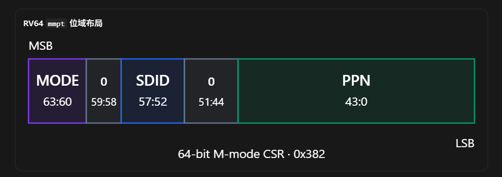
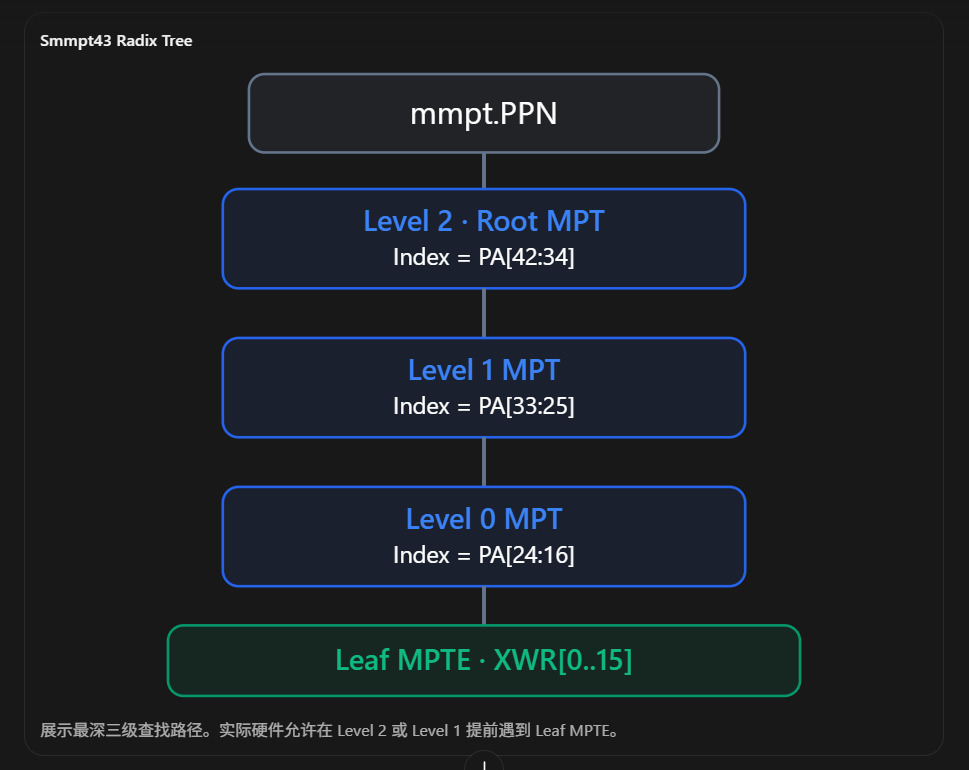
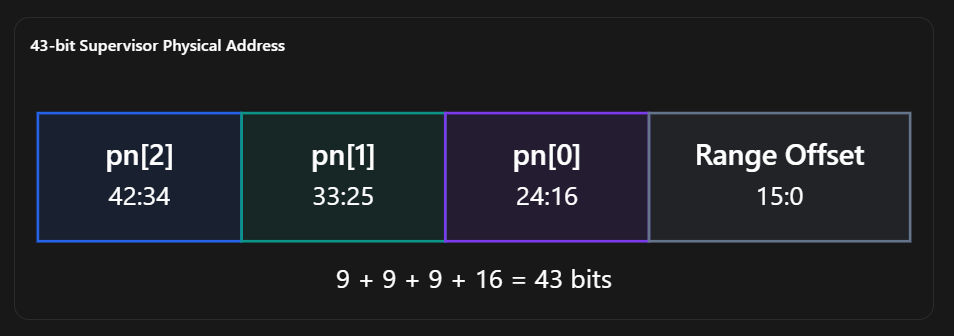
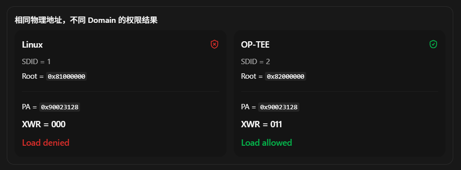
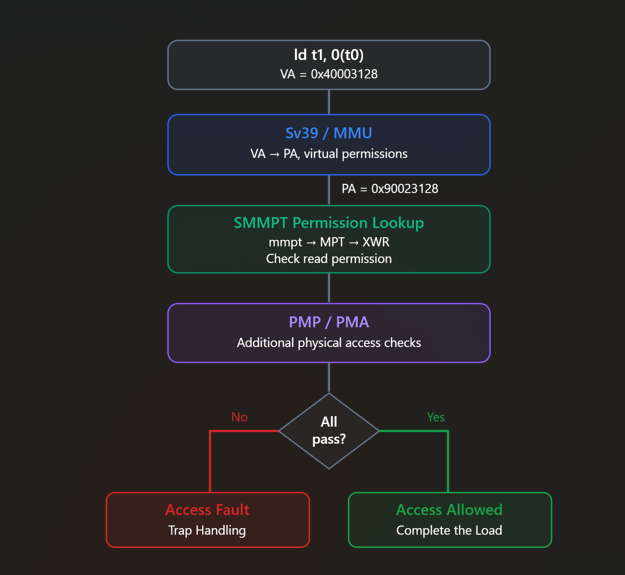

# RISC-V SMMPT 架构深度教程

PART II · Chapter 04–06 · 核心硬件机制

本部分将深入 RISC-V Supervisor Domain 的硬件隔离机制，重点研究 `mmpt`、MPT、MPTE、Table Walk 和 Memory Access Permission Check。

我们将以一个贯穿三个章节的案例展开：

在同一个 RV64 SoC 中，Linux 和 OP-TEE 都运行在 S-mode，但 Linux 无法访问 OP-TEE 的私有物理内存。

通过这个案例，逐步弄清楚硬件究竟是如何识别 Domain、找到权限表、执行权限检查，以及产生异常的。

## 阅读前需要明确的规范边界

本文以 RISC-V 官方公开的 [Supervisor Domains Access Protection 规范仓库](https://github.com/riscv/riscv-smmtt?utm_source=chatgpt.com) 当前 `main` 分支为主要技术依据，重点对应 `Smsd` 和 `Smmpt` 相关章节。

截至 2026 年 11 月，Supervisor Domains 规范仍在推进标准审查。规范的最新公开讨论也涉及 I/O MPT 和安全属性方面的进一步设计，因此下面会严格区分三类内容：

- 规范定义： CSR 位域、MPTE 编码、地址拆分、权限查找算法等。
- 实现推导： 依据规范构造的数据结构、Firmware C 代码和汇编示例。
- 平台相关： RDSM 集成、实际硬件流水线、缓存实现、仿真及 SoC 集成。

尤其需要注意：本教程的 C 和汇编示例主要是用于解释规范的参考代码，不应直接视为 OpenSBI 或 OP-TEE 上游已经合入的实现。

# Chapter 04 — `mmpt` CSR 与 Supervisor Domain 上下文

核心主题：一个 Hart 如何知道自己当前属于哪个安全域？

## 4.1 本章学习目标

完成本章之后，应当能够：

1. 准确解释 `mmpt.MODE`、`mmpt.SDID`、`mmpt.PPN` 的作用。
2. 理解 `mmpt` 与 `satp` 在硬件设计上的本质区别。
3. 读懂 RV32/RV64 的 `mmpt` CSR 编码。
4. 理解 `SDID` 为什么是 Hart-local Identifier，而不是全局唯一 Domain ID。
5. 使用 RISC-V 汇编构造和修改 `mmpt`。
6. 理解为什么写入 `mmpt` 不等于完成安全的 Domain Switching。

## 4.2 从一个最基本的问题开始

假设我们现在有一颗 RV64 SoC，运行以下两个操作系统：

```
                RISC-V SoC
                     |
                CPU Hart 0
                     |
         +-----------+-----------+
         |                       |
      Linux                   OP-TEE
      S-mode                  S-mode
         |                       |
     Domain A                Domain B
         |                       |
     Linux DDR               Secure DDR
```

假设 Linux 和 OP-TEE 都处于 S-mode。

这意味着，单纯依靠 RISC-V 的 Privilege Mode，硬件无法将它们区分为不同的安全等级。

那么问题来了：

当 Hart 0 执行一条 Load 指令时，硬件如何判断当前访问者是 Linux 还是 OP-TEE？

不能只依赖 `satp`。

因为 `satp` 主要决定当前虚拟地址转换的方式和根页表；Linux 作为自己的页表管理者，可以重新创建映射。

例如：

```
Linux Virtual Address
        |
        v
Linux Page Table
        |
        v
0x90000000  <- Secure DDR Physical Address
```

如果系统仅依赖 Linux 自己控制的 Page Table，那么 Linux 完全可能将某个 Secure DDR 的物理地址映射到自己的虚拟地址空间。

即使这种映射最终会被 PMP 拒绝，问题仍然存在：

如何在多个动态 Domain 之间，以更细的物理内存粒度、高效管理各自的访问权限？

SMMPT 的答案是：

为当前 Hart 配置一个独立于 `satp` 的、由 M-mode 管理的内存保护上下文。

这个上下文的核心就是 `mmpt` CSR。

## 4.3 `mmpt` 的设计理念

`mmpt` 可以理解为当前 Hart 的 Supervisor Domain Memory Protection Context Selector。

在 RV64 中，它至少承担三个职责：

```
                     mmpt CSR
                         |
          +--------------+--------------+
          |              |              |
         MODE           SDID           PPN
          |              |              |
     MPT 地址模式    当前本地域标识    Root MPT 地址
          |              |              |
          +--------------+--------------+
                         |
                         v
                MPT Permission Lookup
                         |
                         v
                   Allow / Deny
```

其中：

- `MODE` 回答：采用什么形式的物理内存保护表？
- `SDID` 回答：当前 Hart 运行的是哪个本地 Supervisor Domain 上下文？
- `PPN` 回答：当前 Domain 使用的 MPT 根表在哪里？

这三个字段有联系，但不是相同的概念。

例如，Linux Domain 与 OP-TEE Domain 可能都使用 `Smmpt43`，但是它们具有不同的 `SDID` 和 MPT Root。

两个 Domain 的示意配置

| 字段      | Linux        | OP-TEE       |
| ------- | ------------ | ------------ |
| `MODE`  | `Smmpt43`    | `Smmpt43`    |
| `SDID`  | `1`          | `2`          |
| `PPN`   | `0x81000`    | `0x82000`    |
| Root PA | `0x81000000` | `0x82000000` |

> 假设两个 MPT Root 均位于可信 M-mode Firmware 管理的内存中。数字用于后文教学计算。

当 Hart 从 Linux 切换到 OP-TEE 时，RDSM 需要将当前硬件保护上下文切换为 OP-TEE 的配置。

但必须强调：

`SDID` 本身不是一个完整的内存权限数据库。真正的物理内存访问权限保存在 MPT 中，并由 `PPN` 指向。

## 4.4 RV64 `mmpt` CSR 的完整位域

规范定义：

- CSR 名称：`mmpt`
- CSR 编号：`0x382`
- 特权等级：M-mode
- 宽度：`MXLEN`

对于 RV64：
RV64 `mmpt` 位域布局


| Bits  | 字段       | 说明             |
| ----- | -------- | -------------- |
| 63:60 | MODE     | 选择 MPT Mode    |
| 59:58 | Reserved | 当前规范要求写零       |
| 57:52 | SDID     | 6-bit 最大编码空间   |
| 51:44 | Reserved | 当前规范要求写零       |
| 43:0  | PPN      | Root MPT 的物理页号 |

注意，`SDID` 字段虽然在编码上有 6 bit，但硬件不必实现全部位。

规范将实际实现位数称为 `SDIDLEN`，最大为 6，最小甚至可以是 0。

这属于 `WARL`（Write Any Values, Reads Legal Values）寄存器行为：软件写入的值不一定原样保存，必须根据实际读回值判断硬件支持情况。

RV32 布局也需要掌握：

| Bits  | RV32 字段  |
| ----- | -------- |
| 31:30 | MODE     |
| 29:28 | Reserved |
| 27:22 | SDID     |
| 21:0  | PPN      |

可以看到，RV32 和 RV64 的字段位置不同，因此 Firmware 不能使用同一组位移常量直接处理所有架构。

## 4.5 `MODE`：选择不同的内存保护模式

RV64 下的 `MODE` 编码：

| MODE | 名称      | 物理地址宽度       | MPT 层数 |
| ---- | ------- | ------------ | ------ |
| 0    | Bare    | 不启用 MPT 分页保护 | —      |
| 1    | Smmpt43 | 43 bit       | 3      |
| 2    | Smmpt52 | 52 bit       | 4      |
| 3    | Smmpt64 | 64 bit       | 5      |

对于 RV32，`MODE=1` 对应 `Smmpt34`，使用两级保护表。

这里最容易犯的错误，就是把 `Smmpt43` 误认为 `Sv39` 的另一种名称。

实际上：

- `Sv39` 的 39 bit 描述的是 Virtual Address Space。
- `Smmpt43` 的 43 bit 描述的是 Supervisor Physical Address Space。
- `Sv39` 的叶节点用于完成地址转换及权限检查。
- `Smmpt43` 的叶节点只提供物理地址的访问类型权限，不生成新的物理地址。

假设一个系统使用：

```bash
satp.MODE = Sv39
mmpt.MODE = Smmpt43
```

这完全合理。

同一个系统也可能使用 `Sv48` 加 `Smmpt52`。

两个模式不需要名称或地址位数一致，但必须满足平台实际地址能力和资源访问需求。

另外，`Bare` 的含义不是关闭全部内存安全保护，而是当前不使用基于 MPT 的分页保护；PMP/Smepmp 仍有其独立作用。

在启用 `Smsd` 的架构中，MPT 和 e(PMP) 共同构成内存访问保护机制。

## 4.6 `PPN`：它究竟保存什么地址？

假设 MPT Root 的物理地址为：

```
Root MPT PA = 0x81000000
```

假设使用 4 KiB Page Size，那么：
```bash
PPN = 0x81000000 / 0x1000 = 0x81000
```

因此写入 `mmpt.PPN` 的是：

```
0x81000
```

而不是：

```
0x81000000
```

硬件读取 Root MPT 时，重新计算：

```bash
RootPA = mmpt.PPN << 12
```

这与 `satp.PPN` 的基本寻址思想相似，但指向的是不同的数据结构。

需要特别注意 `Smmpt64`：它的根表是 32 KiB，必须按 32 KiB 对齐，而其他 RV64 Smmpt 模式的根表是 4 KiB。相应地，Smmpt64 下 `mmpt.PPN[2:0]` 为零。

## 4.7 `SDID`：为什么它不是全局 Domain ID？

这是本章最重要的设计细节之一。

假设系统有两个 Hart：

```
Hart 0                       Hart 1
  |                             |
SDID = 1                    SDID = 1
  |                             |
Linux Domain                OP-TEE Domain
```

是否违反规范？

不一定。

因为规范中 `mmpt.SDID` 是 Hart-local Identifier。

它标识的是该 Hart 本地可以缓存和区分的 Supervisor Domain 上下文，而不是 SoC 范围内的全局 Domain 身份。

这和 `ASID`、`VMID` 有相似的设计思想。

例如，Hart 内部可能存在：

```
Translation / Permission Cache

Key:
    SDID
    ASID / VMID
    Address

Value:
    Cached Translation / Permission
```

这里仅是用于解释缓存隔离的概念模型，不要求实际硬件采用这个完全相同的 Cache Tag 结构。

一个更重要的结果是：不能直接使用 Hart-local SDID 作为整个 SoC I/O 请求的全局安全标识。

DMA 等全局事务需要 I/O Domain Classification 和相应的隔离机制。

规范还明确提出，SDID 与 ASID/VMID 一起影响相关内存管理 Fence 指令的有效作用域。

### SDID 复用为什么危险？

考虑：

```
T0:
  Domain A
  SDID = 3
  MPT  = Root_A

T1:
  Domain A Destroyed

T2:
  Domain B Created
  SDID = 3
  MPT  = Root_B
```

如果旧的权限缓存仍然保存着 SDID=3 对应的 Domain A 权限，新的 Domain B 可能观察到不属于自己的旧权限状态。

所以，SDID 复用不仅涉及软件数据结构回收，还涉及硬件缓存同步。

这也是为什么规范明确规定，修改 MPT 结构或复用 SDID 时，可能需要执行 `MFENCE.PA`。

## 4.8 `msdcfg`：为什么还需要另一个 CSR？

仅使用 `mmpt` 能够标识当前 Domain 以及它的 MPT。

但 Domain 并不只有内存资源，还可能需要：

- 中断资源分配。
- QoS ID。
- 资源监控与带宽控制。

因此规范引入：

```
msdcfg CSR = 0x74E
```

目前公开定义的主要字段包括：

| 字段   | 作用                                 |
| ---- | ---------------------------------- |
| SIDN | Supervisor Interrupt Domain Number |
| SRL  | QoS 相关配置                           |
| SML  | QoS 相关配置                           |
| SSRM | QoS 资源监控配置                         |
| SSMM | QoS 资源监控配置                         |

这些字段分别由 `Smsdia`、`Smsdqosid` 等扩展定义。

关键认识：

`mmpt` 主要承载内存保护和本地域标识；`msdcfg` 承载相关可选 Domain 扩展的配置。

如果平台没有实现这些可选扩展，`msdcfg` 可以表现为只读零寄存器。不能仅凭 `msdcfg=0` 就判断 SMMPT 不存在。


## 4.9 从 C 与汇编角度操作 `mmpt`

下面设计一个简化的 M-mode Firmware 接口。

先定义 RV64 编码：

```cpp
#include <stdint.h>

#define CSR_MMPT       0x382

#define MMPT_MODE_SHIFT 60
#define MMPT_SDID_SHIFT 52

#define MMPT_MODE_SMMPT43 1UL

#define MMPT_PPN_MASK ((1ULL << 44) - 1)

static inline uint64_t mmpt_encode(
    uint64_t mode,
    uint64_t sdid,
    uint64_t root_pa)
{
    return (mode << MMPT_MODE_SHIFT) |
           ((sdid & 0x3f) << MMPT_SDID_SHIFT) |
           ((root_pa >> 12) & MMPT_PPN_MASK);
}
```

这段代码只是编码示例，真实 Firmware 还必须验证根表对齐、MODE 支持、SDIDLEN、地址范围和 Reserved Bits 等条件。

接下来使用 CSR 指令：

```cpp
static inline uint64_t read_mmpt(void)
{
    uint64_t value;

    __asm__ volatile (
        "csrr %0, 0x382"
        : "=r"(value)
    );

    return value;
}

static inline void write_mmpt(uint64_t value)
{
    __asm__ volatile (
        "csrw 0x382, %0"
        :
        : "r"(value)
        : "memory"
    );
}
```

从汇编角度，关键只有两条：

```bash
csrr  t0, 0x382
csrw  0x382, t1
```

第一条从 `mmpt` CSR 读取到通用寄存器 `t0`。

第二条将 `t1` 写入 `mmpt`。

这里 `0x382` 就是规范定义的 CSR Number。在支持该扩展的汇编工具链中，也可以使用符号名称 `mmpt`。

这些指令应当由具备相应权限的 M-mode Firmware 执行。普通 Linux S-mode 不能直接修改它。

C 代码中的 `"memory"` 只形成编译器层面的约束，不代表硬件已经完成 MPT Cache 同步。

### 构造 Domain 配置

例如：

```cpp
uint64_t linux_mmpt = mmpt_encode(1, 1, 0x81000000);

uint64_t optee_mmpt = mmpt_encode(1, 2, 0x82000000);
```

在 RV64 上，理论编码结果分别为：

```bash
Linux:
0x1010000000081000

OP-TEE:
0x1020000000082000
```

硬件是否接受这个具体配置，仍取决于实际支持的模式及 SDID 位数。

## 4.10 一次 Domain Switching 究竟需要做什么？

来看一个更接近实际的软件设计。

假设：

```
Current Domain: Linux
Target Domain : OP-TEE
Hart          : 0
```

最基本的流程：

```
Linux S-mode
     |
     | ecall / platform-defined entry
     v
M-mode RDSM
     |
     +-- Save Linux execution context
     |
     +-- Validate target Domain
     |
     +-- Prepare OP-TEE context
     |
     +-- Perform required synchronization
     |
     +-- Program mmpt
     |
     +-- Restore OP-TEE execution context
     |
     +-- Set return privilege and target PC
     |
     v
mret
     |
     v
OP-TEE S-mode
```

可以使用下面的抽象代码解释：

```cpp
struct sd_memory_context {
    uint64_t mmpt_value;
};

void switch_memory_context(
    const struct sd_memory_context *next)
{
    /*
     * Precondition:
     * The target MPT is initialized and synchronized.
     * Any required invalidation has been completed.
     */
    write_mmpt(next->mmpt_value);
}
```

这个函数只执行 Memory Protection Context 更新，绝对不是一个完整的 Domain Switch。

真实实现还必须考虑：

- GPR、PC 和 Stack Pointer。
- `satp`、`sstatus`、`stvec` 等执行上下文。
- Interrupt Delegation 与中断资源隔离。
- PMP/Smepmp 访问权限。
- MPT 更新可见性和 SDID 复用。
- FPU、Vector、Debug 等需要隔离的状态。
- Context 中敏感信息的保存位置与访问权限。

这里要建立一个重要的安全不变量：

> 从 RDSM 准备把控制权交给目标 Domain 开始，到目标 Domain 真正执行其第一条指令，所有影响访问权限的架构状态必须与目标 Domain 的安全策略一致。

尤其是：

```
新的执行上下文
          +
新的 MPT Protection Context
          +
正确的硬件缓存状态
          =
安全的 Domain Entry
```

如果这三者不一致，即使 `mmpt` 寄存器内容看起来正确，也不能证明 Domain Switching 安全。

## 4.11 `mmpt` 不代表什么？

最后明确几个常见误区。

| 错误理解                        | 正确认识               |
| --------------------------- | ------------------ |
| `mmpt` 代替 `satp`            | 两者职责不同             |
| 修改 `mmpt` 就完成 Domain Switch | 仍需完整 CPU/平台上下文管理   |
| SDID 全 SoC 唯一               | SDID 是 Hart-local  |
| SDID 越大，权限越高                | SDID 不代表特权等级       |
| `MODE=Bare` 关闭所有内存保护        | PMP 等其他保护仍存在       |
| `csrw mmpt` 自动同步 MPT        | 没有这一保证             |
| M-mode 访问也一定经过 MPT          | MPT 根据有效特权模式判断是否生效 |

规范规定，只有当 Effective Privilege Mode 不是 M-mode 时，`mmpt` 才参与对应的内存保护查询。这里的 Effective Privilege Mode 很重要，例如 M-mode 设置 `MPRV` 后执行某些访存时，不能简单用当前正在执行的代码属于 M-mode 来判断。

## Chapter 04 — Staff Engineer 自测题

以下 10 题不仅考察定义，还要求能够解释设计取舍和安全后果。

1\. SDID 一致性： 在 16-Hart SoC 中，Hart 0 的 SDID=1 属于 Linux，Hart 1 的 SDID=1 属于 OP-TEE，这种设计是否允许？如果允许，为什么 I/O 事务不能直接使用这个 SDID？

2\. MPT 安全绕过： 如果 Linux 能够修改自己正在使用的 MPT Root，它能否通过修改 MPTE 访问 OP-TEE Private DDR？从 M-mode、PMP、MPT Table Storage 角度设计防护。

3\. Domain Switch 设计： Linux → OP-TEE 切换过程中，只更新 `mmpt`、`satp` 然后执行 `mret`，是否足够？列出至少六类必须审查的状态。

4\. SDID 复用： 一个 Domain 被销毁，SDID=3 随后分配给新 Domain。设计一个安全的回收和复用协议。

5\. WARL 行为： 软件写入 MODE=3、SDID=63，但读回值与预期不同。应当如何定位硬件支持能力和 Firmware 配置错误？

6\. 上下文一致性： 如果先恢复 OP-TEE 的 `satp`，却暂时保留 Linux 的 `mmpt`，是否可能出现安全问题？讨论中断、异常及乱序执行窗口。

7\. Smmpt43 与 Sv39： 为什么不能因为两者分别为 43-bit 和 39-bit 就认为系统配置不兼容？从输入地址空间和功能角度解释。

8\. MPRV： M-mode Firmware 设置 `mstatus.MPRV=1`，并使数据访问有效特权为 S-mode，这时访问是否应经过 MPT？说明判断依据。

9\. Bare 模式： 如果一个 Domain 使用 `MODE=Bare`，是否还能对它宣称具备与其他 S-mode Domain 的强隔离？需要审查哪些补充保护机制？

10\. 架构设计： 将 `mmpt` 扩展为同时存储所有 Domain 的完整访问权限是否更简单？为什么当前设计选择 CSR + Memory-resident MPT 的组合？

本章掌握标准： 不依赖规范，能够独立解释 `mmpt` 的完整位域、其与 `satp` 的边界，以及 M-mode 如何选择一个可信 Supervisor Domain 内存保护上下文。

# Chapter 05 — MPT 数据结构与多级 Memory Protection Table

核心主题：一个物理地址如何找到属于自己的 X/W/R 权限？

Chapter 04 解决了一个问题：

> 当前 Hart 如何找到某个 Domain 的 Memory Protection Context？

答案是 `mmpt`。

本章则要回答更深入的问题：

`mmpt.PPN` 指向的那一块物理内存，究竟存储了什么？硬件又如何根据物理地址从中找到访问权限？

## 5.1 本章学习目标

本章结束后，应该能够：

1. 理解 MPT Radix Tree 的整体组织。
2. 正确区分 Non-leaf MPTE 与 Leaf MPTE。
3. 掌握 Smmpt43 地址拆分与三级查表。
4. 准确理解 16 个 XWR Permission Tuple。
5. 手工编码、解码 MPTE。
6. 计算不同层级的内存覆盖范围。
7. 了解 NAPOT MPTE 的意义。
8. 独立实现一个简化的 MPT Builder 和 Software Walker。

## 5.2 为什么 MPT 使用类似 MMU 的 Radix Tree？

先回顾 PMP。

PMP 的基本设计是：

```
pmpcfg[]
pmpaddr[]
     |
     v
Physical Address Matching
     |
     v
Permission Check
```

每个 PMP Entry 能够描述一定物理地址范围。

如果我们想保护一段连续的 Secure DDR，那么 PMP 很合适。

但是考虑一个更复杂的情况：

Linux 正在不断分配和回收 4 KiB Page，其中部分页面需要动态交给 OP-TEE、受保护服务或独立 Domain。

物理页面可能非常分散：

```
Physical DDR

0x80000000  Linux
0x80001000  Linux
0x80002000  OP-TEE
0x80003000  Linux
0x80004000  OP-TEE
0x80005000  Shared
0x80006000  Linux
...
```

如果所有变化都依赖有限的 PMP Entry，管理会越来越困难。

MPT 采用的思路是：

把物理地址访问权限保存到普通内存中的多级 Radix Tree，由硬件根据物理地址进行查表。

这样能够做到：

- 保护表数量可以根据实际映射需求动态增长。
- 可以实现 4 KiB 粒度的访问控制。
- 相邻的相同权限可以利用更高层级的叶节点表示。
- 允许硬件缓存查表结果。
- 由可信 M-mode Firmware 控制权限表，而不是交给不可信的 S-mode OS。

这就是为什么 MPT 在数据结构上与 MMU Page Table 相似，但最终目的不同。

## 5.3 Smmpt43 的三级表结构

我们首先研究 RV64 Smmpt43。

它是最适合用来掌握核心机制的模式，因为只有三级表，并且每级 512 个 MPTE。



> 展示最深三级查找路径。实际硬件允许在 Level 2 或 Level 1 提前遇到 Leaf MPTE。

与 Sv39 Page Table 相似：

- Root MPT 有 512 个 Entry。
- 每个 Entry 为 64 bit，即 8 Byte。
- 每个 MPT Table 为 4 KiB。
- Root MPT 必须按 4 KiB 对齐。

但是，最大的区别即将出现。

## 5.4 Smmpt43 的物理地址拆分

Smmpt43 使用 43-bit Supervisor Physical Address：



理解这里的 `Range Offset` 非常重要。

传统 Sv39 的地址拆分通常是：

```
VPN[2] | VPN[1] | VPN[0] | Page Offset
  9        9        9          12
```

而 Smmpt43 是：

```
pn[2] | pn[1] | pn[0] | Range Offset
  9       9       9           16
```

为什么最下面保留 16 bit，而不是 12 bit？

因为：

2^16 =65536 = 64KB

一个最底层 Leaf MPTE 能够描述 64 KiB 物理地址范围。

但是，请注意：

64 KiB 不是最小的权限保护粒度。

一个 Leaf MPTE 内部包含 16 组独立的 XWR 权限：
```bash
16 * 4KB = 64KB
```

因此：

- 一个 MPTE 占用 8 Byte。
- 一个底层 Leaf MPTE 覆盖 64 KiB。
- 这 64 KiB 内部仍然可以独立设置 16 个 4 KiB Page 的权限。

这就是 SMMPT 在内存占用和保护粒度之间做出的关键设计取舍。

## 5.5 MPTE 有哪些类型？

一个 MPTE 可以属于以下类型：

```
MPTE
 |
 +-- Invalid (V=0)
 |
 +-- Valid
      |
      +-- Non-leaf (L=0)
      |     |
      |     +-- Next-level MPT PPN
      |
      +-- Leaf (L=1)
            |
            +-- Non-NAPOT (N=0)
            |      |
            |      +-- XWR[0..15]
            |
            +-- NAPOT (N=1)
                   |
                   +-- XWR + G
```

### Non-leaf MPTE

Smmpt43 Non-leaf 编码：

| Bits  | 字段                 |
| ----- | ------------------ |
| 0     | V                  |
| 1     | L=0                |
| 9:2   | Reserved           |
| 53:10 | Next-level MPT PPN |
| 63:54 | Reserved           |

与普通 Page Table Non-leaf Entry 类似，它告诉硬件下一层 MPT 在哪里。

假设：

```
Next-level MPT PA = 0x81001000
```

则：

```
PPN = 0x81001
```

编码为：

```text
MPTE = (PPN << 10) | 1
```

结果：

```
MPTE = 0x0000000020400401
```

其中：

```
V = 1
L = 0
PPN = 0x81001
```

注意这里是 `PPN << 10`，不是 `PPN << 12`。

因为：

- `<< 12` 是从 PPN 计算 4 KiB 物理地址。
- `<< 10` 是将 PPN 放入 MPTE 的 bit[53:10]。

它们属于两个不同的数据表示过程。

### Non-NAPOT Leaf MPTE

Leaf MPTE 的结构不同：

| Bits  | 字段             |
| ----- | -------------- |
| 0     | V              |
| 1     | L=1            |
| 2     | N=0            |
| 7:3   | Reserved       |
| 55:8  | XWR[0]～XWR[15] |
| 63:56 | Reserved       |

每组 XWR 占 3 bit，按 `X:W:R` 组织。

例如：

| XWR   | 权限                     |
| ----- | ---------------------- |
| `000` | 无访问                    |
| `001` | Read                   |
| `011` | Read + Write           |
| `100` | Execute                |
| `101` | Read + Execute         |
| `111` | Read + Write + Execute |

其中 `010`、`110` 是保留编码，不能当作合法的 Write-only 权限使用。

硬件不需要 Leaf MPTE 保存目标物理地址的 PPN，因为它不是地址转换表。物理地址本身并不会由 Leaf MPTE 重新映射。

这也是 MPT 与 MMU 的本质区别之一。

## 5.6 为什么一个 MPTE 需要包含 16 组权限？

假设物理内存：

```
0x90000000 – 0x90000FFF  RW
0x90001000 – 0x90001FFF  RW
0x90002000 – 0x90002FFF  NO ACCESS
0x90003000 – 0x90003FFF  RX
...
0x9000F000 – 0x9000FFFF  RW
```

每 4 KiB 页面需要独立权限。

传统的逐页 PTE 设计需要 16 个表项。

SMMPT 可以使用一个 MPTE 表达它们：

```
              One 64-bit MPTE
+--------------------------------------+
| V | L | N | Reserved                 |
+--------------------------------------+
| XWR[0] | XWR[1] | ... | XWR[15]      |
+--------------------------------------+

XWR[0]  -> Page 0
XWR[1]  -> Page 1
...
XWR[15] -> Page 15
```

总计：

```
16 * 3 = 48bits
```

48 bit 就能够描述 16 页的 X/W/R 权限。

再加上 Entry 控制位和保留位，刚好装入 64 bit。

这意味着它不需要牺牲 4 KiB 保护粒度，就可以显著压缩权限表规模。

## 5.7 完整手工案例：查询 `0x90023128`

现在开始本章最重要的实验。

假设当前 Hart：

```
MODE     = Smmpt43
SDID     = 1
Root MPT = 0x81000000
```

CPU 要访问的物理地址：

```
PA = 0x0000000090023128
```

我们手动完成三级 MPT Walk。

### Step 1：拆分 PA

公式：

```cpp
pn2 = (pa >> 34) & 0x1ff;
pn1 = (pa >> 25) & 0x1ff;
pn0 = (pa >> 16) & 0x1ff;

range_offset = pa & 0xffff;
```

计算结果：

| 字段           | 结果       |
| ------------ | -------- |
| pn[2]        | `0x000`  |
| pn[1]        | `0x048`  |
| pn[0]        | `0x002`  |
| Range Offset | `0x3128` |

可以看到，这个地址的三级 Index 分别是：

```
0 → 72 → 2
```

### Step 2：查询 Level 2

Root MPT：

```
Root PA = 0x81000000
```

由于每个 MPTE 是 8 Byte：

MPTE(PA) = RootPA + Index * 8

因此：

```bash
MPTE PA = 0x81000000 + 0 * 8
        = 0x81000000
```

假设读出的内容是：

```
0x0000000020400401
```

解码得到：

```
V = 1
L = 0
Next PPN = 0x81001
```

所以：

```
Next-level MPT PA = 0x81001000
```

### Step 3：查询 Level 1

Level 1 MPT：

```
Base = 0x81001000
Index = 0x48
```

于是：

```
MPTE PA = 0x81001000 + 0x48 * 8
        = 0x81001240
```

假设 MPTE 内容是：

```
0x0000000020400801
```

解码：

```
V = 1
L = 0
Next PPN = 0x81002
```

接着查找：

```
Level 0 Base = 0x81002000
```

### Step 4：查询 Level 0

```
Base  = 0x81002000
Index = 0x002
```

因此：

```
MPTE PA = 0x81002000 + 2 * 8
        = 0x81002010
```

假设此处读出一个 Leaf：

```
MPTE = 0x0000000000060003
```

它的含义：

```
V = 1
L = 1
N = 0

XWR[3] = 011 (Read + Write)
其他 XWR = 000
```

### Step 5：确定使用哪一组 XWR

因为当前 Leaf 位于 Level 0，所以使用：

```
PA[15:12]
```

即 Range Offset 的高 4 bit。

对于：

```
Range Offset = 0x3128
```

得到：

```
pi = 3
```

因此硬件读取：

```
XWR[3] = 011
```

最终结果：


这次查找路径总结如下：

```bash
PA = 0x90023128

Level 2
  Table = 0x81000000
  Index = 0
  Entry = 0x81000000
  Result: Next Table = 0x81001000
           |
           v
Level 1
  Table = 0x81001000
  Index = 72
  Entry = 0x81001240
  Result: Next Table = 0x81002000
           |
           v
Level 0
  Table = 0x81002000
  Index = 2
  Entry = 0x81002010
  Result: Leaf MPTE = 0x60003
           |
           v
  PA[15:12] = 3
           |
           v
  XWR[3] = 011
           |
           v
        Read/Write
```

到这里，我们已经能够独立解释硬件如何从一个物理地址找到访问权限。

## 5.8 更高层级的 Leaf：为什么可以提前结束查询？

前面使用三级查表，但规范允许任意层级出现 Leaf。

这与 Sv39 的 Superpage 思想类似，但其覆盖方式需要单独理解。

| Leaf 所在层级 | 一个 XWR Tuple 覆盖 | 一个普通 Leaf MPTE 覆盖 |
| --------- | --------------- | ----------------- |
| Level 0   | 4 KiB           | 64 KiB            |
| Level 1   | 2 MiB           | 32 MiB            |
| Level 2   | 1 GiB           | 16 GiB            |

为什么 Level 1 的一组 XWR 能覆盖 2 MiB？

因为：

```
Level 1 Entry
    |
    +-- XWR[0]  -> first  2 MiB
    +-- XWR[1]  -> second 2 MiB
    ...
    +-- XWR[15] -> last   2 MiB
```

16 组权限总计：
```
16 * 2MB = 32MB
```

对于 Level 2，同理：
```
16 * 1GB = 16GB
```

在实际 Firmware 中，如果一整段连续内存使用相同权限，就没有必要总是构建 Level 0 表。

例如某个 Domain 有一段 1 GiB 连续 RW Memory，可以考虑在 Level 2 的一个 Leaf 中，设置对应的 XWR Tuple。

这样不仅节省 MPT 内存，还减少查表层数。

不过，更大粒度的 Leaf 也限制了后续修改权限时的灵活性。只要其中一个 4 KiB 页面需要特殊权限，可能就需要拆分为下一级表。

## 5.9 NAPOT MPTE 究竟解决什么问题？

现在假设我们有连续的 2 MiB 物理内存，全部是 Read + Write。

即使使用一个高层 Leaf 可以表示大范围权限，某些情况下，为了保持较细粒度管理，Firmware 仍然需要使用底层表。

如果连续许多底层 MPTE 都具有相同的权限，硬件是否可以把这些权限缓存为一个更大的区域？

SMMPT 的 NAPOT MPTE 就是面向这个优化设计的。

NAPOT = Naturally Aligned Power-of-Two。

在 RV64 Smmpt43 中，NAPOT Leaf 主要包含：

```
V = 1
L = 1
N = 1
XWR = one common permission
G = range encoding
```

与普通 Leaf 的区别：

- 普通 Leaf 有 16 组 XWR。
- NAPOT Leaf 只有一组公共 XWR。
- NAPOT 使用 G 来描述一组连续 MPTE 构成的范围。

对于当前 Smmpt43 规范，定义的 G 值为 4，对应 \\(2^{G+1}=32\\) 个连续 MPTE 构成的 NAPOT 范围。

在相应层级上，这支持将 2 MiB 或 1 GiB 的连续权限区域作为单个权限缓存项处理。规范允许实现不进行这种缓存压缩，因此 NAPOT 的架构作用是表达相同的权限，并提供潜在的缓存优化机会，而不是要求硬件必须采用某一种特定 Cache 结构。

需要特别注意，NAPOT 并不是简单地只将其中一个 MPTE 设置成 N=1 就能完成映射。连续 MPTE 组必须满足规范的编码与一致性要求。

## 5.10 MPT 的内存开销究竟有多大？

我们做一个工程上的估算。

假设需要覆盖 16 GiB 物理内存，并且希望每个 4 KiB Page 都能独立设置权限。

一个底层 Leaf MPTE 管理 64 KiB。

因此 Leaf MPTE 数量为：

```bash
16GB / 64KB = 262144
```

每个 MPTE 占 8 Byte：
```bash
262144 * 8 = 2MB
```

如果是一个完整、连续、对齐的 16 GiB Smmpt43 地址范围，采用最深三级表，还需要：

- 512 个 Level 0 Table，共 2 MiB。
- 1 个 Level 1 Table，4 KiB。
- 1 个 Root Table，4 KiB。

因此总计：
```
2MB + 8KB
```

这说明 SMMPT 可以使用相对少的内存来实现细粒度物理内存保护。

实际开销还会受到稀疏映射、跨 Root Entry、Memory Allocator 粒度以及是否使用高层 Leaf 的影响。

另一方面，内存开销低不代表访问延迟低。最深的三级 MPT Walk 仍然可能带来额外的内存读取，因此硬件实现通常需要考虑权限缓存和 Page Walk Cache。

这些性能机制会在 Chapter 08/09 中进一步展开。

## 5.11 参考实现：一个简化的 MPT Builder

为了将理论落到代码，先实现两个最基本的 MPTE 编码函数。

```cpp
#include <stdint.h>
#include <assert.h>

#define MPTE_V  (1ULL << 0)
#define MPTE_L  (1ULL << 1)

#define MPTE_PPN_SHIFT 10
#define MPTE_XWR_SHIFT 8

static uint64_t make_nonleaf(uint64_t next_pa)
{
    assert((next_pa & 0xfff) == 0);

    return ((next_pa >> 12) << MPTE_PPN_SHIFT) |
           MPTE_V;
}

static uint64_t make_leaf(
    unsigned subpage,
    unsigned xwr)
{
    assert(subpage < 16);
    assert(xwr <= 7);
    assert(xwr != 2 && xwr != 6);

    return MPTE_V | MPTE_L |
           ((uint64_t)xwr <<
            (MPTE_XWR_SHIFT + subpage * 3));
}
```

例如：

```cpp
uint64_t l2_entry = make_nonleaf(0x81001000);

uint64_t l1_entry = make_nonleaf(0x81002000);

uint64_t l0_entry = make_leaf(3, 0b011);
```

结果：

```bash
l2_entry = 0x20400401
l1_entry = 0x20400801
l0_entry = 0x60003
```

这些值正好与前面的手工计算一致。

在真实 Firmware 中，还需要更完善的逻辑，包括：

- MPT Page Allocation。
- Page Table Zero Initialization。
- MPTE Reserved Bits 检查。
- Leaf Split / Merge。
- 并发更新。
- MPT Cache Synchronization。
- 物理地址与平台 PMA 的合法性检查。
- 对下一层 MPT 物理内存的可信保护。

尤其应当遵循一个原则：

绝不能在尚未完成权限表初始化与同步时，就把未受信任的 Domain 放入新的 MPT Context 执行。

还有一个常见编码错误：使用普通 `uint64_t` 位域结构体表示 MPTE 时，其布局可能受到编译器、ABI 和 Endianness 影响。在 Firmware 中，显式 Shift/Mask 通常更容易审计。

## 5.12 必须理解的三个底层细节

### 第一：MPT Table Walk 自己也需要访问内存

MPT 位于物理内存中。

硬件读取 MPTE 时，必然需要进行隐式访存。

规范明确规定，MPT Walk 对 MPTE 的访问需要经过 PMA 和 PMP/Smepmp 检查，并按隐式 M-mode 访问处理；Endian 由 `mstatus.MBE` 控制。

因此，如果 MPT Root 正确，但 M-mode 无权读取其所在的 RAM，也会产生 Access Fault。

这和某个 Domain 的 XWR 权限不足不是同一种根因。

### 第二：`V=0` 与修改权限的同步规则不同

当 MPTE 的 `V=0` 时，其他字段是 Don't-care。

规范对 `V:0→1` 存在特殊的最终可见性保证，可以在某些情况下避免额外执行 MPT 同步指令。

但这不表示任意修改 MPTE 都不需要 Fence。

例如：

```bash
RW -> No Access
Valid -> Invalid
Next-level Table Replacement
```

这些变化需要严肃考虑旧权限缓存的失效问题。

### 第三：MPT 不提供地址转换

一个 Page Table Entry 通常可以描述：

```
Virtual Page -> Physical Page
```

但是 MPT Leaf 描述的是：

```
Physical Page -> Access Permissions
```

所以不应该在 Leaf MPTE 中寻找类似普通 MMU PTE 的目标物理页号。

这也是阅读实际 MPT Manager 代码时，最需要避免的概念混淆。

## Chapter 05 — Staff Engineer 自测题

1. 地址拆分： 对物理地址 `0x90023128`，独立计算 Smmpt43 三级 Index、Leaf Slot 和 MPTE 物理地址。解释为何 Range Offset 是 16 bit。
2. 权限压缩： 为什么 Smmpt43 采用 16 组 3-bit XWR，而不是传统的每个 MPTE 对应一个 4 KiB Page？从 Table Memory、Page Walk 和更新灵活性三个角度分析。
3. MPTE 解码： 一个 Level 0 MPTE 的值为 `0x60003`。请完整解码 V、L、N 和 16 个 XWR Tuple，并说明 `PA[15:12]=4` 时会发生什么。
4. Leaf Split： 一段 1 GiB Read-only Memory 当前由 Level 2 Leaf 表示。现在希望其中一个 4 KiB Page 变成 Read-write。设计完整的 MPT 拆分方案与安全更新流程。
5. 错误编码： 一个有效 Leaf MPTE 出现 `XWR=010`。硬件应如何处理？为什么规范不允许把它解释为 Write-only？
6. MPT 内存保护： 如果 Linux 通过自己的 MMU 映射了 MPT Table 所在的物理内存，并具有写权限，系统会有哪些风险？提出硬件和软件双重防护。
7. NAPOT： NAPOT MPTE 为什么有利于降低 Permission Cache 的压力？它和 High-level Leaf 的优势有什么不同？
8. 内存开销： 32 GiB DDR 中只有 128 MiB 需要按 4 KiB 粒度设置细分权限。应该如何利用高层 Leaf 与底层表降低内存开销？
9. Atomic Update： 对一个 RV64 Leaf MPTE 进行原子 64-bit 更新，是否自动保证其他 Hart 立刻看到新权限？为什么？
10. 设计审核： 一个 MPT Manager 允许多个线程同时修改同一 MPTE 的不同 XWR Tuple。设计一个避免 Lost Update、权限竞态和缓存不一致的方案。

本章掌握标准： 给定任意 Smmpt43 物理地址、MPT Root 和 MPTE 数据，能够手动完成 Table Walk、解码权限，并解释如何使用 C 代码构造对应的保护表。

# Chapter 06 — 一次内存访问如何经过 SMMPT 硬件检查？

核心主题：从 RV64 Load 指令一直追踪到 Memory Permission Check 和 Trap Handler。

前面两章已经分别解决了：

- Chapter 04：硬件如何选择当前 Domain 的 MPT。
- Chapter 05：硬件如何通过 MPT 找到物理页面的 X/W/R 权限。

现在我们要把它们串起来。

这一章是整个 Part II 最值得反复研究的部分，因为它会直接关系到后续 OpenSBI、OP-TEE 的实际适配与 Debug。

## 6.1 本章学习目标

完成本章，应当能够：

1. 从 RISC-V `ld` 指令开始，解释完整的内存访问路径。
2. 区分 Virtual Address、Physical Address 和 MPT Protection Lookup。
3. 理解 MMU、MPT、PMP/PMA 的协作。
4. 理解不同 Domain 为什么能对相同物理地址拥有不同权限。
5. 准确区分 Page Fault 和 Access Fault。
6. 从 `scause`、`stval`、`sepc` 等寄存器定位问题。
7. 理解 MPT Cache 的作用及其安全风险。
8. 根据真实固件问题设计完整的 Debug 流程。

## 6.2 实际场景：Linux 试图读取 OP-TEE 的 Secure DDR

假设现在有一颗 RISC-V SoC：

```
Physical DDR Layout

0x80000000
    |
    +-- M-mode Firmware
    |
    +-- MPT Tables
    |
    +-- Linux Memory
    |
    +-- Shared Memory
    |
0x90000000
    |
    +-- OP-TEE Private DDR
    |
0xA0000000
```

我们希望实现：

```
Linux Domain:
    Linux Memory       RWX
    Shared Memory      RW
    OP-TEE Private     NO ACCESS

OP-TEE Domain:
    Linux Memory       Platform-defined
    Shared Memory      RW
    OP-TEE Private     RWX
```

这里的 Linux Memory / Secure Memory 等权限是一套示例安全策略，真实平台仍需进一步细化权限。

现在，Linux 通过自己的 Page Table 建立了一个映射：

```
Linux VA: 0x40003128
       |
       | Sv39 Translation
       v
Physical: 0x90023128
```

请注意，这个 PA 位于 OP-TEE Private DDR 内部。

Linux 中执行：

```cpp
volatile uint64_t *ptr = (volatile uint64_t *)0x40003128;

uint64_t value = *ptr;
```

问题是：

Linux 已经完成虚拟地址映射，为什么仍然无法读到 OP-TEE 的内存？

我们从指令级开始分析。

## 6.3 Step 1：CPU 执行 `ld` 指令

上述 C 代码可能产生类似汇编：

```
li    t0, 0x40003128
ld    t1, 0(t0)
```

逐条分析。

第一条：

```
li t0, 0x40003128
```

是一个伪指令，用于将目标地址加载到通用寄存器 `t0`。

第二条：

```
ld t1, 0(t0)
```

是一条 64-bit Load：

```
Effective VA = t0 + 0
             = 0x40003128
```

这条指令试图从该虚拟地址读取 8 Byte。

当前执行模式为：

```
Privilege = S-mode
Domain    = Linux
```

它不是 M-mode，因此当前 `mmpt` 保护上下文生效。

## 6.4 Step 2：MMU 完成虚拟地址转换

假设：

```
satp.MODE = Sv39
```

并且 Linux 的 Page Table 已经建立：

```
VA Page: 0x40003000
         |
         v
PA Page: 0x90023000
```

Page Offset：

```
0x128
```

于是得到：

```
Final PA = 0x90023128
```

MMU 的主要任务是：

1. 解析虚拟地址。
2. 查找对应 PTE。
3. 验证当前访问是否满足页表权限。
4. 计算访问使用的物理地址。

假设 PTE 有效并允许读取。

那么：

```
Sv39 Translation: PASS
```

但整个访存还没有获得最终许可。

### 为什么 Linux 不能靠修改页表绕过 SMMPT？

因为 Linux 控制的是：

```
VA -> PA
```

而它无法因此改变由可信 M-mode Firmware 配置的：

```
PA -> Domain-specific XWR Permission
```

即使 Linux 将一个 Secure DDR PA 映射进自己的 VA 空间，最终还需要通过 SMMPT 对该 PA 的访问类型检查。

这就是物理内存隔离机制最重要的意义。

## 6.5 Step 3：SMMPT 根据当前 Domain 查找权限

当前 Hart：

```
mmpt.MODE = Smmpt43

mmpt.SDID = 1

mmpt.PPN  = 0x81000
```

所以：

```
MPT Root PA = 0x81000000
```

根据 Chapter 05 的地址计算，查找：

```
PA = 0x90023128

Root Index = 0
Level 1    = 72
Level 0    = 2
Leaf Slot  = 3
```

假设 Linux Domain 对这块 OP-TEE Private DDR 的权限配置为：

```
XWR[3] = 000
```

对应的非 NAPOT Leaf：

```
MPTE = 0x3
```

它的含义是：

```
V = 1
L = 1
N = 0

XWR[0..15] = 000
```

这里需要注意，`V=1` 并不意味着允许内存访问。

它只表示这个 MPTE 是有效表项。

最终是否允许读取，仍然由选中的 XWR 决定。

于是硬件得到：

```
Requested Operation: READ

Required Permission: R=1

MPT Permission:       R=0

Result:               DENY
```

Linux 的此次 Load 必须被拒绝。

## 6.6 Step 4：如果是 OP-TEE Domain，又会发生什么？

现在假设同一个 Hart 切换到了 OP-TEE Domain。

RDSM 配置：

```
mmpt.MODE = Smmpt43

mmpt.SDID = 2

mmpt.PPN  = 0x82000
```

也就是：

```
MPT Root PA = 0x82000000
```

注意，它与 Linux 使用的是不同的 Root MPT。

即使最终访问完全相同的物理地址：

```
PA = 0x90023128
```

硬件仍然会查找 OP-TEE Domain 的 MPT。

假设该位置的 Leaf：

```
MPTE = 0x60003
```

即：

```
XWR[3] = 011
```

代表 Read + Write。

于是得到：

```
Requested Operation: READ

MPT Permission:       RW

Result:               ALLOW
```

这时 MPT 允许该访问。

当然，OP-TEE 自身仍然需要完成虚拟地址映射，并满足 PMP/PMA 等其他必要条件。

### 两个 Domain 的本质区别



请注意一个非常重要的事实：

物理内存并没有因为 Domain Switching 而发生搬移，也没有被 MPT 转换到另一个地址。

发生变化的是访问权限判断所使用的上下文。

这正是 SMMPT 用于实现多 Supervisor Domain 隔离的核心机制。

## 6.7 CPU 完整的 Memory Access Path

现在把整个流程串起来。

一条 Linux Load 的逻辑权限判定过程:


> 教学用逻辑检查图，并非要求所有 CPU 微架构必须按图中串行顺序执行。实际实现可能缓存、合并或并行完成部分检查。

最重要的关系可以表达为：


这里是概念模型，而不是规范中的原始布尔表达式。特定访问还可能涉及虚拟化、设备与其他架构检查。

对于 Linux：

```
MMU:       PASS
MPT:       FAIL
PMP/PMA:   Assume PASS

Final:     FAIL
```

因此即使 Linux 修改自己的 PTE，也不能改变 MPT 的拒绝结果。

## 6.8 MPT Permission Lookup 的规范算法

前面通过具体例子理解了查表过程，接下来再把它整理成一个算法。

对于 Smmpt43：

```
Input:
    Physical Address
    Access Type
    mmpt.MODE
    mmpt.PPN

Output:
    Allow or Access Fault
```

核心流程如下：

```
1. Check current effective privilege

2. Get Root MPT from mmpt.PPN

3. Extract physical address indexes

4. Read current-level MPTE

5. Validate MPTE:
       V
       Reserved Bits
       L / N combination

6. If non-leaf:
       Get next MPT PPN
       Continue walk

7. If leaf:
       Select XWR tuple

8. Check requested access type

9. Return Allow or Access Fault
```

其中有几个很重要的硬件细节。

### A. Non-leaf 不能无限向下查找

如果当前 MPTE：

```
V = 1
L = 0
```

硬件就需要进一步查询下一层。

但是如果已经到了 Level 0，还遇到 Non-leaf：

```
Level 0
   |
   v
Non-leaf MPTE
```

此时没有更低层的 MPT。

规范要求产生 Access Fault。

### B. Invalid MPTE 不能被随意解释

如果：

```
V = 0
```

就应当认为该 Entry 无效。

不能继续尝试解析它的 PPN 或 XWR。

如果有效 MPTE 含有不合法的 Reserved Bit 或编码，也需要产生相应的 Access Fault。

### C. 查表本身的物理访问也可能失败

例如：

```
MPT Root PA = 0x81000000
```

但该地址对隐式 M-mode Walk 不可访问。

此时即使最终 Leaf 权限正确，硬件也无法完成查表。

规范将 MPT 查表中的 PMP/PMA 违规同样定义为对原始访问类型的 Access Fault。

[image](https://www.google.com/s2/favicons?domain=https://raw.githubusercontent.com\&sz=32)

GitHub


## 6.9 用 C 实现简化的 Smmpt43 Software Walker

下面的实现不是驱动代码，而是为了帮助理解规范算法的软件模型。

我们先定义：

```
enum mpt_access {
    MPT_READ  = 1,
    MPT_WRITE = 2,
    MPT_EXEC  = 4
};
```

再定义一个抽象的物理内存读取接口：

```
uint64_t read_physical_u64(uint64_t pa);
```

这个接口假设已经能正确读取 MPT 内存。真实硬件中的 MPT Walk 由硬件执行，并受 PMA/PMP 约束。

核心查询代码：

```
#include <stdint.h>
#include <stdbool.h>

#define MPTE_V  (1ULL << 0)
#define MPTE_L  (1ULL << 1)
#define MPTE_N  (1ULL << 2)

#define MPT_PPN_MASK ((1ULL << 44) - 1)

bool smmpt43_check(uint64_t root_pa,
                   uint64_t pa,
                   enum mpt_access access)
{
    if (pa >> 43)
        return false;

    unsigned pn[3] = {
        (pa >> 16) & 0x1ff,
        (pa >> 25) & 0x1ff,
        (pa >> 34) & 0x1ff
    };

    uint64_t table_pa = root_pa;

    for (int level = 2; level >= 0; level--) {
        uint64_t entry_pa =
            table_pa + pn[level] * 8;

        uint64_t mpte =
            read_physical_u64(entry_pa);

        if (!(mpte & MPTE_V))
            return false;

        bool leaf = (mpte & MPTE_L) != 0;
        bool napot = (mpte & MPTE_N) != 0;

        if (!leaf) {
            /* Non-leaf: reserved bits must be zero. */
            if ((mpte & (0xffULL << 2)) ||
                (mpte >> 54))
                return false;

            if (level == 0)
                return false;

            uint64_t ppn =
                (mpte >> 10) & MPT_PPN_MASK;

            table_pa = ppn << 12;
            continue;
        }

        /* Simplified model: non-NAPOT leaf only. */
        if (napot)
            return false;

        if ((mpte & (0x1fULL << 3)) ||
            (mpte >> 56))
            return false;

        unsigned pi;

        if (level == 0)
            pi = (pa >> 12) & 0xf;
        else
            pi = (pn[level - 1] >> 5) & 0xf;

        unsigned xwr =
            (mpte >> (8 + 3 * pi)) & 0x7;

        if (xwr == 2 || xwr == 6)
            return false;

        return (xwr & access) == access;
    }

    return false;
}
```

这段代码有意只实现核心的 Non-NAPOT 查询路径。

完整规范实现还需要：

- NAPOT 处理及 G 编码验证。
- 特定扩展访问类型规则。
- 真实 PMA/PMP 检查。
- MPT 访问异常的原始访问类型归属。
- 不同 MODE 的层数与索引结构。
- Hardware MPT Cache Synchronization。

### 为什么代码中 `level > 0` 时使用另一种 `pi`？

这是理解 SMMPT 的关键。

在 Level 0：

```
pi = (pa >> 12) & 0xf;
```

表示使用 Range Offset 高 4 bit。

但是如果在 Level 1 就找到了 Leaf，当前 MPTE 的 16 组权限需要区分下一级地址范围。

所以：

```
pi = (pn[0] >> 5) & 0xf;
```

即使用 `pn[0]` 的高 4 bit。

如果在 Level 2 找到 Leaf，则使用 `pn[1]` 的高 4 bit。

这能够保证同一个 Leaf MPTE 在不同层级采用不同的权限覆盖粒度。

这段逻辑与规范定义的 `NUMPGINRANGE=4` 完全对应。

[image](https://www.google.com/s2/favicons?domain=https://raw.githubusercontent.com\&sz=32)

GitHub+1


## 6.10 Page Fault 和 Access Fault 如何区分？

这是实际 Debug 时的重点。

假设 CPU 执行：

```
ld t1, 0(t0)
```

可能出现的异常：

| 问题                         | 可能异常                     | Cause |
| -------------------------- | ------------------------ | ----- |
| Sv39 PTE 权限不满足             | Load Page Fault          | 13    |
| SMMPT Read 权限不满足           | Load Access Fault        | 5     |
| PMP/PMA 拒绝 Load            | Load Access Fault        | 5     |
| MPT Walk 无法读取表项            | Load Access Fault        | 5     |
| Store 被 MPT 拒绝             | Store/AMO Access Fault   | 7     |
| Instruction Fetch 被 MPT 拒绝 | Instruction Access Fault | 1     |

这里的 Cause 值来自 RISC-V Privileged Architecture 的标准同步异常编码。

需要注意：同一个 Access Fault Cause 可能来自不同层面的物理访问保护。因此不能仅凭 `scause=5` 就断言根因一定是 SMMPT。

还要考虑一个重要情况：如果页表检查、MPT 检查或其他硬件条件存在多个故障，实际异常选择需要遵守适用的 RISC-V 架构规则，不能仅凭前面的逻辑流程图推断固定的流水线先后关系。

## 6.11 从 Trap Handler 角度定位 MPT Fault

假设 Linux S-mode 的 Load 触发 Access Fault，且该异常被委托给 S-mode。

CPU 可能进入：

```
Linux S-mode
     |
     | ld
     v
Load Access Fault
     |
     v
stvec
     |
     v
Linux Trap Entry
```

主要观察的 CSR：

```
scause
sepc
stval
sstatus
```

### `scause`

例如：

```
scause = 5
```

表示 Load Access Fault。

它只给出异常类别，并没有明确指出是 MPT、PMP 还是 PMA 拒绝访问。

### `sepc`

指向产生异常的指令。

例如：

```
sepc = 0x80212340
```

反汇编可能看到：

```
80212340: ld a5, 0(a0)
```

从这里可以进一步分析 Load 使用的地址。

### `stval`

如果实现为此次访问提供故障地址，通常需要从其与原始 VA 的关系来解读。

例如：

```
stval = 0x40003128
```

但不能无条件假定 `stval` 一定非零或一定包含 MPT 查询使用的物理地址。

对于 MMU 已开启的访存，Trap Handler 还应当结合 `satp`、相关 PTE 和平台诊断信息，恢复对应的 PA。

### `sstatus`

主要帮助确认异常发生前的特权状态，以及 Trap Entry 相关状态。

如果异常没有委托给 S-mode，而是进入 M-mode，则需要分析：

```
mcause
mepc
mtval
mstatus
```

以及 `medeleg` 配置。

## 6.12 真实项目中如何定位一次 SMMPT Access Fault？

我推荐采用下面的分层排查方法。

推荐的故障定位顺序

1. 确认故障指令及有效特权模式

   获取 EPC、Cause、原始访问类型、Hart ID，以及 `MPRV` 等状态。
2. 验证虚拟地址转换

   检查 `satp`、Page Table、PTE 权限及最终 PA，不能把 VA 直接当 PA 查 MPT。
3. 获取故障时的 Domain Context

   确认当时的 `mmpt.MODE`、`SDID`、`PPN`，而不是读取切换后的配置。
4. 手动执行 MPT Walk

   用 PA 计算 Index，依次读取 Level 2、Level 1、Level 0 MPTE，找到 Leaf 和 XWR。
5. 检查 MPT Walk 本身是否受阻

   检查 Root/中间表地址、PMP、PMA 和相关内存是否可读。
6. 排除权限缓存不一致

   确认最近是否修改 MPTE、重新使用 SDID、改变 MPT Root，以及是否进行了正确同步。
7. 形成可复现结论

   用相同 PA、不同 Domain 或不同 XWR 配置构建最小测试，验证是隔离策略还是实现错误。

值得注意的是，普通 Linux S-mode 不能直接读取 M-mode 的 `mmpt` CSR。

因此，一个真实的 SMMPT 平台应当设计安全的诊断接口，例如由可信 M-mode Firmware 在异常现场记录相关 CSR，并在符合安全策略的条件下输出经过过滤的诊断信息。

否则，在 Linux 中看到 `Load Access Fault`，却无法获得故障发生时的 MPT Context，Debug 会非常困难。

## 6.13 Implicit Memory Access 为什么也会涉及 MPT？

这个问题在 Firmware 和 Hypervisor 领域尤其重要。

我们日常讨论内存访问时，常常只想到：

```
ld
sd
lw
sw
```

但 CPU 还会为了完成其他操作而执行隐式内存访问。

例如：

- 地址转换所需的页表读取。
- 某些页表状态更新。
- VS-stage / G-stage Page Table Walk。
- MPT 自身的隐式查表。

规范规定，MPT 对有效特权低于 M-mode 的显式和隐式内存访问提供访问类型权限检查。

特别是 VS-stage / G-stage 的页表访问，MPT 按对应隐式 Load/Store 的权限进行检查，但异常类型仍然归属于触发该过程的原始 Instruction Fetch、Load 或 Store/AMO。

[image](https://www.google.com/s2/favicons?domain=https://raw.githubusercontent.com\&sz=32)

GitHub+1


### 举例：G-stage Page Table Walk 失败

假设 Host Hypervisor 发起一次 Guest 内存访问。

CPU 需要读取 G-stage Page Table。

但对应的物理内存页面被 MPT 配置为不可读取。

那么可能出现：

```
Guest Memory Access
       |
       v
G-stage Page Table Walk
       |
       v
Implicit Memory Load
       |
       v
MPT Permission Check
       |
       v
DENY
```

这个故障并不是普通 Guest Page Table 中缺少映射那么简单。

它可能来自当前 Supervisor Domain 对 Page Table Memory 的访问权限不足。

这说明：

MPT 不仅要保护业务 Data Memory，还必须正确覆盖执行环境依赖的数据结构。

因此，在设计 Domain Memory Layout 时，需要考虑：

```
Kernel Code
Kernel Data
Page Tables
Stacks
Shared Memory
MMIO
```

而不能只配置代码段和普通数据段。

## 6.14 `MXR` 能不能绕过 MPT？

假设有一个页面：

```
MMU PTE:
    X = 1
    R = 0
```

在 RISC-V 中，`MXR` 机制允许特定情况下将可执行页面作为可读页面处理。

那么，如果 MPT 也配置：

```
XWR = 100
```

即 Execute-only。

Linux 能否通过启用 MXR 来读取这个物理页面？

不能。

MPT 权限的解释不受 MXR 影响，规范也明确排除了通过 HLVX 改变或覆盖 MPT 权限解释的可能性。

[image](https://www.google.com/s2/favicons?domain=https://raw.githubusercontent.com\&sz=32)

GitHub


可以这样理解：

```
MMU:
    MXR may relax its own read check

MPT:
    Read permission is still required
```

因此：

```
PTE permits read via MXR
          |
          v
MPT R = 0
          |
          v
Access Fault
```

这是非常重要的安全设计原则：

更低信任等级的软件不能利用自己的虚拟内存配置去扩大物理内存保护权限。

## 6.15 MPT Cache 在真实硬件中可能如何实现？

如果每次 Load 都必须先访问三级 MPT，然后再完成真正的 DDR 访问，性能显然无法接受。

因此实际微架构可以采用缓存机制。

概念上可能存在：

```
                  CPU Core
                     |
             Virtual Memory
                     |
              TLB / PTW Cache
                     |
           Physical Address
                     |
           MPT Permission Cache
                     |
                L1 / L2 Cache
                     |
                  Memory
```

注意，这只是概念模型。

规范要求的是观察到正确的权限行为，并没有强制规定必须采用一个单独、物理存在的 MPT Cache。

某些实现可能会将权限结果与地址转换缓存关联，某些则可能使用独立的 Permission Cache。

但无论如何实现，都存在一个关键问题：

如果 MPT Memory 已经发生变化，旧的权限缓存如何失效？

例如：

```
Time T0:
    MPT Permission = RW

Time T1:
    RDSM changes MPT to NO ACCESS

Time T2:
    CPU has stale RW permission cache
```

如果没有正确完成缓存同步，CPU 可能继续使用过期的 RW 权限。

这会直接破坏 Domain Isolation。

因此不能认为：

```
*mpte = new_permission;
```

就代表安全策略已经完成全系统生效。

### 为什么只执行 `SFENCE.VMA` 不够？

`SFENCE.VMA` 主要用于处理 S-stage Virtual Memory Translation 相关的状态。

MPT 有自己的物理内存保护表与权限缓存同步要求。

规范为此定义了 `MFENCE.PA`、`MINVAL.PA`，并扩展了相关内存管理 Fence 的 Domain 语义。

例如，在 M-mode 中：

```
mfence.pa x0, x0
```

表示对所有 Supervisor Domain 地址空间执行全局范围的 MPT 同步。

而通过非零的物理地址或 SDID 操作数，可以指定更细的作用范围；具体实现允许保守地采用更大范围的同步。

这里的指令名称与语义来自规范，真实编译和运行需要工具链及处理器支持相应扩展。

[image](https://www.google.com/s2/favicons?domain=https://raw.githubusercontent.com\&sz=32)

GitHub+1


另外，`MFENCE.PA` 的保证是针对执行它的 Hart；多 Hart 系统仍然需要处理远端 Hart 的同步和并发运行窗口。

这个问题将在 Chapter 08 中作为独立的高级专题展开。

## 6.16 从安全角度理解 SMMPT 的根本价值

现在回到最初的例子：

Linux 尝试读取 OP-TEE 的私有物理内存。

如果只使用 Linux Page Table：

```
Linux Kernel
    |
    +-- Controls Page Table
    |
    +-- Maps Secure PA
    |
    +-- Potentially accesses Secure Memory
```

如果引入由 M-mode 可信管理的 SMMPT：

```
Linux Kernel
    |
    +-- Controls its own Page Table
    |
    +-- Maps Secure PA
    |
    v
SMMPT Hardware Check
    |
    +-- Select Linux Domain MPT
    |
    +-- Check Secure PA
    |
    +-- XWR = 000
    |
    v
Access Fault
```

这相当于在传统 S-mode 软件自主管理的虚拟地址空间之外，建立了一道由更高信任等级控制的物理访问边界。

但是，要把它变成完整的 TEE 隔离架构，还必须满足以下条件：

- M-mode Security Manager 自身可信。
- Linux 不能修改 MPT。
- Domain Switching 正确管理全部敏感状态。
- MPT 更新具备正确的缓存同步。
- DMA 不能绕过保护。
- 设备和中断资源不能破坏 Domain 隔离。

也就是说，SMMPT 提供了重要的硬件隔离原语，但它本身并不等价于一套完整的 Secure World 实现。

## Chapter 06 — Staff Engineer 自测题

这一章的测试会更加接近真实芯片 Bring-up 和 Firmware Debug。

1. 完整访存分析： Linux 使用 Sv39，将 VA `0x40003128` 映射到 PA `0x90023128`，对应 PTE 具有 Read 权限，但 MPT 配置为 `XWR=000`。请从 `ld` 指令开始完整解释权限检查与异常处理过程。
2. 异常根因区分： Linux 收到 `scause=5`。请设计一套调试流程，分别定位 MPT Permission Fault、PMP Fault、PMA Fault 和 MPT Walk 失败。
3. Domain 隔离验证： 相同 PA 在 Linux Domain 中不可读、在 OP-TEE Domain 中可读。请设计最小化测试证明这一点，并说明如何确认测试没有被虚拟地址映射问题干扰。
4. 隐式访存： 如果一个 Domain 的 MPT 拒绝访问它自身的 Page Table Memory，会发生什么？请讨论 S-stage 和虚拟化地址转换相关的场景。
5. MXR 安全性： Linux 将 `MXR=1`，并映射了一个 Execute-only 页面，但 MPT 同样配置为 Execute-only。Linux 是否可以读取该页面？说明 MMU 和 MPT 的权限检查如何共同决定结果。
6. MPT Cache： RDSM 把某个页面权限从 RW 修改为 No Access，但没有执行任何 MPT 同步操作。请描述可能出现的安全漏洞及修复方案。
7. 多 Hart： Hart 0 修改了一个 MPT Entry，Hart 1 仍然运行在对应 Domain 并访问该内存。如何保证最终权限不会被旧缓存绕过？讨论 IPI、同步、执行窗口和远端 Hart 状态。
8. MPRV： 某段 M-mode Firmware 设置 `MPRV=1`，让 Load 使用 S-mode 有效权限。如果这次 Load 被 MPT 拒绝，异常应该如何被处理？应检查哪些 CSR？
9. DMA 绕过： CPU 访问 OP-TEE Private DDR 被 MPT 拒绝，但一个归 Linux 控制的 DMA Engine 可以读到相同地址。为什么 CPU MPT 无法自动解决这一问题？系统架构必须补充什么？
10. 完整安全审计： 某 SoC 已实现 Linux/OP-TEE 双 Supervisor Domain，并声称通过 SMMPT 实现安全隔离。请设计一份架构审查清单，覆盖 MPT 保护、Domain Switching、异常、缓存、多 Hart、DMA 和 Device Access。

本章掌握标准： 面对一次 SMMPT 相关的访存失败，能够从原始 RISC-V 指令、地址转换、MPT Root、MPTE、权限判断一直定位到 Trap Handler，并提出可验证的修复方案。

# Part II 前三个章节的知识整合

到这里，Chapter 04–06 已经形成完整的硬件访问权限判断链路。

| Chapter | 核心问题           | 必须掌握的能力                         |
| ------- | -------------- | ------------------------------- |
| 04      | 当前属于哪个 Domain？ | 配置与解读 `mmpt` / `msdcfg`，理解 SDID |
| 05      | 权限记录在哪里？       | 构建、解码、遍历 MPT / MPTE             |
| 06      | 一次访问如何被允许或拒绝？  | 分析 VA→PA→MPT→Fault 的完整路径        |

接下来建议使用下面的交互式练习，把三个章节串联起来。

## 综合实验：亲自执行一次简化的 MPT Walk

当前 Supervisor Domain

LinuxOP-TEE

访问类型

LoadStoreInstruction Fetch

64 KiB Range 中的目标物理页Page 3 — PA 0x90023000

MPT Root

0x81000000

目标 PA

0x90023128

Index 路径

0 → 72 → 2

Leaf Slot

3

Leaf MPTE

0x3

XWR 权限

000

16 个 4 KiB 页面权限

0

—

1

—

2

—

3

—

4

—

5

—

6

—

7

—

8

—

9

—

10

—

11

—

12

—

13

—

14

—

15

—

模拟 MPT：Linux 全部禁止；OP-TEE 仅 Page 3 设置 RW，其余页面禁止。蓝色为当前查询页。

MPT Check：ACCESS FAULT

目标 Leaf Slot 不具备所请求的 read 权限。

重置到 Linux Load 场景这是按本章规则制作的软件演示，假定地址转换和其他物理访问检查已通过；它不模拟真实硬件的并发、缓存或 Fence 行为。

建议重点比较三个情景：Linux 访问 Page 3、OP-TEE 访问 Page 3，以及 OP-TEE 访问 Page 4。观察为什么同一个物理地址会因为 Domain Context 不同而得到不同结果，以及为什么一个 Leaf MPTE 可以给相邻的 4 KiB 页面分配不同权限。

## 接下来最值得深入的内容

Chapter 07 将把 MMU、PMP、MPT、PMA 以及虚拟化场景下的 G-stage 组合起来，研究它们的权限边界、异常来源和相互作用。

Chapter 08 则会进入真正影响安全正确性的高级主题：

MPT 更新、`MFENCE.PA`、`MINVAL.PA`、多 Hart Shootdown，以及 Domain Switching 中的权限缓存一致性。

前面三个章节让我们理解了“一个访问为什么被允许或拒绝”。后面两个章节会进一步回答：

当系统正在修改访问权限、切换 Domain，并且多个 Hart 同时运行时，怎样保证不存在任何可以绕过隔离策略的时间窗口？

这才是将 SMMPT 真正集成到 OP-TEE 时，需要重点掌握的工程问题。
